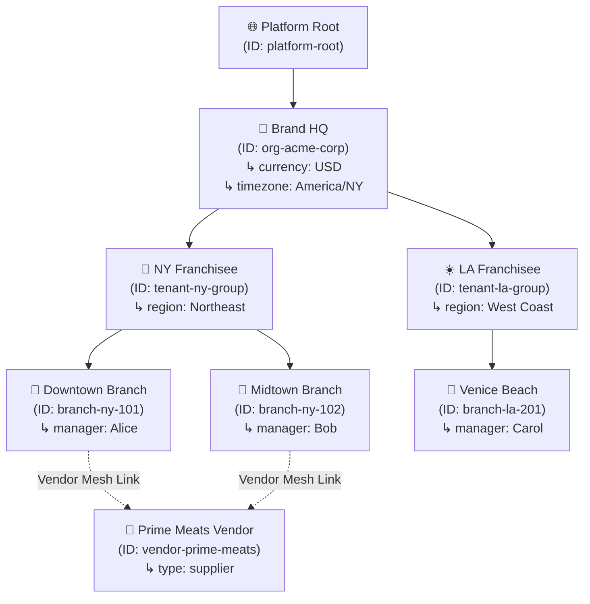
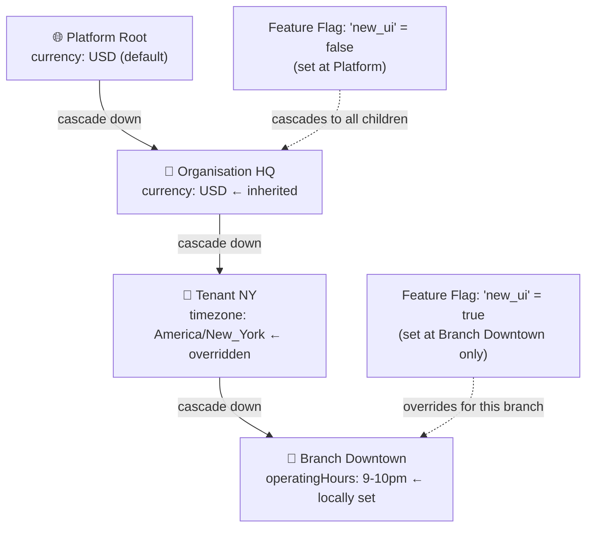

# 🏢 Step 3: O2O2B2B Multi-Tenant Context Graph Engine

OrbitoX models enterprise business structures as a **hierarchical Context Graph** — not flat `tenant_id` database columns. Every node knows its ancestors, children, and cross-linked partners.

---

## 💡 What is the Context Graph?

Instead of `tenant_id = 'abc'`, OrbitoX treats each organizational entity as a **Context Node** with parent-child relationships:

```
🌐 Platform Root
 └── 🏢 Brand HQ (Organisation)
      ├── 🗽 NY Franchise (Tenant)
      │    ├── 📍 Downtown Store (Branch)
      │    └── 📍 Midtown Store (Branch)
      └── ☀️ LA Franchise (Tenant)
           └── 📍 Venice Beach Store (Branch)

🥩 Meat Vendor (Cross-Linked to Downtown + Midtown)
```

---

## 📊 Context Node Type Matrix

| Context Type | Level | Role in Hierarchy | Inherits Settings From | Can Override? | Typical Owner |
| :--- | :--- | :--- | :--- | :--- | :--- |
| **`platform`** | Level 0 | System root — one per deployment | Nothing (root) | Defines defaults | SuperAdmin |
| **`organisation`** | Level 1 | Enterprise Brand HQ or Holdings company | Platform defaults | ✅ Yes | CEO / Executive |
| **`tenant`** | Level 2 | Franchisee, Subsidiary, or Business Unit | Organisation settings | ✅ Yes | Franchise Owner |
| **`branch`** | Level 3 | Local physical outlet, store, or branch | Tenant settings | ✅ Yes | Branch Manager |
| **`vendor`** | Cross-mesh | External supplier, partner, or API consumer | Isolated (no cascade) | ✅ Own scope | Vendor Admin |

---

## 🏢 Full Hierarchy & Vendor Mesh Diagram



---

## 🔄 Settings & Feature Flag Cascade Flow



---

## 🛠️ Step-by-Step Context Setup Code

### Step 3.1: Create Organisation Node (Brand HQ)

```typescript
import { orbitox } from '@orbitox/runtime';

const orgHQ = orbitox.context.create({
  slug: 'acme-corp',
  displayName: 'Acme Corporation HQ',
  type: 'organisation',
  ownerId: 'exec_john',
  settings: {
    currency: 'USD',
    timezone: 'America/New_York',
    country: 'US',
  },
});

console.log('HQ Context ID:', orgHQ.id);
```

### Step 3.2: Create Tenant (Franchisee) Node

```typescript
const tenantNY = orbitox.context.create({
  slug: 'ny-franchise',
  displayName: 'Acme NY Group',
  type: 'tenant',
  parentId: orgHQ.id,   // ← Links to HQ
  ownerId: 'owner_bob',
  settings: { region: 'Northeast' },
});
```

### Step 3.3: Create Branch (Local Store) Node

```typescript
const branchDowntown = orbitox.context.create({
  slug: 'downtown-store',
  displayName: 'Downtown Store #101',
  type: 'branch',
  parentId: tenantNY.id,   // ← Links to Tenant
  ownerId: 'mgr_alice',
  settings: { operatingHours: '09:00-22:00' },
});
```

### Step 3.4: Create Vendor with Mesh Links

```typescript
const vendor = orbitox.context.create({
  slug: 'prime-meats',
  displayName: 'Prime Meats National Supplier',
  type: 'vendor',
  ownerId: 'vendor_admin',
  relatedContexts: [branchDowntown.id], // Cross-tenant mesh
});
```

### Step 3.5: Query and Traverse the Hierarchy

```typescript
// Walk UP the tree from branch → tenant → org
const chain = orbitox.context.ancestors(branchDowntown.id);
// Returns: [Downtown Store, NY Franchise, Acme HQ]

// Walk DOWN the tree from tenant → branches
const children = orbitox.context.children(tenantNY.id);
// Returns: [Downtown Store, Midtown Store]

// Look up a context by slug
const ctx = orbitox.context.get('downtown-store');
console.log('Branch owner:', ctx.ownerId);
```

---

[⬅️ Prev: Architecture](./02_ARCHITECTURE.md) | [Back to Index](./README.md) | [Next: Zero-Trust Security ➔](./04_ZERO_TRUST_SECURITY.md)
