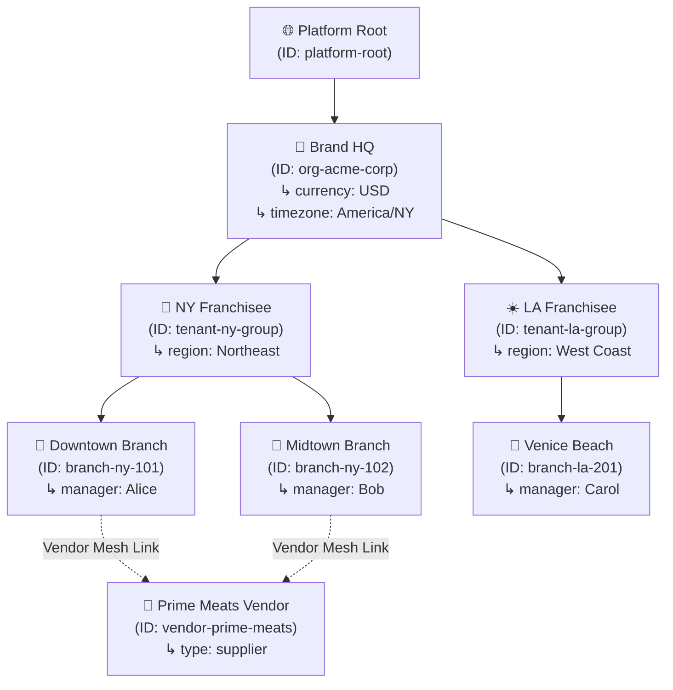
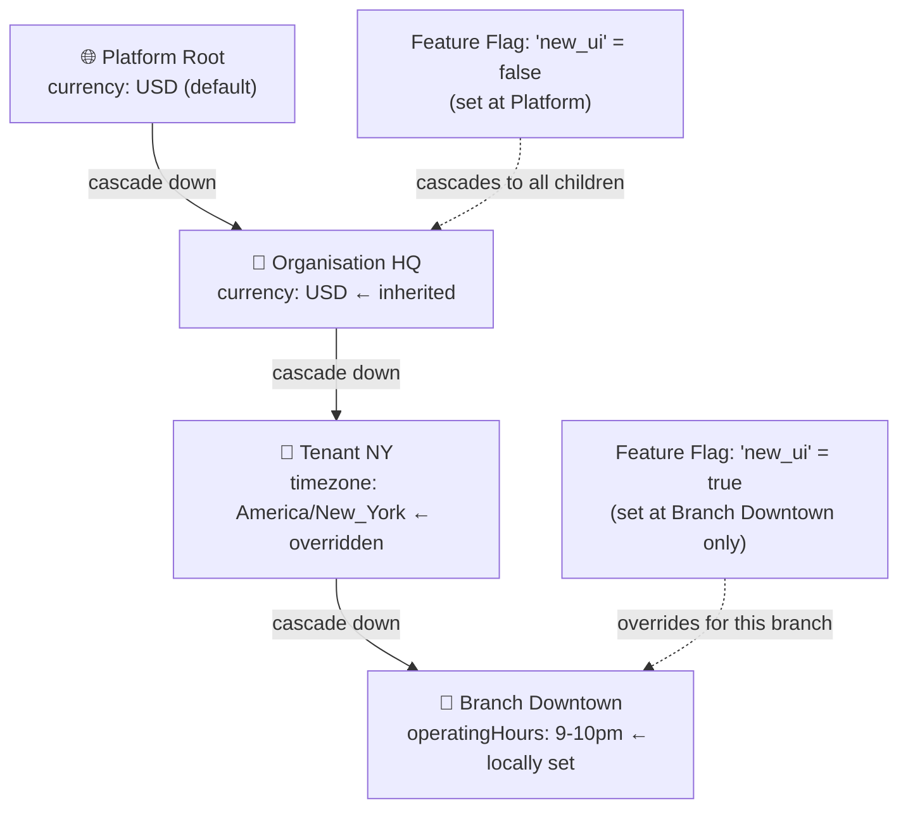

# 🏢 Step 3: O2O2B2B Multi-Tenant Context Graph Engine

OrbitoX models enterprise business structures as a **hierarchical Context Graph** — not flat `tenant_id` database columns. Every node knows its ancestors, children, and cross-linked partners.

---

## 💡 What is the Context Graph?

Instead of `tenant_id = 'abc'`, OrbitoX treats each organizational entity as a **Context Node** with parent-child relationships:

```
🌐 Platform Root
 └── 🏢 Brand HQ (Organisation)
      ├── 🗽 NY Franchise (Tenant)
      │    ├── 📍 Downtown Store (Branch)
      │    └── 📍 Midtown Store (Branch)
      └── ☀️ LA Franchise (Tenant)
           └── 📍 Venice Beach Store (Branch)

🥩 Meat Vendor (Cross-Linked to Downtown + Midtown)
```

---

## 📊 Context Node Type Matrix

| Context Type | Level | Role in Hierarchy | Inherits Settings From | Can Override? | Typical Owner |
| :--- | :--- | :--- | :--- | :--- | :--- |
| **`platform`** | Level 0 | System root — one per deployment | Nothing (root) | Defines defaults | SuperAdmin |
| **`organisation`** | Level 1 | Enterprise Brand HQ or Holdings company | Platform defaults | ✅ Yes | CEO / Executive |
| **`tenant`** | Level 2 | Franchisee, Subsidiary, or Business Unit | Organisation settings | ✅ Yes | Franchise Owner |
| **`branch`** | Level 3 | Local physical outlet, store, or branch | Tenant settings | ✅ Yes | Branch Manager |
| **`vendor`** | Cross-mesh | External supplier, partner, or API consumer | Isolated (no cascade) | ✅ Own scope | Vendor Admin |

---

## 🏢 Full Hierarchy & Vendor Mesh Diagram



---

## 🔄 Settings & Feature Flag Cascade Flow



---

## 🛠️ Step-by-Step Context Setup Code

### Step 3.1: Create Organisation Node (Brand HQ)

```typescript
import { orbitox } from '@orbitox/runtime';

const orgHQ = await orbitox.tenant('acme-corp', 'Acme Corporation HQ')
  .type('organisation')
  .owner('exec_john')
  .settings({
    currency: 'USD',
    timezone: 'America/New_York',
    country: 'US',
  })
  .create();

console.log('HQ Context ID:', orgHQ.id);
```

### Step 3.2: Create Tenant (Franchisee) Node

```typescript
const tenantNY = await orbitox.tenant('ny-franchise', 'Acme NY Group')
  .type('tenant')
  .parent(orgHQ.id) // ← Links to HQ
  .owner('owner_bob')
  .settings({ region: 'Northeast' })
  .create();
```

### Step 3.3: Create Branch (Local Store) Node

```typescript
const branchDowntown = await orbitox.tenant('downtown-store', 'Downtown Store #101')
  .type('branch')
  .parent(tenantNY.id) // ← Links to Tenant
  .owner('mgr_alice')
  .settings({ operatingHours: '09:00-22:00' })
  .create();
```

### Step 3.4: Create Vendor with Mesh Links

```typescript
const vendor = await orbitox.tenant('prime-meats', 'Prime Meats National Supplier')
  .type('vendor')
  .owner('vendor_admin')
  // For mesh links, you can still use the underlying context facade or extensions
  .create();

// Add mesh link manually (vendor mesh extension)
orbitox.context.addMeshLink(vendor.id, branchDowntown.id);
```

### Step 3.5: Query and Traverse the Hierarchy

```typescript
// Walk UP the tree from branch → tenant → org
const chain = orbitox.context.ancestors(branchDowntown.id);
// Returns: [Downtown Store, NY Franchise, Acme HQ]

// Walk DOWN the tree from tenant → branches
const children = orbitox.context.children(tenantNY.id);
// Returns: [Downtown Store, Midtown Store]

// Look up a context via builder
const ctx = orbitox.tenant('downtown-store').get();
console.log('Branch owner:', ctx.ownerId);
```

### Step 3.6: Manage Contexts (Update and Delete)

```typescript
// Update settings (deep merged automatically)
await orbitox.tenant('ny-franchise')
  .settings({ supportEmail: 'ny-support@acme.com' })
  .update();

// Delete a context (will cascade delete or fail if protection is enabled)
orbitox.tenant('downtown-store').delete();
```

### Step 3.7: Inter-Branch Mesh & Peer Collaboration (Amazon / Hospital Network Style)

Organizations can grant explicit permissions for sibling branches under the same Org (or connected hospital/fulfillment networks) to view stock, dispatch inter-branch supply requests, and communicate securely:

```typescript
// 1. Link Sibling Branch A and Branch B for Stock Viewing & Supply Requests
orbitox.context.linkPeers(branchDowntown.id, branchMidtown.id, [
  'inventory.read', 
  'supply.request', 
  'messages.send'
]);

// Or configure via TenantBuilder on creation:
const branchMidtown = await orbitox.tenant('midtown-store', 'Midtown Store #102')
  .type('branch')
  .parent(tenantNY.id)
  .linkPeer(branchDowntown.id, ['inventory.read', 'supply.request'])
  .create();

// 2. Validate Inter-Branch Supply Access
const canCheckStock = orbitox.context.canPeerAccess(branchDowntown.id, branchMidtown.id, 'inventory.read');
console.log('Downtown can view Midtown stock?', canCheckStock); // true

// 3. Query Stock across all authorized Peer Branches
const peerBranches = orbitox.context.getAccessiblePeerContexts(branchDowntown.id, 'inventory.read');
const peerIds = peerBranches.map(b => b.id);

// Generate multi-branch WHERE clause for inventory ORM queries
const whereClause = await orbitox.security.getPeerVisibilityClause(branchDowntown.id, peerIds, 'user_alice');
// Result: { OR: [{ contextId: 'branch-downtown' }, { contextId: 'branch-midtown' }] }

const multiBranchStock = await StockRepository.findAll(whereClause);
```

---

[⬅️ Prev: Architecture](./02_ARCHITECTURE.md) | [Back to Index](./README.md) | [Next: Zero-Trust Security ➔](./04_ZERO_TRUST_SECURITY.md)
