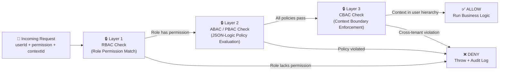
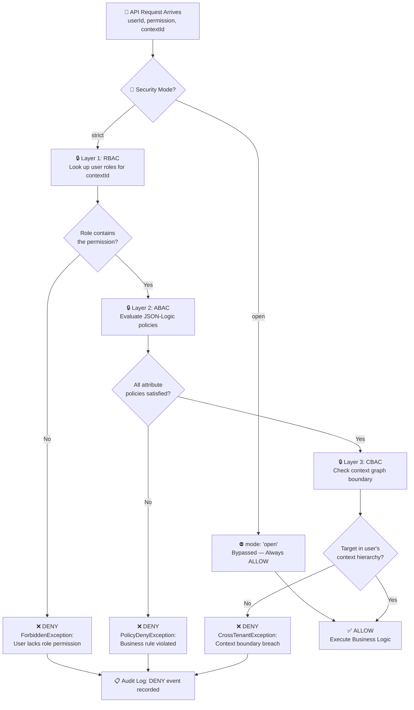

# 🛡️ Step 4: Dual-Layer Zero-Trust Security (`orbitox.security`)

OrbitoX enforces security using a **3-layer progressive check** — each request must pass every gate before business logic runs. No exceptions.

---

## 🧱 The 3 Security Layers Explained



---

## 📊 Security Layer Comparison Matrix

| Layer | Model | Technology | What It Checks | Example Failure |
| :--- | :--- | :--- | :--- | :--- |
| **Layer 1 — RBAC** | Role-Based Access Control | `RbacService`, `RoleService` | Does the user hold a Role containing this permission? | User `alice` has `viewer` role but action needs `orders.refund` |
| **Layer 2 — ABAC/PBAC** | Attribute/Policy-Based | `PolicyEngine`, JSON-Logic AST | Do user attributes + context state satisfy dynamic rules? | Account is suspended, IP not whitelisted, request exceeds refund limit |
| **Layer 3 — CBAC** | Context Boundary | `ContextService` | Is the target resource within the user's allowed context tree? | User in NY Franchise tries to read data from LA Franchise |

---

## 🚦 Development Mode vs. Production Mode

| Feature | `mode: 'open'` (Dev / Prototyping) | `mode: 'strict'` (Production) |
| :--- | :--- | :--- |
| **RBAC Check** | ⛔ Skipped (always pass) | ✅ Required |
| **ABAC Policies** | ⛔ Skipped | ✅ All policies evaluated |
| **Context Boundary** | ⛔ Skipped | ✅ Enforced |
| **Event Transport** | In-memory emitter | Redis / BullMQ |
| **Audit Logging** | Console output only | Cryptographic hash chain |
| **AI Responses** | Mock fallback stubs | Live OpenAI / Gemini |
| **Best For** | Building UIs, Prototyping | Staging, Production |

---

## 🔄 Full Authorization Flowchart



---

## 🛠️ Step-by-Step Implementation Code

### Step 4.1: Configure the Security Mode

```typescript
import { orbitox } from '@orbitox/runtime';

// Development: bypass all gates for fast prototyping
orbitox.configure({ mode: 'open' });

// Production: enforce all 3 layers
orbitox.configure({ mode: 'strict' });
```

### Step 4.2: Authorize a User Action (Throws on Denial)

```typescript
// Hard gate — throws SecurityException if any layer fails
try {
  await orbitox.security.authorize('user_alice', 'orders.refund', 'branch-downtown');
  console.log('✅ Authorized — proceed with refund');
} catch (err) {
  console.error('❌ Blocked:', err.message);
  // e.g. "[OrbitoX Security] Access denied: 'user_alice' lacks permission 'orders.refund' in context 'branch-downtown'"
}
```

### Step 4.3: Soft Permission Check (Non-Throwing, for UI Rendering)

```typescript
const canRefund = await orbitox.security.check('user_alice', 'orders.refund', 'branch-downtown');

// Use for conditional UI rendering
if (canRefund) {
  renderRefundButton();
} else {
  renderDisabledButton('Insufficient permissions');
}
```

### Step 4.4: Bulk Permission Check (For Navigation Menus)

```typescript
const perms = await orbitox.security.checkMany(
  'user_alice',
  ['orders.read', 'orders.create', 'orders.refund', 'settings.manage', 'staff.invite'],
  'branch-downtown'
);

// Returns: {
//   'orders.read': true,
//   'orders.create': true,
//   'orders.refund': true,
//   'settings.manage': false,
//   'staff.invite': false
// }

// Render sidebar navigation based on actual permissions
renderSidebar(perms);
```

### Step 4.5: Register a Custom ABAC Policy (JSON-Logic)

```typescript
// Block refunds exceeding $500 limit and block if account is suspended
orbitox.security.policy('refund-limit-and-status')
  .resource('order')
  .action('refund')
  .fieldEquals('user.attributes.status', 'active')
  .maxFieldValue('request.amount', 500)
  .register();

// Manage policies via CRUD
const policy = orbitox.security.policy('refund-limit-and-status').get();

// Update existing policy
orbitox.security.policy('refund-limit-and-status')
  .maxFieldValue('request.amount', 1000) // increase limit to $1000
  .update();

// Delete a policy
orbitox.security.policy('refund-limit-and-status').delete();
```

### Step 4.6: Register a Custom PBAC Evaluator (Programmatic Policy)

```typescript
// Block requests from blacklisted IP ranges
orbitox.security.addPolicy('ip-allowlist', async (check) => {
  const blockedIPs = ['192.168.99.1', '10.0.0.255'];
  if (blockedIPs.includes(check.clientIp)) {
    return PolicyDecision.DENY;
  }
  return PolicyDecision.ALLOW;
});
```

### Step 4.7: Get Data Visibility Clause (Row-Level Security)

```typescript
// Automatically scope database WHERE clause based on user's role
const whereClause = await orbitox.security.getVisibilityClause(
  'branch-downtown',
  'user_alice',
  'order'
);

// In open mode: { contextId: 'branch-downtown' }
// In strict mode (for Viewer role): { contextId: 'branch-downtown', createdBy: 'user_alice' }
// In strict mode (for Manager role): { contextId: 'branch-downtown' } (sees all)

const orders = await OrderRepository.findAll(whereClause);
```

### Step 4.8: PII Data Sanitization

```typescript
// Automatically mask sensitive PII fields (emails, phones, credit cards, tokens) before logging or returning to client
const payload = { 
  customer: 'John Doe', 
  email: 'john.doe@example.com', 
  phone: '+1 555-1234',
  cardNumber: '4111222233334444',
  stripeToken: 'tok_123456789'
};

const safeData = orbitox.security.sanitizePii(payload);
console.log(safeData);
/* Output:
{
  customer: 'John Doe',
  email: 'j***e@example.com',
  phone: '+1******1234',
  cardNumber: '**** **** **** 4444',
  stripeToken: '***REDACTED***'
}
*/
```

### Step 4.9: Instant API Protection with Middleware

```typescript
import express from 'express';
import { orbitox } from '@orbitox/runtime';

const app = express();

// Automatically resolve tenant context from subdomains / headers (x-tenant-id, x-org-id, Host)
// reject unknown/inactive tenants with 403, and auto-sanitize mutation payloads:
app.use(orbitox.middleware({ strictDomainProtection: true, enforceAuth: true }));

app.post('/api/orders', async (req, res) => {
  // context, user, and auto-generated ORM scope filter are securely attached to req!
  const { orbitoxContext, orbitoxUser, orbitoxScopeFilter } = req as any;
  
  await orbitox.security.authorize(orbitoxUser.id, 'orders.create', orbitoxContext.id);
  res.json({ status: 'Order created securely' });
});
```

### Step 4.10: Dynamic N-Tier Data Isolation & IDOR Silent 404 Defense

OrbitoX supports **Dynamic N-Tier Data Isolation** (from 1-Tier up to arbitrary deep N-Tier context hierarchies):

```typescript
// 1. Immutable Hierarchy Write Protection (Strips spoofed context IDs on updates)
const cleanUpdate = orbitox.security.sanitizeWritePayload(
  { name: 'Updated Order', tenantId: 'hacker_tenant_id' }, 
  true
);
console.log(cleanUpdate); // { name: 'Updated Order' }

// 2. IDOR Attack Neutralization (Throws 404 Not Found instead of 403 to prevent resource scanning)
try {
  orbitox.security.enforceContextBoundary('tenant_123', 'tenant_999');
} catch (err: any) {
  console.log(err.status); // 404
}

// 3. Isolated Cache Keys
import { buildCacheKey } from '@orbitox/core';
const cacheKey = buildCacheKey('tenant_123', 'rules', 'billing');
console.log(cacheKey); // 'context:tenant_123:billing:rules'
```

---

[⬅️ Prev: Multi-Tenancy](./03_MULTI_TENANCY.md) | [Back to Index](./README.md) | [Next: Billing & Subscriptions ➔](./05_BILLING_SUBSCRIPTIONS.md)
