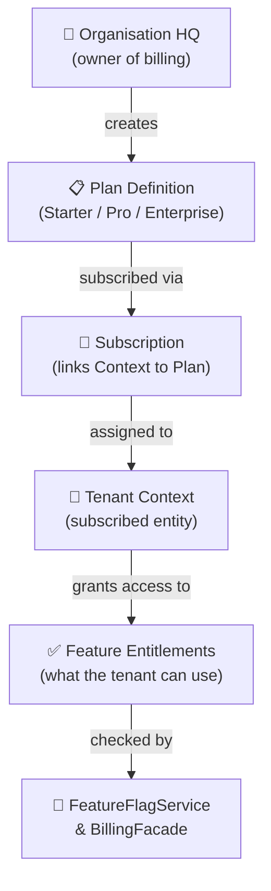
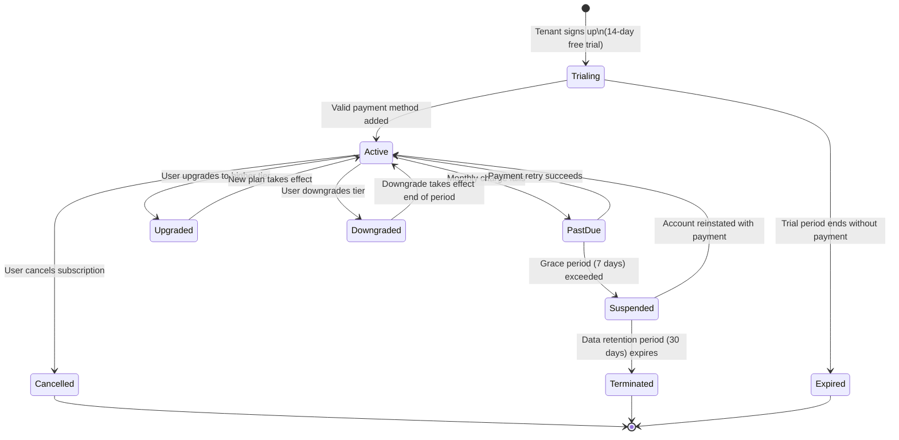
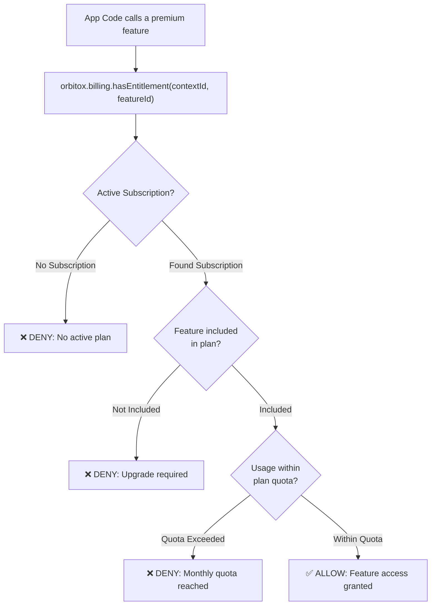

# 💳 Step 5: Billing, Plans & Subscription Engine (`orbitox.billing`)

OrbitoX provides complete multi-tenant subscription management: plan creation, tier-based feature entitlements, subscription lifecycle tracking, and usage quota enforcement — all backed by a Stripe-ready engine.

---

## 💳 Subscription Architecture Overview



---

## 📊 Subscription Tier Comparison Matrix

| Plan Tier | Price / Month | Billing Cycle | Max Branches | Max Monthly Orders | Included Features |
| :--- | :--- | :--- | :--- | :--- | :--- |
| **Starter** | $29 | Monthly or Yearly | 1 | 1,000 | Basic POS, Standard Reports |
| **Pro** | $99 | Monthly or Yearly | 5 | 10,000 | All Starter + AI Assistant, Custom Feature Flags |
| **Enterprise** | $499 | Monthly or Yearly | Unlimited | Unlimited | All Pro + Custom Workflows, Dedicated AI, Priority Support |
| **Custom** | Contact Sales | Custom | Unlimited | Unlimited | Fully bespoke configuration |

---

## 🔄 Subscription Lifecycle State Machine



---

## 📋 Feature Entitlement Enforcement Flow



---

## 🛠️ Step-by-Step Billing Implementation

### Step 5.1: Define Plan Tiers

```typescript
import { orbitox } from '@orbitox/runtime';

// Starter Plan
const starterPlan = await orbitox.billing.createPlan({
  name: 'Starter',
  description: 'Best for single-location businesses',
  price: 29,
  currency: 'USD',
  interval: 'month',
  features: ['pos_basic', 'reports_standard'],
  limits: { maxBranches: 1, maxMonthlyOrders: 1000 },
});

// Pro Plan
const proPlan = await orbitox.billing.createPlan({
  name: 'Pro Franchise',
  description: 'For growing chains and multi-branch operations',
  price: 99,
  currency: 'USD',
  interval: 'month',
  features: ['pos_basic', 'reports_standard', 'ai_assistant', 'custom_flags', 'api_access'],
  limits: { maxBranches: 5, maxMonthlyOrders: 10000 },
});

// Enterprise Plan
const enterprisePlan = await orbitox.billing.createPlan({
  name: 'Enterprise',
  description: 'Unlimited scale for franchise empires',
  price: 499,
  currency: 'USD',
  interval: 'month',
  features: ['pos_basic', 'reports_standard', 'ai_assistant', 'custom_flags', 'api_access', 'custom_workflows', 'dedicated_support'],
  limits: { maxBranches: -1, maxMonthlyOrders: -1 }, // -1 = unlimited
});
```

### Step 5.2: List Available Plans

```typescript
const allPlans = await orbitox.billing.listPlans('global');
console.table(allPlans.map(p => ({ name: p.name, price: `$${p.price}/mo`, features: p.features.length })));
```

### Step 5.3: Enforce Feature Entitlements in App Code

```typescript
// Guard before running a premium feature
async function generateAIMenuSuggestions(tenantId: string) {
  const hasAI = await orbitox.billing.hasEntitlement(tenantId, 'ai_assistant');
  
  if (!hasAI) {
    throw new Error('AI Menu Suggestions require the Pro Plan or higher. Please upgrade.');
  }

  // ✅ Safe to run premium feature
  const suggestions = await orbitox.ai.ask(
    'Suggest 5 seasonal menu items for an Italian restaurant in autumn',
    { contextId: tenantId }
  );
  return suggestions;
}
```

---

[⬅️ Prev: Zero-Trust Security](./04_ZERO_TRUST_SECURITY.md) | [Back to Index](./README.md) | [Next: Events & Queues ➔](./06_EVENTS_QUEUES.md)
