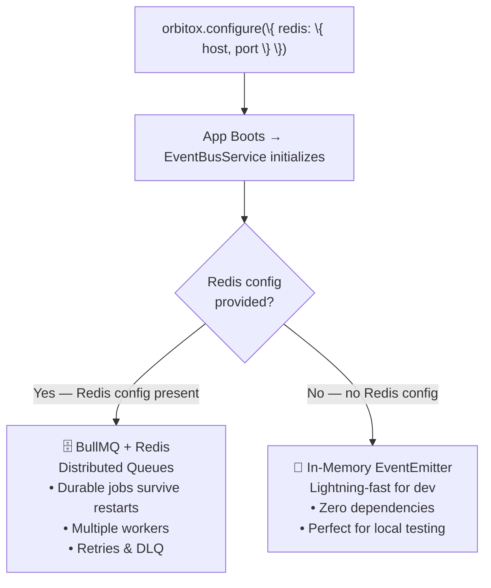
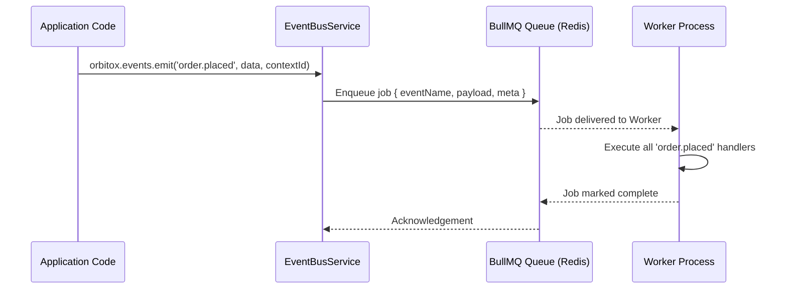

# ⚡ Step 6: Event Bus & Distributed Task Queues (`orbitox.events`)

OrbitoX ships with an **auto-detecting event bus** — it automatically uses Redis + BullMQ for cloud deployments and falls back to an in-memory emitter for local development. Zero configuration needed to switch between them.

---

## ⚡ How the Auto-Detection Works



---

## 📊 Event Transport Comparison Matrix

| Feature | In-Memory Emitter (Dev) | BullMQ + Redis (Production) |
| :--- | :--- | :--- |
| **Setup Required** | None | Redis host + port |
| **Durability** | ❌ Lost on process restart | ✅ Jobs survive restarts |
| **Multiple Workers** | ❌ Single process only | ✅ Unlimited horizontal scaling |
| **Failed Job Retries** | ❌ No retry mechanism | ✅ Configurable retry + backoff |
| **Dead Letter Queue** | ❌ No DLQ | ✅ Failed jobs move to DLQ |
| **Event Order** | ✅ Guaranteed in-process | ✅ Guaranteed per-queue |
| **Best For** | Local Dev, CI/CD Testing | Staging, Production |

---

## 🔄 Event Lifecycle Sequence



---

## 🛠️ Step-by-Step Event Bus Implementation

### Step 6.1: Configure Redis for Production Events

```typescript
import { orbitox } from '@orbitox/runtime';

// Development: no config needed — auto uses in-memory
orbitox.configure({ mode: 'open' });

// Production: auto-upgrades to BullMQ
orbitox.configure({
  mode: 'strict',
  redis: {
    host: process.env.REDIS_HOST || '127.0.0.1',
    port: Number(process.env.REDIS_PORT) || 6379,
  },
});
```

### Step 6.2: Emit Domain Events

```typescript
// Emit a named domain event scoped to a tenant context
await orbitox.events.emit(
  'order.placed',                           // Event name
  {                                          // Payload
    orderId: 'ord_9901',
    total: 49.99,
    items: ['2 Burgers', '1 Large Fries'],
    customerName: 'John Doe',
  },
  'branch-downtown'                          // Context scope
);
```

### Step 6.3: Subscribe to Specific Events

```typescript
// Listen for a specific domain event
orbitox.events.on('order.placed', async (payload, meta) => {
  console.log(`📦 Order ${payload.orderId} received at ${meta.contextId}`);
  console.log(`💰 Total: $${payload.total}`);
  // Trigger downstream logic: print receipt, notify kitchen, etc.
});
```

### Step 6.4: Wildcard Listener (Platform-Wide Monitoring)

```typescript
// Capture EVERY event emitted across ALL contexts
orbitox.events.onAny((eventName, payload, meta) => {
  // Useful for: analytics dashboards, global audit logging, monitoring
  analyticsService.track(eventName, {
    contextId: meta.contextId,
    timestamp: meta.timestamp,
    payload,
  });
});
```

### Step 6.5: Real-World Domain Event Patterns

```typescript
// Pattern 1: Notify kitchen on order
orbitox.events.on('order.placed', async (payload) => {
  await kitchenDisplaySystem.push(payload.items);
});

// Pattern 2: Send confirmation email
orbitox.events.on('order.placed', async (payload) => {
  await emailService.send({
    to: payload.customerEmail,
    subject: `Order #${payload.orderId} Confirmed`,
    body: `Your order of $${payload.total} is being prepared!`,
  });
});

// Pattern 3: Update inventory on order fulfillment
orbitox.events.on('order.completed', async (payload) => {
  for (const item of payload.items) {
    await inventoryService.decrementStock(item.productId, item.quantity);
  }
});
```

---

[⬅️ Prev: Billing](./05_BILLING_SUBSCRIPTIONS.md) | [Back to Index](./README.md) | [Next: AI Gateway ➔](./07_AI_GATEWAY.md)
