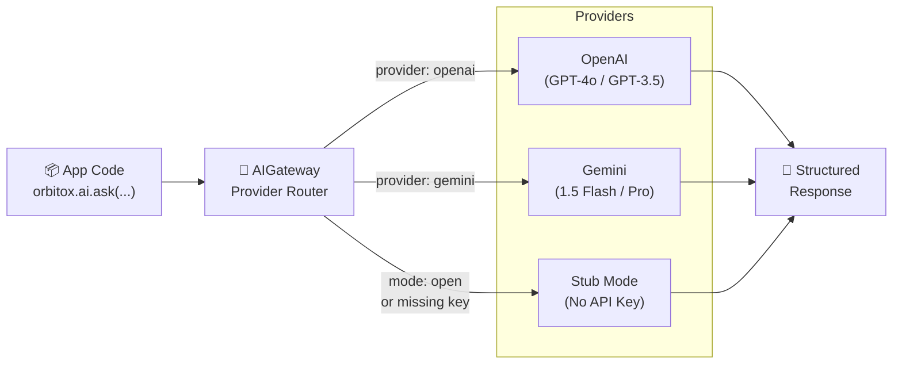
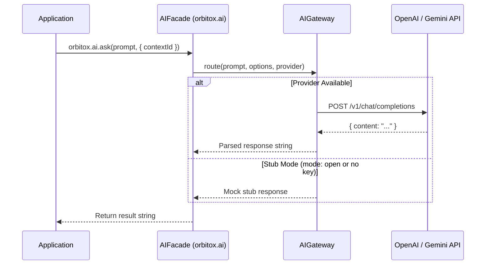

# 🤖 Step 7: Multi-Provider LLM AI Gateway (`orbitox.ai`)

OrbitoX provides a unified AI gateway that standardizes operations across OpenAI, Gemini, and Azure — so you can switch providers without changing a single line of business code.

---

## 🤖 AI Gateway Routing Architecture



---

## 📊 AI Provider Capability Matrix

| Capability | Method | OpenAI GPT-4o | Gemini 1.5 Flash | Local Stub Mode |
| :--- | :--- | :---: | :---: | :---: |
| **Text Completion** | `ask()` | ✅ | ✅ | ✅ Mock |
| **Structured JSON Extraction** | `extract()` | ✅ Native JSON Mode | ✅ Schema Enforcement | ✅ Schema Default |
| **Text Classification** | `classify()` | ✅ Structured Output | ✅ Category Detection | ✅ First Category |
| **Vector Embeddings** | `embed()` | ✅ 1536-dim Ada-002 | ✅ 768-dim text-004 | ✅ Mock Array |
| **Real-time Streaming** | `stream()` | ✅ AsyncIterable Chunk Stream | ✅ AsyncIterable Chunk Stream | ✅ Mock Word Chunks |

---

## 🛠️ Step-by-Step AI Gateway Implementation

### Step 7.1: Configure the AI Provider

```typescript
import { orbitox } from '@orbitox/runtime';

// OpenAI
orbitox.configure({
  mode: 'strict',
  ai: { provider: 'openai', apiKey: process.env.OPENAI_API_KEY!, model: 'gpt-4o' }
});

// Gemini
orbitox.configure({
  mode: 'strict',
  ai: { provider: 'gemini', apiKey: process.env.GEMINI_API_KEY!, model: 'gemini-1.5-flash' }
});

// Dev (no config = stub mode → fast mock responses)
orbitox.configure({ mode: 'open' });
```

### Step 7.2: Text Completion with `ask()`

```typescript
// Use Case: Draft customer-facing messages
const response = await orbitox.ai.ask(
  'Write a polite apology to a customer whose order arrived 30 minutes late.',
  { contextId: 'branch-downtown' }
);
// → "Dear valued customer, we sincerely apologize for the delay..."
```

### Step 7.3: Structured JSON Extraction with `extract()`

```typescript
// Use Case: Parse a server's natural language order into a structured object
const orderData = await orbitox.ai.extract(
  'Table 4 wants 2 ribeye steaks medium-rare, 1 Caesar salad no croutons, 3 still waters, and a birthday cake',
  {
    tableNumber: 'number',
    items: 'array of strings',
    specialRequests: 'array of strings',
  }
);

console.log(orderData);
// {
//   tableNumber: 4,
//   items: ['2 ribeye steaks medium-rare', '1 Caesar salad', '3 still waters', 'birthday cake'],
//   specialRequests: ['no croutons on Caesar salad']
// }
```

### Step 7.4: Text Classification with `classify()`

```typescript
// Use Case: Auto-route customer support tickets
const feedbackCategory = await orbitox.ai.classify(
  'My pasta was undercooked and the waiter was extremely rude to my family.',
  ['food_quality_complaint', 'service_complaint', 'billing_issue', 'compliment', 'general_inquiry']
);

// → 'food_quality_complaint'  or  'service_complaint'
// Route ticket to appropriate department automatically
await supportTicketRouter.route(feedbackCategory, feedbackData);
```

### Step 7.5: Semantic Vector Embeddings with `embed()`

```typescript
// Use Case: Semantic menu search (find dishes similar to a query)
const queryVector = await orbitox.ai.embed('spicy pasta with seafood');

const allMenuItems = await MenuItemRepository.findAll();
const itemVectors = await Promise.all(
  allMenuItems.map(item => orbitox.ai.embed(item.name + ' ' + item.description))
);

// Find most similar menu items using cosine similarity
const ranked = cosineSimilarityRank(queryVector, itemVectors, allMenuItems);
console.log('Top match:', ranked[0].name); // → "Arrabiata Linguine with Prawns"
```

---

## 🔄 AI Request Flow Diagram



---

[⬅️ Prev: Events & Queues](./06_EVENTS_QUEUES.md) | [Back to Index](./README.md) | [Next: Audit Trail ➔](./08_AUDIT_TRAIL.md)
