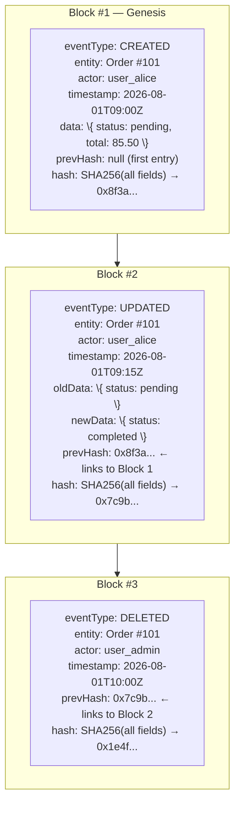
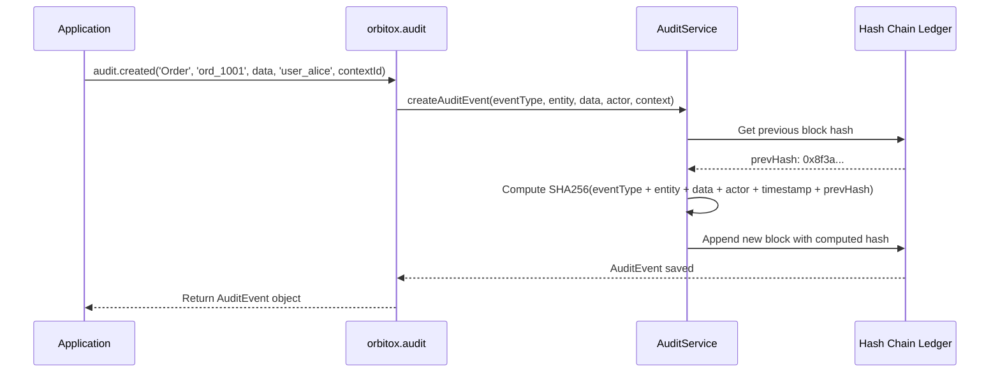

# 📋 Step 8: Cryptographic Hash-Chained Audit Trail (`orbitox.audit`)

OrbitoX creates **tamper-evident, cryptographically linked** audit records for every mutation. If anyone modifies a past log entry in the database, the entire hash chain breaks — instantly detectable. This makes OrbitoX audit-ready for SOC2, HIPAA, and GDPR out of the box.

---

## 🔐 How Cryptographic Hash Chaining Works



> [!IMPORTANT]
> If Block #2 is tampered with (e.g., changing `user_alice` to `user_bob`), its stored hash `0x7c9b...` will no longer match a fresh SHA256 calculation — and Block #3's `prevHash` will fail validation. Tampering is **mathematically provable**.

---

## 📊 Audit Event Types Reference

| Event Method | Triggered For | Fields Captured | Use Case |
| :--- | :--- | :--- | :--- |
| `audit.created()` | Entity creation | entityType, entityId, newData, actorId, contextId | Log when any record is first created |
| `audit.updated()` | Entity modification | entityType, entityId, oldData, newData, actorId, contextId | Track what changed and who changed it |
| `audit.deleted()` | Entity deletion | entityType, entityId, actorId, contextId | Immutable record of who deleted what |
| `audit.log()` | Custom business event | eventType, description, meta, actorId, contextId | Log non-CRUD business actions (e.g., payment processed) |

---

## 📋 Compliance Readiness Matrix

| Regulation | Requirement | How OrbitoX Satisfies It |
| :--- | :--- | :--- |
| **SOC2 Type II** | Immutable access logs | Hash-chained audit blocks — tamper-evident |
| **HIPAA** | PHI access tracking | Every read/write to patient data logged with actor |
| **GDPR** | Right to audit trail | Complete lifecycle of any entity queryable by entityId |
| **PCI-DSS** | Payment event tracking | `audit.log('payment.processed', ...)` captures full payment metadata |

---

## 🔄 Audit Lifecycle Flow



---

## 🛠️ Step-by-Step Audit Implementation

### Step 8.1: Record an Entity Creation

```typescript
import { orbitox } from '@orbitox/runtime';

// Called whenever a new entity is created in your system
await orbitox.audit.created(
  'Order',             // Entity type name
  'ord_1001',          // Entity unique ID
  {                    // Full snapshot of new data
    status: 'pending',
    total: 85.50,
    items: ['2 Burgers', '1 Fries'],
    tableNumber: 4,
  },
  'user_alice',        // Who performed the action
  'branch-downtown'    // Which context / tenant
);
```

### Step 8.2: Record an Entity Update (With Before/After)

```typescript
// Captures BOTH old and new state for diff analysis
await orbitox.audit.updated(
  'Order',
  'ord_1001',
  { status: 'pending', total: 85.50 },   // 🔴 Old state (before)
  { status: 'completed', total: 85.50 }, // 🟢 New state (after)
  'user_alice',
  'branch-downtown'
);
```

### Step 8.3: Record an Entity Deletion

```typescript
// Creates permanent, undeletable record of deletion
await orbitox.audit.deleted(
  'Order',
  'ord_1001',
  'user_admin',      // Who deleted it
  'branch-downtown'  // In which context
);
```

### Step 8.4: Log a Custom Business Event

```typescript
// Non-CRUD business events — payment, login, export, etc.
await orbitox.audit.log(
  'payment.processed',
  'ord_1001',
  {
    paymentMethod: 'card',
    last4: '4242',
    amount: 85.50,
    currency: 'USD',
    gateway: 'stripe',
    transactionId: 'txn_8Xk3...',
  },
  'user_alice',
  'branch-downtown'
);
```

---

[⬅️ Prev: AI Gateway](./07_AI_GATEWAY.md) | [Back to Index](./README.md) | [Next: Feature Flags ➔](./09_FEATURE_FLAGS.md)
