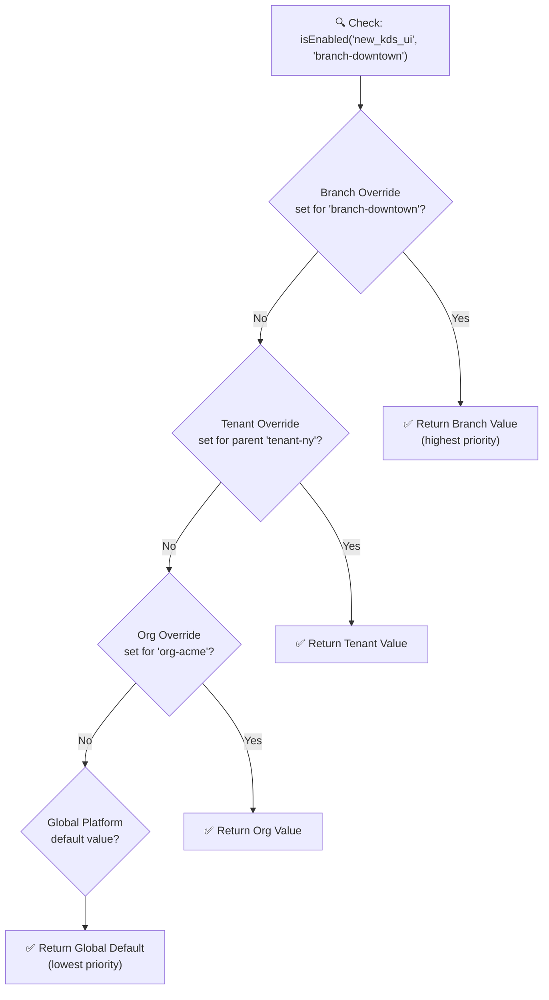
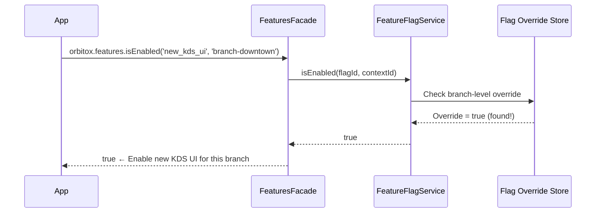

# 🚩 Step 9: Context-Aware Feature Flags & Rollouts (`orbitox.features`)

Feature flags allow you to enable or disable features dynamically — per tenant, per branch, or globally — without redeploying code. OrbitoX resolves flags through a **cascading priority chain** so parent settings always apply unless explicitly overridden.

---

## 🚩 How Flag Resolution Works (Priority Chain)



---

## 📊 Feature Flag Override Priority Table

| Priority | Level | Set Via | Scope | Example |
| :---: | :--- | :--- | :--- | :--- |
| **1 (Highest)** | Branch | `setOverride(flag, branchId, value)` | This branch only | Beta test at downtown store only |
| **2** | Tenant | `setOverride(flag, tenantId, value)` | All branches under this tenant | Enable for all NY Franchise stores |
| **3** | Organisation | `setOverride(flag, orgId, value)` | All tenants under this org | Enable for all Acme Corp locations |
| **4 (Lowest)** | Global Default | `define({ defaultValue })` | All contexts platform-wide | Off by default for everyone |

---

## 📊 Use Case Reference Matrix

| Scenario | Strategy | Flag Config |
| :--- | :--- | :--- |
| **Beta Test at 1 branch** | Branch override = `true` | `setOverride('flag', 'branch-downtown', true)` |
| **Roll out to a franchise** | Tenant override = `true` | `setOverride('flag', 'tenant-ny', true)` |
| **Launch globally for all** | Update global default = `true` | `define({ defaultValue: true })` |
| **Block a specific branch** | Branch override = `false` | `setOverride('flag', 'branch-la', false)` even if Tenant = `true` |
| **Emergency kill switch** | Set all overrides to `false` | `setOverride('flag', 'org-acme', false)` — overrides all children |

---

## 🔄 Flag Check Sequence Diagram



---

## 🛠️ Step-by-Step Feature Flag Implementation

### Step 9.1: Define a Global Feature Flag

```typescript
import { orbitox } from '@orbitox/runtime';

// Register the flag definition once (at app startup or admin panel)
orbitox.features.define({
  id: 'new_kitchen_display_ui',
  displayName: 'New KDS Touchscreen Interface',
  description: 'Replaces the legacy kitchen display with a new touchscreen-optimised UI',
  defaultValue: false,   // Off globally by default
  category: 'ui',
});
```

### Step 9.2: Set an Override for a Specific Branch (Beta Test)

```typescript
// Enable only for downtown branch — beta testing
await orbitox.features.setOverride('new_kitchen_display_ui', 'branch-downtown', true);

// Enable for entire NY franchise
await orbitox.features.setOverride('new_kitchen_display_ui', 'tenant-ny', true);
```

### Step 9.3: Check the Flag in Application Code

```typescript
const isNewUiEnabled = await orbitox.features.isEnabled(
  'new_kitchen_display_ui',
  'branch-downtown'
);

if (isNewUiEnabled) {
  // Render new touchscreen KDS component
  renderNewKitchenDisplay();
} else {
  // Render legacy KDS
  renderLegacyKitchenDisplay();
}
```

### Step 9.4: Check Multiple Flags at Once (Dashboard)

```typescript
const flags = await Promise.all([
  orbitox.features.isEnabled('new_kitchen_display_ui', contextId),
  orbitox.features.isEnabled('ai_menu_recommender', contextId),
  orbitox.features.isEnabled('tip_prompt_screen', contextId),
]);

const [showNewKDS, showAIMenu, showTipScreen] = flags;
renderDashboard({ showNewKDS, showAIMenu, showTipScreen });
```

---

[⬅️ Prev: Audit Trail](./08_AUDIT_TRAIL.md) | [Back to Index](./README.md) | [Next: Workflows & Automation ➔](./10_WORKFLOWS.md)
