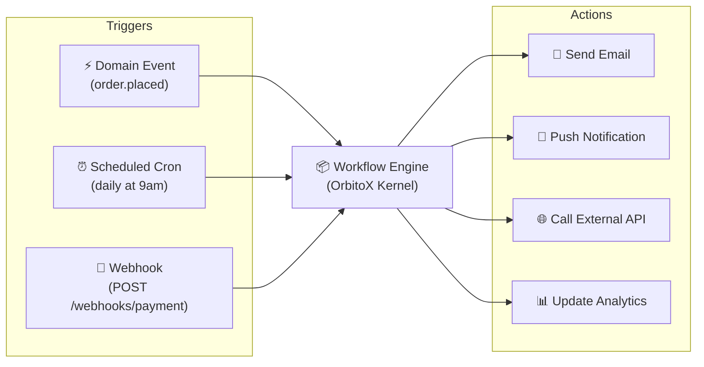
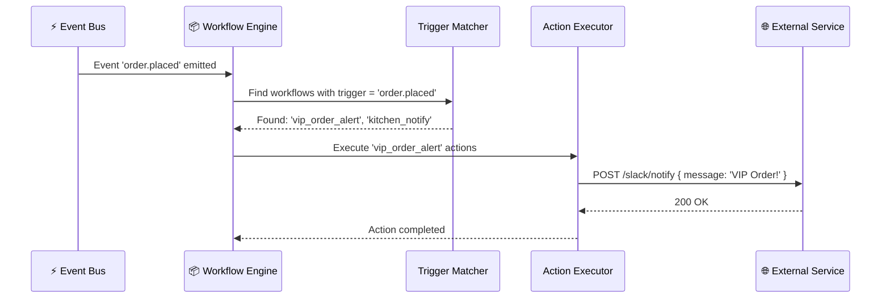

# 📦 Step 10: No-Code Workflows & Automation Engine (`orbitox.workflows`)

The OrbitoX Workflow Engine lets you define **declarative background automations** that trigger on domain events, time schedules, or webhooks — and automatically execute actions like sending emails, calling APIs, or pushing notifications. No manual wiring needed.

---

## 📦 Workflow Architecture Overview



---

## 📊 Trigger Types Reference

| Trigger Type | Config Key | When It Fires | Example |
| :--- | :--- | :--- | :--- |
| **Domain Event** | `type: 'event'` | When a matching event is emitted | `eventName: 'order.placed'` |
| **Cron Schedule** | `type: 'schedule'` | On a time-based cron expression | `cron: '0 9 * * *'` (daily at 9am) |
| **Webhook** | `type: 'webhook'` | When an HTTP POST hits the webhook endpoint | `path: '/webhooks/payment-confirmed'` |

---

## 📊 Action Types Reference

| Action Type | Config Key | What It Does | Example |
| :--- | :--- | :--- | :--- |
| **Email Notification** | `type: 'email'` | Sends an email via configured email provider | Send receipt to customer |
| **Push Notification** | `type: 'notification'` | Sends in-app or mobile push notification | Alert manager of large order |
| **External API Call** | `type: 'api_call'` | POSTs data to an external REST endpoint | Update Slack, send to ERP |

---

## 🔄 Workflow Execution Sequence



---

## 🛠️ Step-by-Step Workflow Implementation

### Step 10.1: Event-Triggered Notification Workflow

```typescript
import { orbitox } from '@orbitox/runtime';

// Alert the manager when any order over $200 is placed
await orbitox.workflows.build('vip_order_alert', 'tenant-ny')
  .name('VIP Order Manager Alert')
  .onEvent('order.placed')
  // We can push actions to the workflow directly:
  .action('notification', 'manager@restaurant.com', {
    message: '🔔 VIP Order Alert: A large order of ${{payload.total}} has been placed at Table {{payload.tableNumber}}!'
  })
  .activate();
```

### Step 10.2: Scheduled Cron Workflow (Daily Report)

```typescript
// Send a daily summary report every morning at 9am
await orbitox.workflows.build('daily_summary_report', 'tenant-ny')
  .name('Daily Revenue Summary Email')
  .onSchedule('0 9 * * *') // 9:00 AM every day
  .action('email', 'owner@restaurant.com', {
    subject: 'Daily Revenue Summary — {{date}}',
    templateId: 'daily_revenue_summary_template'
  })
  .activate();
```

### Step 10.3: Manually Trigger a Workflow

```typescript
// Manually fire a workflow in response to a custom business condition
await orbitox.workflows.trigger(
  'vip_order_alert',
  {
    orderId: 'ord_9901',
    total: 350.00,
    tableNumber: 7,
    customerName: 'Mr. Johnson',
  },
  'branch-downtown'
);
```

### Step 10.4: Combined Workflow — Email + External API

```typescript
// On order completion: send receipt email AND update external inventory system
await orbitox.workflows.build('order_fulfillment_pipeline', 'tenant-ny')
  .name('Order Fulfillment: Email + Inventory Sync')
  .onEvent('order.completed')
  .action('email', '{{payload.customerEmail}}', {
    subject: 'Your Order #{{payload.orderId}} is Ready!',
    body: 'Thank you for your order. Total charged: ${{payload.total}}.',
  })
  .action('api_call', 'https://inventory.internal/api/stock/decrement', {
    method: 'POST',
    body: { orderId: '{{payload.orderId}}', items: '{{payload.items}}' },
    headers: { Authorization: 'Bearer {{env.INVENTORY_API_KEY}}' }
  })
  .activate();
```

### Step 10.5: Manage Workflows (Update and Delete)

```typescript
// Add a delay step to an existing workflow
await orbitox.workflows.build('vip_order_alert', 'tenant-ny')
  .delay(5, 'minutes')
  .update();

// Get Workflow Definition
const wf = await orbitox.workflows.build('vip_order_alert', 'tenant-ny').get();
console.log('Workflow Steps Count:', wf.steps.length);

// Delete Workflow
await orbitox.workflows.build('vip_order_alert', 'tenant-ny').delete();
```

---

[⬅️ Prev: Feature Flags](./09_FEATURE_FLAGS.md) | [Back to Index](./README.md) | [Next: CLI & Scaffolding ➔](./11_CLI_SCAFFOLDING.md)
