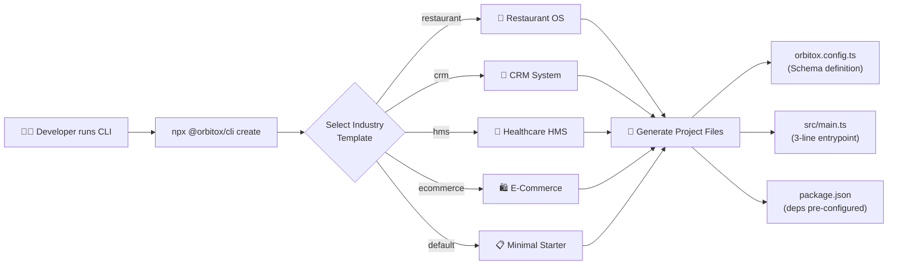

# 🛠️ Step 11: Declarative CLI & Dynamic REST API Generator

The OrbitoX CLI instantly scaffolds complete industry-specific backends. Just define your entity schema in `orbitox.config.ts` — the runtime automatically generates and mounts all REST API endpoints with security gates, audit logging, and event emission.

---

## 🛠️ CLI Scaffolding Pipeline



---

## 📊 Available Composable Templates Matrix

| Template | Flag | Composed Plugin | Built-In Capabilities | Target Industry |
| :--- | :--- | :--- | :--- | :--- |
| **Restaurant OS** | `--template=restaurant` | `@orbitox/pos` | Deterministic GST Quote, Kitchen DAG, Order Lifecycle, Dining Sessions | Food & Beverage SaaS |
| **CRM Platform** | `--template=crm` | `@orbitox/crm` | Predictive Lead Scoring, Opportunity Stages, Durable State Machine | Sales & B2B SaaS |
| **Foundation Starter** | `--template=blank` | `@orbitox/core` | Barebones Zero-Trust Multi-Tenancy & Platform Telemetry | Custom SaaS Vertical |

---

## 📦 Installation Modes

`orbitox create` supports multiple package resolution modes:

| Mode | Flag | Description |
| :--- | :--- | :--- |
| **Registry (Default)** | `--install-mode=registry` | Resolves packages from npm / GitHub Packages registry. |
| **Local Tarballs** | `--install-mode=file --pack-dir=<dir>` | Offline mode: installs pre-packed `.tgz` tarballs from a directory. |
| **Monorepo Workspace**| `--install-mode=workspace` | Uses `workspace:*` links when scaffolding inside the monorepo. |

---

## 📁 Generated Project Structure

Every scaffolded application includes:
- `docker-compose.yml`: Out-of-the-box local PostgreSQL container.
- `orbitox.config.ts`: Host configuration specifying plugins, tenancy resolver, auth provider, and platform connection.
- `package.json`: Pre-configured dependencies (`@orbitox/runtime`, plugin package, and `tsx`).
- `src/main.ts`: 1-line asynchronous `createOrbitoXApp(config)` bootstrap.

---

## 📋 Entity Field Types Reference

| Type | TypeScript Equivalent | Validation | Example |
| :--- | :--- | :--- | :--- |
| `text` | `string` | Required if `required: true` | `name`, `email`, `description` |
| `number` | `number` | Must be numeric | `price`, `quantity`, `tableNumber` |
| `boolean` | `boolean` | `true` or `false` | `isActive`, `isPublished` |
| `date` | `Date` | ISO 8601 format | `createdAt`, `appointmentDate` |
| `json` | `Record<string, any>` | Any valid JSON object | `metadata`, `settings` |
| `enum` | `string` (constrained) | Must match `values[]` array | `status: ['pending', 'completed']` |

---

## ⚙️ Schema Configuration Reference (`orbitox.config.ts`)

```typescript
import { OrbitoXConfig } from '@orbitox/runtime';

const config: OrbitoXConfig = {
  app: {
    name: 'Super Restaurant OS',
    port: 3000,
    description: 'Full-stack restaurant management system',
  },
  entities: [
    {
      id: 'menu_item',
      name: 'Menu Item',
      fields: [
        { name: 'name',        type: 'text',    required: true               },
        { name: 'price',       type: 'number',  required: true               },
        { name: 'category',    type: 'text',    required: true               },
        { name: 'description', type: 'text',    required: false              },
        { name: 'isActive',    type: 'boolean', default: true                },
        { name: 'tags',        type: 'json',    default: []                  },
        {
          name: 'status',
          type: 'enum',
          values: ['available', 'out_of_stock', 'seasonal'],
          default: 'available'
        },
      ],
    },
    {
      id: 'customer_order',
      name: 'Customer Order',
      fields: [
        { name: 'tableNumber',  type: 'number', required: true               },
        { name: 'totalAmount',  type: 'number', required: true               },
        { name: 'customerName', type: 'text',   required: false              },
        {
          name: 'status',
          type: 'enum',
          values: ['pending', 'preparing', 'ready', 'served', 'paid'],
          default: 'pending',
        },
      ],
    },
  ],
};

export default config;
```

---

## 🔄 Auto-Generated REST Endpoints at Runtime Boot

When `createOrbitoXApp(config)` is called, OrbitoX **automatically mounts** these endpoints:

| Entity | Auto-Mounted Routes | Security Gate | Audit Event |
| :--- | :--- | :--- | :--- |
| `menu_item` | `GET /api/menu-items` | `authorize(userId, 'menu_item.read', ctx)` | — |
| `menu_item` | `POST /api/menu-items` | `authorize(userId, 'menu_item.create', ctx)` | `audit.created(...)` |
| `customer_order` | `GET /api/customer-orders` | `authorize(userId, 'customer_order.read', ctx)` | — |
| `customer_order` | `POST /api/customer-orders` | `authorize(userId, 'customer_order.create', ctx)` | `audit.created(...)` |
| *(all)* | `GET /health` | None (public) | — |

---

## 🚀 How to Use the CLI

```bash
# Step 1: Scaffold a new project
npx @orbitox/cli create my-restaurant --template=restaurant

# Step 2: Navigate into the project
cd my-restaurant

# Step 3: Install dependencies
npm install

# Step 4: Start in dev mode
npm run dev
# → 🚀 Server running at http://localhost:3000

# Step 5: Test auto-generated endpoints
curl http://localhost:3000/health
curl http://localhost:3000/api/menu-items
```

---

[⬅️ Prev: Workflows & Automation](./10_WORKFLOWS.md) | [Back to Index](./README.md) | [Next: Production Deployment ➔](./12_PRODUCTION_DEPLOYMENT.md)
