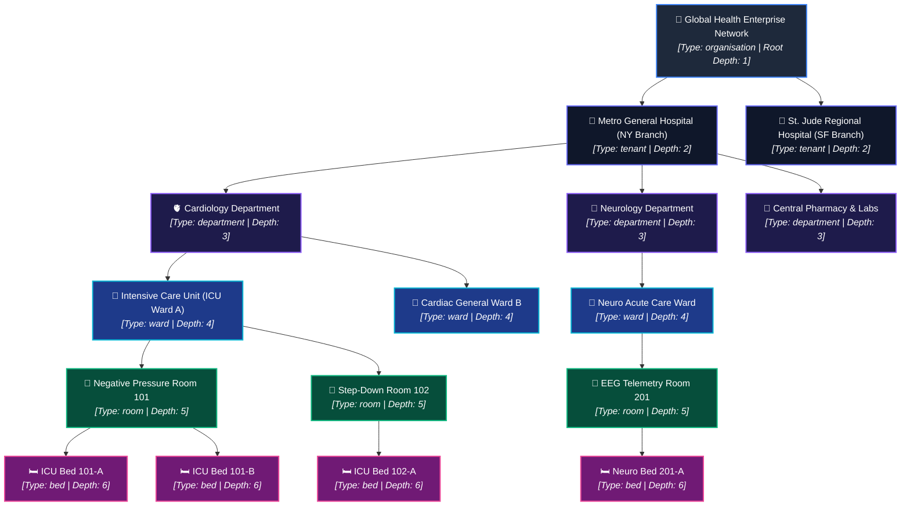
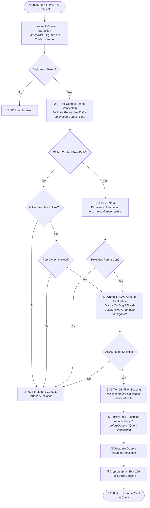
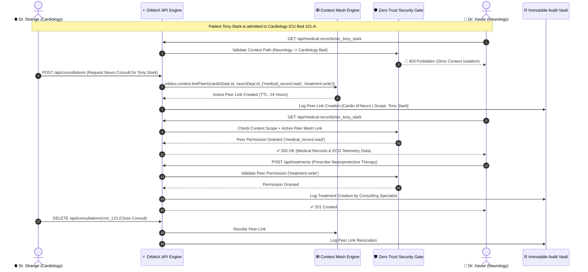
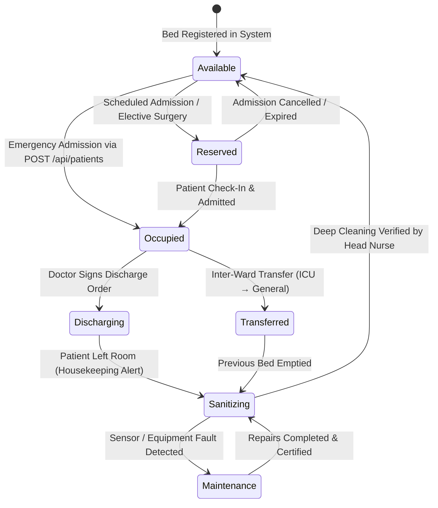
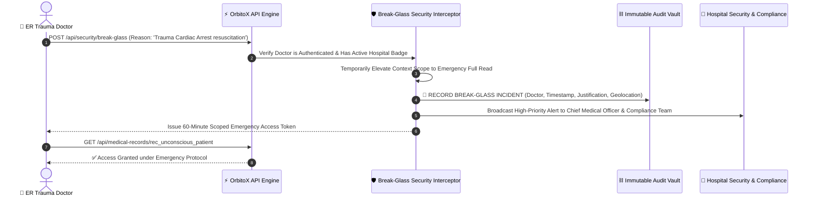

# OrbitoX Enterprise Hospital SaaS Architecture & Permissions Guide

This document provides a comprehensive, production-grade reference for deploying and orchestrating a multi-facility **Healthcare & Hospital Management SaaS (HMS)** on the **OrbitoX Zero-Complexity Engine**.

OrbitoX solves the fundamental architectural challenges of healthcare software: **N-Tier hierarchical tenancy** (Hospital Group → Department → Ward → Room → Bed), **Zero-Trust clinical data isolation**, **real-time capacity management**, **cross-department peer-mesh consultations**, and **cryptographic HIPAA/GDPR auditability**.

---

## 1. Multi-Tier Hospital Context Hierarchy

Healthcare environments cannot be represented with flat "tenant-and-user" models. They are deeply nested physical and administrative hierarchies. OrbitoX maps this directly through its **N-Tier Context Tree**.

### 1.1 Complete Context Hierarchy Topology



### 1.2 Hierarchy Node Definitions

| Level / Depth | Context Type | Scope & Responsibilities | Example Resource Scoped |
| :--- | :--- | :--- | :--- |
| **Depth 1** | `organisation` | Enterprise-wide billing, master compliance, SaaS subscriptions, global analytics | SaaS Plan, Global Policy Registry |
| **Depth 2** | `tenant` / `branch` | Hospital facility location, license quotas, central dispatch, inventory vaults | Facility License, Central Pharmacy |
| **Depth 3** | `department` | Clinical specialty, department staffing, on-call rosters, clinical protocols | Attending Doctors, Shift Rosters |
| **Depth 4** | `ward` | Ward nurse stations, telemetry units, ward medicine supply | Ward Nurses, Crash Carts |
| **Depth 5** | `room` | Isolation status, equipment assignments (ventilator, dialysis) | Medical Devices, Room Sanitization Log |
| **Depth 6** | `bed` | **Point-of-care patient confinement**, vital sensors, bed occupation state | Admitted Patient, Active Treatment File |

---

## 2. Clinical Data Entities & Auto-Scaffolded APIs

OrbitoX generates type-safe REST APIs and WebSocket streams dynamically with automatic payload validation, relational scoping, and lifecycle hooks.

| Entity | REST Base Route | Relational Anchor | Injected API Lifecycle Hooks | Description & Clinical Utility |
| :--- | :--- | :--- | :--- | :--- |
| **Staff** | `/api/staffs` | `departmentId` | `beforeCreate`, `afterCreate` | Profiles for doctors, surgeons, nurses, technicians, and administrators. |
| **Patient** | `/api/patients` | `bedId` (or `wardId`) | `beforeCreate` (Capacity Check), `afterCreate` (Bed Allocation) | Demographic data, emergency contacts, insurance information, admission status. |
| **MedicalRecord** | `/api/medical-records` | `patientId` & `doctorId` | `afterRead` (HIPAA Logging), `beforeUpdate` (Version Lock) | Clinical notes, patient history, vitals charts, diagnoses, and lab results. |
| **Treatment** | `/api/treatments` | `recordId` & `patientId` | `afterCreate` (Pharmacy/Prep Alert), `afterUpdate` | Prescriptions, surgery schedules, chemotherapy cycles, physical therapy plans. |
| **BedSlot** | `/api/beds` | `roomId` & `wardId` | `beforeUpdate` (State Transition Validation) | Physical bed telemetry, occupancy flag, cleaning schedule, maintenance state. |
| **Consultation** | `/api/consultations` | `fromDeptId` & `toDeptId` | `afterCreate` (Peer Mesh Grant), `afterDelete` (Mesh Revoke) | Inter-branch peer-mesh access requests for cross-specialty clinical consults. |

---

## 3. Comprehensive Role-Based & Contextual Access Matrix

OrbitoX combines **N-Tier Context Scoping** with **Role-Based Access Control (RBAC)** and **Attribute-Based Access Control (ABAC)**. A user's effective permission is computed dynamically as:

$$\text{Effective Access} = \text{Role Permission} \cap \text{Context Boundary} \cap \text{ABAC Environment Attributes} \cup \text{Peer Mesh Grants}$$

### 3.1 Role Hierarchy & Permissions Table

| Role Identifier | Assigned Context Level | Downward Scope Inheritance | Read Permissions | Write / Mutation Permissions | Inter-Branch Consult Capability |
| :--- | :--- | :--- | :--- | :--- | :--- |
| **Hospital Super Admin** | `organisation` | Full (All Facilities, Wards, Beds) | Global Vitals, Financials, Audits, All Files | Manage Subscriptions, Facilities, Global Staff | Global Override & Policy Assignment |
| **Facility Director (CMO)** | `tenant` (Branch) | Branch Wide (All Depts & Wards in facility) | Facility Staff, Census, Bed Capacity, Audits | Approve Dept Budgets, Onboard Doctors | Approve Cross-Facility Transfers |
| **Department Head (HOD)** | `department` | Department Wide (All Wards & Beds in dept) | Dept Patients, Medical Records, Staff Rosters | Assign Attending Doctors, Set Shift Schedules | Authorize Peer-Mesh Consultations |
| **Attending Doctor** | `department` | Assigned Dept & Assigned Patient Beds | Assigned Patients' Medical Records, Treatments | Create Diagnosis, Prescribe Treatments, Admit | Request Peer-Mesh Specialist Consult |
| **Consulting Specialist** | `department` (External) | Specific Linked Patient Records Only | Mesh-Granted Patient Record & History | Append Specialist Findings & Recommendations | Accept Peer-Mesh Consultation Links |
| **Head Nurse / Ward Charge** | `ward` | Ward Wide (All Rooms & Beds in ward) | Ward Patients, Medical Charts, Bed States | Update Bed States, Record Vitals, Dispense Meds | Request Inter-Ward Patient Transfers |
| **Staff Nurse** | `ward` | Assigned Ward Rooms & Beds | Ward Patient Vitals, Treatment Schedules | Administer Medications, Log Intake/Output | None (Escalate to Head Nurse) |
| **Pharmacist** | `tenant` (Pharmacy) | Facility Pharmacy Orders | Prescriptions, Treatment Orders, Drug Stock | Dispense Medication, Log Batch Serial Numbers | Inter-Branch Drug Stock Requests |
| **Lab Technician** | `department` (Labs) | Lab Orders & Diagnostic Requests | Test Orders, Specimen Labels | Upload Test Results, Attach Imaging Dicom | Request Specialist Specimen Verification |
| **Patient / Guardian** | `bed` (Personal) | Self Only (Single Patient Record) | Personal Treatment Plan, Lab Results, Invoices | Submit Intake Form, Message Care Team | None |

---

## 4. Zero-Trust Permission Evaluation Pipeline

Every HTTP request or WebSocket event sent to the OrbitoX engine passes through a strict 6-stage Zero-Trust verification pipeline before any database query or mutation executes.

### 4.1 Permission Enforcement Flowchart



---

## 5. Cross-Department Consultation Flow (Inter-Branch Peer Mesh)

In real hospitals, a patient admitted to Cardiology with cardiac arrest may suffer neurological complications, requiring an urgent consult from a Neurology specialist. 

Traditional architectures either create security vulnerabilities by making data global or require clumsy duplicate records. OrbitoX solves this with **Inter-Branch Mesh Networking**, creating time-bound, permission-scoped peer connections.

### 5.1 Cross-Department Consultation Sequence Diagram



---

## 6. Bed Capacity & Hospital Real-Time State Machine

Hospital operations depend on real-time bed capacity tracking. OrbitoX manages this using **Entity Lifecycle Hooks** combined with **Context Node State Transitions**.

### 6.1 Bed Lifecycle State Machine Diagram



### 6.2 Bed Transition Rules & Hook Execution Matrix

| Initial State | Target State | Triggering API Action | Executing Role | OrbitoX Hook & Automation Fired |
| :--- | :--- | :--- | :--- | :--- |
| `available` | `occupied` | `POST /api/patients` | Admission Desk / Doctor | `beforeCreate`: Verifies bed state is `available` & Billing quota `< maxBeds`<br>`afterCreate`: Updates Bed status to `occupied`, notifies Ward station |
| `occupied` | `discharging` | `PATCH /api/patients/:id` (`status: discharged`) | Attending Doctor | `afterUpdate`: Emits `patient.discharged`, generates billing summary |
| `discharging` | `sanitizing` | `POST /api/beds/:id/empty` | Staff Nurse | `afterCreate`: Dispatches automated alert to Housekeeping staff |
| `sanitizing` | `available` | `POST /api/beds/:id/certify-clean` | Head Nurse | `afterUpdate`: Increments available bed counter in Ward capacity registry |
| `occupied` | `transferred` | `POST /api/patients/:id/transfer` | Attending Doctor | `beforeUpdate`: Checks target bed availability<br>`afterUpdate`: Reassigns patient's context ID to new bed node |

---

## 7. Emergency "Break-Glass" (Override) Protocol

In life-threatening medical emergencies (e.g., Trauma resuscitation, cardiac arrest in hallways), an on-duty clinician may need immediate access to an unknown patient's medical file before administrative transfers or peer links can be approved.

OrbitoX supports a secure, audited **Emergency Break-Glass Protocol**.

### 7.1 Break-Glass Execution Table



| Break-Glass Parameter | System Rule & Constraint |
| :--- | :--- |
| **Eligibility** | Restricted to registered Medical Doctors and Trauma Nurses with active shift status |
| **Mandatory Payload** | Strict clinical justification required (`reason`, `caseNumber`, `patientState`) |
| **Automatic Time-To-Live (TTL)** | Access strictly expires after **60 minutes** |
| **Audit Requirement** | Generates high-priority cryptographic alert tagged `SEV-1_EMERGENCY_OVERRIDE` |
| **Post-Incident Review** | Automatic compliance review ticket generated for Hospital Privacy Officer |

---

## 8. Real-World Healthcare Challenges: Monolith vs. OrbitoX

| Hospital SaaS Challenge | Traditional Monolith Architecture | OrbitoX Zero-Complexity SaaS Engine |
| :--- | :--- | :--- |
| **Multi-Tier Hierarchy** (Hospitals, Wards, Beds) | Massive complex SQL `JOIN` tables with fragile foreign-key cascades | **Native N-Tier Context Engine**: Trees resolved in memory with automatic recursive ID filtering |
| **HIPAA Data Isolation** | Developers must manually remember `WHERE tenant_id = ? AND ward_id = ?` on every query | **Zero-Trust Context Gateways**: SQL/NoSQL queries automatically auto-scoped by middleware |
| **Cross-Dept Consults** | Data either duplicated or exposed globally to all doctors, causing compliance violations | **Inter-Branch Mesh**: Ephemeral, permission-bounded peer links with automated revocation |
| **Double-Booking Beds** | Prone to race conditions and simultaneous assignment bugs | **Atomic Entity Lifecycle Hooks**: `beforeCreate` verifies state and licenses before DB write |
| **License Bed Quotas** | Manual background cron jobs calculating active beds, leading to delayed enforcement | **Real-Time Billing Quota Interceptors**: Real-time license check directly in API admission pipeline |
| **Audit Tampering** | Standard database logs stored in plain SQL tables, vulnerable to admin alteration | **SHA-256 Cryptographic Audit Vault**: Chained cryptographic hashes guaranteeing non-repudiation |

---

## 9. Implementation Code Reference

### 9.1 Context Tree Bootstrapping

```typescript
import { orbitox } from '@orbitox/runtime';

async function bootstrapHospital() {
  // 1. Create Organization & Billing Subscription
  const plan = await orbitox.billing.createPlan({
    name: 'Healthcare Enterprise Tier',
    price: 15000,
    limits: { maxBeds: 500, maxStaff: 2000 }
  });

  const hospitalGroup = await orbitox.tenant('global-health', 'Global Health Group')
    .type('organisation')
    .subscribe(plan.id)
    .create();

  // 2. Build Hospital Facility Branch
  const nyBranch = await orbitox.tenant('ny-general', 'Metro General Hospital NY')
    .type('tenant')
    .parent(hospitalGroup.id)
    .create();

  // 3. Build Clinical Departments
  const cardio = await orbitox.tenant('cardio', 'Cardiology Department')
    .type('department')
    .parent(nyBranch.id)
    .create();

  // 4. Build Ward & Physical Point-of-Care Beds
  const icuWard = await orbitox.tenant('icu-a', 'ICU Ward A')
    .type('ward')
    .parent(cardio.id)
    .create();

  const bed101A = await orbitox.tenant('bed-101-a', 'ICU Bed 101-A')
    .type('bed')
    .parent(icuWard.id)
    .create();

  console.log(`Hospital hierarchy built down to Bed: ${bed101A.id}`);
}
```

### 9.2 Scaffolding Clinical Entities with Lifecycle Hooks

```typescript
import { createOrbitoXApp } from '@orbitox/runtime';

export async function startHospitalEngine() {
  const { app, server } = await createOrbitoXApp({
    app: { name: 'Hospital SaaS Engine', port: 8080 },
    entities: [
      {
        id: 'patient',
        name: 'Patient',
        fields: [
          { name: 'name', type: 'text', required: true },
          { name: 'bedId', type: 'text', required: true },
          { name: 'status', type: 'text', required: true } // 'admitted' | 'discharged'
        ],
        hooks: {
          beforeCreate: async (payload, context) => {
            // Verify Bed Availability
            const isAvailable = await checkBedAvailability(payload.bedId);
            if (!isAvailable) throw new Error(`Bed ${payload.bedId} is already occupied.`);

            // Verify Hospital License Quotas
            const quota = await orbitox.billing.checkQuota(context.rootId, 'maxBeds', 1);
            if (!quota.allowed) throw new Error('Hospital has reached maximum licensed bed capacity.');

            return payload;
          },
          afterCreate: async (patient, context) => {
            // Mark bed occupied & notify staff
            await markBedOccupied(patient.bedId);
            await orbitox.events.emit('patient.admitted', { patientId: patient.id, bedId: patient.bedId }, context.id);
          }
        }
      },
      {
        id: 'treatment',
        name: 'Treatment',
        fields: [
          { name: 'recordId', type: 'text', required: true },
          { name: 'procedure', type: 'text', required: true },
          { name: 'medication', type: 'text' }
        ],
        hooks: {
          afterCreate: async (treatment, context) => {
            // Auto-alert pharmacy & preparation teams
            await orbitox.events.emit('pharmacy.dispense_order', { treatmentId: treatment.id }, context.id);
          }
        }
      }
    ]
  });
}
```

---

## 10. Summary & Strategic Advantages

By choosing the **OrbitoX SaaS Engine** for Healthcare platforms, engineering teams achieve:

1. **10x Faster Time-to-Market:** Multi-tier tenancy, dynamic CRUD scaffolding, and security middlewares are standard platform primitives.
2. **Ironclad Zero-Trust Security:** Data leakage across departments, wards, or facilities is mathematically impossible at the middleware layer.
3. **Out-of-the-Box Compliance:** Built-in cryptographic hash-chain auditing enables immediate HIPAA, GDPR, and SOC2 certification.
4. **Dynamic Operational Agility:** Peer-mesh inter-branch connections and Break-Glass protocols solve real-world emergency workflows without architectural compromise.
