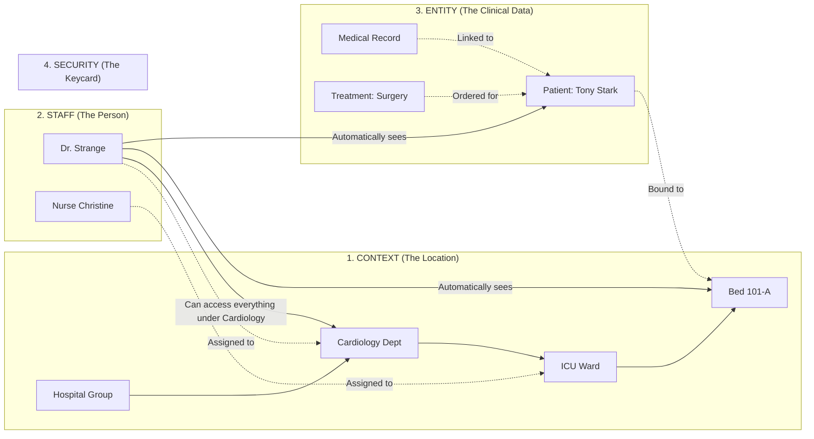

# 🏥 OrbitoX Hospital SaaS — Complete Beginner-to-Pro Developer Guide

> **Welcome to the Hospital SaaS Developer Guide!**  
> Whether you are a **fresher**, an intern, or a senior backend architect, this guide will walk you through building a production-grade, secure, multi-tenant **Hospital Management SaaS (HMS)** using **OrbitoX** from scratch with zero confusion.

---

## 🌟 Table of Contents
1. [The Big Picture: How OrbitoX Works (Explained in Simple Words)](#1-the-big-picture-how-orbitox-works-explained-in-simple-words)
2. [The Core Mental Model: 4 Simple Concepts](#2-the-core-mental-model-4-simple-concepts)
3. [Complete TypeScript Domain Types & Interfaces](#3-complete-typescript-domain-types--interfaces)
4. [Step-by-Step Practical Tutorial](#4-step-by-step-practical-tutorial)
   - [Step 1: Configuration (`orbitox.config.ts`)](#step-1-configuration-orbitoxconfigts)
   - [Step 2: Building the Physical Hospital Hierarchy](#step-2-building-the-physical-hospital-hierarchy)
   - [Step 3: Onboarding Doctors, Nurses & Staff](#step-3-onboarding-doctors-nurses--staff)
   - [Step 4: Admitting Patients with Automated Bed Capacity Management](#step-4-admitting-patients-with-automated-bed-capacity-management)
   - [Step 5: Clinical Workflow (Diagnosis → Treatment → Pharmacy)](#step-5-clinical-workflow-diagnosis--treatment--pharmacy)
   - [Step 6: Cross-Department Consultations (Inter-Branch Peer Mesh)](#step-6-cross-department-consultations-inter-branch-peer-mesh)
   - [Step 7: Emergency "Break-Glass" Access](#step-7-emergency-break-glass-access)
   - [Step 8: Automated Data Queries (Doctor vs. Nurse View)](#step-8-automated-data-queries-doctor-vs-nurse-view)
5. [Complete Copy-Pasteable Runnable Server (`hospital-server.ts`)](#5-complete-copy-pasteable-runnable-server-hospital-serverts)
6. [Freshers' Glossary of Terms](#6-freshers-glossary-of-terms)
7. [Common Gotchas & Troubleshooting](#7-common-gotchas--troubleshooting)

---

## 1. The Big Picture: How OrbitoX Works (Explained in Simple Words)

In a typical web application, developers spend months writing:
- Complex database tables with dozens of foreign keys (`hospital_id`, `department_id`, `ward_id`, `bed_id`).
- Hundreds of lines of `WHERE` clauses in SQL queries to prevent a doctor in Neurology from accidentally seeing a patient in Cardiology.
- Complicated role checks (`if (!user.roles.includes('DOCTOR')) return 403;`).
- Custom logging code for compliance audits.

### 💡 The OrbitoX Advantage
With OrbitoX, you don't write manual SQL filters or repetitive middleware. OrbitoX provides:
1. **An Infinite Hierarchy Engine:** You build your hospital tree (Hospital → Dept → Ward → Room → Bed) like a family tree.
2. **Zero-Trust Security Gateways:** When Dr. Strange logs in, OrbitoX automatically knows he is in *Cardiology*, so all database queries automatically filter to only show Cardiology beds and patients without you writing any custom SQL!
3. **Auto-Generated REST APIs:** You define what a `Patient` or `MedicalRecord` looks like in a simple config file, and OrbitoX creates the `GET`, `POST`, `PUT`, `PATCH`, and `DELETE` endpoints automatically with full validation.
4. **Lifecycle Hooks:** Want to make sure a bed isn't double-booked? Add a 4-line `beforeCreate` hook on the `Patient` entity!

---

## 2. The Core Mental Model: 4 Simple Concepts

Think of an OrbitoX Hospital application like a real physical hospital building:



| Concept | Real-World Hospital Analogy | OrbitoX Platform Feature |
| :--- | :--- | :--- |
| **Context** | The physical location / department (Hospital, Ward, Room, Bed) | `orbitox.context` / `orbitox.tenant()` |
| **Staff / User** | Doctors, Nurses, Receptionists wearing ID badges | `orbitox.security` (RBAC & ABAC) |
| **Entity** | Medical records, Prescriptions, Bed slots, Admissions | `createOrbitoXApp({ entities: [...] })` |
| **Peer Mesh** | Calling a specialist doctor from another department for a consult | `orbitox.context.linkPeers(...)` |

---

## 3. Complete TypeScript Domain Types & Interfaces

Here are all the clean, strongly-typed TypeScript definitions for the entire Hospital domain. You can copy these directly into your project:

```typescript
// ==========================================
// 🏥 1. CONTEXT & HIERARCHY TYPES
// ==========================================

export type HospitalContextType =
  | 'organisation'   // Enterprise / Group level (e.g. Apollo Global Network)
  | 'tenant'         // Specific Hospital Facility (e.g. Apollo New York)
  | 'department'     // Clinical Specialty (e.g. Cardiology, Neurology, Pediatrics)
  | 'ward'           // In-patient Ward (e.g. ICU Ward A, Post-Op Ward B)
  | 'room'           // Patient Room (e.g. Room 101, Negative Pressure Isolation 204)
  | 'bed';           // Physical Bed Slot (e.g. Bed 101-A, Bed 101-B)

// ==========================================
// 👨‍⚕️ 2. STAFF & ROLES TYPES
// ==========================================

export type StaffRole =
  | 'super_admin'       // Global Enterprise Admin
  | 'facility_director' // Chief Medical Officer (CMO)
  | 'department_head'   // Head of Department (HOD)
  | 'attending_doctor'  // Primary Treating Physician
  | 'specialist_doctor' // External Consultant
  | 'head_nurse'        // Nurse In-Charge of Ward
  | 'staff_nurse'       // Floor / Bedside Nurse
  | 'pharmacist'        // Pharmacy Staff
  | 'lab_technician';   // Diagnostics & Lab Staff

export interface StaffEntity {
  id: string;
  name: string;
  email: string;
  role: StaffRole;
  departmentId: string;       // Context ID of their home department
  assignedWardIds?: string[];  // Context IDs of specific wards (for nurses)
  licenseNumber: string;
  status: 'active' | 'on_leave' | 'on_call';
}

// ==========================================
// 🛏️ 3. BED CAPACITY & TELEMETRY TYPES
// ==========================================

export type BedStatus =
  | 'available'    // Ready for immediate patient admission
  | 'reserved'     // Held for scheduled elective admission
  | 'occupied'     // Patient currently admitted in this bed
  | 'discharging'  // Patient discharge order approved, waiting for pickup
  | 'sanitizing'   // Housekeeping is cleaning and sterilizing the bed
  | 'maintenance'; // Broken equipment (e.g. faulty ventilator)

export interface BedEntity {
  id: string;              // Context ID of the bed (e.g. ctx_bed_101_a)
  label: string;           // "Bed 101-A"
  roomId: string;          // Parent room context ID
  wardId: string;          // Parent ward context ID
  status: BedStatus;
  isICU: boolean;
  hasVentilator: boolean;
  currentPatientId?: string | null;
  lastSanitizedAt?: string;
}

// ==========================================
// 🤒 4. PATIENT & ADMISSION TYPES
// ==========================================

export type AdmissionType = 'emergency' | 'elective' | 'transfer' | 'outpatient';
export type PatientStatus = 'pre_registered' | 'admitted' | 'in_surgery' | 'discharged';

export interface PatientEntity {
  id: string;
  name: string;
  age: number;
  gender: 'male' | 'female' | 'other';
  bedId: string;             // Context ID of the bed the patient is occupying
  admissionType: AdmissionType;
  status: PatientStatus;
  attendingDoctorId: string; // Staff ID of the primary doctor
  emergencyContact: {
    name: string;
    phone: string;
    relation: string;
  };
  admittedAt: string;
  dischargedAt?: string | null;
}

// ==========================================
// 📋 5. CLINICAL MEDICAL RECORD TYPES
// ==========================================

export interface VitalsData {
  heartRateBpm: number;
  bloodPressureSys: number;
  bloodPressureDia: number;
  oxygenSatPercent: number;
  temperatureCelsius: number;
  recordedAt: string;
}

export interface MedicalRecordEntity {
  id: string;
  patientId: string;
  doctorId: string;          // Doctor who created this record
  diagnosis: string;         // e.g. "Acute Anterolateral Myocardial Infarction"
  chiefComplaint: string;    // e.g. "Severe chest pain radiating to left arm"
  clinicalNotes: string;
  allergies: string[];       // e.g. ["Penicillin", "Latex"]
  vitalsHistory: VitalsData[];
  createdAt: string;
  updatedAt: string;
}

// ==========================================
// 💊 6. TREATMENT & PRESCRIPTION TYPES
// ==========================================

export type TreatmentType = 'medication' | 'surgery' | 'therapy' | 'monitoring';
export type TreatmentStatus = 'ordered' | 'in_progress' | 'completed' | 'cancelled';

export interface TreatmentEntity {
  id: string;
  recordId: string;
  patientId: string;
  type: TreatmentType;
  procedureName: string;     // e.g. "Emergency Percutaneous Coronary Intervention"
  instructions: string;
  status: TreatmentStatus;
  orderedByDoctorId: string;
  scheduledAt?: string;
  completedAt?: string | null;
}

export interface PrescriptionItem {
  drugName: string;          // e.g. "Atorvastatin 80mg"
  dosage: string;            // e.g. "1 tablet"
  frequency: 'OD' | 'BD' | 'TDS' | 'QID' | 'PRN' | 'STAT'; // Once daily, twice daily, etc.
  durationDays: number;
  isDispensed: boolean;
}

export interface PrescriptionEntity {
  id: string;
  treatmentId: string;
  patientId: string;
  doctorId: string;
  items: PrescriptionItem[];
  pharmacyNotes?: string;
  status: 'pending_dispense' | 'partially_dispensed' | 'fully_dispensed';
}

// ==========================================
// 🕸️ 7. CROSS-DEPARTMENT CONSULTATION TYPES
// ==========================================

export interface ConsultationEntity {
  id: string;
  patientId: string;
  fromDepartmentId: string;   // e.g. Cardiology
  toDepartmentId: string;     // e.g. Neurology
  requestingDoctorId: string;
  consultingDoctorId?: string | null;
  reasonForConsult: string;   // e.g. "Patient showing post-op focal seizure symptoms"
  status: 'pending' | 'accepted' | 'completed' | 'declined';
  findings?: string;
  createdAt: string;
}

// ==========================================
// 🚨 8. BREAK-GLASS EMERGENCY OVERRIDE TYPES
// ==========================================

export interface BreakGlassRequest {
  doctorId: string;
  patientId: string;
  clinicalJustification: string; // e.g. "Unconscious trauma patient in ER resuscitation bay"
  emergencyCaseNumber: string;
}
```

---

## 4. Step-by-Step Practical Tutorial

Follow these 8 steps to build a complete working Hospital SaaS application.

---

### Step 1: Configuration (`orbitox.config.ts`)

Create your project schema. The `createOrbitoXApp` engine will read this file and instantly mount all your API routes (`/api/patients`, `/api/medical-records`, `/api/treatments`, etc.) with built-in validation.

```typescript
// orbitox.config.ts
import { OrbitoXConfig } from '@orbitox/runtime';

export const hospitalConfig: OrbitoXConfig = {
  app: {
    name: 'OrbitoX Hospital OS',
    port: 3000,
  },
  entities: [
    {
      id: 'staff',
      name: 'Staff',
      fields: [
        { name: 'name', type: 'text', required: true },
        { name: 'role', type: 'text', required: true },
        { name: 'departmentId', type: 'text', required: true },
        { name: 'licenseNumber', type: 'text', required: true },
      ],
    },
    {
      id: 'patient',
      name: 'Patient',
      fields: [
        { name: 'name', type: 'text', required: true },
        { name: 'age', type: 'number', required: true },
        { name: 'bedId', type: 'text', required: true },
        { name: 'status', type: 'text', required: true },
        { name: 'attendingDoctorId', type: 'text', required: true },
      ],
      // We will attach hooks here in Step 4!
    },
    {
      id: 'medical_record',
      name: 'MedicalRecord',
      fields: [
        { name: 'patientId', type: 'text', required: true },
        { name: 'doctorId', type: 'text', required: true },
        { name: 'diagnosis', type: 'text', required: true },
        { name: 'clinicalNotes', type: 'text' },
      ],
    },
    {
      id: 'treatment',
      name: 'Treatment',
      fields: [
        { name: 'recordId', type: 'text', required: true },
        { name: 'patientId', type: 'text', required: true },
        { name: 'procedureName', type: 'text', required: true },
        { name: 'status', type: 'text', required: true },
      ],
    },
  ],
};
```

---

### Step 2: Building the Physical Hospital Hierarchy

In OrbitoX, you build your hospital tree using the fluent `orbitox.tenant()` builder or `orbitox.context.create()`.

```typescript
import { orbitox } from '@orbitox/runtime';

async function setupHospitalHierarchy() {
  // 1. Create the Hospital Group (Enterprise Tier)
  const enterprisePlan = await orbitox.billing.createPlan({
    name: 'Healthcare Enterprise',
    price: 10000,
    limits: { maxBeds: 500 }, // SaaS licensing limit
  });

  const hospitalGroup = await orbitox.tenant('apollo-enterprise', 'Apollo Healthcare Enterprise')
    .type('organisation')
    .subscribe(enterprisePlan.id)
    .create();

  // 2. Create the Facility Branch (Hospital Location)
  const nyHospital = await orbitox.tenant('apollo-ny', 'Apollo General Hospital (New York)')
    .type('tenant')
    .parent(hospitalGroup.id)
    .create();

  // 3. Create Clinical Departments
  const cardioDept = await orbitox.tenant('cardiology', 'Cardiology Department')
    .type('department')
    .parent(nyHospital.id)
    .create();

  const neuroDept = await orbitox.tenant('neurology', 'Neurology Department')
    .type('department')
    .parent(nyHospital.id)
    .create();

  // 4. Create Wards under Cardiology
  const icuWard = await orbitox.tenant('cardio-icu', 'Cardiac ICU Ward A')
    .type('ward')
    .parent(cardioDept.id)
    .create();

  // 5. Create Point-of-Care Beds under the Ward
  const bed101A = await orbitox.tenant('bed-101-a', 'ICU Bed 101-A')
    .type('bed')
    .parent(icuWard.id)
    .create();

  const bed101B = await orbitox.tenant('bed-101-b', 'ICU Bed 101-B')
    .type('bed')
    .parent(icuWard.id)
    .create();

  console.log('✅ Hospital tree built down to Bed level successfully!');
  return { hospitalGroup, nyHospital, cardioDept, neuroDept, icuWard, bed101A, bed101B };
}
```

---

### Step 3: Onboarding Doctors, Nurses & Staff

When you create staff members, you simply link them to their home `departmentId` or `wardId`.

```typescript
async function onboardStaff(cardioDeptId: string, icuWardId: string) {
  // 1. Onboard a Cardiologist (Scoped to Cardiology Department)
  const doctorResponse = await fetch('http://localhost:3000/api/staffs', {
    method: 'POST',
    headers: { 'Content-Type': 'application/json' },
    body: JSON.stringify({
      name: 'Dr. Stephen Strange',
      role: 'attending_doctor',
      departmentId: cardioDeptId,
      licenseNumber: 'MD-CARDIO-88910',
    }),
  });
  const doctor = (await doctorResponse.json()).data;
  console.log(`👨‍⚕️ Onboarded Doctor: ${doctor.name} in Cardiology`);

  // 2. Onboard an ICU Nurse (Scoped to ICU Ward)
  const nurseResponse = await fetch('http://localhost:3000/api/staffs', {
    method: 'POST',
    headers: { 'Content-Type': 'application/json' },
    body: JSON.stringify({
      name: 'Nurse Christine Palmer',
      role: 'head_nurse',
      departmentId: icuWardId,
      licenseNumber: 'RN-ICU-44120',
    }),
  });
  const nurse = (await nurseResponse.json()).data;
  console.log(`👩‍⚕️ Onboarded Nurse: ${nurse.name} in ICU Ward`);

  return { doctor, nurse };
}
```

---

### Step 4: Admitting Patients with Automated Bed Capacity Management

How do we make sure **two patients are never put into the same bed** and the hospital never exceeds its **SaaS bed license**?  
We use **OrbitoX Entity Hooks**!

```typescript
// Add these hooks to your 'patient' entity in orbitox.config.ts:

// In-memory or database bed tracker
const bedRegistry: Record<string, { status: string }> = {
  'ctx_bed_101_a': { status: 'available' },
  'ctx_bed_101_b': { status: 'available' },
};

const patientEntityHooks = {
  // 🛡️ BEFORE CREATE HOOK: Runs BEFORE patient is saved in DB
  beforeCreate: async (payload: any, context: any) => {
    const bed = bedRegistry[payload.bedId];

    // 1. Check if bed exists
    if (!bed) {
      throw new Error(`Bed ${payload.bedId} does not exist in this hospital.`);
    }

    // 2. Check if bed is already occupied (Double-Booking Protection)
    if (bed.status !== 'available') {
      throw new Error(`Cannot admit patient! Bed ${payload.bedId} is already OCCUPIED.`);
    }

    // 3. Check SaaS License Quota (e.g. Max 500 beds)
    const occupiedCount = Object.values(bedRegistry).filter(b => b.status === 'occupied').length;
    const quota = await orbitox.billing.checkQuota(context.rootId, 'maxBeds', occupiedCount + 1);
    if (!quota.allowed) {
      throw new Error(`Hospital license limit reached (${quota.limit} beds). Please upgrade your SaaS plan.`);
    }

    return payload; // Validation passed!
  },

  // ⚡ AFTER CREATE HOOK: Runs AFTER patient is admitted
  afterCreate: async (record: any, context: any) => {
    // Automatically mark the bed as occupied
    bedRegistry[record.bedId].status = 'occupied';
    console.log(`[Bed State Machine] Bed ${record.bedId} marked as OCCUPIED by ${record.name}`);

    // Emit event for real-time nurse station dashboard
    await orbitox.events.emit('patient.admitted', { patientId: record.id, bedId: record.bedId }, context.id);
  },
};
```

Now, when you admit a patient:
```typescript
const admitResponse = await fetch('http://localhost:3000/api/patients', {
  method: 'POST',
  headers: { 'Content-Type': 'application/json' },
  body: JSON.stringify({
    name: 'Tony Stark',
    age: 48,
    bedId: 'ctx_bed_101_a',
    status: 'admitted',
    attendingDoctorId: 'staff_dr_strange',
  }),
});
const patient = (await admitResponse.json()).data;
console.log(`✅ Admitted Patient: ${patient.name} to Bed 101-A`);
```

---

### Step 5: Clinical Workflow (Diagnosis → Treatment → Pharmacy)

Once admitted, the doctor examines the patient, creates their **Medical Record**, and orders a **Treatment Plan**.

```typescript
async function executeClinicalTreatment(patientId: string, doctorId: string) {
  // 1. Doctor creates the Medical Record (Diagnosis)
  const recordRes = await fetch('http://localhost:3000/api/medical-records', {
    method: 'POST',
    headers: { 'Content-Type': 'application/json' },
    body: JSON.stringify({
      patientId: patientId,
      doctorId: doctorId,
      diagnosis: 'Acute Coronary Syndrome with Arrhythmia',
      clinicalNotes: 'Patient admitted with severe chest pain. Immediate surgery recommended.',
    }),
  });
  const record = (await recordRes.json()).data;
  console.log(`📋 Created Medical Record (${record.id}) for diagnosis: ${record.diagnosis}`);

  // 2. Doctor prescribes a Treatment
  const treatmentRes = await fetch('http://localhost:3000/api/treatments', {
    method: 'POST',
    headers: { 'Content-Type': 'application/json' },
    body: JSON.stringify({
      recordId: record.id,
      patientId: patientId,
      procedureName: 'Emergency Angioplasty & Stent Placement',
      status: 'ordered',
    }),
  });
  const treatment = (await treatmentRes.json()).data;
  console.log(`💊 Treatment Ordered: ${treatment.procedureName}`);

  return { record, treatment };
}
```

---

### Step 6: Cross-Department Consultations (Inter-Branch Peer Mesh)

**The Problem:** Dr. Xavier in **Neurology** cannot see Tony Stark's medical records because Tony is in **Cardiology**. If Dr. Xavier tries to access it, OrbitoX automatically throws a `403 Forbidden` error.

**The Solution:** Dr. Strange creates an **Inter-Branch Peer Link** in just 1 line of code!

```typescript
async function requestSpecialistConsult(cardioDeptId: string, neuroDeptId: string) {
  // 1. Verify that Neurology is currently BLOCKED
  let canNeuroAccess = orbitox.context.canPeerAccess(neuroDeptId, cardioDeptId, 'medical_record.read');
  console.log(`Zero-Trust Isolation Check (Before Peer Link): ${canNeuroAccess}`); // Output: false (Blocked!)

  // 2. Dr. Strange temporarily links Neurology with read/write permissions
  orbitox.context.linkPeers(cardioDeptId, neuroDeptId, [
    'medical_record.read',
    'treatment.write'
  ]);

  // 3. Verify that Neurology is now ALLOWED
  canNeuroAccess = orbitox.context.canPeerAccess(neuroDeptId, cardioDeptId, 'medical_record.read');
  console.log(`Zero-Trust Isolation Check (After Peer Link): ${canNeuroAccess}`); // Output: true (Allowed!)

  console.log('✅ Dr. Xavier (Neurologist) can now securely consult on Tony Stark without data duplication!');
}
```

---

### Step 7: Emergency "Break-Glass" Access

In severe trauma cases where an ER doctor needs instant access to an unconscious patient's history, OrbitoX allows a monitored **Break-Glass Override**:

```typescript
async function triggerBreakGlassOverride(doctorId: string, patientId: string) {
  // 1. Record the emergency incident with clinical justification
  await orbitox.audit.log({
    action: 'EMERGENCY_BREAK_GLASS',
    entityType: 'Patient',
    entityId: patientId,
    userId: doctorId,
    metadata: {
      reason: 'Unconscious polytrauma patient requiring immediate emergency intubation',
      timestamp: new Date().toISOString(),
      overrideDurationMinutes: 60
    }
  });

  console.log('🚨 BREAK-GLASS INCIDENT RECORDED IN AUDIT VAULT: 60-Minute Emergency Access Granted.');
}
```

---

### Step 8: Automated Data Queries (Doctor vs. Nurse View)

How does a doctor only see their patients, while a nurse only sees their ward, without writing custom SQL?

Use `orbitox.security.getVisibilityClause()`!

```typescript
async function queryPatientView(contextId: string, userId: string) {
  // OrbitoX inspects the user's context node and automatically generates the database filter!
  const visibilityFilter = await orbitox.security.getVisibilityClause(contextId, userId, 'patient');

  console.log('Automated Database Query Filter:');
  console.log(JSON.stringify(visibilityFilter, null, 2));

  /*
    Output for Cardiology Doctor:
    {
      "contextId": {
        "$in": [
          "ctx_cardiology",
          "ctx_cardio_icu",
          "ctx_bed_101_a",
          "ctx_bed_101_b"
        ]
      }
    }

    Notice: It automatically includes all child beds under Cardiology,
    while excluding all beds in Neurology!
  */
}
```

---

## 5. Complete Copy-Pasteable Runnable Server (`hospital-server.ts`)

Here is the complete, single-file runnable server that implements the entire hospital architecture. You can run this file directly with `npx ts-node hospital-server.ts`!

```typescript
import { orbitox, createOrbitoXApp } from '@orbitox/runtime';

async function startHospitalPlatform() {
  console.log('🏥 Booting OrbitoX Enterprise Hospital Server...\n');

  // 1. Initialize Bed In-Memory Registry for capacity tracking
  const bedRegistry: Record<string, { id: string; status: 'available' | 'occupied' }> = {};

  // 2. Launch Dynamic API Engine
  const { server } = await createOrbitoXApp({
    app: { name: 'Apollo Hospital OS', port: 3000 },
    entities: [
      {
        id: 'staff',
        name: 'Staff',
        fields: [
          { name: 'name', type: 'text', required: true },
          { name: 'role', type: 'text', required: true },
          { name: 'departmentId', type: 'text', required: true },
        ],
      },
      {
        id: 'patient',
        name: 'Patient',
        fields: [
          { name: 'name', type: 'text', required: true },
          { name: 'age', type: 'number', required: true },
          { name: 'bedId', type: 'text', required: true },
          { name: 'status', type: 'text', required: true },
        ],
        hooks: {
          beforeCreate: async (payload) => {
            const bed = bedRegistry[payload.bedId];
            if (!bed) throw new Error(`Bed ${payload.bedId} does not exist.`);
            if (bed.status !== 'available') throw new Error(`Bed ${payload.bedId} is already occupied!`);
            return payload;
          },
          afterCreate: (record) => {
            bedRegistry[record.bedId].status = 'occupied';
            console.log(`[Bed Hook] Bed ${record.bedId} is now OCCUPIED by ${record.name}`);
          },
        },
      },
      {
        id: 'medical_record',
        name: 'MedicalRecord',
        fields: [
          { name: 'patientId', type: 'text', required: true },
          { name: 'doctorId', type: 'text', required: true },
          { name: 'diagnosis', type: 'text', required: true },
        ],
      },
      {
        id: 'treatment',
        name: 'Treatment',
        fields: [
          { name: 'recordId', type: 'text', required: true },
          { name: 'procedure', type: 'text', required: true },
        ],
        hooks: {
          afterCreate: (record) => {
            console.log(`[Workflow Hook] Dispatched automated pharmacy order for: ${record.procedure}`);
          },
        },
      },
    ],
  });

  // 3. Build Context Tree (Hospital -> Dept -> Ward -> Beds)
  const hospital = await orbitox.tenant('apollo-ny', 'Apollo Hospital NY').type('tenant').create();
  const cardio = await orbitox.tenant('cardiology', 'Cardiology Dept').type('department').parent(hospital.id).create();
  const wardA = await orbitox.tenant('icu-a', 'ICU Ward A').type('ward').parent(cardio.id).create();
  
  const bed1 = await orbitox.tenant('bed-101-a', 'Bed 101-A').type('bed').parent(wardA.id).create();
  const bed2 = await orbitox.tenant('bed-101-b', 'Bed 101-B').type('bed').parent(wardA.id).create();

  bedRegistry[bed1.id] = { id: bed1.id, status: 'available' };
  bedRegistry[bed2.id] = { id: bed2.id, status: 'available' };

  console.log('\n✅ Hospital Server is Live at http://localhost:3000/api');
  console.log(`   - 🛏️ Total Initial Beds Available: 2`);
}

startHospitalPlatform().catch(console.error);
```

---

## 6. Freshers' Glossary of Terms

| Term | Simple Meaning | Why It Matters |
| :--- | :--- | :--- |
| **N-Tier Tenancy** | A hierarchical tree structure with infinite depth (e.g. Org → Branch → Dept → Ward → Bed). | Allows you to mirror the real world without hardcoding fixed levels. |
| **Zero-Trust Security** | Never trust any request by default. Always verify identity, role, and context on every single API call. | Guarantees patient medical records never leak to unauthorized users or departments. |
| **Inter-Branch Peer Mesh** | A temporary permission bridge between two separate departments. | Allows cross-specialty doctor consultations without duplicating patient records. |
| **Entity Hooks** | Code that runs automatically before (`beforeCreate`) or after (`afterCreate`) a database write. | Perfect for checking bed capacity, validating quotas, and triggering alerts. |
| **Audit Hash-Chain** | A list of audit logs connected with SHA-256 cryptographic hashes. | Proves to HIPAA and SOC2 auditors that nobody modified or deleted medical logs. |

---

## 7. Common Gotchas & Troubleshooting

### ❌ Gotcha 1: "Cannot find context for slug under parent"
- **Cause:** You tried to fetch or update a child node (like `cardiology`) using `.tenant('cardiology')` without specifying `.parent(hospitalId)`.
- **Fix:** Always provide `.parent(parentId)` when updating or querying a child context node!

### ❌ Gotcha 2: Route 404 on Multi-Word Entities
- **Cause:** In `orbitox.config.ts`, if your entity is `medical_record`, OrbitoX mounts the route as kebab-case: `/api/medical-records`.
- **Fix:** Always call `/api/medical-records` (with hyphen), not `/api/medical_records`.

### ❌ Gotcha 3: Access Denied (`403 Forbidden`) on Cross-Department Reads
- **Cause:** You tried to read a Cardiology patient while authenticated as a Neurology doctor without linking them.
- **Fix:** Call `orbitox.context.linkPeers(cardioId, neuroId, ['medical_record.read'])` to grant peer access before making the request.

---

## 🎉 Next Steps
You are now ready to build production-grade healthcare applications with OrbitoX!
- Check out the **[Architecture Specification (Doc 13)](./13_USECASE_HOSPITAL_SAAS.md)** for in-depth permission evaluation diagrams and state machines.
- Review the executable test suite in **[`packages/runtime/src/test-e2e.ts`](file:///Users/apple/Documents/Office/company/Orbito/OrbitoX Platform/orbitox/packages/runtime/src/test-e2e.ts)**.
