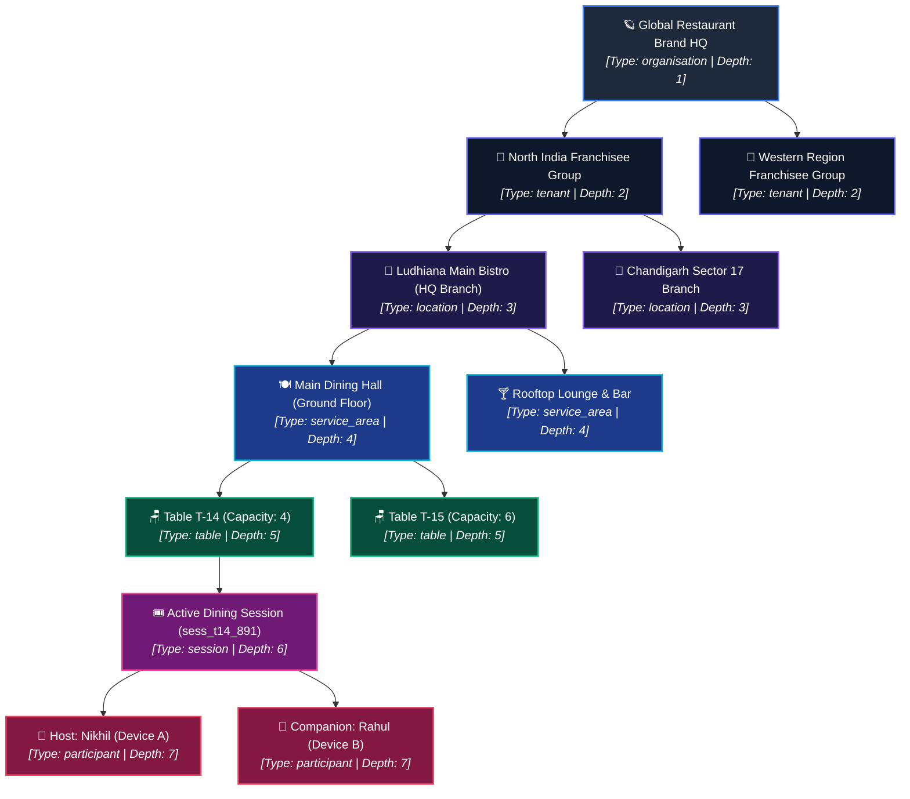
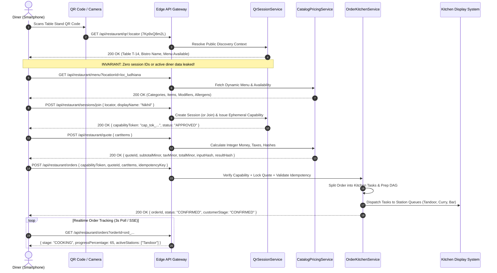
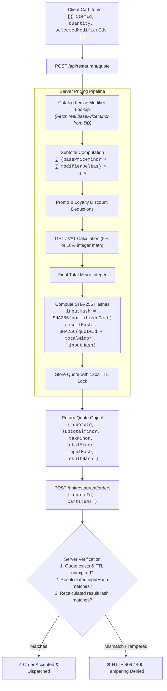
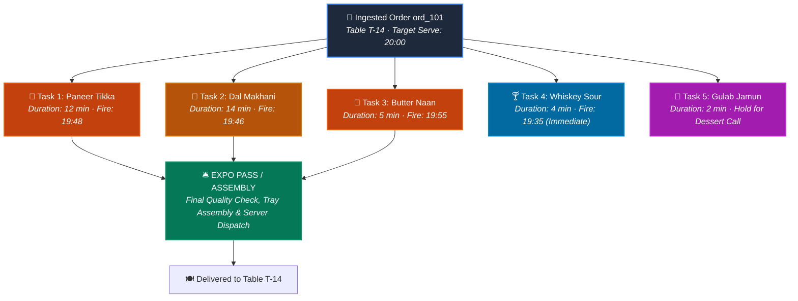
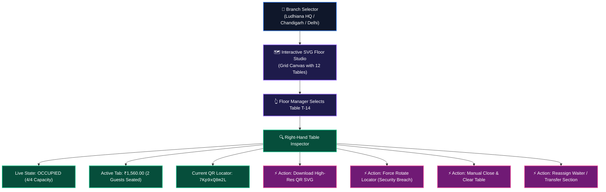
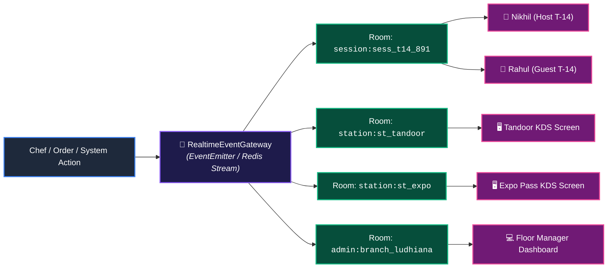
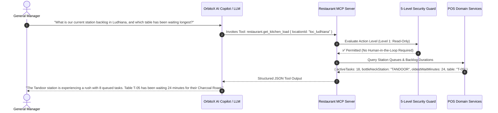

# 🍽️ OrbitoX RestaurantOS: Master Flows, Features, and Use Cases Manual

> **Document ID:** `docs/19_RESTAURANTOS_MASTER_FLOW_FEATURES_AND_USES.md`  
> **Classification:** Authoritative Technical Specification & Operations Guide  
> **Target Version:** OrbitoX Platform v2.2.0 · `@orbitox/pos` · `@orbitox-io/plugin-engine`  
> **Status:** Production Ready  

---

## 📑 Table of Contents

1. [Executive Summary & Core Philosophy](#1-executive-summary--core-philosophy)
2. [Universal O2O2B2B2C Multi-Tenancy Hierarchy](#2-universal-o2o2b2b2c-multi-tenancy-hierarchy)
3. [End-to-End Operational & Technical Flows](#3-end-to-end-operational--technical-flows)
   - [3.1 Guest Dining & QR Mobile Journey (Flow 1)](#31-guest-dining--qr-mobile-journey-flow-1)
   - [3.2 Multi-Guest Companion & Session Party Flow (Flow 2)](#32-multi-guest-companion--session-party-flow-flow-2)
   - [3.3 Deterministic Pricing Quote & Tamper-Proof Cryptography (Flow 3)](#33-deterministic-pricing-quote--tamper-proof-cryptography-flow-3)
   - [3.4 Double-Idempotent Order Ingestion & OCC Concurrency (Flow 4)](#34-double-idempotent-order-ingestion--occ-concurrency-flow-4)
   - [3.5 Kitchen Display System (KDS) & Preparation DAG Routing (Flow 5)](#35-kitchen-display-system-kds--preparation-dag-routing-flow-5)
   - [3.6 Floor Management, Table Matrix & Admin Studio (Flow 6)](#36-floor-management-table-matrix--admin-studio-flow-6)
   - [3.7 Zero-Trust QR Security & Anti-Tamper Flow (Flow 7)](#37-zero-trust-qr-security--anti-tamper-flow-flow-7)
   - [3.8 Realtime Event Gateway & Scoped WebSockets (Flow 8)](#38-realtime-event-gateway--scoped-websockets-flow-8)
   - [3.9 Autonomous AI Operations & Model Context Protocol (MCP) (Flow 9)](#39-autonomous-ai-operations--model-context-protocol-mcp-flow-9)
4. [Master Feature Catalog](#4-master-feature-catalog)
   - [4.1 Guest Mobile PWA Experience (`/dine/[locator]`)](#41-guest-mobile-pwa-experience-dinelocator)
   - [4.2 Kitchen Display System Touchscreen (`/kds`)](#42-kitchen-display-system-touchscreen-kds)
   - [4.3 Multi-Branch Admin & Floor Operations Console (`/admin/restaurant`)](#43-multi-branch-admin--floor-operations-console-adminrestaurant)
   - [4.4 Backend Domain Engine & Service Architecture (`@orbitox/pos`)](#44-backend-domain-engine--service-architecture-orbitoxpos)
   - [4.5 Orthogonal State Machines & Customer Visibility Projection](#45-orthogonal-state-machines--customer-visibility-projection)
   - [4.6 Minor-Unit Integer Financial Engine (`MoneyMinor`)](#46-minor-unit-integer-financial-engine-moneyminor)
5. [Real-World Uses & Deployment Architecture](#5-real-world-uses--deployment-architecture)
   - [5.1 Fine Dining & Contemporary Bistros](#51-fine-dining--contemporary-bistros)
   - [5.2 High-Velocity Multi-Brand Cloud Kitchens & Dark Kitchens](#52-high-velocity-multi-brand-cloud-kitchens--dark-kitchens)
   - [5.3 Enterprise Food Franchise & Multi-Tenant Retail Hubs](#53-enterprise-food-franchise--multi-tenant-retail-hubs)
   - [5.4 Food Courts & Shared Physical Dining Spaces](#54-food-courts--shared-physical-dining-spaces)
   - [5.5 Edge-Resilient & Hybrid Network Establishments](#55-edge-resilient--hybrid-network-establishments)
6. [Live Verification, Endpoints & Diagnostic Commands](#6-live-verification-endpoints--diagnostic-commands)

---

## 1. Executive Summary & Core Philosophy

**OrbitoX RestaurantOS** is an enterprise-grade, zero-trust culinary operating system engineered as a plug-and-play module within the **OrbitoX Platform Kernel**. Unlike conventional POS systems that treat restaurant management as flat database record keeping, RestaurantOS models culinary hospitality as a high-concurrency, distributed event-driven graph.

### Architectural Pillars

```
┌──────────────────────────────────────────────────────────────────────────────┐
│                         ORBITOX RESTAURANTOS CORE                            │
├─────────────────────┬──────────────────────┬─────────────────────────────────┤
│ 1. SCAN ≠ JOIN      │ 2. INTEGER CURRENCY  │ 3. 4-DIMENSIONAL STATE MACHINE  │
│ Strict isolation of │ All calculations in  │ Commercial, Fulfillment,        │
│ discovery context   │ minor units (paise/  │ Payment, and Kitchen states are │
│ from active session │ cents). Zero float.  │ decoupled with OCC versions.    │
├─────────────────────┼──────────────────────┼─────────────────────────────────┤
│ 4. PREPARATION DAG  │ 5. DOUBLE IDEMPOTENCY│ 6. ZERO-LEAK REALTIME GATEWAY   │
│ Multi-station route │ Durable request hash │ WebSockets strictly scoped by   │
│ & fire-time sync    │ + database outbox    │ session and station rooms.      │
└─────────────────────┴──────────────────────┴─────────────────────────────────┘
```

1. **`SCAN ≠ JOIN` Invariant (Zero-Trust QR Trust):** Scanning a physical table QR code resolves a public discovery context (table metadata, menu catalog). It **never leaks** private dining data, previous order history, or session tokens to unauthorized scanners. Joining a table party requires explicit seating approval and issues ephemeral, non-fungible `GuestCapability` tokens.
2. **Minor-Unit Financial Determinism (`MoneyMinor`):** Zero IEEE-754 floating-point numbers are used for accounting. All pricing, item modifiers, taxes, and service charges are calculated as integers (e.g., `₹350.00` is represented as `35000n`). Every pricing quote generates deterministic SHA-256 `inputHash` and `resultHash` signatures valid for a 120-second TTL.
3. **Orthogonal 4-Dimensional State Machines:** Orders do not transition linearly. Instead, four independent sub-state machines (`Commercial`, `Fulfillment`, `Payment`, `Kitchen`) govern lifecycle events simultaneously, consolidated into an ephemeral, optimistic `CustomerVisibility` projection.
4. **Parallel Preparation DAG (Directed Acyclic Graph):** Kitchen items automatically route to specialized cooking stations (Tandoor, Curry Line, Cold Prep, Bar, Dessert, Expo Pass). The engine calculates synchronized fire times so appetizers and entrees arrive at the table at optimal temperatures.
5. **Idempotency & Concurrency Hardening:** Dual-layer idempotency (`Idempotency-Key` HTTP header and database outbox pattern) guarantees that duplicate submissions across intermittent mobile connections will never result in duplicate orders or double deductions.
6. **Zero-Leakage Realtime Gateway:** Live SSE/WebSocket communication is scoped strictly to dining session rooms and kitchen station rooms. Table A never receives telemetry from Table B, and the Bar station never receives Tandoor queue updates.

---

## 2. Universal O2O2B2B2C Multi-Tenancy Hierarchy

RestaurantOS inherits the native multi-tenancy capabilities of `@orbitox/core` and the `ContextService`. It maps physical enterprise restaurant networks across an 8-level context tree:



### Context Scoping Rules

| Depth | Level | Scoped Responsibilities | Examples |
| :--- | :--- | :--- | :--- |
| **Depth 1** | `organisation` | Enterprise brand standards, global master catalog, license bounds, aggregate revenues | Brand HQ, Multi-brand parent company |
| **Depth 2** | `tenant` | Franchisee commercial contract, regional pricing overrides, localized tax regimes | Regional operator, Joint venture partner |
| **Depth 3** | `location` | Branch physical address, inventory depot, local kitchen stations, branch manager roles | Ludhiana Bistro, Delhi CP Branch |
| **Depth 4** | `service_area` | Floor sections, dedicated runners, service fee policies (e.g., +10% Rooftop surcharge) | Main Hall, Patio, VIP Suite, Rooftop |
| **Depth 5** | `table` | Physical seating asset, capacity, assigned table number, opaque QR locator (`7Kp9xQ8m2L`) | Table T-14, Booth 4, Bar Stool 08 |
| **Depth 6** | `session` | Temporal dining event, party ledger, table tab, active status machine, order collection | Party of 4 seated at 19:30 |
| **Depth 7** | `participant` | Diner device identity, individual orders, ephemeral capability token, individual payment split | Seated host, Joined guest companion |

---

## 3. End-to-End Operational & Technical Flows

### 3.1 Guest Dining & QR Mobile Journey (Flow 1)

The complete customer lifecycle from entering the restaurant to table-side mobile checkout:



#### Step-by-Step Breakdown:
1. **Physical Discovery:** The diner sits at Table T-14 and scans the QR code. The browser navigates to `/dine/7Kp9xQ8m2L`.
2. **Public Context Resolution:** The client queries `/api/restaurant/qr/7Kp9xQ8m2L`. The server validates that the table is active and returns table number, service area, and restaurant branding. Private session identifiers remain unrevealed.
3. **Catalog Browsing:** The guest browses categories (Starters, Mains, Breads, Beverages, Desserts), reviews allergen tags (`DAIRY`, `WHEAT`, `FISH`) and dietary badges (`VEG`, `NON_VEG`, `GLUTEN_FREE`).
4. **Seating & Party Join:** The guest enters their name ("Nikhil") and taps **Confirm Seating & Enter**. The server issues an ephemeral `GuestCapability` token cryptographically scoped to table T-14 and session `sess_t14_891`.
5. **Item Customization:** The guest configures item modifiers (e.g., Paneer Tikka with `Medium` spice level).
6. **Server Pricing Quote:** Before submission, the cart is transmitted to `/api/restaurant/quote`. The server locks in a 120-second quotation with minor-unit integer pricing and returns signed SHA-256 integrity hashes.
7. **Idempotent Order Submission:** The client submits the order with a client-generated UUID `idempotencyKey`. The server confirms the order, creates the internal ledger, and compiles preparation tasks.
8. **Live Preparation Tracker:** The guest UI renders a dynamic progress bar displaying milestones: `ORDERED` (15%) $\rightarrow$ `CONFIRMED` (35%) $\rightarrow$ `COOKING` (65%) $\rightarrow$ `PLATING` (85%) $\rightarrow$ `SERVED` (100%).

---

### 3.2 Multi-Guest Companion & Session Party Flow (Flow 2)

RestaurantOS supports collaborative dining at the same table without shared device handling:

```mermaid
graph TD
    classDef host fill:#064e3b,stroke:#10b981,stroke-width:2px,color:#fff;
    classDef guest fill:#1e3a8a,stroke:#06b6d4,stroke-width:2px,color:#fff;
    classDef server fill:#1e1b4b,stroke:#8b5cf6,stroke-width:2px,color:#fff;
    classDef tab fill:#701a75,stroke:#ec4899,stroke-width:2px,color:#fff;

    H["📱 Host: Nikhil<br><i>(First to scan & join T-14)</i>"]:::host
    G["📱 Companion: Rahul<br><i>(Arrives 10 mins later, scans T-14)</i>"]:::guest
    SRV["⚙️ QrSessionService<br><i>(Table T-14 Active Session)</i>"]:::server
    TAB["🧾 Unified Table Tab & Ledger<br><i>(Session ID: sess_t14_891)</i>"]:::tab

    H -->|POST /sessions/join| SRV
    SRV -->|Becomes Host & Issues Cap Token A| H

    G -->|POST /sessions/join| SRV
    SRV -->|Detects Active Session & Auto-Approves| G
    SRV -->|Issues Independent Cap Token B| G

    H -->|Submits Starters Order| TAB
    G -->|Submits Beverages Order| TAB

    TAB -->|Item 1: Paneer Tikka (Nikhil)| SRV
    TAB -->|Item 2: Mango Lassi (Rahul)| SRV

    SRV -->|Realtime Broadcast| H
    SRV -->|Realtime Broadcast| G
```

#### Companion Key Invariants:
- **Independent Capability Tokens:** Rahul and Nikhil each hold their own non-fungible cryptographic tokens (`tokenRahul !== tokenNikhil`). A compromised token on one device cannot forge requests on behalf of another diner.
- **Unified Table Tab:** Both guests see their personal items as well as the aggregate table bill.
- **Host Seating Governance:** The restaurant can configure the join policy:
  - `OPEN`: Any diner scanning the QR code joins the table party automatically.
  - `HOST_APPROVAL`: Incoming join requests trigger a confirmation prompt on the Host's smartphone.
  - `PIN_PROTECTED`: A 4-digit table PIN must be entered to join an active session.
- **Access Epoch Invalidation:** When the table pays and departs, the cashier marks the session closed. The server increments `accessEpoch = accessEpoch + 1`. This immediately renders all issued capability tokens dead, preventing former diners from tampering with subsequent seatings.

---

### 3.3 Deterministic Pricing Quote & Tamper-Proof Cryptography (Flow 3)

In client-driven web apps, attackers often attempt to manipulate pricing in JavaScript payloads (e.g., modifying `basePrice = 1` or bypassing taxes). RestaurantOS prevents this via a **Server-Validated Quotation Engine**:



#### Math Determinism Example:
- **Item 1:** Paneer Tikka Charcoal Grilled (`basePriceMinor = 35000n`)
  - Modifier: Extra Spicy (`priceDeltaMinor = 2000n`)
  - Item 1 Total: $35000 + 2000 = 37000\text{ minor units}$ ($₹370.00$)
- **Item 2:** Dal Makhani Slow-Simmered (`basePriceMinor = 38000n`)
  - Modifiers: None ($0\text{ minor units}$)
  - Item 2 Total: $38000\text{ minor units}$ ($₹380.00$)
- **Subtotal Minor:** $37000 + 38000 = 75000\text{ minor units}$ ($₹750.00$)
- **Tax Minor (5% GST):** $\lfloor (75000 \times 500) / 10000 \rfloor = 3750\text{ minor units}$ ($₹37.50$)
- **Final Total Minor:** $75000 + 3750 = 78750\text{ minor units}$ ($₹787.50$)

---

### 3.4 Double-Idempotent Order Ingestion & OCC Concurrency (Flow 4)

Mobile dining apps operate over cellular connections where retries, dropped packets, and rapid double-clicks on "Submit Order" are common. RestaurantOS employs a **Double Idempotency & Optimistic Concurrency Control (OCC)** architecture:

```mermaid
flowchart TD
    Client["Client Mobile PWA"] -->|POST /orders with Idempotency-Key: idemp_abc123| Gateway["API Gateway Guard"]

    Gateway --> CheckCache{"Has IdempotencyRecord<br>with key 'idemp_abc123'?"}

    CheckCache -->|Yes & Status = COMPLETED| ReturnReplay["🔄 Return Replay Cached Response<br>(HTTP 200 with original orderId)"]
    CheckCache -->|Yes & Status = IN_PROGRESS| Conflict["⚠️ Return HTTP 409 Concurrent Submission In Progress"]

    CheckCache -->|No| InsertLock["Insert IdempotencyRecord (status: 'IN_PROGRESS')"]

    InsertLock --> OCCCheck{"Fetch DiningSession & Check Version"}

    OCCCheck --> VersionVerify{"Expected session.version == current.version?"}

    VersionVerify -->|No (Conflict)| Rollback["Rollback IdempotencyRecord & Return OCC Conflict (HTTP 412)"]
    VersionVerify -->|Yes| ExecuteTx["Execute Atomic PostgreSQL Transaction:<br>1. Create Order & OrderItems<br>2. Compile PreparationTasks<br>3. session.version = session.version + 1<br>4. Update IdempotencyRecord (COMPLETED, responsePayload)"]

    ExecuteTx --> ReturnSuccess["✅ Return HTTP 200 Order Created"]
```

#### Resilience Features:
1. **Replay Cache Safety:** If Nikhil clicks "Submit Order", loses connectivity, and his browser automatically resends the request 5 seconds later, the server detects the identical key, retrieves the cached result, and returns the original order without creating a duplicate ticket in the kitchen.
2. **Optimistic Concurrency Control (OCC):** Every order and session row maintains an integer `version` field. When mutating an order, queries check `WHERE id = :id AND version = :expectedVersion`. If another waiter or guest modified the record concurrently, the transaction fails and requests a clean refresh.

---

### 3.5 Kitchen Display System (KDS) & Preparation DAG Routing (Flow 5)

Orders received by the server are not printed as single monolithic slips. Instead, they are disassembled into an **algorithmic preparation directed acyclic graph (DAG)** and dispatched across station queues:



#### Synchronized Fire-Time Algorithm:
Traditional kitchens often finish breads 10 minutes before the curries, resulting in cold naans. The RestaurantOS DAG calculates:
$$\text{Fire Time} = \text{Target Serve Time} - \text{Preparation Duration Minutes}$$
- **Dal Makhani (14 min):** Fired at 19:46.
- **Paneer Tikka (12 min):** Fired at 19:48.
- **Butter Naan (5 min):** Held in queue until 19:55, firing exactly in time to meet the hot curries at the Expo pass.
- **Beverages:** Flagged as `IMMEDIATE` and routed instantly to the Bar station.

#### Chef Bump Bar Flow:
1. Task appears on station touchscreen in `QUEUED` state (Orange border).
2. Cook taps the task or presses physical Bump Bar: transitions to `IN_PROGRESS` (Blue border). The guest's smartphone tracker shifts to **Cooking (65%)**.
3. Cook finishes plating and taps **Bump**: transitions to `READY` (Green border).
4. Expo screen sounds an acoustic chime indicating all items for Table T-14 are ready for runner pick-up.
5. Runner picks up tray and bumps Expo: order transitions to `SERVED`.

---

### 3.6 Floor Management, Table Matrix & Admin Studio (Flow 6)

The restaurant management console (`/admin/restaurant`) gives floor managers and supervisors real-time physical control:



#### Real-Time Telemetry & Floor KPIs:
- **Instant Utilization:** Live calculation of physical occupancy (e.g., $8/12\text{ Tables Occupied} = 67\%$).
- **Live Branch Revenue:** Aggregated in real time from completed and confirmed orders.
- **Locator Rotation:** A one-click administrative action to regenerate a table's physical QR locator if compromised, immediately invalidating old codes.

---

### 3.7 Zero-Trust QR Security & Anti-Tamper Flow (Flow 7)

Restaurant QR codes present significant physical security risks. Competitors or malicious actors can photograph table QR codes, leave the premises, and attempt to view who is dining or send fake orders to rack up bills.

```mermaid
flowchart TD
    Attacker["Remote Attacker<br><i>(Photographed Table T-14 QR earlier)</i>"] -->|GET /api/restaurant/qr/7Kp9xQ8m2L| GW["Security Gateway"]

    GW --> CheckDisc["Public Table Discovery Context"]
    CheckDisc -->|Returns Only Public Data| Attacker
    Note over CheckDisc,Attacker: Leaks ZERO session IDs, ZERO guest names, ZERO active orders!

    Attacker -->|Attempts to Spoof Order Without Token| OrderGate["POST /api/restaurant/orders"]
    OrderGate --> TokenVerify{"Inspect Ephemeral CapabilityToken"}

    TokenVerify -->|Missing Token| Denied1["❌ 401 Unauthorized: Valid GuestCapability Required"]
    TokenVerify -->|Expired or Mismatched Table Token| Denied2["❌ 403 Forbidden: Invalid Table / Session Context"]
    TokenVerify -->|Valid Capability Token| Allow["✅ Proceed to Order Processing"]
```

#### Security Mitigations Matrix:

| Threat Vector | Attack Scenario | RestaurantOS Protection Invariant |
| :--- | :--- | :--- |
| **QR Clone Snooping** | Remote attacker scans photo of QR code to see who is currently dining at the table. | **`SCAN ≠ JOIN`**: The QR discovery endpoint returns only static restaurant and table metadata. Active dining sessions, diner names, and active tabs are **never exposed**. |
| **Ghost Ordering** | Attacker sends automated POST requests to `/api/restaurant/orders` to order ₹50,000 worth of wine to an empty table. | **Capability Guard (`withApiGuard`)**: Every order requires an ephemeral, cryptographically signed `GuestCapability` token issued only upon approved seating. |
| **Price Tampering** | Attacker intercepts cart payload and alters ₹500 item to ₹1. | **Deterministic Pricing Hash**: Quote IDs are locked with SHA-256 hashes (`inputHash` and `resultHash`). The server recalculates prices from database records and rejects modified values. |
| **Zombie Session Re-use** | Departing diner keeps browser open and tries to view subsequent dining party's orders. | **`accessEpoch` Revocation**: Cashier checkout increments the table's `accessEpoch`, instantly blacklisting and expiring all previously issued capability tokens. |

---

### 3.8 Realtime Event Gateway & Scoped WebSockets (Flow 8)

The real-time notification engine (`RealtimeEventGateway`) partitions events strictly by context boundaries:



- **Event Isolation:** Events emitted with `session:sess_t14_891` are delivered exclusively to participants seated at Table T-14.
- **Station Scoping:** KDS task transitions (`task.bumped`) are dispatched only to the affected station and the central Expo screen.
- **Admin Aggregation:** Floor metrics and order counter updates route to the branch management channel without polluting diner feeds.

---

### 3.9 Autonomous AI Operations & Model Context Protocol (MCP) (Flow 9)

RestaurantOS exposes safe, tool-first AI capabilities via the **Model Context Protocol (MCP)** server (`restaurant-tools.ts`):



#### MCP 5-Level Tool Action Governance:

| Level | Action Type | Example Tools | Governance Protocol |
| :--- | :--- | :--- | :--- |
| **Level 1** | **Read-Only Analytics** | `restaurant.get_sales`, `restaurant.get_kitchen_load`, `restaurant.get_menu` | Autonomous execution; logged in audit trail. |
| **Level 2** | **Low-Impact Mutations** | `restaurant.toggle_item_availability`, `restaurant.bump_task` | Autonomous within role bounds. |
| **Level 3** | **Commercial Mutations** | `restaurant.apply_table_discount`, `restaurant.void_item` | Requires Supervisor PIN / Role verification. |
| **Level 4** | **Financial & Settlement** | `restaurant.refund_order`, `restaurant.split_bill` | Human-in-the-Loop (Manager Four-Eyes Approval). |
| **Level 5** | **Destructive / Structural** | `restaurant.purge_branch_data`, `restaurant.rotate_master_key` | Cryptographic platform signature required. |

---

## 4. Master Feature Catalog

### 4.1 Guest Mobile PWA Experience (`/dine/[locator]`)

The diner mobile web application provides a friction-free guest experience optimized for $390 \times 844\text{px}$ viewports:

```
┌────────────────────────────────────────────────────────┐
│  ORBITOX BISTRO                                        │
│  Table T-14 · Ludhiana Main HQ                         │
├────────────────────────────────────────────────────────┤
│  [Starters]  [Mains]  [Breads]  [Desserts]  [Drinks]   │
├────────────────────────────────────────────────────────┤
│  ┌──────────────────────────────────────────────────┐  │
│  │ 🟢 VEG                                           │  │
│  │ Paneer Tikka Charcoal Grilled         ₹350.00    │  │
│  │ Kashmiri chili marinade, hung curd.              │  │
│  │ Allergens: DAIRY                                 │  │
│  │ [ - 1 + ]  Modifier: Medium Spice                │  │
│  └──────────────────────────────────────────────────┘  │
│  ┌──────────────────────────────────────────────────┐  │
│  │ 🔴 NON-VEG                                       │  │
│  │ Amritsari Fish Tikka                  ₹480.00    │  │
│  │ Sole chunks, carom seeds, mustard oil.           │  │
│  │ Allergens: FISH                                  │  │
│  │ [ + Add to Order ]                               │  │
│  └──────────────────────────────────────────────────┘  │
├────────────────────────────────────────────────────────┤
│  LIVE ORDER PROGRESS (ord_8912)                        │
│  [======== COOKING (65%) ========>       ]             │
│  Station Active: Tandoor Clay Oven                     │
├────────────────────────────────────────────────────────┤
│  [ 🛒 View Table Cart (2 Items · ₹730.00) ]            │
└────────────────────────────────────────────────────────┘
```

#### Key Capabilities:
- **Instant Discovery Header:** Displays restaurant branding, service area, table number, and capacity upon landing.
- **Category Filter Tabs:** Smooth horizontal tab bar allowing rapid navigation between menu sections.
- **Dietary & Allergen Indicators:** Explicit badges (`VEG`, `NON_VEG`, `GLUTEN_FREE`) and allergen warnings (`DAIRY`, `WHEAT`, `NUTS`, `FISH`).
- **Interactive Modifier Modal:** Radio selection for mandatory groups (Spice Level: Mild, Medium, Extra Spicy) with real-time price delta reflection.
- **Live Seating Gate:** Guest enters name to receive an ephemeral capability token before ordering.
- **Visual Order Progression Bar:** High-contrast step progress indicator with estimated preparation countdown.
- **Multi-Guest Cart Drawer:** Shows individual item attributions ("Added by Nikhil", "Added by Rahul").

---

### 4.2 Kitchen Display System Touchscreen (`/kds`)

Designed for commercial kitchen environments ($1920 \times 1080\text{px}$ high-density displays, touch targets $\ge 52\text{px}$):

```
┌──────────────────────────────────────────────────────────────────────────────┐
│ 👨‍🍳 ORBITOX KITCHEN DISPLAY SYSTEM (KDS)                     [19:48:22]      │
│ Stations: [ Tandoor (3) ] [ Curry (4) ] [ Bar (1) ] [ Dessert (0) ] [ EXPO ] │
├──────────────────────────┬──────────────────────────┬────────────────────────┤
│ TICKET #101 · TABLE T-14 │ TICKET #102 · TABLE T-03 │ TICKET #103 · TABLE T-07│
│ [QUEUED] ⏱️ 12m Fire:19:48│ [IN_PROGRESS] ⏱️ 8m      │ [DELAYED] ⏱️ 18m 🔥 RUSH│
├──────────────────────────┼──────────────────────────┼────────────────────────┤
│ 1x Paneer Tikka          │ 2x Tandoori Murgh        │ 4x Butter Naan         │
│   • Spice: Medium        │   • Extra Char           │   • Extra Crispy       │
│                          │                          │                        │
│ 1x Amritsari Fish Tikka  │                          │                        │
│   • No Lemon             │                          │                        │
├──────────────────────────┼──────────────────────────┼────────────────────────┤
│ [ 🚀 START COOKING ]     │ [ ✅ BUMP TO READY ]     │ [ ⚠️ RE-ROUTE ]        │
└──────────────────────────┴──────────────────────────┴────────────────────────┘
```

#### Key Capabilities:
- **Station Filter Tabs:** Rapid switching between specialized cooking stations (`Tandoor`, `Curry Line`, `Bar`, `Dessert`, `Expo Pass`).
- **Status Lifecycle Cards:** Card borders and badges reflect state dynamically:
  - `QUEUED`: Orange warning border.
  - `IN_PROGRESS`: Bright blue active cooking state.
  - `READY`: Vivid emerald green ready for pickup.
  - `DELAYED`: Flashing crimson alert indicating ticket exceeded preparation SLA.
- **One-Touch Chef Bump Bar:** Large interactive buttons supporting physical keyboard bump bars, touch taps, or mouse clicks.
- **Modifier Differentiation:** Special instructions and customer modifier choices highlighted in high-contrast yellow typography.
- **Automatic Polling & WebSocket Updates:** Real-time refresh ensures tickets appear on screens without manual reloading.

---

### 4.3 Multi-Branch Admin & Floor Operations Console (`/admin/restaurant`)

The operational cockpit for general managers and multi-unit operators:

```
┌──────────────────────────────────────────────────────────────────────────────┐
│ 🪐 ORBITOX PLATFORM · MULTI-BRANCH ENTERPRISE CONTROL                        │
│ Restaurant Operations & Floor Studio                                         │
│ Branches: [ Ludhiana Main (HQ) ] [ Chandigarh Sec 17 ] [ Delhi Connaught Pl ]│
├────────────────────────────────────────┬─────────────────────────────────────┤
│ 🗺️ INTERACTIVE FLOOR MAP               │ 🪑 TABLE INSPECTOR: T-14            │
│ ┌────────────────────────────────────┐ │ Status: OCCUPIED (4/4 Capacity)     │
│ │ [T-01]  [T-02]  [T-03]  [T-04]     │ │ Current Tab: ₹1,560.00 (2 Guests)   │
│ │ Avail   Occup   Occup   Avail      │ │ Active Host: Nikhil                 │
│ │                                    │ │ Active Companion: Rahul             │
│ │ [T-05]  [T-06]  [T-07]  [T-08]     │ │ Opaque Locator: 7Kp9xQ8m2L          │
│ │ BillReq Avail   Occup   Avail      │ ├─────────────────────────────────────┤
│ │                                    │ │ [ 📥 Download QR Stand SVG ]        │
│ │         [T-14]                     │ │ [ 🔄 Rotate Security Locator ]      │
│ │         Selected (T-14)            │ │ [ 🧾 Close Session & Clear Table ]  │
│ └────────────────────────────────────┘ │ [ 🖨️ Print Final Tax Invoice ]      │
├────────────────────────────────────────┴─────────────────────────────────────┤
│ 📊 LIVE BRANCH TELEMETRY                                                     │
│ Active Tables: 8 / 12 (67%) · Daily Revenue: ₹84,200.00 · Avg Prep Time: 11m │
└──────────────────────────────────────────────────────────────────────────────┘
```

#### Key Capabilities:
- **Multi-Branch Switcher:** Switch between Ludhiana HQ, Chandigarh, and Delhi branches with one click.
- **Visual Floor Canvas:** Live representation of tables color-coded by real-time status:
  - `AVAILABLE`: Sleek translucent dark border.
  - `OCCUPIED`: Vibrant orange fill with live guest count.
  - `BILL_REQUESTED`: Pulsing amber alert prompting waiter action.
  - `DIRTY / SANITIZING`: Crimson state indicating table requires clearing.
- **Deep Table Inspector Panel:** Displays seated diners, current monetary balance, active orders, and security metadata.
- **Dynamic QR Code Asset Generator:** Generates production-ready SVG and PNG QR codes with branded center logos and table numbers.
- **Administrative Overrides:** Force close sessions, rotate locators, void items, and issue compensatory discounts.

---

### 4.4 Backend Domain Engine & Service Architecture (`@orbitox/pos`)

The modular engine services residing in `orbitox/plugins/pos/src/services/`:

```
┌─────────────────────────────────────────────────────────────────────────────┐
│                       @orbitox/pos DOMAIN SERVICES                          │
├──────────────────────────┬──────────────────────────┬───────────────────────┤
│ QrSessionService         │ CatalogPricingService    │ OrderKitchenService   │
│ • Table QR registration  │ • Item & modifier catalog│ • Order creation      │
│ • Discovery context      │ • Real-time availability │ • Task compilation    │
│ • Session management     │ • Deterministic pricing  │ • Station routing     │
│ • Ephemeral token issuing│ • Integer Money arithmetic│ • Chef bump bar      │
│ • Epoch revocation       │ • SHA-256 quote hashes   │ • Milestone projection│
├──────────────────────────┴──────────────────────────┴───────────────────────┤
│ RealtimeEventGateway                                                        │
│ • Session room isolation · Station queue routing · Admin event broadcasts   │
└─────────────────────────────────────────────────────────────────────────────┘
```

---

### 4.5 Orthogonal State Machines & Customer Visibility Projection

Rather than forcing an order into a single linear status, RestaurantOS tracks **four distinct operational dimensions**:

#### 1. Commercial State Machine
$$\text{DRAFT} \longrightarrow \text{SUBMITTED} \longrightarrow \text{CONFIRMED} \longrightarrow \text{COMPLETED} \quad (\text{or } \text{CANCELLED})$$

#### 2. Fulfillment State Machine
$$\text{UNFULFILLED} \longrightarrow \text{PREPARING} \longrightarrow \text{READY\_FOR\_PICKUP} \longrightarrow \text{DISPATCHED} \longrightarrow \text{DELIVERED}$$

#### 3. Payment State Machine
$$\text{UNPAID} \longrightarrow \text{AUTHORIZED} \longrightarrow \text{CAPTURED} \quad (\text{or } \text{REFUNDED} \mid \text{PARTIALLY\_REFUNDED})$$

#### 4. Kitchen State Machine (Per Task)
$$\text{QUEUED} \longrightarrow \text{IN\_PROGRESS} \longrightarrow \text{READY} \longrightarrow \text{BUMPED} \quad (\text{or } \text{VOIDED})$$

#### Derived Customer Visibility Projection:
To keep diners informed without overwhelming them with kitchen jargon, the system derives an intuitive client projection:

$$\text{CustomerStage} = f(\text{Commercial}, \text{Fulfillment}, \text{KitchenTasks})$$

| Commercial | Fulfillment | Kitchen Tasks Summary | Derived Customer Stage | Progress Bar |
| :--- | :--- | :--- | :--- | :--- |
| `DRAFT` | `UNFULFILLED` | None | `SEATED` | $10\%$ |
| `SUBMITTED` | `UNFULFILLED` | All `QUEUED` | `ORDERED` | $25\%$ |
| `CONFIRMED` | `UNFULFILLED` | All `QUEUED` | `CONFIRMED` | $40\%$ |
| `CONFIRMED` | `PREPARING` | Any task `IN_PROGRESS` | `COOKING` | $65\%$ |
| `CONFIRMED` | `READY_FOR_PICKUP` | All tasks `READY` | `PLATING` | $85\%$ |
| `COMPLETED` | `DELIVERED` | All tasks `BUMPED` | `SERVED` | $100\%$ |

---

### 4.6 Minor-Unit Integer Financial Engine (`MoneyMinor`)

Floating-point arithmetic in JavaScript can lead to rounding errors:
```javascript
// Floating-point inaccuracy:
0.1 + 0.2 = 0.30000000000000004
```
In RestaurantOS, all currency operations are governed by `MoneyMinor` (`bigint` arithmetic):

```typescript
export interface MoneyMinor {
  amount: bigint;    // e.g. 35000n for ₹350.00
  currency: string;  // 'INR', 'USD', 'EUR'
}

export class MoneyEngine {
  static add(a: MoneyMinor, b: MoneyMinor): MoneyMinor {
    if (a.currency !== b.currency) throw new CurrencyMismatchError();
    return { amount: a.amount + b.amount, currency: a.currency };
  }

  static calculateTax(subtotal: MoneyMinor, rateBasisPoints: bigint): MoneyMinor {
    // 5% GST = 500 basis points
    const tax = (subtotal.amount * rateBasisPoints) / 10000n;
    return { amount: tax, currency: subtotal.currency };
  }

  static format(m: MoneyMinor): string {
    const units = Number(m.amount) / 100;
    return new Intl.NumberFormat('en-IN', {
      style: 'currency',
      currency: m.currency,
    }).format(units);
  }
}
```

---

## 5. Real-World Uses & Deployment Architecture

### 5.1 Fine Dining & Contemporary Bistros
- **Use Case:** High-touch table service where guest privacy, split billing, and dish timing are paramount.
- **Workflow:**
  - Guests scan discreet acrylic QR stands on the table.
  - The sommelier receives beverage orders immediately at the Bar station while appetizers remain paced.
  - Courses are synchronized so hot entrees do not fire until appetizers are flagged as consumed by floor runners.
  - Guests view live shared bills and split payments between individual credit cards.

### 5.2 High-Velocity Multi-Brand Cloud Kitchens & Dark Kitchens
- **Use Case:** Single kitchen facility preparing food for 4 virtual brands (e.g., Burger Brand, Biryani Brand, Dessert Brand) fulfilling both dine-in pickup and delivery.
- **Workflow:**
  - Multi-tenant catalog partitioning routes orders from distinct digital storefronts into a unified KDS matrix.
  - The Expo screen groups orders by driver pickup container and packaging station.
  - Preparation DAG prioritizes high-duration items (e.g., 20-minute Dum Biryani) ahead of rapid flash-fry items.

### 5.3 Enterprise Food Franchise & Multi-Tenant Retail Hubs
- **Use Case:** Corporate headquarters overseeing 50+ franchised branches across multiple states or territories.
- **Workflow:**
  - Corporate Chef updates master recipe definitions, allergen disclosures, and base pricing in Brand HQ (Depth 1).
  - Regional franchisees (Depth 2) set local tax regimes and promotional calendars.
  - Branch managers (Depth 3) monitor real-time table turnover, average preparation durations, and station bottlenecks.
  - Integrated billing splits calculate corporate royalties and franchise ledger disbursements automatically.

### 5.4 Food Courts & Shared Physical Dining Spaces
- **Use Case:** Centralized food hall seating where patrons order from multiple distinct counters (Pizza, Mexican, Ramen, Gelato) from a single table.
- **Workflow:**
  - Table QR codes represent common seating shared across all counter merchants.
  - The guest adds Ramen from Merchant A and Gelato from Merchant B into a unified cart.
  - RestaurantOS executes split order compilation, routing the Ramen to Station A and the Gelato to Station B, while computing single-pass guest settlement.

### 5.5 Edge-Resilient & Hybrid Network Establishments
- **Use Case:** Locations with intermittent or unreliable internet connectivity (rooftops, outdoor resorts, cruise liners).
- **Workflow:**
  - In distributed mode (`npm run switch:cluster`), the local in-store server runs an edge replica of RestaurantOS.
  - Waiters and kitchen staff continue taking orders and bumping KDS tasks across local Wi-Fi during broadband outages.
  - When connection is restored, the `IdempotencyOutbox` synchronizes changes back to central cloud storage without conflict.

---

## 6. Live Verification, Endpoints & Diagnostic Commands

### 6.1 Live Web Interfaces & Ports

| Component | Target URL | Purpose |
| :--- | :--- | :--- |
| **Mobile Dine Experience** | [http://localhost:3005/dine/7Kp9xQ8m2L](http://localhost:3005/dine/7Kp9xQ8m2L) | Guest table mobile PWA (QR locator `7Kp9xQ8m2L`) |
| **Kitchen Display System (KDS)** | [http://localhost:3005/kds](http://localhost:3005/kds) | High-density kitchen touchscreen & bump bar |
| **Restaurant Admin Console** | [http://localhost:3005/admin/restaurant](http://localhost:3005/admin/restaurant) | Multi-branch management, live floor canvas, table inspector |
| **Developer API Catalog** | [http://localhost:3005/admin/developer-apis](http://localhost:3005/admin/developer-apis) | Live interactive OpenAPI catalog and endpoint explorer |

---

### 6.2 REST API Endpoint Inventory

```http
### 1. Resolve Table QR Locator (SCAN ≠ JOIN)
GET http://localhost:3005/api/restaurant/qr/7Kp9xQ8m2L

### 2. Fetch Public Dynamic Menu
GET http://localhost:3005/api/restaurant/menu?locationId=loc_ludhiana

### 3. Join Table Dining Party
POST http://localhost:3005/api/restaurant/sessions/join
Content-Type: application/json

{
  "locator": "7Kp9xQ8m2L",
  "displayName": "Nikhil"
}

### 4. Compute Deterministic Pricing Quote
POST http://localhost:3005/api/restaurant/quote
Content-Type: application/json

{
  "cartItems": [
    { "itemId": "item_paneer_tikka", "quantity": 1, "selectedModifierIds": ["m_medium"] },
    { "itemId": "item_dal_makhani", "quantity": 1, "selectedModifierIds": [] }
  ]
}

### 5. Submit Order (Double-Idempotent)
POST http://localhost:3005/api/restaurant/orders
Content-Type: application/json

{
  "capabilityToken": "{{guest_capability_token}}",
  "quoteId": "{{quote_id}}",
  "cartItems": [...],
  "idempotencyKey": "idemp_client_uuid_12345"
}

### 6. Fetch Kitchen Station Queue
GET http://localhost:3005/api/restaurant/kds?stationId=st_tandoor

### 7. Chef Bump Kitchen Task
POST http://localhost:3005/api/restaurant/kds
Content-Type: application/json

{
  "taskId": "task_tandoor_101",
  "newStatus": "IN_PROGRESS",
  "bumpedBy": "Chef Balwant"
}
```

---

### 6.3 Automated Verification Commands

#### 1. Live HTTP REST API Integration Test Suite
Executes all 9 live integration stages (QR discovery, pricing quotes, idempotent retries, KDS queues, chef bumping, companion seating, attack verification) against the active server:
```bash
node scripts/test-live-restaurant-apis.js
```

#### 2. Standalone Headless Kernel Test
Validates the portability of the headless engine without web dependencies:
```bash
cd external-restaurant-os && npm start
```

#### 3. Core Engine Unit Test Suite
Runs unit tests across the core security, context, and RBAC engines:
```bash
cd orbitox && pnpm --filter @orbitox/core test
```

---

## 7. Summary

OrbitoX RestaurantOS demonstrates that modern culinary software does not need to compromise on speed, security, or developer experience. By combining:
- **Zero-Trust QR Trust** (`SCAN ≠ JOIN`),
- **Integer Currency Determinism** (`MoneyMinor`),
- **Multi-Station Preparation DAGs**,
- **Orthogonal State Machines**, and
- **High-Density Realtime Workspaces**,

the platform provides an extensible foundation capable of powering single bistros, ghost kitchen networks, and multinational restaurant franchises alike.
