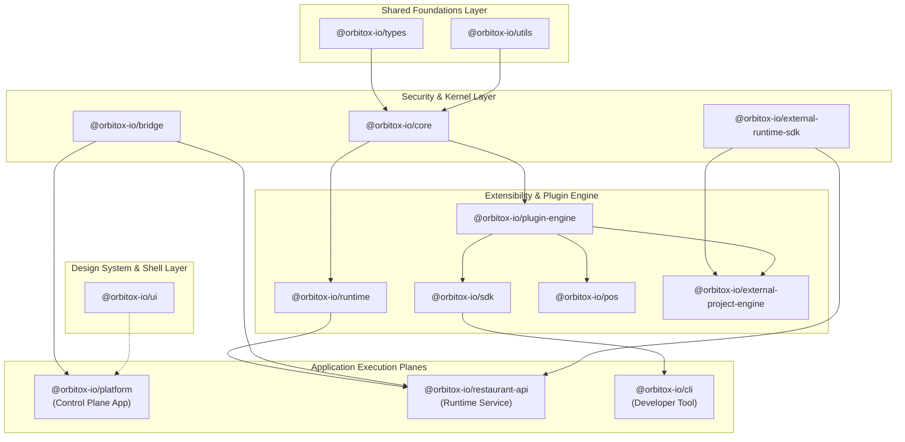
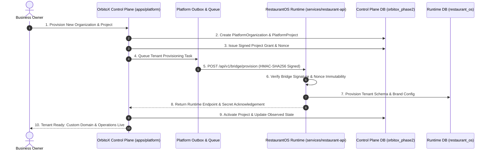
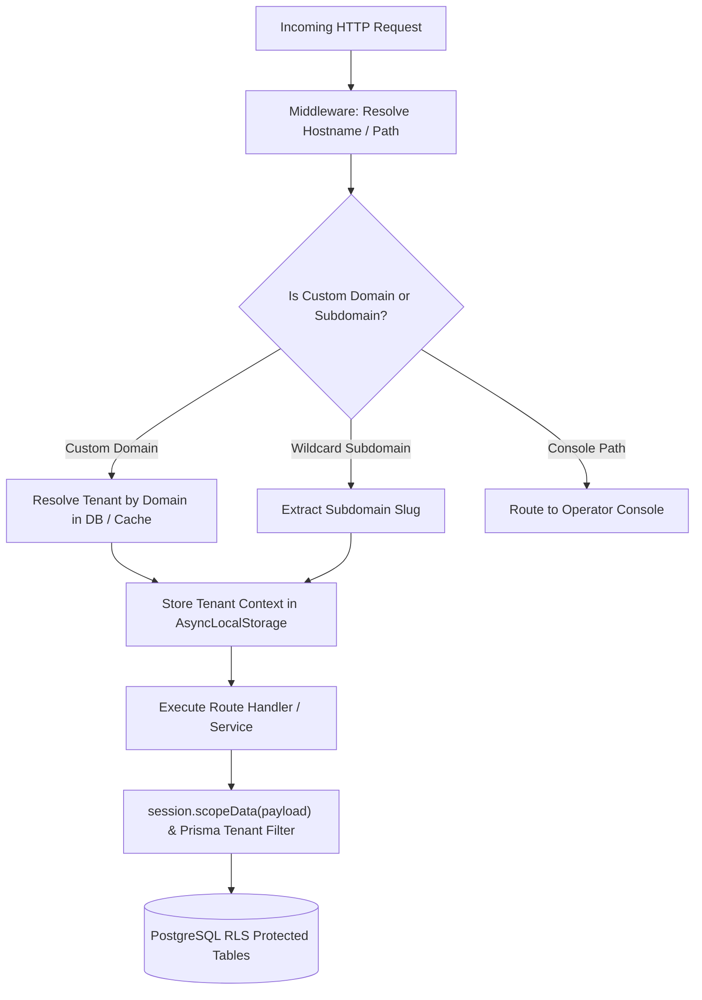

# 🪐 OrbitoX Platform OS — Master Project Completion Program
# Document 02: Architecture & Dependency Map

**Repository:** `Nikhil-ig/OrbitoX-Platform`  
**Delivered HEAD:** `188680c27ce51ebb8ca6e998e504c51a24c34fa0`  
**Date:** November 18, 2026  
**Auditor / Role:** Principal Software Architect & Staff Engineer

---

## 1. Monorepo Package Topology & Workspace Graph

OrbitoX follows a decoupled monorepo topology designed to enforce separation of concerns between shared design primitives, foundational types, security kernels, external developer SDKs, control plane orchestration, and standalone runtime services.



### 1.1 Boundary Decoupling Rules

1. **Zero UI Platform Dependencies:**  
   `packages/ui` must **never** import from `apps/platform` or any application-layer package. This is statically enforced by AST guard `TST-CMP-06` (`packages/ui/test/lint-invariants.test.ts`).
2. **Control Plane vs Runtime Plane Segregation:**  
   The Control Plane (`apps/platform`) and Runtime Plane (`services/restaurant-api`) run on completely independent databases, independent process trees, and isolated port bindings. Communication occurs exclusively over cryptographically signed HTTP bridge requests (`services/restaurant-api/src/bridge/control-bridge.ts`).
3. **Types & Utils Purity:**  
   `packages/types` and `packages/utils` contain zero external runtime framework dependencies (no React, Next.js, or NestJS). They compile to pure ES2022/CommonJS modules.

---

## 2. Control Plane vs Runtime Plane Architecture



### 2.1 The Central Brain: OrbitoX Control Plane (`apps/platform`)
The Control Plane serves as the centralized SaaS operating system brain. It is responsible for:
- **Organization & Multi-Tenancy Management:** Lifecycle states (`ACTIVE`, `SUSPENDED`, `CLOSED`), custom domains, and branding configurations.
- **Project Factory & Catalog:** Project templates, environment configurations (`development`, `staging`, `production`), and resource graphs.
- **Plan & Entitlement Engine:** Feature flag gating, seat limits, quota enforcement, and downgrade preflight analysis (`PlanFeature`, `PlanQuota`).
- **Cryptographic Grant Issuance:** Authoritative project grants containing cryptographically signed capability tokens issued to runtimes.
- **Commercial Billing Engine:** Authoritative subscription states, plan mapping, and payment webhook reconciliation with Razorpay.
- **Audit & Governance:** Append-only audit records (`PlatformAuditEvent`) under restricted PostgreSQL runtime roles.

### 2.2 The Runtime Plane: RestaurantOS & External Runtimes (`services/restaurant-api`)
The Runtime Plane executes the actual business logic for individual vertical SaaS products:
- **Zero Direct Access to Control Plane DB:** Runtimes operate on their own PostgreSQL database using Row-Level Security (RLS) (`tenant_id`).
- **Bridge Nonce Deduplication:** Every bridge call from the Control Plane carries an HMAC-SHA256 signature and a unique UUID nonce recorded in `BridgeNonce`. Replayed requests are rejected.
- **Authoritative Business State:** Order creation, table layouts, menu items, kitchen display system (KDS) tasks, and staff credentials reside in the runtime database.
- **Lifecycle Webhook Callbacks:** Runtimes emit state events back to the Control Plane for quota tracking and usage billing.

---

## 3. Cryptographic Security & Anti-Tamper Architecture

OrbitoX enforces cryptographic security at every layer:

### 3.1 Digital Signatures (`CryptoSigner`)
- External plugins and packages must be signed via Ed25519 or RSA digital signatures before installation.
- The `PluginLoaderService` in `packages/plugin-engine` verifies package signatures against trusted platform public keys before executing plugin code.

### 3.2 Immutability & Deep Freezing (`SandboxGuard`)
- Internal facades and runtime kernels are deeply frozen using `SandboxGuard.freezeAllFacades` to prevent monkey-patching or prototype pollution by untrusted plugin code.

### 3.3 Protected Health Information (PHI) Encryption
- In HospitalOS (`apps/platform/src/server/hospital/phi-crypto.ts`), sensitive medical data is encrypted at rest using AES-256-GCM with key identifiers (`ORBITOX_PHI_KEYS`) and HMAC-SHA256 blinded indexing for secure search without plaintext exposure.

---

## 4. Multi-Tenancy & Custom Domain Resolution

OrbitoX utilizes a zero-trust multi-tenancy model:



- **AsyncLocalStorage:** `getActiveTenant()` retrieves the tenant context across asynchronous boundaries without parameter drilling.
- **Row-Level Security (RLS):** In `services/restaurant-api`, all database queries run through PostgreSQL policies:
  ```sql
  CREATE POLICY tenant_isolation_policy ON restaurant_orders
    USING (tenant_id = current_setting('app.current_tenant_id', true));
  ```
- **Session Scoping:** Every write or query in `apps/platform` enforces `tenantId` validation in `platform-tenant-scope.ts`.
