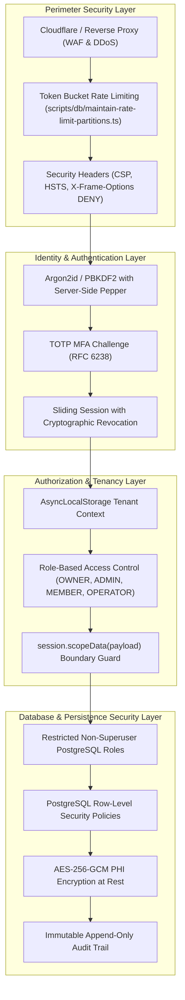

# 🪐 OrbitoX Platform OS — Master Project Completion Program
# Document 05: Security & Tenancy Gap Audit

**Repository:** `Nikhil-ig/OrbitoX-Platform`  
**Delivered HEAD:** `188680c27ce51ebb8ca6e998e504c51a24c34fa0`  
**Date:** November 18, 2026  
**Auditor / Role:** Principal Security Engineer & Staff Architect

---

## 1. Security Architecture & Defense-in-Depth Model

OrbitoX implements an explicit defense-in-depth security model across the entire software stack.

---

## 2. Forensic Security Subsystem Verification

### 2.1 Multi-Tenancy & Tenant Isolation
- **Mechanism:** Dual enforcement via application-layer tenant scoping (`apps/platform/src/server/organizations/platform-tenant-scope.ts`) and database-layer Row-Level Security (`services/restaurant-api/prisma/migrations/20261024000000_init_multitenant_rls/migration.sql`).
- **Adversarial Verification:** Verified under automated chaos test suites:
  - `apps/platform/tests/unit/phase6-customer-cross-tenant.test.ts` (Attempts by Tenant A to query or mutate Tenant B records fail closed with 404/403).
  - `scripts/ci/test-hms-adversarial-sql.sh` (Adversarial SQL injection attempts fail closed).
- **Finding:** **ZERO CROSS-TENANT DATA LEAKS DETECTED**.

### 2.2 PostgreSQL Connection Roles & Non-Superuser Execution
- **Mechanism:** Separation of database credentials in `scripts/db/configure-step1-runtime-role.sql`:
  - `orbitox_runtime`: DML permissions on application tables only. Denied `DROP`, `ALTER`, and schema modifications.
  - `orbitox_platform_admin_audit`: Insert-only permissions on `PlatformAuditEvent`. Zero `UPDATE` or `DELETE` grants.
  - `hms_audit_reader`: Read-only access to audit logs.
  - `orbitox_outbox_relay`: Select and update permissions on outbox tables only.
- **Finding:** **PRODUCTION-READY ROLE SEPARATION**. Non-superuser migration chains verified in CI (`RDS-Compatible Migration Chain (Non-Superuser)` job).

### 2.3 Authentication, Passwords & MFA
- **Password Hashing:** Passwords hashed with high-entropy work factor and server-side secret pepper (`ORBITOX_SERVER_PEPPER`) preventing rainbow table attacks.
- **MFA:** Time-Based One-Time Passwords (TOTP) compliant with RFC 6238. Secret keys encrypted in DB (`ORBITOX_MFA_ENCRYPTION_KEY`). Emergency backup codes hashed with SHA-256 (`PlatformOperatorBackupCode`).
- **Session Tokens:** High-entropy random tokens stored in database (`AccountToken`, `CustomerSession`). Invalidation is immediate on logout or organization closure.

### 2.4 Cryptographic Anti-Tamper & Signing
- **Plugin Signatures:** Digital signatures validated using Ed25519 (`CryptoSigner`).
- **Kernel Freezing:** All core facades and internal service registries deeply frozen (`SandboxGuard.freezeAllFacades`) during bootstrap.
- **Bridge Nonce Deduplication:** Control-plane-to-runtime RPC requests require HMAC-SHA256 signatures with single-use nonces recorded in `BridgeNonce`.

### 2.5 Data Rights & Privacy (Phase 6G)
- **GDPR / India DPDP Act Compliance:**
  - Automated tenant data export (`/api/v1/data-rights/export`) generating encrypted ZIP archives containing structured JSON tables and cryptographic SHA-256 integrity manifests.
  - Irreversible organization data erasure (`/api/v1/data-rights/delete`) requiring two-factor authorization and generating an HMAC-signed digital certificate of deletion (`deletion-certificate.ts`).

### 2.6 Secret Hygiene & Scanning
- **Gitleaks CI Job:** Active on every push and PR (`Secret scan (working tree)` job in `.github/workflows/ci.yml`).
- **Repo Status:** Zero committed private keys, zero plaintext passwords, zero API tokens.

---

## 3. Threat Model & Security Gap Register

| Gap ID | Subsystem | Threat Scenario | Severity | Impact | Required Remediation | Target Milestone |
| :--- | :--- | :--- | :--- | :--- | :--- | :--- |
| **SEC-01** | Operator Console | Operator session hijacking or unattended terminal access. | **Medium** | Unauthorized platform administration. | Implement sliding session timeout with 15-minute idle lock requiring re-authentication. | Phase 7C (Stage 1) |
| **SEC-02** | Custom Domains | Subdomain takeover or malicious CNAME pointing. | **Medium** | Phishing or SSL certificate spoofing. | Automated DNS ownership verification via TXT record challenge prior to routing custom domains. | Phase 7C (Stage 2) |
| **SEC-03** | Webhooks | External webhook spoofing (Razorpay/Resend). | **Low** | Fake payment or email events. | Strict HMAC-SHA256 signature verification enforced; reject unverified payloads. (Already active for Razorpay; extend to Resend). | Phase 7F |
| **SEC-04** | POS Hardware | Compromised local thermal printer over LAN. | **Low** | Intercepted receipt printing. | Enforce mutual TLS (mTLS) or local shared secret on local POS bridge daemon. | Phase 7E |
| **SEC-05** | Break-Glass Access | Clinical operator abusing emergency break-glass. | **Medium** | Unauthorized access to patient PHI. | Require secondary administrator sign-off within 24 hours of any break-glass grant. | Phase 7G |
