# 🪐 OrbitoX Platform OS — Master Project Completion Program
# Document 06: Test & Quality Gap Audit

**Repository:** `Nikhil-ig/OrbitoX-Platform`  
**Delivered HEAD:** `188680c27ce51ebb8ca6e998e504c51a24c34fa0`  
**Date:** November 18, 2026  
**Auditor / Role:** Principal QA Lead & Staff Test Engineer

---

## 1. Test Pyramid & Verification Inventory

OrbitoX maintains an extensive automated test pyramid combining fast in-memory unit tests, headless browser accessibility audits, adversarial database penetration suites, and full Linux container crash-resilience harnesses.

```mermaid
graph TD
    subgraph E2EAndVisual ["Level 4: E2E, Browser & Visual (Top)"]
        A11Y["Storybook WCAG 2.2 AA Audit (372 checks, 0 violations)"]
        VISUAL["Visual Regression with Pixelmatch (372 screenshots)"]
        CDP["Chrome DevTools Protocol Touch & Gesture Tests"]
    end

    subgraph IntegrationAndChaos ["Level 3: Integration, DB & Chaos Harnesses"]
        STEP3["Step 3 Resilience: PostgreSQL kill -9 & WAL Durability"]
        STEP4["Step 4 Concurrency: Multi-Process Rate Limiting & Atomic Balances"]
        STEP5["Step 5 Durability: JSON Migration & Importer Recovery"]
        ADV_SQL["HMS Adversarial SQL Injection & Cross-Tenant Penetration"]
        REST_RLS["RestaurantOS HTTP Multi-Tenant & RLS Suite"]
    end

    subgraph UnitAndContracts ["Level 2: Unit & Invariant Tests"]
        UI_UNIT["@orbitox-io/ui Unit Tests (86 tests)"]
        PLAT_UNIT["@orbitox-io/platform Unit Suites (48 suites)"]
        SDK_UNIT["@orbitox-io/sdk & plugin-engine Unit Suites"]
        AST_GUARD["AST Static Style & Import Boundary Guards"]
    end

    subgraph PackagingAndSecurity ["Level 1: Packaging, Size & Security (Base)"]
        GITLEAKS["Gitleaks Secret Scanner (0 leaks)"]
        SIZE["Bundle Size Budget (size-limit: 6 bundles)"]
        IMMUTABLE["Migration Immutability Check"]
        TARBALL["Package Tarball & External Install Smoke"]
    end

    E2EAndVisual --> IntegrationAndChaos
    IntegrationAndChaos --> UnitAndContracts
    UnitAndContracts --> PackagingAndSecurity
```

---

## 2. Exhaustive Verification Results Summary

### 2.1 Design System & Shell Primitives (`packages/ui`)
- **Unit Tests:** 86/86 passing (`pnpm --filter @orbitox-io/ui test`).
- **Bundle Size Budget (`size-limit`):** All 6 bundles strictly within limits:
  - `dist/index.js` (Core components)
  - `dist/shells.js` (Responsive persona shells)
  - `dist/tokens.css` (Semantic design tokens)
  - `dist/styles.css` (Tailwind compiled bundle)
  - `dist/utils.js` (Formatters and class helpers)
  - `dist/bottom-sheet.js` (Gesture bottom sheets)
- **WCAG 2.2 AA Accessibility Audit:** 372/372 checks passing with **0 Axe violations**. Strict enforcement of normal text contrast ($\ge 4.5:1$) and large text/UI components contrast ($\ge 3:1$).
- **Visual Regression Audit:** 372 screenshots verified with 0 diffs against approved Linux baselines under calibrated `MAX_DIFF_RATIO = 0.05`.
- **Browser Interaction Suites:**
  - `persona-shells.test.tsx`: 16 Chrome DevTools Protocol responsive viewport tests.
  - `bottom-sheet.test.ts`: 10 touch gesture drag-to-dismiss and threshold tests.

### 2.2 Platform Control Plane (`apps/platform`)
- **Unit & Security Suites:** 48 test files covering:
  - Appearance API & Database Outage Resiliency (`appearance-api.test.ts`, `appearance-database-fallback.test.ts`).
  - Account Auth, TOTP MFA & Backup Codes (`phase6-account-auth.test.ts`, `phase6-account-security.test.ts`).
  - Customer Org Onboarding & Slug Validation (`customer-account-onboarding.test.ts`, `customer-slug-check.test.ts`).
  - Razorpay Billing & Webhooks (`phase6-billing-checkout-db.test.ts`, `phase6-billing-webhook-db.test.ts`).
  - Phase 6G Data Rights & Certificates (`data-rights-foundations.test.ts`, `verify-deletion-certificate.ts`).
  - HMS Encryption & PHI Access (`hms-auth-security.test.ts`, `hms-cross-tenant.test.ts`).
- **Integration & Chaos Harnesses:**
  - `test-platform-step1-db.ts`: Verifies non-superuser PostgreSQL role permissions.
  - `test-platform-step3-resilience.ts`: Executes hard `kill -9` on PostgreSQL 16 container mid-transaction; verifies WAL durability and atomic rollback.
  - `test-platform-step4-concurrency.ts`: 50 concurrent worker threads verifying atomic balances and token bucket rate limits.
  - `test-platform-step5-import.ts`: JSON migration import recovery under worker crash.

### 2.3 RestaurantOS Runtime (`services/restaurant-api`)
- **Multi-Tenant RLS Suite:** `test/branch-isolation.test.ts`, `scripts/test-safe-tenancy-and-rls.ts`.
- **End-to-End HTTP Suite:** `scripts/test-e2e-http-multitenancy.ts`.
- **Preview & Test Orders Security:** `test/preview-test-orders-security.test.ts`.

---

## 3. Quality & Test Coverage Gap Register

| Gap ID | Subsystem | Gap Description | Severity | Impact | Required Remediation | Target Milestone |
| :--- | :--- | :--- | :--- | :--- | :--- | :--- |
| **TST-01** | Operator Console | Lack of multi-page Playwright browser E2E test covering full Operator Console navigation. | **Medium** | Regressions in route navigation could go undetected in browser UI. | Implement end-to-end Playwright console navigation test (`tests/e2e/console-e2e.spec.ts`). | Phase 7C (Stage 2) |
| **TST-02** | Customer Onboarding | Customer registration to live restaurant preview lacks automated browser E2E test. | **Medium** | Onboarding flow breakage across multi-step wizard. | Implement multi-step onboarding Playwright flow test (`tests/e2e/onboarding-e2e.spec.ts`). | Phase 7D |
| **TST-03** | Billing Webhooks | Razorpay webhook test suites run against mock payloads, lacking network jitter injection. | **Low** | Webhook listener failure during network partitions. | Add chaos test simulating delayed and out-of-order Razorpay webhook delivery. | Phase 7F |
| **TST-04** | KDS Real-Time | Kitchen display system task queue uses polling rather than WebSocket stress testing. | **Low** | Latency or state desynchronization under high kitchen order volume. | Implement 100-concurrent-order KDS benchmark script. | Phase 7E |
| **TST-05** | Hardware POS | POS thermal printer integration lacks mock hardware socket harness. | **Low** | Inability to test receipt printing in CI. | Create virtual ESC/POS TCP printer socket emulator for automated test runs. | Phase 7E |
