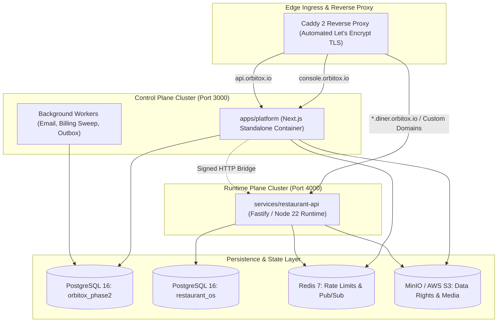

# 🪐 OrbitoX Platform OS — Master Project Completion Program
# Document 07: Deployment & Operations Gap Audit

**Repository:** `Nikhil-ig/OrbitoX-Platform`  
**Delivered HEAD:** `188680c27ce51ebb8ca6e998e504c51a24c34fa0`  
**Date:** November 18, 2026  
**Auditor / Role:** Principal DevOps & Site Reliability Engineer

---

## 1. Deployment Topology & Infrastructure Architecture

OrbitoX supports two primary operational deployment topologies:
1. **Single-Node VPS / Standalone Appliance:** Optimized for small-to-medium operators running Control Plane, PostgreSQL, Redis, and RestaurantOS on a single secured virtual server (`infra/docker/docker-compose.standalone.yml`).
2. **Multi-Server Distributed Cluster:** Enterprise topology with separated Control Plane containers, dedicated PostgreSQL database instances, and distributed edge runtime clusters (`infra/docker/docker-compose.cluster.yml`).

---

## 2. Forensic Deployment Assets Inventory

### 2.1 Container Images (`Dockerfile` Verification)
- **Control Plane Image (`apps/platform/Dockerfile`):**
  - Multi-stage production build using Node 22 Alpine.
  - Generates Next.js standalone output (`output: "standalone"`).
  - Unprivileged user `nextjs:nodejs` (UID 1001).
  - Verified in CI `Docker image builds` job.
- **RestaurantOS Runtime Image (`services/restaurant-api/Dockerfile`):**
  - Node 22 Alpine production build.
  - Prisma client generation and compiled TypeScript output.
  - Verified in CI `Docker image builds` job.

### 2.2 Configuration & Secret Generation Tools
- **Automated Secret Generator:** `scripts/secrets/generate-secrets.sh` and `generate-secrets.ts`:
  - Generates cryptographically secure 256-bit AES keys for `ORBITOX_MFA_ENCRYPTION_KEY`, `ORBITOX_ACCOUNT_TOKEN_ENCRYPTION_KEY`, and `ORBITOX_PHI_KEYS`.
  - Generates 64-character hex strings for `ORBITOX_SERVER_PEPPER` and `ORBITOX_CONTROL_SECRET`.
  - Output is formatted for `.env.production` with strict file permissions (`chmod 600`).
- **Production Preflight Validator:** `scripts/ci/check-production-env.mjs`:
  - Enforces that no dummy, default, or leaked keys exist before application startup.
  - Fails closed if production variables fail entropy requirements.

### 2.3 Health Check & Observability Endpoints
- **Control Plane:** `GET /api/health`: Returns HTTP 200 with database readiness, active schema version, and timestamp.
- **RestaurantOS:** `GET /health`: Returns HTTP 200 with tenant RLS connection health.

---

## 3. Operational & SRE Gap Register

| Gap ID | Subsystem | Operational Scenario | Severity | Impact | Required Remediation | Target Milestone |
| :--- | :--- | :--- | :--- | :--- | :--- | :--- |
| **OPS-01** | Database | PostgreSQL database crash or disk corruption. | **High** | Data loss or extended downtime. | Establish automated continuous WAL archiving (`pg_dump` + S3 daily snapshots) with automated restore verification test. | Phase 7H |
| **OPS-02** | Background Workers | Unsupervised background email or billing sweep thread crashes in container. | **Medium** | Delayed emails or missed subscription grace sweeps. | Migrate long-running sweep loops to supervised cron worker process or Kubernetes CronJob. | Phase 7C (Stage 1) |
| **OPS-03** | Metrics & Logging | Production incident troubleshooting across multi-container fleet. | **Medium** | Slow mean time to recovery (MTTR). | Integrate OpenTelemetry (OTel) structured JSON logger and trace headers (`x-orbitox-trace-id`). | Phase 7C (Stage 2) |
| **OPS-04** | Migration Rollback | Failed migration during zero-downtime rolling update. | **Medium** | Application failure against incompatible schema. | Document backward-compatible two-phase migration policy (expand/contract pattern). | Phase 7H |
| **OPS-05** | Rate Limit Purge | PostgreSQL `PlatformRateLimitBucket` table growing unbounded over time. | **Low** | Disk bloat on long-running instances. | Verify cron execution of `scripts/db/maintain-rate-limit-partitions.ts` partition drop scheduler. | Phase 7C (Stage 1) |
