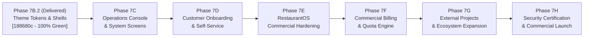

# 🪐 OrbitoX Platform OS — Master Project Completion Program
# Document 08: Master Completion Roadmap

**Repository:** `Nikhil-ig/OrbitoX-Platform`  
**Delivered HEAD:** `188680c27ce51ebb8ca6e998e504c51a24c34fa0`  
**Date:** November 18, 2026  
**Auditor / Role:** Principal Software Architect & Release Engineer

---

## 1. Master Strategic Roadmap Overview

OrbitoX transitions from its verified Phase 7B.2 architectural baseline into a commercial, multi-product SaaS operating system through six controlled execution phases.

---

## 2. Phase-by-Phase Execution Breakdown

### Phase 7C — Operations Console & System Screens
* **Focus:** Transforming the platform Control Center into an authoritative, fully wired operational command center.
* **Stage 0 (Design & Architecture):**
  - Master design specification in `docs/ui-reset/phase-7c/`.
  - Information architecture, screen and route matrix, component hierarchy, and data contracts.
  - Review and approval gate before implementation.
* **Stage 1 (Foundations):**
  - Consolidate legacy `/admin/*` and `/platform/*` routes under unified `/console/*` persona shell path.
  - Establish reusable operational data tables, filter bars, action inspectors, and slide-over sheets.
* **Stage 2 (Operational Screens):**
  - Connect real backend services for System Overview, Tenant Management, Project Factory, Package/Plugin Management, API Security Keys, Billing & Invoices, Audit Trail, and Data Rights.
* **Exit Criteria:** Zero mocked data in Console; full Playwright E2E navigation test green; 100% CI pass.

---

### Phase 7D — Customer Onboarding & Self-Service Experience
* **Focus:** Providing a frictionless self-service journey for business owners to sign up, create an organization, configure branding, select a plan, and preview their live vertical SaaS product.
* **Key Deliverables:**
  - Fast onboarding wizard (`/onboarding`) with organization registration, slug availability checker, and branch setup.
  - Interactive template gallery showcasing vertical SaaS starter layouts (e.g. Diner Fresh, Diner Noir).
  - Customer dashboard (`/dashboard`) with quick actions, billing status, and domain configuration.
* **Exit Criteria:** Complete automated signup-to-live-preview journey tested under Playwright browser tests.

---

### Phase 7E — RestaurantOS Commercial Hardening
* **Focus:** Hardening RestaurantOS for real commercial food & beverage operations.
* **Key Deliverables:**
  - Real-time guest QR ordering with live order status tracking.
  - Kitchen Display System (KDS) station routing, task completion, and rush-hour audio cues.
  - Operations Studio floor plan and table editor.
  - GSTIN tax compliance, discount rules, and printable tax invoice generator.
  - POS thermal printer local network bridge client specification.
* **Exit Criteria:** End-to-end multi-diner ordering and kitchen fulfillment passing real transaction benchmarks.

---

### Phase 7F — Commercial Engine & Billing Integration
* **Focus:** Complete monetization, subscription lifecycle, and revenue reconciliation.
* **Key Deliverables:**
  - Live Razorpay payment gateway integration with verified webhook signature processing.
  - Preflight downgrade validation enforcing quota compliance before plan changes.
  - Automated billing grace period sweep with multi-step dunning emails.
  - Invoicing history, credit adjustments, and tax breakdown reports.
* **Exit Criteria:** Automated test subscription lifecycle (trial $\to$ active $\to$ past_due $\to$ suspended $\to$ resumed) verified with simulated bank webhooks.

---

### Phase 7G — External Project Engine & Ecosystem Expansion
* **Focus:** Expanding beyond RestaurantOS to support external developers and additional SaaS verticals.
* **Key Deliverables:**
  - Finalize `@orbitox-io/sdk` and publish comprehensive developer documentation.
  - Pilot implementation of HospitalOS clinical appointment and patient management flows.
  - E-commerce starter project manifest and template definition.
  - External runtime bridge client with bidirectional heartbeat telemetry.
* **Exit Criteria:** Third-party developer can scaffold, sign, and provision a new project using the OrbitoX CLI without accessing platform internals.

---

### Phase 7H — Security Certification, Penetration Testing & Launch
* **Focus:** Final operational readiness, disaster recovery testing, and commercial release authorization.
* **Key Deliverables:**
  - Third-party penetration test and automated OWASP ZAP security audit.
  - Full disaster recovery simulation: restore database from S3 snapshot on clean server.
  - Zero-downtime rolling update dry run.
  - Official commercial launch tag: `v1.0.0-commercial-ready`.
* **Exit Criteria:** 100% green release checklist verified by platform owner.
