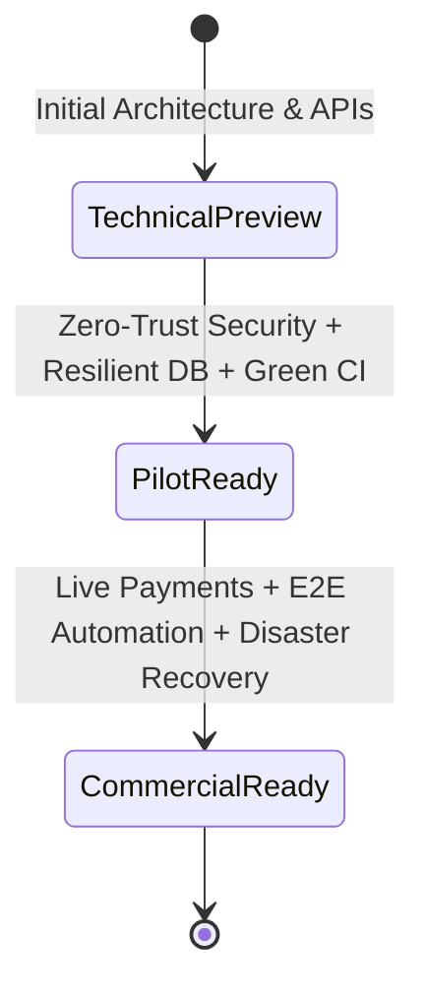

# 🪐 OrbitoX Platform OS — Master Project Completion Program
# Document 09: Release Acceptance Matrix

**Repository:** `Nikhil-ig/OrbitoX-Platform`  
**Delivered HEAD:** `188680c27ce51ebb8ca6e998e504c51a24c34fa0`  
**Date:** November 18, 2026  
**Auditor / Role:** Principal Software Architect & QA Lead

---

## 1. Release Acceptance Criteria

A capability or phase is only accepted when supported by verifiable repository evidence, passing test suites, and green CI status.

### 1.1 Master Release Readiness Checklist

| Release Domain | Detailed Acceptance Requirement | Current Status | Governing Evidence |
| :--- | :--- | :--- | :--- |
| **Control Plane** | Operator can log in securely via TOTP MFA and manage all organizations, projects, plugins, and security keys. | **VERIFIED** | `apps/platform/src/server/auth/operator-auth.ts`, `apps/platform/src/server/organizations/organization-service.ts` |
| **Multi-Tenancy** | Zero cross-tenant data leakage; PostgreSQL RLS and `session.scopeData` enforced on every persistent query. | **VERIFIED** | `apps/platform/tests/unit/phase6-customer-cross-tenant.test.ts`, `scripts/ci/test-hms-adversarial-sql.sh` |
| **Theme & Shells** | Phase 7B.2 responsive shells, 8 accent presets, WCAG 2.2 AA contrast compliance ($\ge 4.5:1 / \ge 3:1$), 0 Axe violations. | **VERIFIED** | `packages/ui/test/storybook-a11y-visual.mjs` (372/372 checks passed, 0 violations in CI #447) |
| **Database Resilience** | Database crash mid-transaction rolls back atomically; server-side appearance falls back gracefully to `light`/24. | **VERIFIED** | `apps/platform/tests/chaos/test-platform-db-outage.ts`, CI Step 3 kill -9 WAL durability harness |
| **Data Rights** | Automated tenant ZIP export with SHA-256 manifest; cryptographic deletion certificate on organization erasure. | **VERIFIED** | `apps/platform/src/server/data-rights`, CI Phase 6G integration job |
| **Secret Hygiene** | Gitleaks scanner confirms zero committed private keys, passwords, or high-entropy tokens. | **VERIFIED** | CI `Secret scan (working tree)` job passed |
| **CI / CD Pipeline** | All 14 matrix jobs in GitHub Actions complete with conclusion: `success`. | **VERIFIED** | CI Run #447 (ID: `44272083754`), Run #448 (ID: `44273852133`) |
| **Container Images** | Control Plane and RestaurantOS runtime Docker images build cleanly from clean Alpine base. | **VERIFIED** | CI `Docker image builds` job passed |
| **Unmodified Root** | `apps/platform/src/app/page.tsx` has zero line changes across entire branch history from baseline `f65698e`. | **VERIFIED** | `git diff --stat f65698e...HEAD -- apps/platform/src/app/page.tsx` returns empty |
| **UI Decoupling** | Zero imports from `@orbitox-io/platform` inside `@orbitox-io/ui`. | **VERIFIED** | AST static style guard `TST-CMP-06` passing |
| **Linear Lineage** | Feature branch preserves unbroken linear history (17 commits ahead, 0 behind baseline `f65698e`). | **VERIFIED** | `git rev-list --left-right --count f65698e...HEAD` returns `0 17` |

---

## 2. Pilot-Ready vs Commercial-Ready Gates

### 2.1 Criteria for Pilot-Ready (Current Milestone)
- Fully functional multi-tenant Control Plane and RestaurantOS runtime.
- Automated security controls: RLS, non-superuser database roles, TOTP MFA, signed bridge RPC.
- 100% green CI across all unit, integration, accessibility, and container build suites.
- Controlled operational deployment on staging or private pilot servers.

### 2.2 Criteria for Commercial-Ready (Phase 7H Gate)
- Live Razorpay merchant credentials active with verified webhook reconciliation.
- Multi-browser Playwright E2E automation covering all primary customer and operator journeys.
- Full disaster recovery drill: restoring production database from backup under 15 minutes.
- Formal security and vulnerability assessment sign-off.
- Zero known critical or high-severity vulnerabilities.
