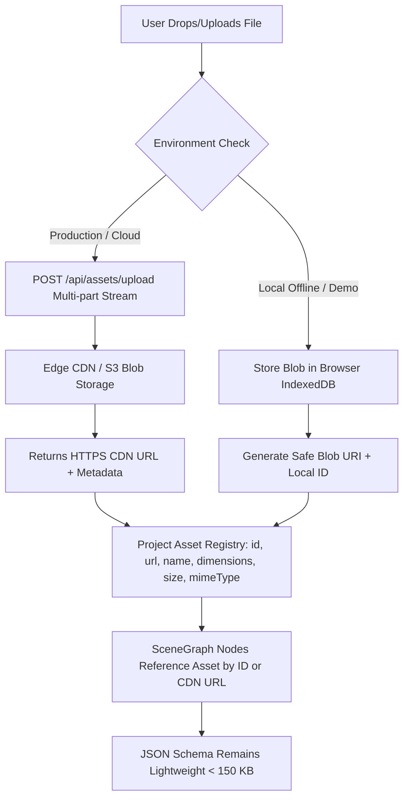

# 🪐 OrbitoX Studio — P20 Asset Subsystem & Storage Audit
**Document ID:** `docs/P20_ASSET_SYSTEM_AUDIT.md`  
**Phase:** P20 — Phase 0: Forensic Audit & Rebuild Planning  
**Date:** October 3, 2026  
**Auditor:** Principal Media & Storage Systems Architect  
**Status:** **AUDIT COMPLETE (AWAITING USER APPROVAL)**

---

## 1. Executive Summary: The Base64 Quota Failure

The current asset pipeline implemented in `FileUploadService.ts` converts uploaded files directly into Base64 Data URLs via `FileReader.readAsDataURL()` and embeds them inside the project's JSON schema:

```typescript
// FileUploadService.ts line 48 & line 60
const dataUrl = e.target?.result as string;
const asset: ProjectAsset = {
  id: assetId,
  url: dataUrl, // BASE64 STRING EMBEDDED DIRECTLY!
  ...
};
```

When saved to `localStorage` via `TemplateEditorPersistence.ts`:
1. Standard browser `localStorage` enforces a strict **5,120 KB (5 MB)** domain-level quota.
2. A single 3MB image encoded as Base64 consumes ~4.1MB of string storage.
3. Uploading 2 images exceeds 5MB, throwing an unhandled `QuotaExceededError`.
4. As a result, the entire schema save fails silently. On page refresh, the user experiences **100% catastrophic data loss**.

---

## 2. Target Asset Architecture: True Media Subsystem

The asset pipeline must be decoupled from the serializable JSON document schema:



---

## 3. Supported Asset Classes & Formats

The Asset Subsystem must support 8 distinct creative asset categories:

| Asset Category | Supported File Extensions | Optimization Pipeline | Node Creation Target |
|---|---|---|---|
| **Raster Images** | `.webp, .png, .jpg, .jpeg, .avif` | Auto-convert to WebP; generate 32px LQIP blurhash thumbnail | `image` node |
| **Vector Graphics** | `.svg` | Sanitize SVGs (strip `<script>`, `<foreignObject>`); inline or object embed | `svg` / `shape` node |
| **Video Streams** | `.mp4, .webm` | Video thumbnail capture; autoplay loop config | `video` node |
| **Ambient Audio** | `.mp3, .wav, .aac, .ogg` | Waveform extraction; streaming playback | `audio` / `MusicPlayer` |
| **Typography Fonts** | `.woff2, .woff, .ttf` | `@font-face` injection into document stylesheet | `tokens.typography` |
| **3D Meshes** | `.glb, .gltf, .hdr` | Draco geometry decompression; GLTF material validation | `three_d` node |
| **Lottie Animations** | `.json` | DotLottie parser; loop/trigger options | `lottie` node |
| **Interactive Rive** | `.riv` | Rive runtime state machine validation | `rive` node |

---

## 4. Drag-and-Drop Interaction Contract

Dragging an asset card from the Assets drawer onto the canvas must follow deterministic contextual rules:

```
                      ASSET DRAGGED ONTO CANVAS
                                  │
         ┌────────────────────────┼────────────────────────┐
         │                        │                        │
         ▼                        ▼                        ▼
Dropped on Image Node    Dropped on Container     Dropped on Canvas Backdrop
         │                        │                        │
• Replaces existing src  • Appends as child node  • Sets section or artboard
• Preserves node size    • Sized to natural aspect  background image fill
• Preserves styles       • Flow or Absolute layout• Cover/contain mode
```

### Drag Session Lifecycle:
1. **Pointer Down on Asset Card**: Mounts a semi-transparent drag ghost thumbnail under the cursor. Sets `e.dataTransfer.setData('orbitox_asset', JSON.stringify(asset))`.
2. **Pointer Move over Canvas**: Highlights target drop zones with a blue outline (image node target) or insertion line (stack container target).
3. **Pointer Drop**:
   - If over an existing `image` node: Dispatches `SG_UPDATE_NODE_PROPERTY` with `smartProps: { src: asset.url }`.
   - If over a container: Dispatches `SG_CREATE_NODE` with natural aspect ratio dimensions (`width: '100%'`, `height: 'auto'`).
   - If over empty canvas: Sets section background fill.
