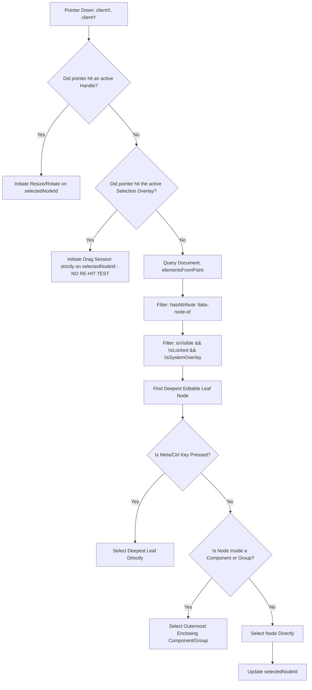

# 🪐 OrbitoX Studio — P20 Canvas Interaction & Hit-Testing Audit
**Document ID:** `docs/P20_CANVAS_INTERACTION_AUDIT.md`  
**Phase:** P20 — Phase 0: Forensic Audit & Rebuild Planning  
**Date:** October 3, 2026  
**Auditor:** Principal Canvas & Interaction Engineer  
**Status:** **AUDIT COMPLETE (AWAITING USER APPROVAL)**

---

## 1. Executive Summary: The Physics of Canvas Failure

A creative canvas must behave with mathematical determinism. When a designer clicks an object, the system must select that exact object. When they drag its bounding box, that exact object must move.

In the current implementation:
1. **Selection overlays sit on a separate DOM layer** above the rendered Virtual DOM.
2. When the user clicks the selection overlay to drag the selected node, `CanvasInteractionLayer.tsx` runs an inverted hit-test query:
   ```typescript
   const underNodeEl = hitElements.find((el) => {
     const nid = el.getAttribute('data-node-id');
     return Boolean(nid && nid !== nodeId ...);
   });
   ```
3. This deliberately reassigns the drag target to **any underlying element that is NOT the selected node**!
4. The underlying element (usually a container, background gradient, or parent stack) moves, while the selected node stays frozen.
5. In nested hierarchies, double-clicking or pressing Escape has no formal state machine, leaving the designer trapped in inconsistent selection states.

---

## 2. Canvas Geometry & Coordinate System Breakdown

### 2.1 Current Viewport Transformations
The canvas uses an artboard wrapper with CSS transform:
$$\mathbf{T}_{\text{screen}} = \begin{bmatrix} \text{zoom} & 0 & \text{panX} \\ 0 & \text{zoom} & \text{panY} \\ 0 & 0 & 1 \end{bmatrix}$$

When an event fires on the screen at $(x_{\text{client}}, y_{\text{client}})$, converting to artboard-local coordinates requires:
$$x_{\text{artboard}} = \frac{x_{\text{client}} - \text{containerLeft} - \text{panX}}{\text{zoom}}$$
$$y_{\text{artboard}} = \frac{y_{\text{client}} - \text{containerTop} - \text{panY}}{\text{zoom}}$$

### 2.2 Forensic Flaws in Current Coordinate Mapping
- **Handle Offset Skew**: Resize handles are rendered at 6px squares with negative margin offsets (`-3px`). When zoom is $0.88$ or $0.50$, the pixel snapping causes pointer hit regions to drift outside the handle visual boundary.
- **Multi-Section Stacking**: Because each section is a separate `<section>` with its own relative positioning context, an absolute element inside Section 2 computes $(x, y)$ relative to Section 2's top, but the selection overlay computes bounds relative to the entire artboard container!

---

## 3. The Deterministic Hit-Testing Algorithm Specification

To eliminate the backward-element drag bug and provide Figma-class selection precision, we design the **OrbitoX Deterministic Hit-Test Engine**:



### 3.1 Invariants of the Deterministic Hit-Tester:
1. **Rule of Drag Ownership**: Clicking on the bounding box or body of an *already selected element* **NEVER** re-queries underlying elements. The drag session is owned exclusively by `selectedNodeId`.
2. **Rule of Bounding Transparency**: Clicks on empty, transparent areas of a container fall through to whatever is visually underneath, unless the container has a solid/gradient fill.
3. **Rule of Background Invariant**: Background decorative layers (e.g. `node_hero_background_gradient_1`) tagged with `role: "background"` or `locked: true` are non-draggable unless explicitly unlocked in the Layers panel.
4. **Rule of Z-Index Priority**: If two sibling elements visually overlap, the one with the higher computed `z-index` (or higher position in DOM render order) receives the hit.

---

## 4. The 5-State Nested Selection Machine

```
              ┌────────────────────────────────────────┐
              │                                        │
              ▼                                        │
     [ 0. UNSELECTED ]                                 │
              │                                        │
              │ Click                                  │ Click Canvas Backdrop
              ▼                                        │
     [ 1. COMPONENT / SECTION LEVEL ]                  │
              │                                        │
              │ Double-Click / Cmd+Click               │
              ▼                                        │
     [ 2. CONTAINER / STACK LEVEL ]                    │
              │                                        │
              │ Double-Click                           │
              ▼                                        │
     [ 3. DEEPEST LEAF NODE (Text/Image/Button) ]      │
              │                                        │
              │ Double-Click (Text Only)               │
              ▼                                        │
     [ 4. INLINE TEXT EDITING MODE ] ──────────────────┘
```

### Keyboard Navigation Contract:
- **Escape Key**: Climbs one level up the hierarchy:
  - If in *Inline Text Editing* ➔ returns to *Leaf Node Selection*.
  - If in *Leaf Node Selection* ➔ ascends to *Container / Stack*.
  - If in *Container / Stack* ➔ ascends to *Section*.
  - If in *Section* ➔ deselects to *Page*.
- **Shift + Click**: Toggles element in multi-selection set without changing hierarchy depth.
- **Tab / Shift+Tab**: Cycles through sibling nodes within the current parent container.
