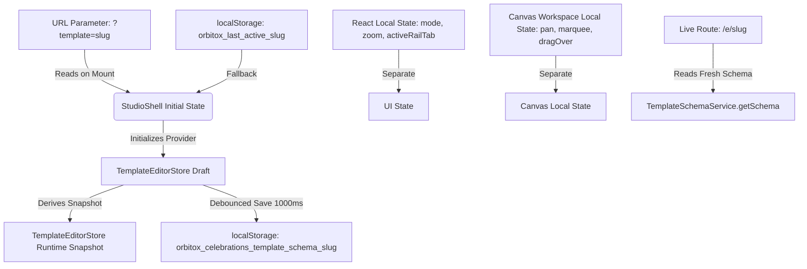

# 🪐 OrbitoX Studio — P20 Data Architecture & State Audit
**Document ID:** `docs/P20_DATA_ARCHITECTURE_AUDIT.md`  
**Phase:** P20 — Phase 0: Forensic Audit & Rebuild Planning  
**Date:** October 3, 2026  
**Auditor:** Principal Data & Platform Architect  
**Status:** **AUDIT COMPLETE (AWAITING USER APPROVAL)**

---

## 1. Executive Summary: The Multiple Sources of Truth Crisis

A core vulnerability of the current OrbitoX Studio architecture is the **coexistence of competing and out-of-sync state stores**:



When a user switches templates, updates styles, or navigates pages:
1. `TemplateEditorStore` mutates its draft.
2. But `StudioShell` holds separate state variables (`activeUniverseId`, `mode`, `selectedSceneId`).
3. If an async event or browser reload fires before the debounced 1000ms timer commits, or if `localStorage` hits the 5MB browser quota, the stores diverge permanently.

---

## 2. Entity Hierarchy & Structural Flaws

### 2.1 The Legacy "Celebration" Schema Bias
The current schema structure retains legacy fields from single-page wedding invitations:
```typescript
interface TemplateSchema {
  id: string;
  name: string;
  slug: string;
  scenes: TemplateSceneDefinition[]; // "Scenes" instead of Sections!
  designTokens: TemplateDesignTokens;
  audioSupport?: { ... };             // Wedding ambient music hardcoded at root!
  guestPassDecree?: { ... };          // Wedding VIP decree hardcoded at root!
  contentSchema?: { ... };            // Bride, Groom, Couple fields!
}
```

### 2.2 Conflation of "Page" and "Scene"
In a modern website builder:
$$\text{Project} \longrightarrow \text{Pages} \longrightarrow \text{Sections} \longrightarrow \text{Containers / Stacks} \longrightarrow \text{Elements}$$

In the current codebase:
- `schema.scenes` is used interchangeably as sections AND pages.
- `schema.pages` was bolted on later in `PagesPanel.tsx` by grouping `sectionIds`.
- The right inspector displays `"Page Inspector"`, but its inputs directly mutate `activeScene` (a single section).
- When `activeScene` changes, `LayersPanel` resets because it only observes `activeScene.sceneGraph`.

---

## 3. The LocalStorage Quota Timebomb

```
Browser LocalStorage Quota: 5,120 KB (5 MB)
Current Baseline Celestial Odyssey Schema: ~85 KB
Single Uncompressed iPhone Photo: ~3,500 KB (Base64: ~4,660 KB)
Result: Schema Size = 4,745 KB (92.6% of entire browser storage)
Second Photo Upload: QuotaExceededError -> DRAFT DISCARDED
```

Embedding assets as Base64 strings directly in `schema.assets` or `node.smartProps.src` causes fatal browser storage exceptions. 

### Target Architectural Resolution:
- **Project Schema**: Strictly stores asset metadata (`id`, `url`, `width`, `height`, `mimeType`, `sizeBytes`).
- **Binary Payloads**: Handled through a dedicated API endpoint (`/api/assets/upload`) backed by edge blob storage (or client-side IndexedDB for local offline drafts).

---

## 4. Canonical State vs. UI State Separation

### Current Anti-Pattern:
`StudioShell.tsx` mixes canonical document definitions with transient viewport controls:
- `mode` (UI state)
- `activeRailTab` (UI state)
- `zoom` (UI state)
- `pan` (UI state)
- `marqueeState` (UI state)
- `selectedNodeId` (UI state)
- `schema` (Canonical document state)
- `designTokens` (Canonical design state)

### Proposed Clean Architecture:
```typescript
interface StudioState {
  // 1. CANONICAL DOCUMENT STATE (Persisted, Undoable, Published)
  project: {
    id: string;
    name: string;
    slug: string;
    tenantId: string;
    version: number;
    pages: PageEntity[];
    components: Record<string, ComponentEntity>;
    assets: Record<string, AssetEntity>;
    designTokens: DesignTokensEntity;
    customBreakpoints?: BreakpointConfig[];
  };

  // 2. TRANSIENT UI STATE (Unpersisted, Session-Only, Never in Undo Tree)
  ui: {
    activePageId: string;
    activeSectionId: string | null;
    selectedNodeIds: string[];
    hoveredNodeId: string | null;
    activeWorkspace: 'build' | 'style' | 'motion' | 'prototype' | '3d';
    activeTool: 'select' | 'hand' | 'text' | 'frame';
    activeRailDrawer: string | null;
    activeDevice: 'desktop' | 'tablet' | 'mobile';
    viewport: {
      zoom: number;
      panX: number;
      panY: number;
    };
    inspectorTab: 'layout' | 'style' | 'motion' | 'advanced';
  };
}
```

---

## 5. Normalized Node Tree Model

Currently, each section maintains an isolated `SceneGraph` dictionary:
`scene.sceneGraph.nodes: Record<string, SceneGraphNode>`

This prevents:
1. Moving an element across section boundaries via drag-and-drop.
2. Rendering a continuous active-page layer tree.
3. Defining page-level absolute floating elements (sticky navigation bars, floating CTA buttons, ambient audio widgets).

### Proposed Target Model:
A single normalized node store for the active page, with sections acting as root-level container nodes:
```typescript
interface NormalizedPageModel {
  id: string;
  slug: string;
  name: string;
  rootNodeId: string; // The Page Canvas Root
  nodes: Record<string, SceneGraphNode>;
  sectionOrder: string[]; // Node IDs of sections in top-to-bottom flow
}
```
This enables seamless dragging between sections, unified layer rendering, and deterministic hit testing.
