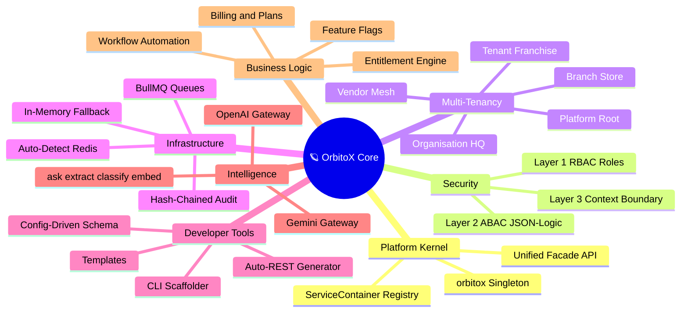
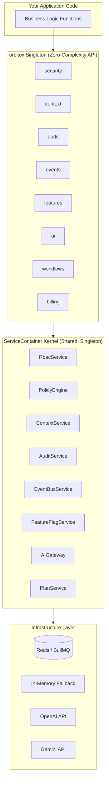

# 🪐 OrbitoX Documentation Navigator

> **The Zero-Complexity Engine for Next-Gen B2B2C Applications**  
> Everything you need to build, deploy, and scale enterprise SaaS — in one unified platform.

---

## 🧠 Platform Ecosystem Mindmap



---

## 🗂️ Guide Index

| # | Topic & Guide | Focus Area | Key Visuals |
| :-: | :--- | :--- | :--- |
| **01** | [🚀 Getting Started](./01_GETTING_STARTED.md) | CLI, Scaffolding, Health Verification | Dev Journey Flowchart, Prerequisites Table |
| **02** | [🏛️ Architecture & Kernel](./02_ARCHITECTURE.md) | Singleton, ServiceContainer, Facades | Class Diagram, Facade Matrix |
| **03** | [🏢 Multi-Tenancy Graph](./03_MULTI_TENANCY.md) | O2O2B2B Context Trees, Vendor Mesh | Hierarchy Graph, Context Type Table |
| **04** | [🛡️ Zero-Trust Security](./04_ZERO_TRUST_SECURITY.md) | RBAC + ABAC JSON-Logic + CBAC | 3-Layer Auth Flowchart, Mode Comparison Table |
| **05** | [💳 Billing & Subscriptions](./05_BILLING_SUBSCRIPTIONS.md) | Plans, Entitlements, Lifecycle | Subscription State Machine, Tier Matrix |
| **06** | [⚡ Event Bus & Queues](./06_EVENTS_QUEUES.md) | BullMQ, Redis, In-Memory | Redis Topology Flowchart, Event Patterns |
| **07** | [🤖 AI Gateway](./07_AI_GATEWAY.md) | OpenAI, Gemini, ask/extract/classify | Provider Matrix, AI Routing Diagram |
| **08** | [📋 Immutable Audit Trail](./08_AUDIT_TRAIL.md) | SHA-256 Hash Chains, Compliance | Hash-Chain Diagram, Compliance Table |
| **09** | [🚩 Feature Flags](./09_FEATURE_FLAGS.md) | Context Overrides, Canary Rollouts | Priority Flowchart, Overrides Table |
| **10** | [📦 Workflows & Automation](./10_WORKFLOWS.md) | Event Triggers, Background Actions | Workflow Sequence Diagram |
| **11** | [🛠️ CLI & Scaffolding](./11_CLI_SCAFFOLDING.md) | Templates, Config, Auto-REST | Template Matrix, CLI Pipeline |
| **12** | [🎯 Production Deployment](./12_PRODUCTION_DEPLOYMENT.md) | Hardening, Redis, AI Keys | Infrastructure Topology, Checklist |

---

## ⚡ One-Minute Quick Start

```typescript
import { orbitox } from '@orbitox/runtime';

// 1. Configure (one line changes everything)
orbitox.configure({ mode: 'open' }); // Dev: open, Prod: strict

// 2. Use clean, powerful, unified APIs
async function handleOrder(userId: string, tenantId: string, orderData: any) {
  // 🛡️ Zero-Trust Security Gate
  await orbitox.security.authorize(userId, 'orders.create', tenantId);
  // 📋 Immutable Audit Record
  await orbitox.audit.created('Order', orderData.id, orderData, userId, tenantId);
  // ⚡ Distributed Event
  await orbitox.events.emit('order.placed', orderData, tenantId);
  // 🤖 AI Analysis
  const risk = await orbitox.ai.classify(
    `Order total: ${orderData.total}`,
    ['low-risk', 'medium-risk', 'high-risk']
  );
  return risk;
}
```

---

## 🏛️ How the Layers Stack Together


