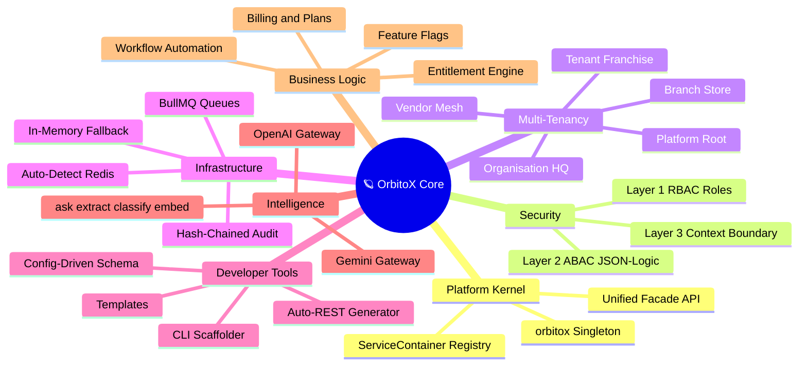
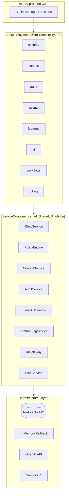

# 🪐 OrbitoX Documentation Navigator

> **The Zero-Complexity Engine for Next-Gen B2B2C Applications**  
> Everything you need to build, deploy, and scale enterprise SaaS — in one unified platform.

---

## 🧠 Platform Ecosystem Mindmap



---

## 🗂️ Guide Index

| # | Topic & Guide | Focus Area | Key Visuals |
| :-: | :--- | :--- | :--- |
| **01** | [🚀 Getting Started](./01_GETTING_STARTED.md) | CLI, Scaffolding, Health Verification | Dev Journey Flowchart, Prerequisites Table |
| **02** | [🏛️ Architecture & Kernel](./02_ARCHITECTURE.md) | Singleton, ServiceContainer, Facades | Class Diagram, Facade Matrix |
| **03** | [🏢 Multi-Tenancy Graph](./03_MULTI_TENANCY.md) | O2O2B2B Context Trees, Vendor Mesh | Hierarchy Graph, Context Type Table |
| **04** | [🛡️ Zero-Trust Security](./04_ZERO_TRUST_SECURITY.md) | RBAC + ABAC JSON-Logic + CBAC | 3-Layer Auth Flowchart, Mode Comparison Table |
| **05** | [💳 Billing & Subscriptions](./05_BILLING_SUBSCRIPTIONS.md) | Plans, Entitlements, Lifecycle | Subscription State Machine, Tier Matrix |
| **06** | [⚡ Event Bus & Queues](./06_EVENTS_QUEUES.md) | BullMQ, Redis, In-Memory | Redis Topology Flowchart, Event Patterns |
| **07** | [🤖 AI Gateway](./07_AI_GATEWAY.md) | OpenAI, Gemini, ask/extract/classify | Provider Matrix, AI Routing Diagram |
| **08** | [📋 Immutable Audit Trail](./08_AUDIT_TRAIL.md) | SHA-256 Hash Chains, Compliance | Hash-Chain Diagram, Compliance Table |
| **09** | [🚩 Feature Flags](./09_FEATURE_FLAGS.md) | Context Overrides, Canary Rollouts | Priority Flowchart, Overrides Table |
| **10** | [📦 Workflows & Automation](./10_WORKFLOWS.md) | Event Triggers, Background Actions | Workflow Sequence Diagram |
| **11** | [🛠️ CLI & Scaffolding](./11_CLI_SCAFFOLDING.md) | Templates, Config, Auto-REST | Template Matrix, CLI Pipeline |
| **12** | [🎯 Production Deployment](./12_PRODUCTION_DEPLOYMENT.md) | Hardening, Redis, AI Keys | Infrastructure Topology, Checklist |
| **13** | [🏥 Hospital SaaS Blueprint](./13_USECASE_HOSPITAL_SAAS.md) | Clinical N-Tier, Bed State Machine, Peer Mesh | Context Topology, Permission Flow, Bed State Machine |
| **14** | [🧑‍💻 Hospital Developer Guide](./14_HOSPITAL_SAAS_DEVELOPER_GUIDE.md) | Beginner-to-Pro Tutorial, TypeScript Types, Copy-Paste Server | Mental Model, 8-Step Tutorial, Runnable Code |
| **15** | [🗄️ Database Architecture & Flow](./15_DATABASE_ARCHITECTURE_AND_FLOW.md) | Multi-Tenant Storage, Read/Write Sequences, Query Translation | Storage Models, Read Flow, Write Flow, Cache Namespaces |
| **16** | [🪐 Client Projects & O2O2B2B2C Ecosystem](./16_CLIENT_PROJECTS_AND_O2O2B2B2C_ECOSYSTEM.md) | Zero-Code Plugins, Instant API Keys, Dynamic Quotas, O2O2B2B2C | Ecosystem Flowchart, Gateway Enforcement, Multi-Lang SDKs |
| **17** | [🌐 Dual-Engine: Single & Multi-Server Architecture](./17_MULTI_SERVER_DISTRIBUTED_ARCHITECTURE_AND_CLIENT_PROVISIONING.md) | Dual-Engine Standalone & Clustered Mesh, Redis Pub/Sub, PgBouncer, Client Provisioning | Dual Topology Diagrams, Invalidation Sequence, Single vs Multi Matrix, Fallback Specs |
| **18** | [🔄 Easy Switch & State Transfer (Standalone Guide)](./18_EASY_SWITCH_AND_STATE_TRANSFER_STANDALONE_GUIDE.md) | 1-Click / 1-Command Seamless Scale Down to Standalone Single Node, Zero Data Loss State Transfer | State Extraction Sequence, SHA-256 Snapshot Schema, 5-Phase Traffic Drain Stepper, CLI Integration |

---

## ⚡ One-Minute Quick Start

```typescript
import express from 'express';
import { orbitox } from '@orbitox/runtime';

const app = express();

// 1. Configure (one line changes everything)
orbitox.configure({ mode: 'strict' }); 

// 2. Add OrbitoX Middleware (auto-resolves tenants, validates auth, logs audits)
app.use(orbitox.middleware({ enforceAuth: true }));

// 3. Use Ultra-Easy Builders for complex setup
const tenant = await orbitox.tenant('acme-corp', 'Acme Corp')
  .owner('user_123')
  .subscribe('pro-plan')
  .enableFeature('ai_assistant')
  .create();

// 4. Use clean, powerful, unified APIs in your routes
app.post('/orders', async (req, res) => {
  const { orbitoxUser, orbitoxContext } = req as any;
  const orderData = req.body;

  // 🛡️ Zero-Trust Security Gate (RBAC + ABAC + CBAC)
  await orbitox.security.authorize(orbitoxUser.id, 'orders.create', orbitoxContext.id);
  
  // 📋 Immutable Audit Record (auto-logged by middleware, but manual logs also work)
  await orbitox.audit.created('Order', orderData.id, orderData, orbitoxUser.id, orbitoxContext.id);
  
  // ⚡ Distributed Event
  await orbitox.events.emit('order.placed', orderData, orbitoxContext.id);
  
  res.json({ success: true });
});
```

---

## 🏗️ Ultra-Easy Builders (Full CRUD)

OrbitoX includes fluent builder APIs for managing your SaaS entities. All builders support full `get()`, `update()`, and `delete()` operations alongside creation:

```typescript
// Tenant Builder
const tenant = await orbitox.tenant('acme').settings({ theme: 'dark' }).update();

// Workflow Builder
await orbitox.workflows.build('onboarding', tenant.id)
  .onEvent('client.joined')
  .action('send-email', 'notifications.email')
  .activate();

// Plan Builder
await orbitox.billing.buildPlan('Enterprise').price(999).publish();

// Security Policy Builder
orbitox.security.policy('refund-limit').maxFieldValue('amount', 500).register();
```

---

## 🏛️ How the Layers Stack Together


