# 🪐 OrbitoX Platform Architecture

This document describes the unified single-workspace architecture of OrbitoX Platform, defining the boundaries, inter-service contracts, multi-tenant database isolation, cryptographic invariants, and automated governance guardrails.

---

## 1. Repository & Workspace Topology

OrbitoX is organized as a single pnpm + Turborepo workspace (`pnpm-workspace.yaml`) with a single root lockfile (`pnpm-lock.yaml`).

```mermaid
flowchart TD
    subgraph Apps["apps/ - User-Facing Deployables"]
        Platform["apps/platform\nNext.js 15: Operator Console, Customer Dashboard, HospitalOS, Public API"]
        RestaurantUI["apps/restaurant\nRestaurantOS Web UI (Created in Stage 7F)"]
    end

    subgraph Services["services/ - Backend-Only Deployables"]
        RestaurantAPI["services/restaurant-api\nRestaurantOS API: Isolated Database & Independent Deploy"]
    end

    subgraph Packages["packages/ - Shared Libraries (@orbitox-io/*)"]
        UI["@orbitox-io/ui (Pure Design System)"]
        Core["@orbitox-io/core (RBAC, ABAC, Crypto, PII)"]
        PluginEngine["@orbitox-io/plugin-engine (Tenancy, Grants, Sandbox)"]
        Bridge["@orbitox-io/bridge (Signed Inter-Service HMAC)"]
        Runtime["@orbitox-io/runtime (Workflow & Policy Engine)"]
        RuntimeSDK["@orbitox-io/external-runtime-sdk"]
        SDK["@orbitox-io/sdk"]
        Types["@orbitox-io/types"]
        Utils["@orbitox-io/utils"]
        Config["@orbitox-io/eslint-config, jest-config, tsconfig"]
    end

    subgraph Plugins["plugins/ - Platform Plugins (@orbitox-io/*)"]
        POS["@orbitox-io/pos"]
        ExtProjectEngine["@orbitox-io/external-project-engine"]
    end

    subgraph Databases["Dedicated Databases"]
        PlatformDB[("Platform PostgreSQL\nPrisma Client")]
        RestaurantDB[("RestaurantOS PostgreSQL\nIsolated Generated Client")]
    end

    Platform --> PlatformDB
    RestaurantAPI --> RestaurantDB
    Platform -- "@orbitox-io/bridge (Signed HMAC + Nonces)" --> RestaurantAPI
    RestaurantAPI -- "Lifecycle Events & Sync" --> Platform
    Platform --> UI
    Platform --> Core
    Platform --> PluginEngine
    Platform --> Bridge
    RestaurantAPI --> Bridge
    RestaurantAPI --> PluginEngine
    RestaurantAPI --> POS
```

### Folder Roles & Responsibilities

| Directory | Purpose | Boundary Rules |
|---|---|---|
| `apps/` | User-facing deployables (`apps/platform`, future `apps/restaurant`) | Route files only parse, authorize, and invoke domain code in `src/server/`. Never import from `services/`. |
| `services/` | Backend-only deployables (`services/restaurant-api`) | Own database schema, migrations, and independent deployment. Never import from `apps/`. Talk to platform via `@orbitox-io/bridge`. |
| `packages/` | Shared libraries published under `@orbitox-io/*` | Never import from `apps/` or `services/`. `packages/ui` has zero data access and no Prisma. |
| `plugins/` | Platform plugins (`pos`, `external-project-engine`) | Expose only public contracts (`index.ts`). No deep imports into plugin internals. |
| `tools/` | Developer CLI tools (`tools/cli`) | Project scaffolding and local workspace tasks. |
| `infra/` | Infrastructure-as-Code | `infra/terraform/aws` (production) and `infra/docker` (compose/local dev). |
| `scripts/` | Domain-grouped maintenance scripts | `scripts/db/`, `scripts/secrets/`, `scripts/ci/`. |

---

## 2. Core Architectural Principles

### A. Thin Routes & Domain Separation
In `apps/platform`, route files in `src/app/` are strictly presentation and parsing entrypoints:
- `src/app/(public)/` — Landing, authentication, invitation acceptance.
- `src/app/(console)/` — Operator console (`/platform/*` and legacy `/admin/*`).
- `src/app/(dashboard)/` — Customer SaaS dashboard.
- `src/app/(hospital)/` — HospitalOS clinical staff suite (`/hms/*`).
- `src/app/(restaurant-legacy)/` — Legacy restaurant routes (to be superseded in 7F).
- `src/app/api/` — API route handlers (`/api/v1/`, `/api/hospital/`, `/api/restaurant/`, `/api/health/`).

Domain code resides in `apps/platform/src/server/` marked with `import 'server-only'`. Client components cannot import server-only domain logic.

In `services/restaurant-api`, each domain module follows a uniform structure:
- `routes.ts` — HTTP parsing, status codes, route dispatching.
- `service.ts` — Domain rules and business workflows.
- `repository.ts` — Database interactions and Prisma queries.
- `main.ts` — Minimal runtime bootstrapper (≤ 150 lines).

### B. Inter-Service Communication via `@orbitox-io/bridge`
Applications and independent services never directly import each other's code or share database connections. They communicate over HTTP using signed bridge requests:
- **HMAC Signatures**: Every inter-service request is signed using Ed25519/HMAC with active key IDs (`x-orbitox-signature`).
- **Nonce Stores**: Single-use cryptographic nonces prevent replay attacks.
- **Tenant Context Propagation**: Tenant ID is passed in headers and verified before execution.

### C. Zero-Trust Multi-Tenancy & Isolated Databases
- **Separate Databases**: Platform control plane and RestaurantOS each own their own PostgreSQL database, Prisma schema, and migrations.
- **Client Isolation**: RestaurantOS generates its Prisma Client to `services/restaurant-api/generated/prisma`, preventing client clobbering in the workspace.
- **Row-Level Security (RLS)**: Scoped queries enforce `tenantId` isolation with non-superuser database roles.
- **Ambient Context**: Multi-tenant execution contexts propagate via `AsyncLocalStorage` (`getActiveTenant()` / `tryGetActiveTenant()`).

### D. Cryptographic Grants & Plugin Sandboxing
- Plugins run inside sandboxed facades deeply frozen by `SandboxGuard.freezeAllFacades`.
- Plugin entitlements are cryptographically signed via Ed25519 tokens (`PluginGrantEnforcer`).
- Sensitive tenant data is protected using AES-256-GCM authenticated encryption and cryptographic peppers.

---

## 3. Automated CI Guardrails

The monorepo enforces architectural invariants automatically on every pull request (`.github/workflows/ci.yml`):

| Guardrail | Enforcement Tool | Policy |
|---|---|---|
| **Architectural Boundaries** | ESLint (`eslint.config.mjs`) | `apps/*` and `services/*` cannot import each other. Route groups `(console)`, `(dashboard)`, `(hospital)` cannot cross-import. `packages/ui` cannot import data or backend modules. |
| **Circular Dependencies** | Madge (`pnpm run check:circular`) | `madge --circular = 0`. Zero circular dependencies permitted across packages, plugins, apps, and services. |
| **Max Lines Warning** | ESLint (`max-lines: ["warn", { max: 400 }]`) | Files over 400 non-blank/non-comment lines raise warnings to prevent monolith creep. |
| **Dead Code & Dependencies** | Knip (`pnpm run check:knip`) | Zero unused files, zero unlisted dependencies, and zero unlisted binaries permitted. |
| **Migration Immutability** | `scripts/ci/verify-migration-immutability.sh` | Existing Prisma migrations are byte-identical and immutable. |
| **Single Monorepo Lockfile** | CI verification | Exactly one root `pnpm-lock.yaml`, zero nested lockfiles. |

---

## 4. Operational Scripts & Workers

- **Long-Running Workers** (`apps/platform/src/workers/`):
  - `email.ts` — Asynchronous email delivery from outbox.
  - `billing-grace-sweep.ts` — Subscription grace period enforcement and entitlement de-provisioning.
  - `data-rights.ts` — DSR data export and cryptographic erasure worker.
- **Operations Scripts** (`apps/platform/scripts/ops/`):
  - `bootstrap-operator.ts` — Initial operator credential seeding.
  - `import-json.ts` — Data migration utility.
  - `recover-audit-intents.ts` — Audit intent reconciliation.
- **Database Maintenance** (`scripts/db/`):
  - `maintain-rate-limit-partitions.ts` — Partition pruning and rolling table maintenance.
  - `check-rate-limit-partition-runway.ts` — Runway capacity verification.

