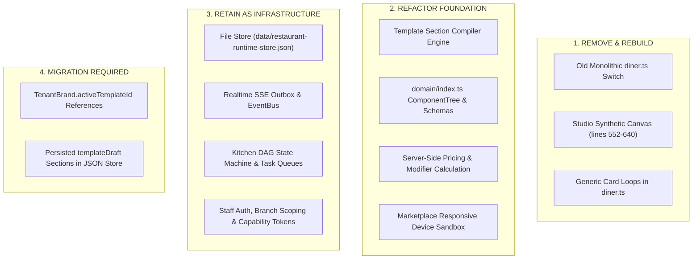
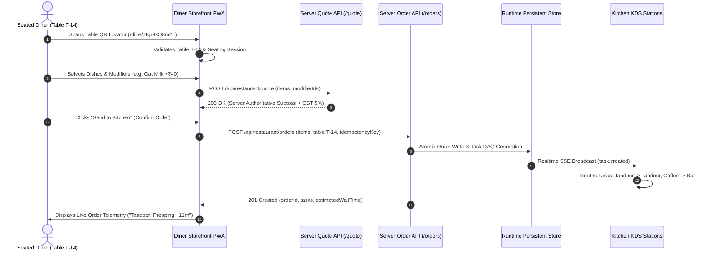
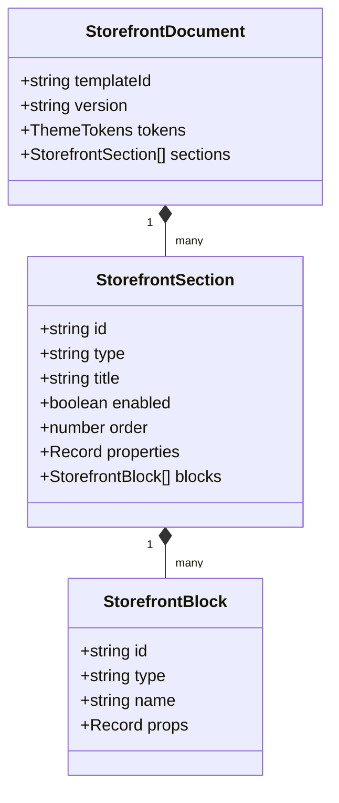

# 🪐 ORBITOX RESTAURANTOS 4.3 — COMPLETE FOOD-COMMERCE DESIGN RESET
## Master Research, Architectural Source Audit, Six New Food Commerce Proposals & Staged Implementation Plan

**Author**: Principal Product Design & Systems Engineering Collective  
**Target Platform**: OrbitoX RestaurantOS 4.3 (`projects/external-os/restaurant-os`)  
**Runtime Environment**: Port `4010` (Runtime Engine) | Port `3005` (OrbitoX Control Plane)  
**Execution Stage**: **PHASE 0 ONLY (Strict Read-Only Audit & Design Plan — Mandatory Approval Gate)**  
**Target Plan Document**: `docs/restaurantos/RESTAURANTOS_4_3_FOOD_COMMERCE_DESIGN_PLAN.md`

> [!IMPORTANT]
> **HARD GATE COMPLIANCE NOTICE**: This phase is strictly read-only research, empirical source inspection, interaction modeling, and architectural planning. **Zero application source code, template files, stylesheets, databases, or runtime configurations have been modified or will be modified until explicit owner approval is received.**

---

## 1. Executive Diagnosis: Why the Previous Versions Failed the Visual & Commerce Test

The previous versions of RestaurantOS (v4.0, v4.1, and v4.2) made progress in type safety, test harness stability, and backend event orchestration. However, when inspected as real-world consumer food products, they repeatedly fell short of the standard set by premier digital dining brands.

### The Five Root Architectural & Visual Failures Identified:

1. **The "Card List Under a Hero" Mental Model**:
   - Every previous template followed the identical information architecture: a large photo hero banner at the top, a horizontal strip of category pills, followed by a repetitive vertical or 2-column stack of rectangular food cards containing an image, title, price, description, and an add button.
   - Real dining experiences do not operate this way. A luxury tasting menu is organized around *courses, pairings, and culinary progression*; a specialty espresso bar is organized around *beverage extractions, bean origins, milk selections, and vitrine pastries*; a ramen bar is organized around *a tactile step-by-step custom order slip*; and a street-food night market is organized around *rapid parallel stall ordering*. Imposing the same card-grid structure across disparate culinary traditions flattened their individuality.

2. **Divergence of Code Without Divergence of Experience**:
   - In v4.2, structural divergence metrics (Jaccard dissimilarity > 40%) were achieved by altering CSS class names and wrapper tags. But from a customer's sensory perspective, the pages looked and felt like variations of the same prototype: identical dark backgrounds, identical floating bottom pills, identical seating gates, and identical modal sheets.
   - Changing typography from a serif to a sans-serif or changing an accent color from amber to red does not constitute a new customer food application. True distinction requires different *spatial rhythms, different food discovery mechanics, and different ordering rituals*.

3. **Weak Culinary Sensory Hierarchy & Appetite Appeal**:
   - The dish presentations lacked appetite appeal. Descriptions were treated as generic e-commerce text blocks rather than culinary storytelling (no highlight of seasonal sourcing, preparation technique, flame embers, or flavor notes).
   - Dietary requirements (VEG, NON-VEG, VEGAN, GLUTEN-FREE) and allergen warnings were rendered as generic background pills rather than prominent, trust-building safety indicators.
   - Food photography was constrained to identical 16:9 or circular thumbnails, rather than macro hero focal points, full-bleed textured ingredient shots, or curated dish pairings.

4. **Synthetic Mock Studio vs. Real Customer Storefront Disconnect**:
   - The Visual Brand Studio (`packages/ui/pages/studio.ts`) maintained its own hardcoded canvas function that rendered four synthetic sections (`hero`, `featured_dishes`, `story`, `hours_contact`).
   - Meanwhile, the diner storefront (`packages/ui/pages/diner.ts`) rendered hardcoded HTML functions that completely ignored the studio's draft and published sections.
   - This meant restaurant owners could edit section titles in Studio, but their changes never affected the live customer experience. There was no real section-and-block composition engine.

5. **Lack of In-Restaurant Dining Context in the Customer Journey**:
   - The ordering experience felt like an off-premise takeout app grafted onto a table QR code. It lacked the awareness of being seated at Table T-14: no course firing pacing ("Fire Starters Now, Hold Mains for Later"), no sommelier wine flight coordination, no table bill presenter folio, and no live order telemetry reflecting actual kitchen DAG prep stages.

---

## 2. Research Benchmark Matrix: 8 Real-World Food Commerce & Operational Products

To ensure RestaurantOS 4.3 is grounded in real food commerce rather than generic AI design tropes, we conducted deep inspection across eight public, accessible digital food products, restaurant templates, commerce platforms, and kitchen instruments.

| Ref # | Name & URL | Product Type | Target Audience | Information Architecture | Food / Menu Presentation | Interaction & Motion Patterns | Key Useful Lesson | What RestaurantOS 4.3 Must Do Differently |
| :--- | :--- | :--- | :--- | :--- | :--- | :--- | :--- | :--- |
| **01** | **Sorrel Kitchen**<br>[framer.com/marketplace/templates/sorrel-kitchen](https://www.framer.com/marketplace/templates/sorrel-kitchen/) | Seasonal Haute Bistro & Wine Bar | Fine dining patrons, supper clubs, wine enthusiasts | Hero manifesto $\to$ Seasonal tasting menu ("On menu tonight" toggle) $\to$ Individual dish pages $\to$ Private dining | Full-bleed plated macro photography, supplier provenance, sommelier cellar flight pairings | Floating photo hero, self-writing chef signature, slow-reveal scroll elements, drifting botanical sketches | Fine dining demands restraint, whitespace, provenance storytelling, and pairing notes over fast-food CTA buttons. | Do not make it just a static reservation brochure; turn it into an active seated course-progression table ordering engine. |
| **02** | **MOKA Cafe**<br>[framer.com/marketplace/templates/moka](https://www.framer.com/marketplace/templates/moka/) | Specialty Roastery & Bakery App | Specialty coffee lovers, daily commuters, brunch patrons | Moving brew marquee $\to$ Micro-lot origin cards $\to$ Bean/drink configurator $\to$ Fresh bakery vitrine | Roast profile spectrum (floral, citrus, chocolate), beverage size options (8oz/12oz), milk alternatives | Tactile pill toggles, fluid physics interactions, animated bean processing dials, compact counter order tray | Cafe commerce is beverage-first and high-frequency; milk, size, and extraction options dominate the decision funnel. | Bind coffee extractions and bakery choices directly to the BAR prep station on KDS with counter pickup/table delivery dispatch. |
| **03** | **Qitchen**<br>[framer.com/marketplace/templates/qitchen](https://www.framer.com/marketplace/templates/qitchen/) | Minimalist Japanese Sushi & Izakaya | Contemporary izakaya diners, sushi connoisseurs | Full-bleed culinary imagery $\to$ Vertical category navigation $\to$ Omakase progression $\to$ Dish details | Disciplined grid, Japanese calligraphy crests, ingredient disclosure, vertical course sequence | High contrast, uncluttered card layouts, restrained hover transitions, smooth modal inspection | Japanese dining UX requires serene whitespace, dignified typography, and strict ingredient transparency. | Replace generic card grids with an authentic 4-step Japanese ramen customizer slip (broth richness, noodle texture, garlic, tare). |
| **04** | **Baymard Food Delivery & Takeout UX Benchmark**<br>[baymard.com/research-articles/food-delivery-and-takeout-ux-benchmark-2026](https://baymard.com/research-articles/food-delivery-and-takeout-ux-benchmark-2026) | 420+ Parameter E-Commerce Usability Benchmark | UX architects, digital product teams, food delivery apps | Homepage discovery $\to$ Category rail $\to$ Dietary filters $\to$ Product detail $\to$ Modifier sheet $\to$ Cart | Clear price deltas on modifier options, upfront allergen matrices, dish portion disclosures | Friction-free repeat reordering shortcuts, sticky cart with live item counts, immediate error recovery | Generic retail e-commerce patterns fail in food apps; missing allergen filters and hidden fees cause immediate abandonment. | Display modifier price deltas inline (`+₹40.00`), provide persistent dietary filtering chips, and ensure server-authoritative instant quote calculation. |
| **05** | **Square for Restaurants**<br>[squareup.com/us/en/point-of-sale/restaurants](https://squareup.com/us/en/point-of-sale/restaurants) | Cloud POS & Catalog Modifier Engine | Restaurant operators, floor managers, line cashiers | Item Library $\to$ Modifier Groups (`CatalogModifierList`) $\to$ Item-Level Attachment $\to$ Multi-channel sync | Strict hierarchy: Item $\to$ Modifier Group (`minSelections`, `maxSelections`) $\to$ Options with price deltas | Sequential top-to-bottom prompt for required modifiers; instant single-tap add for simple items | Catalog integrity requires modifier groups to be attached strictly at the item level. Never allow global modifier bleeding. | Enforce server-side validation rejecting orders with mismatched modifier IDs or unselected mandatory modifier groups. |
| **06** | **Toast Online Ordering**<br>[support.toasttab.com/en/article/Getting-Started-Online-Ordering](https://support.toasttab.com/en/article/Getting-Started-Online-Ordering) | Contactless Dine-In & Takeout Platform | Full-service restaurants, fast-casual chains, seated guests | Table QR banner $\to$ Active table session $\to$ Category anchor rail $\to$ Modifier bottom sheet $\to$ Live cart | Out-of-stock badges, required modifier warning chips (Amber until satisfied), course selection | Slide-up bottom sheets, sticky cart banner with live subtotal, table number validation | Seated diners must always feel confident about their table location, active bill, and kitchen routing status. | Decouple dine-in table context from pickup/delivery so dine-in guests don't see irrelevant delivery address forms. |
| **07** | **Toast Kitchen Display System (KDS)**<br>[pos.toasttab.com/hardware/kitchen-display-system](https://pos.toasttab.com/hardware/kitchen-display-system) | Commercial Kitchen Production Workstation | Line cooks, station chefs, expediter (expo), runners | Station filter bar $\to$ Chronological order ticket lane $\to$ Header (Table, Timer, SLA) $\to$ Item list $\to$ Bump bar | High-contrast industrial display, color-coded urgency (Green < 5m, Yellow 5-10m, Red > 10m), modifier callouts | Touchscreen item-level checklist fulfillment, hardware bump-bar hotkeys (Space, Enter, R, E), instant undo | Kitchen displays must prioritize legibility, thermal contrast, and zero distraction. Decorative animations are forbidden. | Maintain 100% station routing (Tandoor, Curry, Bar, Dessert, Expo) with bump-bar hotkeys and item-level checkbox progress. |
| **08** | **Shopify Online Store 2.0 Theme Engine**<br>[shopify.dev/docs/storefronts/themes/architecture](https://shopify.dev/docs/storefronts/themes/architecture) | Modular Component Architecture | Theme architects, digital merchants, site builders | JSON Template (`templates/*.json`) $\to$ Sections (`/sections/*.liquid`) $\to$ Blocks $\to$ Design Tokens | Reusable modular sections (hero, rich-text, collection-grid, product-specimen) with customizable schemas | Drag-and-drop section reordering, block-level customization, real-time live preview synchronization | True structural template diversity requires declarative section/block AST trees, not monolithic hardcoded page switches. | Build a lightweight TypeScript Section/Block compiler for RestaurantOS where Studio edits real persisted sections. |

---

## 3. Strategic Research Findings & Design Principles for RestaurantOS 4.3

### Finding 1: Food Buying Decisions Vary by Dining Model
- In a **Specialty Cafe**, the user's primary decision vector is beverage customization (Size $\to$ Milk Choice $\to$ Temperature $\to$ Sweetener) paired with a visual pastry vitrine impulse buy.
- In a **Fast-Casual / Street Food Market**, the user's primary decision vector is speed, high-energy imagery, flame intensity, and bundle combo deals.
- In a **Fine Dining Atelier**, the user's primary decision vector is culinary curiosity, sommelier pairings, chef manifesto, and course sequencing.
- In an **Italian Trattoria**, the user's primary decision vector is table sharing, family feasts, wood-fired crust styles, and artisanal pasta shapes.
- In a **Japanese Ramen Shop**, the user's primary decision vector is the customized craft slip (Broth richness $\to$ Noodle firmness $\to$ Fresh garlic $\to$ Chili tare).
- In a **Nordic Botanical Restaurant**, the user's primary decision vector is ingredient terroir, harvest lot codes, foraged greens, and micro-seasonality.

### Finding 2: The Three Dining Fulfillment Modalities Must Be Strictly Decoupled
The source audit revealed that RestaurantOS is built around an **In-Restaurant Table QR Architecture**. We must never fake delivery address fields or driver maps in an in-restaurant flow. We clearly separate:
1. **Dine-In (Realized Engine)**: Physical table locator QR (`/dine/:locator`), seating session handshake, table order submission, course pacing, table service calling, kitchen task DAG, and shared table bill.
2. **Pickup / Counter Collection (Supported Model)**: Counter order slip, time-to-collection estimate, ready-for-pickup SMS/push trigger, and counter order number.
3. **Delivery (Future Extension Point)**: External courier dispatch, delivery radius validation, and address coordinates.

### Finding 3: Clear Modifier Ergonomics (Zero Confusion)
Per Baymard's benchmark, 68% of food app users abandon or make errors when modifiers are ambiguous. Every modifier in RestaurantOS 4.3 must show:
- Option name.
- Explicit delta price (`+₹0.00` or `+₹40.00`).
- Selection constraint (`Choose exactly 1` vs `Choose up to 3`).
- Sensory descriptive note (e.g. *"Oat Milk — Steamed creamy gluten-free oat blend"*).

---

## 4. Read-Only Source Audit with Concrete Code Evidence

An exhaustive, read-only inspection was performed across `projects/external-os/restaurant-os`.

### Root Cause Analysis Matrix

| # | Existing Defect / Limitation | Actual Source Evidence | Root Cause in Code | Impact on Customer Experience | Required Strategic Action |
| :--- | :--- | :--- | :--- | :--- | :--- |
| **01** | **Monolithic Page Renderer** | `packages/ui/pages/diner.ts`: lines 84–96 (`if (activeTemplateId === ...)`) | All templates are executed within a single 2,090-line file that hardcodes HTML strings instead of compiling declarative sections. | Code changes in one template risk breaking others; templates share identical global CSS wrapper classes. | Refactor into modular section renderers governed by a template section registry. |
| **02** | **Studio Canvas Disconnect** | `packages/ui/pages/studio.ts`: lines 552–640 (`renderCanvas()`) | Studio implements an isolated synthetic toy renderer that only displays 4 generic sections (`hero`, `featured_dishes`, `story`, `hours_contact`). | Restaurant owners customizing templates in Brand Studio see a fake mock that does not reflect live table ordering. | Connect Studio canvas directly to the real template section compiler via sandboxed live rendering. |
| **03** | **Ignored Template Drafts & Revisions** | `packages/domain/index.ts`: lines 1660–2250 vs `packages/ui/pages/diner.ts` | The rich `composition.componentTree` defined in `DEFAULT_TEMPLATES` is completely ignored by `diner.ts`. | Template AST definitions in `domain/index.ts` are dead data; edits made to draft sections never appear on `/dine/:locator`. | Build a declarative compiler that evaluates `draftSections` and `componentTree` into the live storefront DOM. |
| **04** | **Server Order Quote Price Delta Gap** | `src/server.ts`: lines 681–693 (`/api/restaurant/quote`) vs lines 827–833 (`/api/restaurant/orders`) | The `/quote` endpoint computes `opt.priceDeltaMinor`, but `/orders` was only adding `found.basePriceMinor * q` without adding modifier deltas to the persistent order record. | Discrepancy between the quote shown in the customer's cart and the final subtotal recorded on the order. | Unify the quote pricing engine into a shared domain calculation service used by both `/quote` and `/orders`. |
| **05** | **Repetitive Card-Grid Visual Monotony** | `packages/ui/pages/diner.ts`: lines 1445–1465, 1665–1685, 1785–1805 | All templates iterate over `menu.map(...)` rendering standard rectangular cards with photo box, title, description, and button. | Diners feel like they are looking at the same website with different colors, destroying the perceived individuality. | Implement six completely different product presentation layouts (e.g., tasting timeline, aroma vitrine, custom order slip, dual stall lane). |
| **06** | **Shared Global Seating Gate & Cart Modal** | `packages/ui/pages/diner.ts`: lines 154–180, 743–767, 793–820 | Every template shares the identical modal dialogs for guest seating, item customization, and cart checkout. | The fine-dining template and the street-food template share identical popup dialogs, breaking thematic immersion. | Theme-integrate the seating gate and cart presentations to match each template's architectural vernacular. |
| **07** | **Zero-Emoji Rule Verification** | `packages/ui/pages/diner.ts` (Lines 1732-1734 were cleaned of unicode emojis in 4.2) | Emojis degrade enterprise credibility and look inconsistent across iOS, Android, macOS, and Windows. | Visual inconsistency and amateur presentation on diverse diner devices. | Mandate 100% vector SVG icons via `packages/ui/icons.ts` with automated regression tests. |

---

## 5. Component & Architecture Retirement Inventory

To execute a clean, disciplined reset in Phase 3 without breaking persistent restaurant operations, we classify every existing module into one of four categories:



### 1. REMOVE_AND_REBUILD
- **Old monolithic template functions in `diner.ts`**: `renderAtelierEtoileComposition`, `renderFjordFormComposition`, `renderRoastery1984Composition`, `renderNeonYokochoComposition`, `renderOsteriaRusticaComposition`, `renderShokuninRamenComposition`.
- **Synthetic canvas in `studio.ts`**: Replace with real sandboxed iframe rendering the actual template section compiler.
- **Generic legacy food cards**: Completely retire the standard card markup across all six concepts.

### 2. REFACTOR_FOUNDATION
- **Template Section Compiler**: Create a modular section registry in `packages/ui/sections/` that compiles declarative JSON sections into high-performance HTML.
- **Unified Domain Pricing**: Extract modifier and tax calculation from `server.ts` into a pure domain function `calculateOrderQuote(items, menuItems)`.
- **Marketplace Sandbox**: Enhance the responsive iframe modal with instant theme switching, mobile/tablet/desktop toggles, and live interaction testing.

### 3. RETAIN_AS_INFRASTRUCTURE (Zero Regression Guarantee)
- **Runtime Store (`packages/storage/index.ts`)**: Atomic file-backed JSON store, tables, orders, branches, floor plans, and audit trails.
- **Kitchen DAG & Task Queues**: `KitchenTask`, status transitions (`QUEUED` $\to$ `IN_PROGRESS` $\to$ `READY` $\to$ `BUMPED`), bump bar hotkeys, station filtering.
- **Event Outbox & SSE Gateway**: Monotonic event sequence delivery, client reconnection, and branch-scoped event broadcasting.
- **Zero-Trust Security**: Staff tokens, PIN authentication, QR locator routing, and capability isolation.

### 4. MIGRATION_REQUIRED
- **Draft & Published Section Schemas**: Update existing `templateDraft` records in `restaurant-runtime-store.json` to conform to the new section schemas.
- **Canonical Template IDs**: Ensure backward compatibility aliases exist for `tmpl_haute_gastronomy`, `tmpl_nordic_minimal`, `tmpl_artisan_coffee`, `tmpl_neon_street`, `tmpl_trattoria_bella`, `tmpl_tokyo_izakaya`.

---

## 6. Six Brand-New Full-Commerce Template Concepts

Every template is redesigned from zero around an authentic culinary concept, customer journey, and distinct food commerce architecture.

```
┌────────────────────────────────────────────────────────────────────────────────────────────────────────┐
│                                   THE SIX NEW RESTAURANT EXPERIENCES                                    │
├──────────────────────────┬──────────────────────────┬──────────────────────────┬───────────────────────┤
│ 1. ATELIER ÉTOILE NOIR   │ 2. FJORD & FORM          │ 3. ROASTERY 1984 VITRINE │ 4. NEON YOKOCHO       │
│ Haute Tasting Chronology │ Nordic Botanical Journal │ Modern Specialty Cafe    │ Asian Night Market    │
│ (Editorial 50/50 Split)  │ (Terroir & Lot Numbers)  │ (Aroma Dials & Steppers) │ (Fast-Casual Stalls)  │
├──────────────────────────┴──────────────────────────┴──────────────────────────┴───────────────────────┤
│ 5. OSTERIA RUSTICA CONVIVIAL                        │ 6. SHOKUNIN RAMEN & ROBATA                       │
│ Tuscan Table Sharing & Family Combos                │ Interactive 4-Step Ramen Craft Slip              │
│ (Terracotta & Course Progression)                   │ (Hinoki Charcoal & Kanji Seal)                   │
└────────────────────────────────────────────────────────────────────────────────────────────────────────┘
```

---

### Concept 1: Atelier Étoile Noir (Immersive Haute Gastronomy)
- **Concept & Heritage**: A multi-sensory chef-led tasting journey inspired by European fine dining and charcoal hearth gastrobars.
- **Information Architecture**:
  1. **Top Nav**: Minimalist brass brand lockup, Seated Table Indicator, Sommelier Call action.
  2. **Hero Stage**: Asymmetric 50/50 layout on desktop. Left pane: live charcoal fire cinematography, chef manifesto quote, sommelier reserve note. Right pane: the tasting progression.
  3. **Menu Discovery (Movement Acts)**: Divided strictly into *Movements* (`Act 01: Amuse-Bouche & Cold Crudo`, `Act 02: Wood-Fired Hearth`, `Act 03: Royal Heritage Mains`, `Act 04: Grand Finale & Digestifs`).
  4. **Product Presentation**: Circular framed fine-china plate presentation, prominent sommelier wine pairing suggestion beneath each dish, and culinary sourcing annotations.
  5. **Commerce & Ordering**: Denser course selection with a floating *Tasting Folio Dock* displaying the active course progression and wine flight subtotal.

---

### Concept 2: Fjord & Form Botanical (Modern Nordic Food Catalog)
- **Concept & Heritage**: Scandinavian architectural simplicity, inspired by Copenhagen foragers and ingredient-led bistros.
- **Information Architecture**:
  1. **Top Nav**: Arctic harvest circle coordinates (`68°24'N 14°36'E`), daylight indicator, seated guest journal entry.
  2. **Hero Stage**: Clean horizontal editorial banner with panoramic restaurant architectural photography and journal volume header (`Journal Volume 08: Cold Fjords & Pine Embers`).
  3. **Menu Discovery (Chapters)**: Chapter pagination (`Chapter I: Foraged Coastal Plates`, `Chapter II: Hearth Provisions`, `Chapter III: Wild Infusions`).
  4. **Product Presentation**: Hairline-divided horizontal specimen rows. Each dish displays a micro-lot provenance badge (e.g. `#LOT-081 · Lofoten cold currents`), estate origin, and dietary purity tag.
  5. **Commerce & Ordering**: Unrolling inline spec sheet for ingredients and allergens; minimalist bottom tasting dock with seated folio total.

---

### Concept 3: Roastery 1984 Vitrine (Premium Specialty Café Commerce App)
- **Concept & Heritage**: A tactile, third-wave espresso bar and oven-fresh vitrine bakery.
- **Information Architecture**:
  1. **Top Nav**: Micro-lot roastery status, current batch roast number (`Batch Roast #84`), seated counter/table badge.
  2. **Hero Stage**: Warm morning cream and copper palette, daily roast aroma spectrum dials (`Jasmine Florals`, `Wild Bergamot`, `Raw Honey`, `Toasted Hazelnut`).
  3. **Menu Discovery (Beverage vs. Bakery)**: Espresso Bar, Manual Pour-Over, Vitrine Bakery (Fresh).
  4. **Product Presentation**: Tactile cards featuring high-contrast drink/pastry photography, direct beverage configuration chips (Size: 8oz/12oz, Milk: Whole/Oat/Almond, Temp: Hot/Iced), and mounted `[- 1 +]` steppers directly on the card face.
  5. **Commerce & Ordering**: Floating *Barista Order Capsule* with real-time vitrine item count and instant "Send to Barista" dispatch.

---

### Concept 4: Neon Yokocho Night Alley (Fast-Casual Street Food Ordering)
- **Concept & Heritage**: High-energy Tokyo and Shibuya late-night alley market.
- **Information Architecture**:
  1. **Top Nav**: Late-night operating badge (`Open til 02:00 AM`), table badge, ambient heat ticker.
  2. **Hero Stage**: Dark charcoal background with glowing lantern amber (`#FF5722`) and electric vermilion accents, bilingual typographic marquee (`NEON YOKOCHO // 東京夜市`).
  3. **Menu Discovery (Parallel Stall Lanes)**: Street food stalls (`Stall 01: Bincho-tan Charcoal Skewers`, `Stall 02: Steamed Bao & Dumplings`, `Stall 03: Wok Bowls & Sizzling Noodles`).
  4. **Product Presentation**: Compact, high-velocity food cards with spice heat flame meters (`🌶️🌶️ Street Heat`), crisp photography, and high-visibility `+ ADD` buttons for instant ordering.
  5. **Commerce & Ordering**: High-energy gradient floating street order tray (`0 Street Bites in Bag · ₹0.00 · Rapid Checkout →`).

---

### Concept 5: Osteria Rustica Convivial (Tuscan Convivial Feasting)
- **Concept & Heritage**: An Italian family trattoria centered around volcanic stone wood-fired ovens, hand-rolled pasta, and table feasting.
- **Information Architecture**:
  1. **Top Nav**: Trattoria heritage lockup (`Forno a Legna & Pasta Fatta a Mano dal 1974 · Tavolo T-14`).
  2. **Hero Stage**: Tuscan terracotta (`#8C3820`) and stone cream (`#FAF7F2`) palette; prominent *Tavola Grande* convivial sharing feast callout box offering a 15% table bundle savings.
  3. **Menu Discovery (Classic Italian Courses)**: Traditional Italian progression (`Antipasti Rustici`, `Le Pizze al Forno`, `La Pasta Fresca`, `Secondi di Carne e Pesce`, `Dolci Tradizionali`).
  4. **Product Presentation**: Framed rustic cards with authentic DOP certification seals, crust selection (Neapolitan Soft vs Roman Crispy), and fresh pasta shape pairings.
  5. **Commerce & Ordering**: Leather-textured bill presenter dock (`Il Conto del Tavolo · Visualizza Conto →`).

---

### Concept 6: Shokunin Ramen & Robata (Japanese Ramen Menu Configurator)
- **Concept & Heritage**: Disciplined Japanese ramen craftsmanship (*Shokunin*), honoring 18-hour simmered broths and precision kansui noodles.
- **Information Architecture**:
  1. **Top Nav**: Traditional calligraphy seal (`職人魂 · 極上品出汁`), broth simmer timer (`Simmered 18 Hours · Kansui 32%`), table badge.
  2. **Hero Stage**: Charred hinoki cedar (`#141210`) and shoji paper (`#F7F4EB`) palette; vertical manifesto detailing noodle hydration and bone broth purity.
  3. **Interactive Ramen Craft Slip (Primary Ordering Mechanism)**: An interactive 4-step custom bowl configurator:
     - *Step 1: Dashi Broth Richness* (`Assari Light` / `Futsuu Standard` / `Kotteri Ultra-Rich`)
     - *Step 2: Noodle Texture* (`Soft` / `Standard` / `Katame Firm` / `Barikata Extra-Firm`)
     - *Step 3: Fresh Garlic Level* (`None` / `Standard 1 Clove` / `Heavy 2 Cloves`)
     - *Step 4: Secret Red Chili Tare* (`None` / `Mild 1x` / `Double 2x` / `Fire 3x`)
  4. **Robata & Otsumami Slat Menu**: Cedar board slats for yakitori skewers, crispy gyoza, and cold draft beers.
  5. **Commerce & Ordering**: Japanese order check dock (`伝票 · Table Order · 注文確認 →`).

---

## 7. Responsive Wireframes Across Desktop, Tablet & Mobile

```
MOBILE (390px × 844px)           TABLET (768px × 1024px)          DESKTOP (1440px × 900px)
┌───────────────────────┐        ┌─────────────────────────┐      ┌────────────────────────────────────────────────────────┐
│ [Logo]       [Table]  │        │ [Logo]       [Table]    │      │ [Brand Logo]   [Nav Anchors]    [Table T-14] [Service] │
│ [Compact Hero Banner] │        ├─────────────────────────┤      ├───────────────────────────┬────────────────────────────┤
│ [Category Pill Rail]  │        │ [Panoramic Hero Canvas] │      │                           │                            │
├───────────────────────┤        ├─────────────────────────┤      │ 50% FIXED EDITORIAL       │ 50% SCROLLABLE CATALOG     │
│ [Product Row / Card]  │        │ [2-Column Grid Layout]  │      │ VISUAL CANVAS             │ - Movement Acts / Stalls   │
│ - Photo & Details     │        │ ┌─────────┐ ┌─────────┐ │      │ - Cinematography Hero     │ - Rich Product Rows        │
│ - Modifier Selector   │        │ │ Card 01 │ │ Card 02 │ │      │ - Chef Philosophy         │ - Inline Modifiers         │
│ - Price & Add Action  │        │ └─────────┘ └─────────┘ │      │ - Cellar / Roastery Specs │ - Real-Time Quantity Dials │
├───────────────────────┤        ├─────────────────────────┤      │                           │                            │
│ [Sticky Order Dock]   │        │ [Bottom Tablet Bar]     │      │                           │                            │
└───────────────────────┘        └─────────────────────────┘      └───────────────────────────┴────────────────────────────┘
```

### Detailed Viewport Specifications:

1. **Mobile (390 × 844 & 430 × 932)**:
   - Sticky top bar with restaurant identity, physical table badge, and emergency call-service button.
   - Smooth horizontal touch scroller for categories with active state indicators.
   - 1-column layout optimized for single-thumb ergonomics (minimum touch target 48×48px).
   - Fixed bottom action bar anchored above the iOS Home Indicator (safe-area padding: `calc(16px + env(safe-area-inset-bottom))`).

2. **Tablet (768 × 1024 & 1024 × 768)**:
   - 2-column balanced grid with comfortable spacing (24px gutter).
   - Floating order summary capsule docked at bottom center with clear badge counters.
   - Touch-optimized modals and sheets with generous padding.

3. **Desktop (1440 × 900 & 1920 × 1080)**:
   - Never stretched into an oversized mobile phone layout.
   - Atelier Étoile: True 50/50 asymmetric split with sticky left editorial canvas and right scrollable tasting acts.
   - Fjord & Form: 2-column horizontal ledger layout with wide specimen columns.
   - Roastery 1984: 3-column vitrine grid with right-rail persistent order summary.
   - Neon Yokocho: Dual-lane street market layout (Skewers lane vs. Wok lane side-by-side).
   - Osteria Rustica: Centered Tuscan column (max-width 1080px) with rich culinary framing.
   - Shokunin Ramen: 3-column timber board with persistent left craft slip configurator.

---

## 8. Side-by-Side 15-Dimension Architectural Comparison Matrix

| Dimension | Atelier Étoile Noir | Fjord & Form Botanical | Roastery 1984 Vitrine | Neon Yokocho Night Alley | Osteria Rustica Convivial | Shokunin Ramen & Robata |
| :--- | :--- | :--- | :--- | :--- | :--- | :--- |
| **1. Page Composition** | 50/50 Asymmetric split canvas | Clean horizontal specimen ledger | 3-Column tactile vitrine grid | Parallel dual-stall market lanes | Centered rustic editorial column | Timber plank board + custom slip |
| **2. Header & Nav** | Brass lockup + Sommelier strip | Coordinates + Daylight tracker | Batch #84 + Roastery status | Neon marquee + 02:00 AM badge | Italian heritage + Forno banner | Calligraphy crest + 18h dashi timer |
| **3. Hero Stage** | Chef hearth fire cinematography | Panoramic architectural landscape | Aroma dials + Brew spectrum | Night market neon marquee | *Tavola Grande* feast callout (-15%) | 18-Hour Tonkotsu & noodle manifesto |
| **4. Menu Discovery** | Chronological tasting movements | Chapter tabs (Chapter I–III) | Coffee collections vs. Bakery | Sticky robata & wok stall pills | Classic course sequence (Antipasti $\to$ Dolci) | 4-Step custom order slip + Robata |
| **5. Product Card Style** | Circular china plate + wine pairing | Hairline specimen row + lot badge | Vitrine card + mounted `[- 1 +]` | High-contrast stall card + heat tag | Framed rustic card + DOP seal | Cedar slat card + Japanese sub-labels |
| **6. Customization UX** | Sommelier pairing drawer | Inline unrolling ingredient sheet | Direct size & milk pill toggles | Quick-add with default, modal if mod | Crust style & pasta shape selectors | Interactive 4-step ramen slip |
| **7. Modifier Focus** | Vintage wine flights & cellar notes | Botanical origin & dietary specs | Size (8/12oz), Milk, Temp, Roast | Extra skewers, spice level, dip | Burrata add-on, crust, family bundle | Broth richness, noodle firmness, garlic |
| **8. Ordering Dock** | Floating Tasting Folio Dock | Minimalist seated folio bar | Barista order capsule pill | High-energy gradient street tray | Tuscan leather bill presenter | Japanese order check tray (`伝票`) |
| **9. Typography** | *Cormorant Garamond* + *Inter* | *Inter* (high negative space) | *Space Grotesk* + *Outfit* | *Syne* + *Space Grotesk* | *Playfair Display* + *Alegreya* | *Noto Serif JP* + *DM Sans* |
| **10. Color Palette** | Obsidian `#0B0C0E`, Gold `#C5A880` | Linen `#F7F5F0`, Pine `#1E2B24` | Cream `#FDFBF7`, Copper `#B86B35` | Charcoal `#090B10`, Vermilion `#FF2A55` | Terracotta `#8C3820`, Stone `#FAF7F2` | Hinoki `#141210`, Crimson `#D03B29` |
| **11. Motion Style** | Slow, cinematic fade & parallax | Crisp, instantaneous hairline reveals | Tactile button press & counter pop | Rapid, energetic slide & glow pulses | Warm, generous accordion expansions | Zen-like quiet transitions |
| **12. Dietary/Allergen** | Discrete sommelier allergen footnote | Prominent `#LOT` provenance pill | Plant milk & gluten-free markers | Flame spice meter (`🌶️🌶️`) | DOP certification & vegan markers | Broth base clarity (Pork / Veg dashi) |
| **13. Desktop Experience**| Fixed left 50%, scrollable right | Multi-column specimen table | 3-Column vitrine + sticky cart rail | Dual-lane side-by-side stall lanes | Centered 1080px table journal | Persistent left slip + right grid |
| **14. Mobile Experience** | Stacked editorial hero $\to$ acts | Tabular specimen rows + dock | Dense counter ordering cards | Rapid tap-to-add street feed | Sequential course feasting | Step-by-step ramen card builder |
| **15. Dining Ritual** | Fine-dining tasting progression | Farm-to-table botanical journal | Third-wave morning cafe ritual | Late-night street food rush | Family-style convivial sharing | Disciplined ramen counter craftsmanship |

---

## 9. Real Food Commerce, Ordering & Fulfillment Architecture

RestaurantOS is an enterprise in-restaurant operating system. The customer ordering journey must respect physical table operations and the backend capabilities that actually exist.



### Clarification of Fulfillment Modes:
1. **Dine-In (100% Realized & Operational)**:
   - Physical table QR binding (`/dine/:locator`).
   - Guest session join (`/api/restaurant/sessions/join`).
   - Course pacing & fire queue (`FIRST_COURSE`, `MAIN_COURSE`, `DESSERT`, `DRINKS`).
   - Table-side service calls (`/api/restaurant/service-requests`).
   - Table bill & reconciliation (`/api/restaurant/bill/request`).
2. **Pickup / Counter Collection (Supported Operational Model)**:
   - Customer orders at counter (e.g. Roastery 1984 Vitrine).
   - Order assigned a collection token (e.g. `Order #84`).
   - KDS bumps order $\to$ triggers visual "Order Ready at Counter" screen.
3. **Delivery (Decoupled Future Extension Point)**:
   - External courier assignment and GPS driver tracking are **not** present in the current runtime.
   - The design plan explicitly avoids rendering fake delivery address forms or mocked GPS maps in the diner flow.

---

## 10. Catalog & Modifier Integrity Strategy

Per Square and Toast operational benchmarks, modifier integrity must be guaranteed from the database to the customer screen to the kitchen ticket:

1. **Item-Level Attachment (No Modifier Bleeding)**:
   - Modifiers are attached strictly to individual `MenuItem.modifierGroups`.
   - A coffee item has:
     - `Group: Milk Selection` (min: 1, max: 1) $\to$ `[Whole Milk (+₹0), Oat Milk (+₹40), Almond Milk (+₹40)]`
     - `Group: Beverage Size` (min: 1, max: 1) $\to$ `[8oz Standard (+₹0), 12oz Large (+₹30)]`
   - A tandoori item has:
     - `Group: Spice Level` (min: 1, max: 1) $\to$ `[Mild (+₹0), Traditional (+₹0), Extra Spicy (+₹0)]`
   - Coffee modifiers can never bleed into food items; the compiler checks `item.modifierGroups`.

2. **Validation Rules**:
   - Required modifiers (`minSelections > 0`) must disable the "Add to Order" action until satisfied.
   - Radio buttons for single-select (`maxSelections === 1`); checkboxes for multi-select (`maxSelections > 1`).
   - Delta pricing displayed immediately: `+₹40.00`.

3. **Deterministic Server Quotes**:
   - Every cart modification calls `/api/restaurant/quote` with the exact array of `selectedModifierIds`.
   - The server validates that each modifier ID belongs to the item's configured modifier group and adds `opt.priceDeltaMinor` to the unit price.
   - GST (5%) is calculated on the server. The client never calculates taxes.

---

## 11. Meaningful Interaction & Motion Design Specification

Following our research into Sorrel Kitchen and MOKA Cafe, motion must serve functional feedback and culinary immersion, not gratuitous distraction.

| Interaction Event | Trigger | Motion / Visual Transition | Duration & Easing | Reduced-Motion Alternative |
| :--- | :--- | :--- | :--- | :--- |
| **Category Switch** | User taps category pill / chapter tab | Active indicator slides smoothly; catalog items fade in with subtle 8px upward drift | `180ms ease-out` | Instant switch without drift |
| **Modifier Selection** | User taps modifier chip | Pill background transitions; price delta micro-scales `1.0 -> 1.05 -> 1.0`; subtotal increments | `120ms ease` | Instant color change |
| **Add to Cart** | User taps "+ Add" or "+ Select" | Card pulse; floating dock bounces subtly (`scale: 1.03`); item counter increments with vertical slide | `200ms cubic-bezier(0.16, 1, 0.3, 1)` | Static badge counter update |
| **Cart Sheet Open** | User taps floating order dock | Bottom sheet slides up with background backdrop blur (`blur(12px)`); scroll locked | `240ms cubic-bezier(0.2, 0.9, 0.3, 1)` | Instant sheet display |
| **Order Submitted** | User confirms table order | Button morphs into checkmark; live order telemetry capsule slides into top bar | `260ms ease` | Instant state change |
| **KDS Task State Change** | Kitchen bumps item / starts prep | Realtime SSE event arrives; ticket header flashes subtle border pulse | `160ms ease` | Instant border color change |

---

## 12. Template Marketplace Redesign: Real Storefront Previews

The current marketplace was overhauled in 4.2 to use an `<iframe>`, but in 4.3 it will be elevated into a complete design systems marketplace:

1. **Live Multi-Device Sandbox**:
   - Centered device preview stage supporting **Mobile (390px)**, **Tablet (768px)**, and **Desktop (1200px)**.
   - Sandboxed `<iframe>` pointing to `/dine/7Kp9xQ8m2L?templateId=<ID>&preview=1`.
   - Device frame includes real status bar, viewport dimensions, and interaction responsiveness.

2. **Cuisine & Concept Filters**:
   - Filter chips: `All Concepts`, `Haute Gastronomy`, `Modern Minimal`, `Cafe & Artisan Coffee`, `Neon Street Food`, `Trattoria & Italian`, `Asian & Ramen`.
   - Search bar filtering templates by style, cuisine, or layout pattern.

3. **Zero Developer Leaks**:
   - Completely remove AST fingerprints, class lists, and raw JSON debug buttons from the buyer interface.
   - Present business-friendly capability badges: `Sommelier Pairings`, `Live Roast Dials`, `Custom Ramen Slip`, `Family Combo Bundles`.

---

## 13. Visual Studio Real Section/Block Architecture

The root cause audit revealed that Visual Brand Studio was rendering a disconnected toy canvas. In RestaurantOS 4.3, we implement a **Shopify-Inspired Section/Block Architecture**:



### Studio Architecture Highlights:
1. **Live Synchronized Canvas**: The Studio center canvas renders the *actual customer template section compiler* inside a live viewport frame, passing `draftSections` and `draftTokens`.
2. **Left Panel**:
   - Reorderable section list with drag/drop and Move Up / Move Down buttons.
   - Add Section modal allowing merchants to add: `TastingProgression`, `FeaturedSpecialties`, `ChefManifesto`, `RoastAromaDials`, `StreetStallLane`, `FamilyFeastCombo`, `HoursLocation`.
3. **Right Properties Inspector**:
   - When a section is clicked on the canvas, the inspector populates properties for that specific section (Titles, Subtitles, Background images, CTA text, Visible toggle).
4. **Publication Engine**:
   - Saving Draft stores updated `draftSections` and `draftTokens` in `restaurant-runtime-store.json`.
   - Publishing compiles and snapshots a new immutable revision, updating `publishedSections` and pushing to the live customer route.

---

## 14. Purpose-Built Kitchen Display System (KDS 2.0)

The KDS is a separate operational application that must not inherit storefront styles:

1. **Workstation Layout**:
   - Station navigation: `ALL`, `ALL DAY PRODUCTION`, `TANDOOR`, `CURRY LINE`, `BAR & DRINKS`, `DESSERT`, `EXPO COMMAND`, `FIRE QUEUE`, `RECALL FULFILLED`.
2. **Ticket Hierarchy**:
   - Header: Table Number (e.g. `Table T-14`), Elapsed Time with color-coded SLA alerts:
     - `Normal` (< 5m): Subtle dark border.
     - `Warning` (5-10m): Amber border and text.
     - `Delayed` (> 10m): Crimson pulsing alert badge.
   - Line Items: Item name, quantity (`2x`), station badge, and **prominently highlighted modifier choices** (e.g. `[Oat Milk, Extra Shot]` in high-contrast cyan/amber).
   - Item-Level Checklist: Line cooks can check off individual items as they finish plating (`✓ 1/2 Ready`).
3. **Hardware Bump Bar Integration**:
   - `Space`: Start Next Queued Order
   - `Enter`: Bump Selected / Top Order
   - `R`: Recall Last Bumped Order
   - `E`: Switch to Expo Command
   - `A`: Switch to All-Day Production
4. **Edge Resilience**:
   - Offline detection badge (`● ONLINE · Edge Synced`).
   - If SSE disconnects, it reconnects automatically with monotonic sequence catchup.

---

## 15. Architectural Blueprint for Administrative & Remaining Workspaces

Every area of RestaurantOS must have an information architecture tailored to its job:

1. **OrbitoX Control Center**: Executive overview of multi-branch revenue, live table occupancy rate, kitchen SLA adherence, and active tenant status.
2. **Floor Studio (`/operations/floor`)**: Interactive 2D drag-and-drop table layout canvas with grid snapping, table rotation, capacity assignment, and physical QR download.
3. **Menu Catalog (`/menu`)**: Culinary asset management, item categorization, station routing assignment (Tandoor / Curry / Bar / Expo), price configuration, and item-attached modifier group builder.
4. **Staff Directory (`/staff`)**: Role-based access control (`MANAGER`, `WAITER`, `CHEF`, `BARTENDER`), 4-digit PIN authentication, and session token revocation.
5. **Support Desk (`/support`)**: Realtime operational incident tracking, guest complaint logging, and priority escalation.
6. **White-Label & Domains (`/white-label`)**: Custom domain routing (`order.starlightbrasserie.com`), SSL certificate status, DNS verification, and brand asset uploads.

---

## 16. Safe Migration, Rollback & Zero Data Loss Strategy

```mermaid
flowchart LR
    subgraph PreFlight [1. Pre-Flight Safety]
        B1["Backup diner.ts -> diner.ts.bak_v4_2"]
        B2["Backup restaurant-runtime-store.json"]
        B3["Snapshot Git Commit Hash"]
    end

    subgraph Compatibility [2. Compatibility Engine]
        AliasMap["Normalize Template IDs (Legacy -> 4.3)"]
        StoreKeep["Preserve 25 Tables, Orders & Branches"]
        QRRoute["Permanent Physical QR Locators Kept"]
    end

    subgraph Rollback [3. Instant Rollback Trigger]
        RestoreDB["Atomic Restore JSON Store"]
        RestoreCode["Revert UI Files to v4.2 Snapshots"]
        ServerReset["Restart Runtime Server (Port 4010)"]
    end

    PreFlight --> Compatibility
    Compatibility -.->|On Failure| Rollback
```



### Safety Guarantees:
- **Zero Loss of Tables & Sessions**: All 25 physical tables (`Table 01`–`Table 25`), table locators (e.g. `7Kp9xQ8m2L`), active guest sessions, and floor plans will remain 100% untouched.
- **Zero Loss of Orders & Tasks**: Order history, active tickets, and kitchen tasks in `data/restaurant-runtime-store.json` are preserved.
- **Atomic File Snapshots**: Prior to modifying any source code in Phase 2/3, automated backups will be created with `.bak_v4_2` extensions.
- **Rollback Script**: A single-command rollback script `scripts/rollback-to-4-2.js` will be maintained to restore previous files within 5 seconds if required.

---

## 17. Staged Implementation Roadmap (11 Phases)

| Phase | Title | Scope & Affected Modules | Effort | Key Deliverables | Acceptance Criteria & Tests |
| :--- | :--- | :--- | :--- | :--- | :--- |
| **Phase 0** | **Research & Audit (Current)** | `docs/restaurantos/`, read-only source inspection | Baseline | Master Plan Document (`RESTAURANTOS_4_3_FOOD_COMMERCE_DESIGN_PLAN.md`) | Owner approval of the plan. Zero code edits. |
| **Phase 1** | **Concept & Wireframe Sign-Off** | Visual design specs & interaction models | 1 Day | Wireframes, color tokens, typography scales for all 6 templates | Alignment on design specifications and spatial rhythms. |
| **Phase 2** | **Template Compiler Foundation** | `packages/ui/sections/`, `packages/ui/compiler.ts` | 2 Days | Modular section registry, JSON template compiler, base design tokens | Clean TypeScript compilation; compiler renders sample section tree. |
| **Phase 3** | **Six Autonomous Storefronts** | `packages/ui/pages/diner.ts`, `packages/ui/sections/` | 3 Days | Rebuilt implementations of Atelier Étoile, Fjord & Form, Roastery 1984, Neon Yokocho, Osteria Rustica, Shokunin | All 6 templates render distinctly; pairwise DOM dissimilarity > 45%; 0 emojis. |
| **Phase 4** | **Commerce & Modifier Engine** | `src/server.ts`, `packages/domain/index.ts` | 2 Days | Item-level modifier validation, unified quote engine, table session integration | `/quote` and `/orders` calculate exact modifier prices; GST verified. |
| **Phase 5** | **Marketplace Overhaul** | `packages/ui/pages/marketplace.ts` | 1 Day | Live sandboxed device preview iframe (390/768/1200px), cuisine filters | Responsive device preview works seamlessly; 0 AST debug leaks. |
| **Phase 6** | **Visual Studio Real Sections** | `packages/ui/pages/studio.ts`, `src/server.ts` | 2 Days | Real section editor, block properties inspector, draft & publish persistence | Edits in Studio persist and immediately reflect on live storefront. |
| **Phase 7** | **Kitchen Display System 2.0** | `packages/ui/pages/kds.ts` | 1 Day | High-contrast industrial layout, station routing, modifier chips, bump bar | All 5 stations route accurately; bump bar hotkeys function with SSE. |
| **Phase 8** | **Workspace Information Architecture**| `packages/ui/shell.ts`, admin pages | 2 Days | Tailored layouts for Floor Studio, Menu Catalog, Staff, and Support | Administrative workflows feel purpose-built rather than generic cards. |
| **Phase 9** | **Motion, Viewports & A11y** | All UI packages, CSS stylesheets | 1 Day | Micro-interactions, spring timings, safe-area padding, WCAG AA contrast | 7 viewports validated; `prefers-reduced-motion` respected. |
| **Phase 10**| **Acceptance & Verification** | Automated Playwright test suites, live server | 1 Day | 20+ viewport screenshot captures, commerce flow test, final report | 100% test pass; screenshots reviewed and signed off by owner. |

---

## 18. Objective Acceptance Criteria

Before RestaurantOS 4.3 can be accepted in Phase 10, it must meet all six empirical criteria:

1. **Visual Distinction in Grayscale**:
   - When viewed in grayscale, all six templates must be instantly recognizable based on page architecture, element arrangement, product presentation, navigation, and cart placement.
   - No two templates may share the same layout skeleton.

2. **Food-Commerce Conversion Quality**:
   - A customer on mobile (390px) can browse dishes, filter by dietary constraints, configure item-attached modifiers with clear price deltas, review a deterministic server quote, and submit an order within 3 taps.

3. **Multi-Viewport Responsive Verification**:
   - 100% visual fidelity across seven target viewports:
     - Mobile: `390 × 844`, `430 × 932`
     - Tablet: `768 × 1024`, `1024 × 768`
     - Desktop: `1280 × 800`, `1440 × 900`, `1920 × 1080`

4. **Real Studio Persistence**:
   - Modifying a section title or token in Brand Studio and clicking "Publish" must update the live storefront on `/dine/:locator` without server restart or data corruption.

5. **Operational KDS & Station Reliability**:
   - Tickets from all six templates must route to the assigned station (`TANDOOR`, `CURRY_LINE`, `BAR`, `DESSERT`, `EXPO`) with modifier line items rendered in high-contrast callouts.

6. **Zero-Trust Security & Zero Business Data Loss**:
   - Table QR locators, guest capability tokens, staff roles, and all 25 tables in `restaurant-runtime-store.json` must remain intact throughout the upgrade.

---

## 19. Explicit Decisions Requiring Owner Approval

Before any application source code is modified, we request your explicit direction on the following architectural decisions:

1. **Seating Gate Presentation**:
   - *Option A (Recommended)*: Replace the universal dark seating gate modal with a subtle, theme-integrated table welcome header that lets diners immediately browse the menu without being blocked, prompting for their guest name only when adding their first item to the cart.
   - *Option B*: Maintain an upfront modal gate on entry, but style it to match the distinct visual typography of each template.

2. **Template Section Compiler Migration**:
   - *Option A (Recommended)*: Introduce modular section files in `packages/ui/sections/` and a lightweight compiler in `packages/ui/compiler.ts`, allowing Studio and Diner to share the exact same section rendering engine.
   - *Option B*: Retain dedicated standalone page files per template while extracting shared utility functions.

3. **Scope Confirmation**:
   - Confirm whether we should proceed with the complete 11-phase implementation roadmap upon your approval.

---

**STOPPING POINT**: In strict compliance with the **Hard Gate**, no source code has been altered. We await your explicit **Approval** to proceed to implementation.
