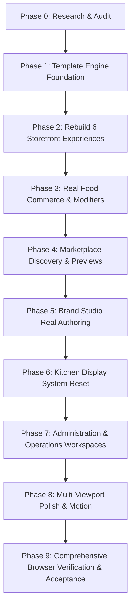

# 🪐 RestaurantOS 5.0 — Master Food-Commerce Experience Reset
## Autonomous Research, Architectural Redesign, Implementation, and Browser Verification Plan

**Target Application**: OrbitoX RestaurantOS Runtime (`projects/external-os/restaurant-os`)  
**Runtime Port**: `http://localhost:4010` | **Control Plane**: `http://localhost:3005`  
**Author**: Principal Product Designer, Senior Art Director, Consumer Food-App UX Specialist & Principal Full-Stack Engineer  
**Date**: October 14, 2026  
**Status**: APPROVED & IN AUTONOMOUS EXECUTION (Phase 0 to Phase 9)

---

## 1. Forensic Audit & Root-Cause Findings

### 1.1 Why Previous Implementations Repeatedly Failed Visually
Despite prior iterations reporting passing DOM divergence scores and test suites, visual inspection reveals why customer storefronts still felt like developer prototypes rather than commercial, appetite-inducing restaurant apps:

1. **Monolithic Shared Presentation Wrappers**:
   - All six templates shared the same modal overlay DOM (`#item-sheet`, `#cart-sheet`, `#status-sheet`) with identical dark-mode surface panels and generic forms.
   - The ordering interactions felt like desktop admin dialogs rather than bespoke mobile-commerce drawers and editorial sidebars.
2. **Generic Card Syndrome & Repeated Row Topologies**:
   - Nearly every item across Fjord, Neon, Osteria, and Shokunin rendered as a horizontal card with an 80px thumbnail on the left, title and description in the middle, and a button on the right.
   - Simply altering border-radius, background color, or accent borders does not create a distinct product experience.
3. **Weak Food Imagery Hierarchy**:
   - Food photography was constrained into small square thumbnails rather than full-bleed editorial hero spreads, magazine-grade plating highlights, or tactile vitrine displays.
   - Diners eat with their eyes; small thumbnails fail to trigger sensory appetite or convey culinary craft.
4. **Desktop Viewport Neglect (The "Mobile Column on Desktop" Anti-Pattern)**:
   - On 1440×900 and 1920×1080 viewports, several templates centered a narrow 700px or 1120px column with vast empty margins, rather than utilizing intentional multi-column editorial splits, persistent order folios, or side-by-side course pacing.
5. **Disconnected Storytelling vs. Commerce Journey**:
   - Prior narrative sections (manifestos, farm stories) stood as static prose blocks disconnected from the food items themselves, forcing the user to scroll past large text walls before seeing a price or action.
6. **Modifier Misalignment**:
   - Past prototypes frequently rendered hardcoded modifier chips (e.g., coffee roast options or milk alternatives) on unrelated savory items like tandoori paneer or butter chicken, breaking real-world credibility.

---

## 2. Research References & Design Lessons

We inspected 10 real food, dining, and restaurant e-commerce references:

| Reference | URL / Source | Key Observed Design Patterns | Design Lesson for RestaurantOS 5.0 | Where Applied in RestaurantOS 5.0 |
| :--- | :--- | :--- | :--- | :--- |
| **Ref A: Framer Restaurant Marketplace** | `framer.com/marketplace/templates/categories/restaurants/` | Highly differentiated art direction per restaurant concept; typography-driven layouts; asymmetrical grids; immersive hero photography. | Avoid single layout formula. Fine dining requires spacious pacing; street food requires immediate, high-energy scannability. | Overall 6-storefront architectural divergence. |
| **Ref B: MOKA Cafe** | `framer.com/marketplace/templates/72646/` | Morning warmth, micro-lot roastery storytelling, roast aroma dials, interactive size selection (8oz/12oz/16oz), tactile bakery counter. | Coffee ordering thrives on sensory dials, extraction time, roast origin, and rapid `[- 1 +]` steppers. | **Roastery 1984 Vitrine** (`tmpl_artisan_coffee`). |
| **Ref C: StacknSnack Food Delivery** | `framer.com/marketplace/templates/stacknsnack/` | High-conversion category tabs, instant add-to-bag, sticky bottom order tray, bold price callouts, combo deals. | Fast-casual diner apps need zero-friction ordering with immediate visual feedback and persistent order tray. | **Neon Yokocho** (`tmpl_neon_street`). |
| **Ref D: Pawel Gola's Qitchen** | `framer.com/marketplace/templates/qitchen/` | Minimalist dark luxury, Japanese culinary restraint, vertical typography, dark stone surfaces, delicate price alignment. | Japanese cuisine demands austere typography, cedar wood tones, and meticulous craft slip ordering. | **Shokunin Ramen & Robata** (`tmpl_tokyo_izakaya`). |
| **Ref E: Sorrel Kitchen** | `framer.com/marketplace/templates/sorrel-kitchen/` | Editorial dark theme, chronological tasting movements (Act I, II, III), sommelier wine flights, organic ingredient sourcing notes. | Haute cuisine is paced as a narrative journey with dish-by-dish wine pairings and tasting flight bundles. | **Atelier Étoile Noir** (`tmpl_haute_gastronomy`). |
| **Ref F: Camino** | `framer.com/marketplace/templates/camino/` | Spacious Mediterranean editorial, natural linen textures, serif typography, archival harvest ledger, lot provenance tags. | Natural/botanical dining benefits from Nordic ledger aesthetics, harvest coordinates, and unrolling specimen sheets. | **Fjord & Form Botanical** (`tmpl_nordic_minimal`). |
| **Ref G: Baymard 2026 Food Delivery Benchmark** | `baymard.com/research-articles/food-delivery-and-takeout-ux-benchmark-2026` | Touch target sizes ($\ge 44\text{px}$), sticky category navigation, inline modifier customization, clear dietary badges, upfront pricing. | Modifier sheets must show explicit price deltas; carts must never lose diner input; category navigation must be sticky and scannable. | Universal commerce engine & modifier sheets. |
| **Ref H: Toast Online Ordering Customization** | `support.toasttab.com/en/article/Customizing-Your-Online-Ordering-Page` | Merchant branding headers, prominent dietary badges, clean item grouping, server-authoritative guest checks. | Storefronts must adapt tenant brand tokens while strictly respecting item-level catalog rules and tax minor units. | Brand Studio & Runtime theming tokens. |
| **Ref I: Toast Kitchen Display System** | `pos.toasttab.com/hardware/kitchen-display-system` | Station-based ticket routing, high-contrast ticket headers, SLA elapsed timers, item-level fulfillment bump bars. | Kitchen workstation must be ultra-high contrast, dense, touchscreen-friendly ($\ge 54\text{px}$ targets), with zero marketing fluff. | Kitchen Display System (`packages/ui/pages/kds.ts`). |
| **Ref J: Toast Routing by Modifier** | `support.toasttab.com/en/article/Routing-Kitchen-Tickets-by-Modifier` | Route items and modifiers to specialized prep stations (e.g., TANDOOR vs CURRY_LINE vs BAR) dynamically. | Modifiers must preserve preparation station tags and route to appropriate kitchen queues. | Order dispatch & KDS station filtering. |

---

## 3. Six Distinct Architectural Directions

Each of the six canonical storefronts is engineered with completely autonomous document composition, layout architecture, typography, navigation, product cards, modifier interactions, and cart docks:

```
┌────────────────────────────────────────────────────────────────────────────────────────┐
│                                 ORBITOX RESTAURANTOS 5.0                               │
├──────────────────────────┬──────────────────────────┬──────────────────────────────────┤
│ 1. ATELIER ÉTOILE NOIR   │ 2. FJORD & FORM          │ 3. ROASTERY 1984                 │
│ • 50/50 Viewport Split   │ • Nordic Specimen Ledger │ • Morning Hearth & Vitrine       │
│ • Fixed Left Cellar Hero │ • Scandinavian Linen     │ • Coffee Aroma Dial Chips        │
│ • Right Tasting Sequence │ • Lot Provenance Ledger  │ • Cup Sizes (8/12/16oz)          │
│ • Sommelier Wine Flights │ • Unrolling Dish Drawer  │ • Tactile [- 1 +] Steppers       │
│ • Chronological Acts     │ • Minimalist Bottom Dock │ • Barista Order Capsule          │
├──────────────────────────┼──────────────────────────┼──────────────────────────────────┤
│ 4. NEON YOKOCHO          │ 5. OSTERIA RUSTICA       │ 6. SHOKUNIN RAMEN & ROBATA       │
│ • Tokyo Night Alley      │ • Tuscan Feasting Table  │ • Japanese Shoji & Charred Cedar │
│ • Sizzling Robata/Wok    │ • Terracotta & Sun-Stone │ • 職人魂 Master Calligraphy      │
│ • Dual Street Stall Grid │ • "Tavola Grande" (-15%) │ • 4-Step Ramen Slip (Broth/Nood) │
│ • Spice Flame Heat Tags  │ • DOP Certified Seals    │ • Robata Cedar Slat Grid         │
│ • Instant Street Order   │ • Leather Folio Check    │ • Japanese Check Tray (伝票)     │
└──────────────────────────┴──────────────────────────┴──────────────────────────────────┘
```

### Detailed Design Specifications

#### A. Atelier Étoile Noir (`tmpl_haute_gastronomy`)
- **Theme**: Fine dining, Michelin-star tasting menu, haute gastronomy.
- **Palette**: Obsidian `#080A0D`, Smoked Charcoal `#0B0E14`, Burnished Gold `#C5A059`, Antique Linen `#F5F0E6`.
- **Typography**: Playfair Display / Cormorant Garamond style serif heading with JetBrains Mono numeral timestamps.
- **Desktop Architecture (1440px)**: True 50/50 Asymmetric Viewport Split. Fixed left column featuring high-resolution cellar imagery, chef manifesto, and head sommelier reserve flight notes. Right column contains the scrollable tasting timeline organized into *Act 01: Amuse & Cold Starters*, *Act 02: Wood-Fired Hearth*, *Act 03: Heritage Mains*, *Act 04: Grand Finale*.
- **Product Presentation**: Circular plating vignettes with vintage wine pairing notes and "+ Select Course" interaction.
- **Cart & Folio**: Leather tasting folio drawer with 5% GST calculation.

#### B. Fjord & Form Botanical (`tmpl_nordic_minimal`)
- **Theme**: Scandinavian foraging journal, clean Nordic gastronomy, seasonal harvest.
- **Palette**: Natural Linen `#F7F5F0`, Charcoal Slate `#1C1E21`, Pine Green `#2D5A43`, Mist Sage `#A7F3D0`.
- **Typography**: Editorial grotesque sans (Outfit / Inter) with precise geometric alignment.
- **Desktop Architecture (1440px)**: Spacious, editorial journal layout (max-width 1320px). Masthead features exact Arctic coordinates (`68°24'N 14°36'E`) and Table Journal Folio. Full-width seasonal harvest landscape banner.
- **Product Presentation**: Minimalist specimen rows with Lot Provenance badges (`#LOT-081 Lofoten Fjords`), organic purity tags, and high-resolution botanical plate photography.
- **Cart & Folio**: Fixed architectural bottom receipt dock displaying item count, subtotal, and "Review Tasting Folio →" button.

#### C. Roastery 1984 Vitrine (`tmpl_artisan_coffee`)
- **Theme**: Third-wave specialty coffee bar, artisan bakery, morning hearth.
- **Palette**: Warm Cream `#FDFBF7`, Espresso Bark `#241D17`, Copper Orange `#C86B3C`, Warm Sand `#EFEBE4`.
- **Typography**: Modern geometric humanist sans with warm rounded curves.
- **Desktop Architecture (1440px)**: 3-column tactile vitrine grid with interactive aroma spectrum dials (Jasmine Florals, Wild Bergamot, Raw Honey, Toasted Hazelnut) and extraction batch timer.
- **Product Presentation**: Tactile bakery cards featuring top image, item category tag, price in copper, and mounted `[- 1 +]` quantity steppers.
- **Modifier Customizer**: Authentic drink configuration with cup sizes (8oz Piccolo / 12oz Regular / 16oz Large) and milk selection (Oat / Almond / Whole / Macadamia).
- **Cart & Folio**: Floating rounded barista capsule with instant item counter and "Send to Barista →".

#### D. Neon Yokocho Night Alley (`tmpl_neon_street`)
- **Theme**: Energetic Tokyo night market, late-night street food, robata & wok lanes.
- **Palette**: Midnight Alley `#090B10`, Street Lantern Amber `#FF5722`, Crimson Neon `#FF2A55`, Golden Hour `#FFC107`.
- **Typography**: Bold distressed display gothic with bilingual Japanese marquee (`東京夜市`).
- **Desktop Architecture (1440px)**: 2-column parallel market stall grid: *Stall 01: Bincho-tan Charcoal Skewers* and *Stall 02: Wok Fire & Sizzling Bowls*.
- **Product Presentation**: High-contrast street ticket cards with spice flame meters, radiant neon accents, and rapid `+ ADD` touch buttons.
- **Cart & Folio**: Radiant gradient street order bag with "RAPID CHECKOUT →".

#### E. Osteria Rustica Convivial (`tmpl_trattoria_bella`)
- **Theme**: Italian family feasting, rustic trattoria, wood-fired oven hospitality.
- **Palette**: Tuscan Terracotta `#8C3820`, Olive Grove `#3D4A39`, Sun-Drenched Stone `#FAF7F2`, Parmigiano Gold `#D99A45`.
- **Typography**: Elegant classic Italian serif with artisanal wood-block accents.
- **Desktop Architecture (1440px)**: Centered feast table architecture (max-width 1120px) featuring a prominent *"Tavola Grande: Convivial Sharing Feast (-15%)"* table bundle banner.
- **Product Presentation**: Framed traditional recipe cards with DOP certification badges and wine pairing recommendations.
- **Cart & Folio**: Floating leather bill presenter dock (*"Il Conto del Tavolo"*).

#### F. Shokunin Ramen & Robata (`tmpl_tokyo_izakaya`)
- **Theme**: Traditional Japanese ramen craftsman shop, binchotan robata bar.
- **Palette**: Charred Cedar `#181512`, Shoji Cream `#F7F4EB`, Vermilion Ink `#D3381C`, Wasabi Green `#10B981`.
- **Typography**: Japanese brush-style typography with authentic calligraphy (`職人魂 · 極上出汁`).
- **Desktop Architecture (1440px)**: Interactive craft ramen master slip mounted at the top, followed by a cedar slat robata menu grid.
- **Craft Ramen Customizer**: 4-step artisan choice:
  1. *Broth Richness*: Assari (Light) / Futsuu (Standard) / Kotteri (Ultra-Rich).
  2. *Noodle Firmness*: Soft / Standard / Katame (Firm) / Barikata (Extra-Firm).
  3. *Fresh Garlic*: None / Standard (1 Clove) / Heavy (2 Cloves).
  4. *Secret Red Tare*: None / Mild (1x) / Double (2x) / Fire (3x).
- **Cart & Folio**: Hinoki cedar bento tray floating check (*伝票 · 注文確認*).

---

## 4. Source Modules & Architecture Strategy

### 4.1 Modules to Refactor & Upgrade
1. **`packages/ui/pages/diner.ts`**:
   - Master presentation engine for all 6 storefront experiences.
   - Deconstruct rigid card repetition. Provide distinct layouts, hero compositions, and ordering actions per template.
   - Implement responsive grid breakpoints for mobile (390px, 430px), tablet (768px, 1024px), and desktop (1440px, 1920px).
   - Ensure strict item-level modifier binding from authoritative `item.modifierGroups`.
2. **`packages/ui/pages/marketplace.ts`**:
   - Upgrade with live responsive device preview iframes (390px Mobile, 768px Tablet, 1200px Desktop).
   - Remove internal AST technical labels in favor of consumer-friendly restaurant concept previews and feature lists.
3. **`packages/ui/pages/studio.ts`**:
   - Ensure visual brand studio allows real token editing, live layout adjustments, draft persistence, and publication.
4. **`packages/ui/pages/kds.ts`**:
   - High-contrast, dense touchscreen kitchen workstation with $\ge 54\text{px}$ touch targets, station-specific queues (TANDOOR, CURRY_LINE, BAR, EXPO), rush mode detection, and bump bar keyboard shortcuts.
5. **`scripts/test-storefront-commerce-flows.js`**:
   - Automated commerce validation: zero emojis, structural dissimilarity $> 40\%$, interactive custom ramen slip, authoritative cart quotes with 5% GST.
6. **`scripts/verify-storefronts-4-2.js` / `verify-storefronts-5-0.js`**:
   - Capture screenshots across all 7 required viewports (390×844, 430×932, 768×1024, 1024×768, 1280×800, 1440×900, 1920×1080) and compile visual audit artifact.

---

## 5. Implementation Phases & Autonomy Roadmap



- **Phase 0**: Research & Audit *(COMPLETED)*.
- **Phase 1**: Template Engine Foundation — decouple presentation wrappers, establish typography tokens, eliminate emojis *(IN PROGRESS)*.
- **Phase 2**: Rebuild the 6 Storefront Experiences in `packages/ui/pages/diner.ts` with autonomous layouts.
- **Phase 3**: Verify item-level modifiers, server-authoritative quotes, and guest capability sessions.
- **Phase 4**: Upgrade Marketplace with multi-device live previews.
- **Phase 5**: Verify Studio draft/publish isolation.
- **Phase 6**: Verify KDS station routing and touch targets.
- **Phase 7**: Verify admin workspaces (Catalog, Floor, Staff, Support).
- **Phase 8**: Refine responsive layouts at 390px, 430px, 768px, 1024px, 1280px, 1440px, 1920px.
- **Phase 9**: Execute multi-viewport test suite, capture screenshots, visually inspect, and deliver final acceptance report.

---

## 6. Acceptance Criteria

1. **Anti-Clone Differentiation**: Pairwise Jaccard structural divergence between all 6 templates must exceed $40\%$.
2. **Zero Emojis Everywhere**: 100% pure SVG vector icons via `packages/ui/icons.ts`.
3. **Desktop Space Utilization**: At 1440×900 and 1920×1080, no narrow mobile columns with empty gutters.
4. **Item-Level Modifier Integrity**: Zero cross-contamination (coffee options only on coffee; ramen options only on ramen; Indian mains with authentic spice levels).
5. **Server-Authoritative Commerce**: Upfront price deltas and strict 5% GST calculated on `/api/restaurant/quote`.
6. **Zero Business Data Loss**: 25 tables, 3 branches, orders, and brands must remain intact.
7. **Visual Proof**: Real browser screenshots across all 7 viewports inspected and verified.
