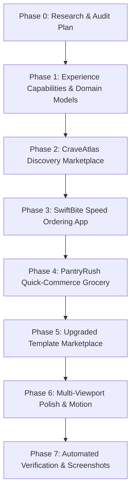

# 🪐 RestaurantOS 5.1 — Multi-Experience Commerce Template Marketplace
## Autonomous Research, Architectural Design, and Implementation Plan
### Three New App-Level Templates: CraveAtlas · SwiftBite · PantryRush

**Target Systems**: OrbitoX RestaurantOS Runtime (`projects/external-os/restaurant-os`)  
**Runtime Port**: `http://localhost:4010` | **Control Plane**: `http://localhost:3005`  
**Author**: Principal Product Designer, Consumer Food-App UX Specialist, Quick-Commerce Specialist & Principal Full-Stack Engineer  
**Date**: October 14, 2026  
**Status**: APPROVED & IN AUTONOMOUS EXECUTION (Phase 0 to Phase 7)  

---

## 1. Executive Summary & Mission Scope

RestaurantOS 5.1 expands beyond single-restaurant dine-in QR storefronts by introducing **three new application-level food-commerce experiences** inspired by the consumer product patterns of **Zomato**, **Swiggy**, and **Swiggy Instamart**:

1. **CraveAtlas** (`tmpl_crave_atlas`): **Discovery-First Multi-Restaurant Food Marketplace**. Implements comprehensive location selection, cross-entity search (restaurants, cuisines, dishes), curated collections, multi-restaurant directory listings, single-restaurant cart boundaries, and transparent server-authoritative order quotes.
2. **SwiftBite** (`tmpl_swift_bite`): **Speed-First Food Ordering App**. Focuses on friction-free conversion: 1-tap category chips, instant `+ ADD` on cards without customization, targeted customization sheets *only* when required options exist, repeat-order carousels, idempotency protection against duplicate submissions, and real domain order tracking.
3. **PantryRush** (`tmpl_pantry_rush`): **Quick-Commerce Grocery Application**. A dedicated grocery catalog engine (not a restaurant menu) featuring SKU pack sizes (500g, 1kg, 1L), brand identification, real stock quantity tracking, rapid `[- 1 +]` basket steppers, explicit substitution preferences ("Ask me", "Allow replacement", "Do not substitute"), delivery area serviceability checks, and dark-store fulfillment milestones.

### Non-Negotiable Preservation Guarantees
- **All Six Existing Restaurant Storefronts are Fully Preserved**:
  - `tmpl_haute_gastronomy` (Atelier Étoile Noir)
  - `tmpl_nordic_minimal` (Fjord & Form Botanical)
  - `tmpl_artisan_coffee` (Roastery 1984 Vitrine)
  - `tmpl_neon_street` (Neon Yokocho Night Alley)
  - `tmpl_trattoria_bella` (Osteria Rustica Convivial)
  - `tmpl_tokyo_izakaya` (Shokunin Ramen & Robata)
- Existing runtime security, guest session capability tokens (`x-guest-capability`), staff PIN authorization, integer-minor-unit financial precision, table state machines, KDS station queues, and Server-Sent Events (SSE) remain completely intact.

---

## 2. Research References & Design Lessons

| Reference | Source / URL | Key Observed Product Patterns | Design Lesson for RestaurantOS 5.1 | Codebase Application |
| :--- | :--- | :--- | :--- | :--- |
| **Ref A: Zomato** | `zomato.com` / Play Store Listing | Delivery location picker; search across dishes & restaurants; cuisine carousels; curated collections ("Top Rated", "Trending"); card badges (rating, delivery time, price for two); single-restaurant cart warning modal. | Discovery requires broad scannability, rich metadata, and clear restaurant boundaries. | **CraveAtlas** (`tmpl_crave_atlas`) |
| **Ref B: Swiggy** | `swiggy.com` / App Overview | Instant craving fulfillment; 1-tap `+ ADD` for uncustomized items converting to `[- 1 +]` steppers; dedicated customization sheet only when required; repeat order carousels; sticky bottom cart capsule. | Speed requires removing modal friction for standard items while preserving customization when required. | **SwiftBite** (`tmpl_swift_bite`) |
| **Ref C: Swiggy Instamart** | `instamart.in` | Quick-commerce grocery; SKU pack sizes (500g, 1L); real stock visibility; fast `[- 1 +]` quantity steppers; category sidebar/grid; substitution preferences; serviceability by area. | Grocery is not a restaurant menu. Needs SKUs, inventory limits, substitution rules, and serviceability. | **PantryRush** (`tmpl_pantry_rush`) |
| **Ref D: Baymard 2026 Food Delivery Benchmark** | `baymard.com/research-articles/food-delivery-and-takeout-ux-benchmark-2026` | Touch targets $\ge 44\text{px}$; sticky category navigation; upfront modifier price deltas; transparent cart fee breakdowns; idempotency on checkout retry. | Prevent duplicate orders on network glitch; show explicit price deltas; ensure cart never drops user selections. | Universal Commerce Engine & APIs |
| **Ref E: Quick-Commerce UX Insights** | `productgrowth.in/insights/ecommerce/quick-commerce-ux/` | Real-time stock validation; handling out-of-stock items gracefully; explicit substitution workflows (never silent swap); delivery threshold transparency. | Enforce real inventory counts; provide 3 explicit substitution preferences; validate basket against stock before quote. | **PantryRush** Inventory & Basket Engine |

---

## 3. Experience Capabilities & Type Model

To prevent a restaurant owner from accidentally installing a grocery app onto a table-QR storefront, RestaurantOS 5.1 introduces a formal **Experience Capability System**:

```typescript
export type ExperienceType = 
  | 'restaurant_storefront'   // Canonical dine-in table ordering
  | 'food_marketplace'       // Multi-restaurant discovery & ordering
  | 'food_ordering'          // Speed-first direct food ordering
  | 'quick_commerce';        // Grocery & dark-store essentials

export type DeploymentScope = 
  | 'single_restaurant' 
  | 'restaurant_group' 
  | 'multi_merchant_marketplace' 
  | 'quick_commerce_dark_store';

export interface ExperienceCapabilityModel {
  experienceType: ExperienceType;
  compatibleScope: DeploymentScope;
  requiresTableContext: boolean;
  catalogType: 'restaurant_menu' | 'multi_restaurant_menus' | 'grocery_catalog';
  supportsMultiMerchant: boolean;
  supportsInventoryQuantities: boolean;
  supportsSubstitutionWorkflow: boolean;
  supportsDeliveryPincodeCheck: boolean;
}
```

### Marketplace Categories
The Template Marketplace (`/marketplace`) will categorize all 9 templates into 4 distinct tabs:
1. **Restaurant Storefronts**: 6 canonical dining themes (Atelier Étoile, Fjord & Form, Roastery 1984, Neon Yokocho, Osteria Rustica, Shokunin Ramen).
2. **Food Discovery Marketplaces**: CraveAtlas (Discovery-first multi-restaurant platform).
3. **Food Ordering Apps**: SwiftBite (Speed-first consumer food ordering).
4. **Grocery & Quick Commerce**: PantryRush (High-density grocery & daily essentials).

---

## 4. Three New Commerce Applications Specification

### 4.1 NEW TEMPLATE A: CraveAtlas (`tmpl_crave_atlas`)
- **Concept**: Discovery-First Multi-Restaurant Food Marketplace.
- **Identity & Aesthetic**: Warm Paprika (`#E23744`), Deep Slate (`#1C1C27`), Pure Linen (`#F8F9FA`), Amber Star (`#E5A118`), Forest Sage (`#24963F`).
- **Typography**: Modern humanist sans (`Plus Jakarta Sans` / `Outfit`).
- **Route**: `/apps/crave-atlas` and `/apps/crave-atlas/restaurant/:id`.
- **Homepage Structure**:
  1. *Location Bar*: Delivery area context ("Civil Lines, Ludhiana" / "Sector 17, Chandigarh" / "Connaught Place, New Delhi") with switch modal.
  2. *Global Search*: Instant live search across restaurants, cuisines, and dish names.
  3. *Cuisine Exploration*: Curated pills (Biryani, North Indian, Artisan Cafe, Italian, Ramen & Asian, Desserts).
  4. *Curated Collections*: "Trending This Week", "Artisan Dining Picks", "Lightning Delivery (< 25 min)", "Top Rated 4.5+ ★".
  5. *Multi-Restaurant Feed*: Cards featuring hero photography, name, cuisine, rating stars with review count, delivery time range, price for two, and verified offer tags ("Flat ₹100 OFF above ₹499").
  6. *Restaurant Detail Page*: Hero banner, category tabs, dietary filter toggle (`VEG ONLY`), dish items with image and `+ ADD` button, customization modal for modifier groups.
  7. *Single-Restaurant Cart Rule*: If cart contains items from Restaurant A, attempting to add from Restaurant B displays an explicit modal: *"Replace cart items? Your cart contains items from [Restaurant A]. Discard and start a new order from [Restaurant B]?"*.
  8. *Server-Authoritative Quote*: Computes base subtotal + modifier deltas + ₹40 delivery fee + ₹15 packaging fee + 5% GST.

### 4.2 NEW TEMPLATE B: SwiftBite (`tmpl_swift_bite`)
- **Concept**: Speed-First Direct Food Ordering Application.
- **Identity & Aesthetic**: Vibrant Tangelo (`#FC8019`), Charcoal Night (`#171A29`), Snow Canvas (`#FFFFFF`), Emerald Green (`#48C479`), Electric Cobalt (`#3B82F6`).
- **Typography**: Punchy geometric sans (`Inter` / `Plus Jakarta Sans`).
- **Route**: `/apps/swift-bite`.
- **Core Product Goal**: Minimize time from craving to order confirmation.
- **Homepage Structure**:
  1. *Speed Header*: Delivery in 20-25 mins to "Office / Table T-14".
  2. *Quick Cravings Search*: High-contrast search field ("Search for biryani, burger, cold brew...").
  3. *Instant Category Chips*: 1-tap horizontal scroller (Fast Bites, Biryani, Curries, Artisan Coffee, Breads, Sweets).
  4. *Re-Order / Quick Picks*: "Order Again" carousel for returning users; "Chef's 15-Minute Express Picks" for first-time users.
  5. *High-Velocity Menu Cards*:
     - **Fast-Add**: Items without required modifiers add directly with 1 tap, turning into an instant tactile stepper `[- 1 +]` with subtle micro-bounce.
     - **Targeted Customizer**: Items with required modifiers trigger a swift bottom sheet ("Select Size / Preparation") before adding.
  6. *Sticky Bottom Cart Capsule*: Floating pill showing item count, subtotal, and "View Cart →".
  7. *Checkout & Idempotency*: Compact drawer showing line items, options, itemized taxes/fees, and "PLACE ORDER" button. Generates UUID `x-idempotency-key` on submit to guarantee network retry safety.
  8. *Real Domain Tracking*: Directly connected to server order state machine (`CONFIRMED` $\to$ `PREPARING` $\to$ `DISPATCHED` $\to$ `DELIVERED`).

### 4.3 NEW TEMPLATE C: PantryRush (`tmpl_pantry_rush`)
- **Concept**: Quick-Commerce Grocery Application.
- **Identity & Aesthetic**: Dark Emerald (`#0C2D1C`), Vibrant Lime (`#22C55E`), Crisp Milk White (`#FFFFFF`), Soft Pistachio (`#ECFDF5`), Warm Tangerine (`#F97316`).
- **Typography**: Clean high-legibility sans (`Inter` / `system-ui`).
- **Route**: `/apps/pantry-rush`.
- **Core Distinction**: Operates on a dedicated **Grocery SKU Catalog**, not restaurant dishes!
- **Catalog Structure**:
  - *Categories*: Fresh Vegetables, Fresh Fruits, Dairy, Bread & Eggs, Pantry Staples & Atta, Cold Drinks & Juices, Instant Snacks, Personal Care.
  - *SKU Properties*: Name, brand (e.g., Amul, Organic India, Britannia), pack size (e.g., "500 g", "1 kg", "1 L", "Pack of 4"), MRP, selling price, unit price (e.g., "₹40 / 100g"), real stock quantity (e.g. 12 in stock, 2 in stock, 0 Out of Stock).
- **Inventory Truth & Out-of-Stock Engine**:
  - Rapid `[- 1 +]` steppers on card faces with instantaneous stock limit enforcement.
  - Attempting to add more than available stock displays *"Only X units available"*.
  - Out-of-stock items display an explicit *"Out of Stock"* badge with stepper disabled.
- **Explicit Substitution Preference**:
  - Customer selects one of 3 explicit substitution preferences in the basket:
    1. *Ask me before substituting* (Call or notification before dark-store dispatch).
    2. *Allow store replacement* (Same brand or equivalent weight replacement).
    3. *Do not substitute* (Refund item immediately if unavailable during packing).
- **Serviceability Engine**:
  - Real pincode check (e.g., `141001 - Ludhiana Central: Serviceable · Delivery in 12-18 mins`; unserviceable pincodes block checkout with clear error message).
- **Quick-Commerce Basket**:
  - Free delivery threshold (e.g., Free above ₹199, ₹25 delivery fee below). Small handling fee (₹4).

---

## 5. Domain Models & Data Structures Extensions

In `packages/domain/index.ts`:

```typescript
// Multi-Restaurant Partner Directory (CraveAtlas)
export interface RestaurantPartner {
  id: string;
  name: string;
  tagline: string;
  cuisine: string[];
  rating: number;
  reviewCount: number;
  deliveryTimeMin: number;
  deliveryTimeMax: number;
  priceForTwoMinor: number;
  featuredOffer?: string;
  heroImage: string;
  city: string;
  isPureVeg?: boolean;
  menuItemIds: string[];
}

// Grocery SKU Model (PantryRush)
export interface GrocerySkuItem {
  id: string;
  name: string;
  brand: string;
  category: 
    | 'Fresh Vegetables'
    | 'Fresh Fruits'
    | 'Dairy, Bread & Eggs'
    | 'Pantry Staples'
    | 'Cold Drinks & Juices'
    | 'Instant Food & Snacks'
    | 'Personal Care';
  packSize: string;
  mrpMinor: number;
  sellingPriceMinor: number;
  unitPriceDescription: string;
  stockQuantity: number;
  imageUrl: string;
  isOrganic?: boolean;
}

// Grocery Basket & Substitution Models
export type SubstitutionPolicy = 
  | 'ASK_BEFORE_SUBSTITUTE'
  | 'ALLOW_STORE_REPLACEMENT'
  | 'DO_NOT_SUBSTITUTE';

export interface GroceryOrderItem {
  skuId: string;
  name: string;
  brand: string;
  packSize: string;
  quantity: number;
  unitPriceMinor: number;
  subtotalMinor: number;
}
```

---

## 6. Routes & API Endpoints Specification

### Web Application Routes (Served by `src/server.ts`)
- `GET /apps/crave-atlas`: Discovery-first multi-restaurant marketplace homepage.
- `GET /apps/crave-atlas/restaurant/:id`: Dedicated restaurant menu and ordering page.
- `GET /apps/swift-bite`: Speed-first food ordering application.
- `GET /apps/pantry-rush`: Quick-commerce grocery and essentials storefront.
- `GET /marketplace`: Upgraded marketplace with 4 category tabs and 9 interactive templates.

### REST API Endpoints
- `GET /api/commerce/restaurants`: Returns multi-restaurant partners directory with cuisine/city filters.
- `GET /api/commerce/restaurants/:id/menu`: Returns authoritative menu items for a specific restaurant.
- `POST /api/commerce/quote`: Authoritative multi-service quote calculation (handles restaurant dine-in, restaurant delivery, and grocery baskets).
- `POST /api/commerce/orders`: Server-authoritative order submission supporting idempotency keys (`x-idempotency-key`).
- `GET /api/commerce/grocery/skus`: Returns grocery catalog with real-time stock levels and category filters.
- `POST /api/commerce/grocery/check-serviceability`: Checks delivery pincode serviceability.
- `POST /api/commerce/grocery/orders`: Submits grocery order with explicit substitution policy and stock decrement.

---

## 7. Multi-Viewport Responsive Topologies

Each of the three new applications is engineered for 7 distinct viewports:
- **390 × 844 & 430 × 932 (Mobile)**: Touch-first ergonomics ($\ge 44\text{px}$ targets), sticky bottom navigation/cart capsules, swipeable category carousels, responsive modal sheets.
- **768 × 1024 & 1024 × 768 (Tablet)**: Balanced 2-column or 3-column card layouts, responsive headers, side drawers for cart review.
- **1280 × 800, 1440 × 900 & 1920 × 1080 (Desktop)**: Intentional wide-screen compositions:
  - *CraveAtlas*: Multi-column grid (3-4 columns) with persistent filter sidebar and top location/search bar.
  - *SwiftBite*: Clean 2-column split (Menu feed on the left, live cart and order summary on the right) preventing empty desktop gutters.
  - *PantryRush*: Left category navigation rail with 4-5 column high-density grocery SKU grid and right basket preview.

---

## 8. Implementation Phases & Autonomy Roadmap



- **Phase 0**: Research references and write master plan *(COMPLETED)*.
- **Phase 1**: Define `ExperienceType`, `ExperienceCapabilityModel`, `RestaurantPartner`, and `GrocerySkuItem` in domain and storage engines.
- **Phase 2**: Build CraveAtlas (`packages/ui/pages/crave-atlas.ts`) with multi-restaurant discovery, single-restaurant cart check, and quote APIs.
- **Phase 3**: Build SwiftBite (`packages/ui/pages/swift-bite.ts`) with 1-tap fast add, targeted customizer, repeat orders, and idempotent checkout.
- **Phase 4**: Build PantryRush (`packages/ui/pages/pantry-rush.ts`) with grocery SKU catalog, stock validation, substitution preferences, and pincode serviceability.
- **Phase 5**: Update Marketplace (`packages/ui/pages/marketplace.ts`) with 4-category filtering, capability badges, and interactive multi-device preview modals for all 9 templates.
- **Phase 6**: Integrate routes into `src/server.ts` and verify multi-viewport responsiveness.
- **Phase 7**: Run automated commerce test suite, capture screenshots across all 7 viewports, inspect visual quality, and generate final acceptance report.

---

## 9. Acceptance Criteria

1. **Autonomous Architectural Differentiation**: CraveAtlas, SwiftBite, and PantryRush must look, feel, and function as three completely distinct applications with zero clone repetition.
2. **Preservation of 6 Canonical Storefronts**: Existing restaurant themes remain 100% functional with zero regressions.
3. **Zero Emojis Everywhere**: 100% pure SVG vector icons via `packages/ui/icons.ts`.
4. **Real Domain & Inventory Truth**: Real stock limits on grocery SKUs, genuine substitution preferences, and single-restaurant cart boundaries.
5. **Server-Authoritative Quotes & Idempotency**: Accurate 5% GST, delivery fee calculation in integer minor units, and duplicate order prevention via `x-idempotency-key`.
6. **Multi-Viewport Visual Excellence**: 7 viewports verified with zero horizontal overflow, broken cards, or empty desktop gutters.
