# 🪐 OrbitoX Architecture Reconciliation & Issue Resolution Report
**Classification:** Canonical Architecture Specification & Resolution Matrix  
**Date:** October 25, 2026  
**Audited SHA:** `e3fd2fa74174360f0984a7b9c9cd04e4059d3e57`  

---

## 1. Canonical OrbitoX Architecture Map

The diagram below reflects the **actual working architecture** of the OrbitoX Platform reconstructed from the audited source code, dependency graphs, and runtime entry points.

```mermaid
graph TB
    subgraph ControlPlaneClient ["🖥️ Platform Control Center (Next.js 15 — Port 3005)"]
        UI_Fleet["Fleet Cockpit (/platform/fleet)"]
        UI_Projects["Projects Manager (/platform/projects)"]
        UI_Blueprints["Resource Graph & Editor (/platform/explorer)"]
        UI_Security["Security & API Keys (/platform/api-keys)"]
        UI_Settings["Cluster & System Settings (/platform/settings)"]
    end

    subgraph ControlPlaneBackend ["⚙️ Control Plane APIs & Brain (/api/v1/...)"]
        API_Projects["/api/v1/projects/*"]
        API_Platform["/api/v1/platform/*"]
        API_Admin["/api/v1/admin/*"]
        ResourceGraph["ResourceGraphService (In-Memory DAG)"]
        CommandBus["CommandBusService (Four-Eyes Approval)"]
        ControlStore["PersistentControlStore (control-plane-store.json)"]
        PlatformRepo["PlatformRepository (Static In-Memory Arrays)"]
    end

    subgraph KernelPackages ["📦 Foundational Kernel & SDK Packages"]
        CorePkg["@orbitox/core\n(RBAC, Audit, Quote, Policy)"]
        PluginEngine["@orbitox/plugin-engine\n(MultiTenantEngine, CryptoSigner, SandboxGuard)"]
        ExtSDK["@orbitox/external-runtime-sdk\n(ControlClient, ProjectHeartbeat)"]
        RuntimePkg["@orbitox/runtime\n(App Container)"]
        TypesPkg["@orbitox/types\n(Domain Interfaces)"]
        UtilsPkg["@orbitox/utils\n(Crypto & Helpers)"]
        ImporterCore["@orbitox/importer-core\n(SceneGraph & Figma Ingestion)"]
    end

    subgraph BusinessPlugins ["🧩 Headless Business Domain Plugins"]
        POSPlugin["@orbitox/pos\n(POS, Dining, Kitchen DAG, KDS, Quotes, QR Trust)"]
        CRMPlugin["@orbitox/crm\n(Lead Scoring, State Machine)"]
        ExtProjEngine["@orbitox/external-project-engine\n(Fleet Monitoring, Template Provisioner)"]
        CommercePlugin["@orbitox/commerce"]
        FinancePlugin["@orbitox/finance"]
        HMSPlugin["@orbitox/hms"]
        HRMSPlugin["@orbitox/hrms"]
        SchoolPlugin["@orbitox/school"]
        CelebrationsPlugin["@orbitox/celebrations"]
    end

    subgraph ScopeProxies ["🔄 Scope Compatibility Layer"]
        CompatCE["@orbitox-io/plugin-engine -> @orbitox/plugin-engine"]
        CompatCRM["@orbitox-io/crm -> @orbitox/crm"]
        CompatCel["@orbitox-io/celebrations -> @orbitox/celebrations"]
        CompatImp["@orbitox-io/importer-core -> @orbitox/importer-core"]
    end

    subgraph IndependentProducts ["🚀 Independent Operating Products"]
        subgraph RestaurantOSProduct ["🍷 RestaurantOS (Port 4010)"]
            RestServer["src/server.ts (7,004 Lines)"]
            RestBridge["RestaurantControlBridge (Syncs with Control Plane)"]
            RestStorage["Storage Engine\n(PostgreSQL RLS + Atomic JSON fallback)"]
            RestWorkspaces["Workspaces: Floor Studio, KDS, Diner PWA, Orders, Menu"]
        end

        subgraph HospitalOSProduct ["🏥 HospitalOS (Port 3000 / Standalone)"]
            HospServer["src/server.ts & factory.ts"]
            HospFlow["11-Stage Clinical Pipeline, Vitals IoT Alarm, Code Blue"]
        end

        subgraph CelebrationsProduct ["🎉 Celebrations Studio (Port 3001)"]
            CelStudio["Visual Studio 3.0 (/admin/template-studio)"]
            CelRenderer["Renderer & Templates (/e/celestial-odyssey)"]
        end

        subgraph ConsumerApp ["💼 Standalone Consumer Example"]
            TestConsumer["projects/examples/test-consumer-app"]
        end
    end

    %% Control Plane Flows
    UI_Fleet --> API_Projects
    UI_Projects --> API_Projects
    UI_Blueprints --> API_Platform
    UI_Security --> API_Admin
    API_Projects --> ExtProjEngine
    ExtProjEngine --> ControlStore
    API_Platform --> CorePkg
    CorePkg --> ResourceGraph
    CorePkg --> CommandBus
    API_Platform --> PlatformRepo

    %% Package Dependencies
    PluginEngine --> CorePkg
    PluginEngine --> TypesPkg
    POSPlugin --> CorePkg
    POSPlugin --> PluginEngine
    CRMPlugin --> PluginEngine
    ExtProjEngine --> CorePkg
    ExtProjEngine --> ExtSDK

    %% Compatibility Links
    CompatCE -.-> PluginEngine
    CompatCRM -.-> CRMPlugin
    CompatCel -.-> CelebrationsPlugin
    CompatImp -.-> ImporterCore
    TestConsumer --> CompatCE
    TestConsumer --> CompatCRM

    %% Product Wiring
    RestServer --> POSPlugin
    RestServer --> ExtSDK
    RestServer --> RestBridge
    RestBridge -.->|Heartbeat / Polling Loop| API_Projects
    RestServer --> RestStorage

    HospServer --> CorePkg
    HospServer --> PluginEngine
    HospServer --> RuntimePkg

    CelStudio --> CelebrationsPlugin
    CelStudio --> ImporterCore
```

---

## 2. Issue A: Package Naming and Publishing Contracts

### 2.1 The Issue
`AGENTS.md` mandates publishing and importing packages under the `@orbitox-io` scope on GitHub Packages (`https://npm.pkg.github.com`). However, the monorepo packages under `orbitox/packages/` and `orbitox/plugins/` use the `@orbitox` scope (e.g. `@orbitox/plugin-engine`, `@orbitox/pos`, `@orbitox/core`). Furthermore, compatibility shim packages (`compat-plugin-engine`, `compat-crm`, `compat-celebrations`, `compat-importer-core`) exist in `orbitox/packages/` which declare the `@orbitox-io` name and re-export the `@orbitox/*` packages.

### 2.2 Evidence-Based Package Mapping

| Package / Directory | Current `package.json` Name | Actual Consumers in Repo | Intended Canonical Scope | Required Action |
| :--- | :--- | :--- | :--- | :--- |
| `orbitox/packages/core` | `@orbitox/core` | `plugin-engine`, `runtime`, `services`, `commerce`, `pos`, `external-project-engine`, `hospital-os` | `@orbitox/core` (Private Kernel) | Keep private within workspace. Do not publish publicly. |
| `orbitox/packages/types` | `@orbitox/types` | All packages and plugins | `@orbitox/types` | Internal workspace dependency. |
| `orbitox/packages/utils` | `@orbitox/utils` | `core`, `services`, `commerce` | `@orbitox/utils` | Internal workspace dependency. |
| `orbitox/packages/sdk` | `@orbitox/sdk` | `core`, `ui`, `commerce`, `pos` | `@orbitox/sdk` | Internal workspace dependency. |
| `orbitox/packages/plugin-engine` | `@orbitox/plugin-engine` | `apps/web`, `runtime`, `restaurant-os`, `hospital-os`, `compat-plugin-engine` | `@orbitox/plugin-engine` | Keep as core engine implementation. |
| `orbitox/packages/compat-plugin-engine` | `@orbitox-io/plugin-engine` (v1.4.0) | `test-consumer-app`, external SDK clients | `@orbitox-io/plugin-engine` | Maintain as public GitHub Packages distribution facade. |
| `orbitox/plugins/crm` | `@orbitox/crm` | `apps/web`, `compat-crm` | `@orbitox/crm` | Keep as implementation plugin. |
| `orbitox/packages/compat-crm` | `@orbitox-io/crm` (v1.0.1) | `test-consumer-app`, `celebrations` | `@orbitox-io/crm` | Maintain as public GitHub Packages distribution facade. |
| `orbitox/plugins/pos` | `@orbitox/pos` | `restaurant-os`, `apps/web` | `@orbitox/pos` & `@orbitox-io/pos` | Provide compatibility alias for `@orbitox-io/pos` to align with `AGENTS.md`. |
| `orbitox/packages/external-runtime-sdk` | `@orbitox/external-runtime-sdk` | `restaurant-os`, `apps/web`, `external-project-engine` | `@orbitox/external-runtime-sdk` | Export public types cleanly. |
| `orbitox/tools/cli` | `@orbitox/cli` | Developers via `npx @orbitox/cli` | `@orbitox/cli` | Publish to GitHub Packages as CLI tool. |

### 2.3 Reconciliation Strategy
1. **Workspace Purity**: Retain `@orbitox/*` for internal monorepo workspace linking (`workspace:*`). This ensures Turborepo, pnpm workspaces, and internal path aliases function without circular network calls to GitHub Packages.
2. **Distribution Facade**: Retain and standardize the `@orbitox-io/*` compatibility packages under `orbitox/packages/compat-*`. When building production packages for GitHub Packages, publish the `@orbitox-io/*` bundles.
3. **Harmonize Documentation**: Update `AGENTS.md` and `orbitox-expert/SKILL.md` to clarify that `@orbitox/*` is the internal monorepo package namespace and `@orbitox-io/*` is the published consumer scope on GitHub Packages.

---

## 3. Issue B: Restaurant Domain Ownership and Plugin Boundaries

### 3.1 The Issue
Platform documentation describes a "Restaurant domain package," but `orbitox/plugins/` does not contain a `restaurant/` directory. Instead, `orbitox/plugins/pos` contains all restaurant business logic, while `projects/external-os/restaurant-os` acts as an independent application.

### 3.2 Code Tracing & Findings
Auditing `orbitox/plugins/pos/src` reveals that `@orbitox/pos` is **not** merely a retail cash register. It contains:
- `kitchen-dag.ts`: Directed Acyclic Graph scheduler for kitchen stations and meal pacing.
- `order-state-machines.ts`: Full lifecycle from `DRAFT` to `CONFIRMED`, `PREPARING`, `READY_TO_SERVE`, `SERVED`.
- `pricing-quote.ts`: Deterministic taxes, discounts, packaging charges, and sac codes.
- `qr-trust.ts`: Ephemeral table QR capability tokens and anti-spoofing verification.
- `idempotency-outbox.ts`: Double-idempotent order submission and outbox event dispatch.
- `pos-plugin.ts` & `mcp/restaurant-tools.ts`: AI copilot tools for restaurant operations.

In `projects/external-os/restaurant-os`:
- `packages/storage/repository.ts` explicitly declares: `export interface RestaurantRepository extends PosRepository`.
- `src/server.ts` imports `PosService` from `@orbitox/pos` to perform quote calculation and order execution.
- Restaurant-specific concerns (table seating, spatial floor editor, waitstaff PIN auth, GST print layouts, multi-tenant SSE broadcast) are layered in `projects/external-os/restaurant-os/packages/domain` and `packages/ui`.

### 3.3 Canonical 3-Tier Layering Model
Rather than creating an artificial second plugin that copies code:
1. **Tier 1 — Core Headless Domain Engine (`@orbitox/pos`)**:
   - Owns: Menu catalogs, item pricing quotes, kitchen DAG compilation, KDS state transitions, QR crypto trust, and order idempotency outbox.
   - Consumers: Any hospitality or retail vertical.
2. **Tier 2 — Runtime Storage & Tenancy Bridge (`projects/external-os/restaurant-os/packages/{domain,storage}`)**:
   - Owns: Multi-tenant database schema, PostgreSQL RLS policies, staff identity directory, location and floor layout records.
3. **Tier 3 — Operational Workspaces & Guest Experience (`projects/external-os/restaurant-os/src/server.ts` & `packages/ui`)**:
   - Owns: Operations Command Center, Spatial Floor Studio, Kitchen Display System (KDS) live monitors, Diner Mobile PWA, and Realtime SSE Gateway.

---

## 4. Issue C: Competing RestaurantOS Implementations

### 4.1 The Issue
The repository previously contained both `external-restaurant-os/` (root-level) and `projects/external-os/restaurant-os/`.

### 4.2 Verified Current State
- **Root Directory Cleaned Up**: Commit `9f4103b` deleted the obsolete root-level `external-restaurant-os/` directory.
- **Contracts Preserved**: All 11 architectural contract documents from the old directory were preserved and relocated to `projects/external-os/restaurant-os/docs/contracts/`.
- **Authoritative Implementation**: `projects/external-os/restaurant-os/` is the single canonical product runtime.
- **Residual Inconsistencies Found**:
  - Project ID mismatch: `orbitox.project.json` in root uses `restaurant-os-pilot`, `.orbitox/orbitox.project.json` uses `project_restaurant_os`, and `docker-compose.yml` uses `restaurant-os-fleet`.
  - Missing test script: `projects/external-os/restaurant-os/package.json` contains `"dev"` and `"start"`, but lacks `"test"`. Its tests currently reside in `scripts/` and `projects/external-os/restaurant-os/scripts/`.

### 4.3 Consolidation Actions
1. Harmonize project metadata: Standardize canonical `projectId` to `restaurant-os` across manifests and Docker compose.
2. Add `"test"` script to `projects/external-os/restaurant-os/package.json`:
   `"test": "npx tsx scripts/test-event-bus-tenants.ts"` and wire E2E tests into CI.

---

## 5. Issue D: Duplicate Celebrations Artifacts & Studio Status

### 5.1 The Issue
The repository previously accumulated multiple large ZIP files (`celebrations.zip`, `celebrations 2.zip`, `celebrations 3.zip`) totaling ~210 MB under `orbitox/apps/`.

### 5.2 Verified Current State
- **Archives Purged from Working Tree**: Commit `a72277a4` removed all 5 binary ZIP archives and added `*.zip` to `.gitignore`.
- **Active Codebase**:
  - `orbitox/apps/celebrations`: Next.js 15 application hosting the visual editor (`/admin/template-studio`) and invitation experiences (`/e/[slug]`).
  - `orbitox/plugins/celebrations`: Headless plugin providing celebration domain types and state handling.
  - `orbitox/packages/importer-core`: SceneGraph compiler, Figma/XD/Shopify adapters, and security sanitizers.
- **Forensic Truth (P27 Audit)**:
  - Documentation claiming "100% Pass" in P14–P20 was invalidated by the P27 forensic probe. Automated tests invoked `window.__studioController` directly and bypassed DOM event handling.
  - The live UI suffers from 28 documented usability bugs, including lack of Tailwind/PostCSS CSS compilation, selection bounding box overlays intercepting pointer events, and lack of database persistence in Prisma for saved creative canvases.

---

## 6. Issue E: Broken and Misleading Documentation Links

### 6.1 Findings
Grep search across all markdown files identified **387 instances** of local-machine `file:///` URLs pointing to:
- Developer local paths: `../../...`
- Temporary IDE brain directories: `file:///Users/apple/.gemini/antigravity-ide/brain/...`
- Non-existent files: References to `packages/runtime/src/test-e2e.ts` (file does not exist; actual test is `orbitox-app.spec.ts`).

### 6.2 Remediation
1. Replace all absolute machine `file:///Users/apple/...` URLs in active documentation with repository-relative Markdown links (`[path/to/file](path/to/file)`).
2. Clearly mark legacy documents in `docs/archive/` as historical archives (`Status: SUPERSEDED`).
3. Point all active specifications to the canonical files under `docs/`.

---

## 7. Issue F: Root-Level Onboarding and Launch Documentation

### 7.1 Current Status
The current root `README.md` was recently updated with a fleet overview, but omits:
- Complete database setup and migration commands (`prisma db push`, `setup-postgres-rls.ts`).
- Explanation of the 3 independent operating products (RestaurantOS, HospitalOS, Celebrations).
- Environment variable definitions and security requirements.
- Full testing and type-checking commands.
- Standalone vs. distributed deployment workflows.

### 7.2 Proposed Canonical README Structure
A comprehensive replacement README specification is detailed in the accompanying `ORBITOX_REMEDIATION_PLAN.md` to serve as the definitive developer and operator gateway.

---

## 8. Control Center Functional Data Flow Audit

To verify that the Control Center is genuinely functional rather than decorative, critical workflows were traced end-to-end:

| Workflow | UI Surface | API Route | Service / Business Logic | Persistence Mechanism | Status | Evidence / Notes |
| :--- | :--- | :--- | :--- | :--- | :--- | :--- |
| **Fleet Monitoring** | `/platform/fleet` | `GET /api/v1/fleet` | `FleetService.getFleetSnapshot()` | `PersistentControlStore` (`control-plane-store.json`) | **Verified Functional** | Real-time status computed from heartbeat age (`< 30s` = Online). Persisted to disk. |
| **Project Creation** | `/platform/projects` | `POST /api/v1/projects` | `ProjectFactoryService.createProject()` | `PersistentControlStore` | **Verified Functional** | Generates cryptographically secure API keys (`orb_proj_...`), persists project record. |
| **Resource Editor & Config Apply** | `/platform/explorer` | `POST /api/v1/platform/reconcile` | `ResourceEditorService.applyConfiguration()` | `ResourceGraphService` + `PlatformRepository` | **Partially Functional** | Configuration applied in-memory; loses uncommitted state on server restart. |
| **Command Execution Loop** | `/platform/operations` | `POST /api/v1/projects/:id/commands` | `RuntimeControllerService.issueCommand()` | `PersistentControlStore` | **Verified Functional** | External SDK polls command, executes, and acknowledges. Persisted in audit log. |
| **API Quota Adjustment** | `/platform/plans` | `PATCH /api/v1/platform/projects/:id` | `PlatformRepository.updateQuotaPolicy()` | `PlatformRepository` | **Degraded Persistence** | Updates static array in memory; does not write to disk or database. |
