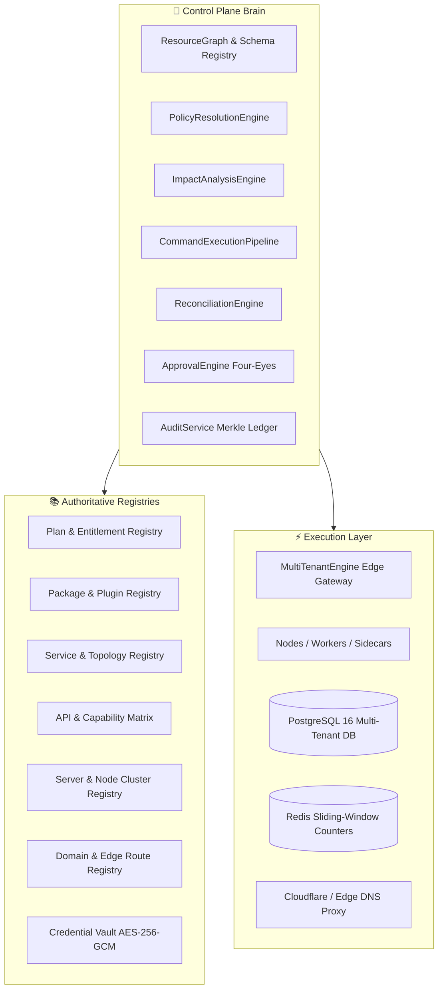

# 🪐 OrbitoX Universal Control Plane Architecture (v4.0)
**Document Ref: CP-00**  
**Classification: Platform Core Engineering Specification**  
**Status: Authoritative Master Architecture**

---

## 1. Executive Mission & System Purpose

The **OrbitoX Universal Control Plane** transforms OrbitoX from a collection of isolated administrative screens into a **declarative, graph-aware, policy-driven, and reconciled Platform Operating Brain**.

```
                           CONTROL CENTER COCKPIT
                                     │
                                     ▼
                           CONTROL PLANE API
                                     │
                                     ▼
                            COMMAND / POLICY BUS
                                     │
                  ┌──────────────────┼──────────────────┐
                  ▼                  ▼                  ▼
           Resource Graph      Policy Engine      Approval Engine
                  │                  │                  │
                  └──────────────────┼──────────────────┘
                                     ▼
                             Command Executor
                                     │
                                     ▼
                           Reconciliation Engine
                                     │
                    ┌────────────────┼────────────────┐
                    ▼                ▼                ▼
                Database          Runtime            Edge
                 (State)         (Services)        (DNS/TLS)
```

### Core Tenet: Declarative + Interconnected + Reconciled
1. **Declarative**: Operators define *what the platform should look like* (Desired State), rather than making ad-hoc database updates.
2. **Interconnected**: Every entity (Plan, Package, Service, API, Key, Credential, Server, Domain, Tenant) is a node in a unified **ResourceGraph**. Relationships, dependencies, and blast-radii are mathematically explicit.
3. **Reconciled**: The background **ReconciliationEngine** constantly compares Desired State against Observed State, detects configuration drift, repairs safe drift, and flags unsafe divergence.

---

## 2. The Tri-Layer Topology



---

## 3. High-Impact Interconnection Examples

### Scenario 1: Modifying a Plan
1. Admin edits `Growth Plan` reducing storage limit from `100 GB` to `50 GB`.
2. `ImpactAnalysisEngine` traverses `ResourceGraph`:
   - `Plan` ➔ `42 Projects` ➔ `128 Environments`.
   - Discovers `3 Projects` currently store `> 65 GB`.
3. Pre-execution verdict: **DOWNGRADE BLOCKED**. Identifies the 3 offending projects and explains: `Resource usage exceeds proposed limit. Archive storage or increase quota before publishing plan v3.`

### Scenario 2: Upgrading a Package
1. Admin requests upgrade: `@orbitox/restaurant` from `v2.2.0` to `v2.2.1`.
2. System calculates graph dependencies:
   - Verifies Ed25519 digital signature of `v2.2.1`.
   - Checks dependency compatibility (`POS >= 3.0` required).
   - Identifies `48 Environments`, `24 APIs`, `31 API Keys`, and `12 Nodes` affected.
3. Checks environment policy: `Production environments require Four-Eyes Quorum`.
4. Creates a multi-step `ExecutionPlan` with automated canary staging, rollback checkpoints, and zero-downtime execution.

---

## 4. Architectural Boundaries: Customization vs. Security Invariants

$$\text{Operability} = \text{Configurable Policy} \cap \text{Immutable Invariants}$$

- **Configurable Policies** (Customizable by SuperAdmin):
  - API rate limits, monthly quotas, warning thresholds.
  - Number of permitted environments per project.
  - Required approvers for production mutations.
  - Session timeouts, key expiration windows.
- **Immutable Security Invariants** (Mathematically Unchangeable):
  - **Zero-Trust Multi-Tenancy**: A tenant can never query outside its cryptographic `tenantId` partition.
  - **Asymmetric Package Provenance**: Unsigned or tampered packages cannot execute.
  - **CSPRNG Key Verification**: Raw secrets cannot be read or stored; only constant-time HMAC verifiers exist.
  - **Cryptographic Audit**: Past audit entries can never be altered or pruned without breaking the SHA-256 Merkle chain.
  - **Four-Eyes Non-Self-Approval**: An operator cannot approve their own high-blast mutation.
