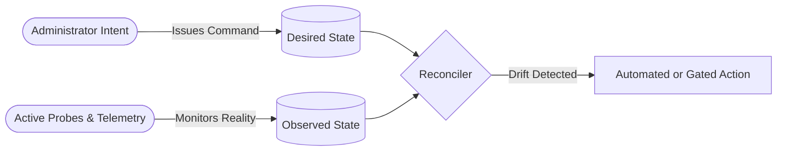

# 🪐 Desired State vs. Observed State Specification (CP-04)
**Classification: Reconciliation & State Orchestration**

---

## 1. Architectural Foundation

The OrbitoX Control Plane operates under declarative reconciliation semantics inspired by control systems theory:

- **Desired State ($S_d$)**: The authoritative target configuration recorded in the platform database by authorized operators or CI/CD pipelines.
- **Observed State ($S_o$)**: The real-world state of running infrastructure, services, DNS records, and edge proxies gathered via active heartbeats, probes, and telemetry agents.
- **Drift ($\Delta = S_d - S_o$)**: The divergence between intent and physical reality.

---

## 2. Universal Drift State Taxonomy

Every managed node in the `ResourceGraph` maintains an explicit `driftState`:

| Drift State | Description | System Behavior |
| :--- | :--- | :--- |
| **`IN_SYNC`** | $S_d == S_o$. Perfect alignment between intent and reality. | Passive continuous monitoring. |
| **`DRIFTED`** | $S_d \ne S_o$. Divergence detected (e.g. replica count dropped, DNS target modified). | Enters reconciliation queue for evaluation. |
| **`RECONCILING`** | Reconciliation worker is actively executing corrective action. | Resource locked against conflicting mutations. |
| **`BLOCKED`** | Remediation requires Four-Eyes quorum approval or human intervention (e.g., potential data loss). | Flags operator attention queue in Control Center. |
| **`FAILED`** | Corrective execution failed (e.g., node out of disk space, timeout). | Triggers exponential backoff and alert incident. |
| **`UNKNOWN`** | Telemetry agent or heartbeat probe disconnected. | Marked degraded; fallback probes initiated. |

---

## 3. Safe Drift vs. Unsafe Drift

1. **Safe Drift (Self-Healing)**:
   - Example: A service replica crashed; Desired = 3, Observed = 2.
   - Action: `ReconciliationEngine` automatically schedules a replacement container on an available node.
2. **Unsafe Drift (Gated)**:
   - Example: A custom domain's external DNS points to an unverified third party, or a database migration failed.
   - Action: System halts automated retry, marks resource `BLOCKED`, and dispatches an immediate notification to the SuperAdmin attention queue.
