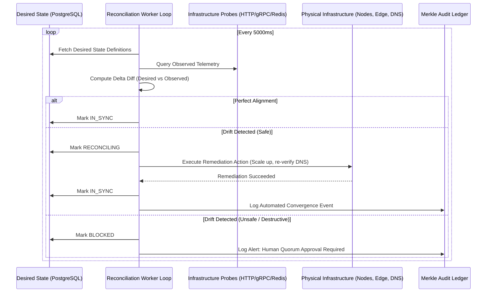

# 🪐 Reconciliation Engine & Drift Telemetry (CP-15)
**Classification: Autonomous State Convergence & SRE Automation**

---

## 1. Reconciliation Loop Mechanics

The **`ReconciliationEngine`** runs continuous control loops ensuring physical infrastructure converges toward desired state:

---

## 2. Supported Autonomous Remediation Tasks

1. **Service Replica Drift**: Desired = 3, Observed = 2 ➔ Worker provisions missing container replica.
2. **Domain DNS Challenge Check**: Desired = `VERIFIED`, Observed = TXT record propagated ➔ Requests ACME certificate and updates status to `ACTIVE`.
3. **Stale Lease Eviction**: Recovers orphaned locks and commands stuck in `IN_PROGRESS` beyond timeout window.
4. **Token Bucket Sliding Window Sync**: Syncs atomic Redis rate-limit counters to PostgreSQL audit metrics.
