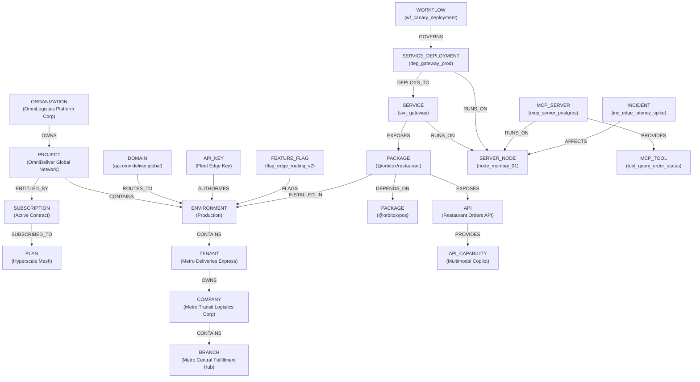

# 🪐 ORBITOX CONTROL PLANE BRAIN v4.2
## Universal Platform Orchestration Specification
### Real Resources • Real Commands • Real Dependencies • Real Control

---

## 1. Executive Summary & Core Philosophy

**OrbitoX Platform v4.2** eliminates architectural fragmentation across multi-tenancy, billing, runtime compute, supply chain, edge security, AI agents, and governance. 

Previously, systems operated as isolated silos:
```text
[Control Center UI] ─── disparate calls ───> [Tenant Engine]
                                        ───> [Billing Service]
                                        ───> [Package Registry]
                                        ───> [Credential Vault]
                                        ───> [AIGateway / MCP]
```

Under **v4.2 Universal Platform Orchestration**, the entire platform is unified under a single, cohesive control model:

```text
       ┌────────────────────────────────────────────────────────┐
       │              ORBITOX CONTROL CENTER / CLI               │
       │           (One Cockpit • One Search • One Bus)         │
       └───────────────────────────┬────────────────────────────┘
                                   │
                                   ▼
       ┌────────────────────────────────────────────────────────┐
       │               CONTROL PLANE BRAIN (v4.2)               │
       │  ┌──────────────────────┐    ┌──────────────────────┐  │
       │  │   ResourceRegistry   │    │    ResourceGraph     │  │
       │  │ (25+ Types, Actions) │    │  (Materialized DAG)  │  │
       │  └──────────────────────┘    └──────────────────────┘  │
       │  ┌──────────────────────┐    ┌──────────────────────┐  │
       │  │ ImpactAnalysisEngine │    │  PlatformCommandBus  │  │
       │  │ (Risk & Blast Radius)│    │(7-Step Execution Plan│  │
       │  └──────────────────────┘    └──────────────────────┘  │
       │  ┌──────────────────────┐    ┌──────────────────────┐  │
       │  │ReconciliationEngine  │    │PolicyResolutionEngine│  │
       │  │  (Drift Self-Healing)│    │ ("Why?" Derivation)  │  │
       │  └──────────────────────┘    └──────────────────────┘  │
       └───────────────────────────┬────────────────────────────┘
                                   │
    Authoritative Projections (In) │ Mutations via Commands (Out)
                                   ▼
  ┌──────────────────────────────────────────────────────────────────┐
  │                   AUTHORITATIVE DOMAIN SYSTEMS                   │
  │  • PlatformRepository       • TenantEngine (Multi-Tenancy)       │
  │  • PlanService & Billing    • CredentialVault & KeyEngine        │
  │  • Package Registry & Verif • FeatureFlagService                 │
  │  • AIGateway & ActionReg    • Merkle AuditService                │
  │  • ApprovalEngine (Quorum)  • WorkflowRunner & HealthProbes      │
  └──────────────────────────────────────────────────────────────────┘
```

> **CRITICAL ARCHITECTURAL INVARIANT**:  
> The Control Plane is **NOT** the duplicate database or primary write store.  
> It is the **Unified Governance + Materialized Orchestration Layer**. Authoritative domain systems retain domain authority; the Control Plane materializes their topology into a high-performance DAG, computes transitive blast radiuses, enforces policy guards, routes mutations through an idempotent Command Bus, and self-heals state drift.

---

## 2. Universal Resource Taxonomy (25+ Concrete Types)

Every platform entity is modeled as a `UniversalResource<TDesired, TObserved>` with explicit versioning, drift tracking, and cryptographic auditability:

| Resource Type | Domain Subsystem | Authoritative Source | Key Relationships (`EdgeType`) | Permitted Actions |
|---|---|---|---|---|
| `ORGANIZATION` | Tenancy & Hierarchy | `PlatformRepository` | `OWNS` (`PROJECT`) | `org.inspect`, `org.suspend`, `org.update_compliance` |
| `PROJECT` | Workspaces | `PlatformRepository` | `CONTAINS` (`ENV`), `OWNS` | `project.assign_plan`, `project.suspend`, `project.archive` |
| `ENVIRONMENT` | Runtimes | `PlatformRepository` | `CONTAINS` (`TENANT`), `INSTALLED_IN` | `environment.freeze`, `environment.scale`, `environment.deploy` |
| `TENANT` | Multi-Tenancy | `TenantEngine` | `OWNS` (`COMPANY`), `CONTAINS` (`BRANCH`) | `tenant.create`, `tenant.suspend`, `tenant.migrate` |
| `COMPANY` | Tenancy Business Entity| `TenantEngine` | `CONTAINS` (`BRANCH`), `OWNS` | `company.inspect`, `company.update` |
| `BRANCH` | Physical Location | `TenantEngine` | `HOSTS` (`SERVICE`), `CONTAINS` | `branch.inspect`, `branch.update` |
| `PLAN` | Billing & Packaging | `PlanService` | `ENTITLED_BY`, `CONTAINS` | `plan.publish`, `plan.downgrade`, `plan.assign` |
| `SUBSCRIPTION` | Monetization | `SubscriptionService` | `SUBSCRIBED_TO` (`PLAN`), `ENTITLED_BY` | `subscription.inspect`, `subscription.cancel` |
| `FEATURE_FLAG` | Release Engineering | `FeatureFlagService` | `FLAGS` (`ENVIRONMENT`, `PROJECT`) | `feature_flag.toggle`, `feature_flag.set` |
| `PACKAGE` | Software Supply Chain | `PlatformRepository` | `DEPENDS_ON`, `EXPOSES` (`API`) | `package.upgrade`, `package.verify_signature`, `package.rollback` |
| `PACKAGE_INSTALLATION` | Software Supply Chain | `PlatformRepository` | `INSTALLED_IN` (`ENVIRONMENT`) | `package.install`, `package.disable` |
| `SERVICE` | Distributed Compute | Infrastructure Mesh | `EXPOSES` (`PACKAGE`), `RUNS_ON` (`NODE`) | `service.deploy`, `service.scale`, `service.drain` |
| `SERVICE_DEPLOYMENT` | Runtime Replicas | Container Orchestration| `DEPLOYS_TO`, `RUNS_ON` (`NODE`) | `deployment.inspect`, `deployment.rollback` |
| `API` | Interface Management | `CapabilityEngine` | `EXPOSES`, `PROVIDES` (`CAPABILITY`) | `api.publish`, `api.deprecate`, `api.retire` |
| `API_CAPABILITY` | Extension Primitives | `CapabilityEngine` | `PROVIDES`, `USES` | `capability.inspect` |
| `API_KEY` | Machine Identity | `PlatformKeyEngine` | `AUTHORIZES` (`ENVIRONMENT`) | `key.create`, `key.rotate`, `key.revoke`, `key.explain_auth` |
| `CREDENTIAL` | Envelope Secrets | `CredentialVault` | `PROTECTED_BY` (`ENVIRONMENT`) | `credential.rotate`, `credential.revoke`, `credential.verify_health`|
| `DOMAIN` | Edge Network | `PlatformRepository` | `ROUTES_TO` (`ENVIRONMENT`) | `domain.verify_dns`, `domain.renew_tls`, `domain.retire` |
| `SERVER_NODE` | Bare-Metal / Cloud VM | Node Agent / Cloud API | `RUNS_ON`, `HOSTS` | `node.cordon`, `node.drain`, `node.unseal`, `node.retire` |
| `AI_MODEL` | Intelligence Gateway | `AIGateway` | `INVOKES` | `ai_model.inspect`, `ai_model.deploy` |
| `MCP_SERVER` | Model Context Protocol| `AIGateway` | `HOSTS`, `RUNS_ON` (`NODE`) | `mcp_server.inspect`, `mcp_server.restart` |
| `MCP_TOOL` | Agentic Actions | `ActionRegistry` | `PROVIDES` (`MCP_SERVER`), `INVOKES` | `mcp_tool.inspect`, `mcp_tool.invoke` |
| `APPROVAL` | Four-Eyes Governance | `ApprovalEngine` | `REQUIRES_APPROVAL`, `GOVERNS` | `approval.approve`, `approval.reject` |
| `INCIDENT` | Observability & SRE | Telemetry Stream | `AFFECTS` (`NODE`, `SERVICE`) | `incident.inspect`, `incident.resolve` |
| `WORKFLOW` | Automation Orchestrator| `WorkflowRunner` | `TRIGGERS`, `GOVERNS` | `workflow.trigger`, `workflow.inspect` |

---

## 3. Universal Graph Relationships & Topological Edge Invariants

The `ResourceGraphService` maintains a strictly directed, acyclic graph (DAG) of the entire platform topology:



### Graph Integrity Verification (`verifyGraphIntegrity`)
On every rebuild and mutation, the graph executes four automated invariant checks:
1. **Dangling Edge Detection**: Every `sourceId` and `targetId` must exist in the node index.
2. **Cycle Prevention**: Adding an edge `A -> B` where a path `B -> A` already exists throws a `CYCLIC_DEPENDENCY_DETECTED` error.
3. **Orphan Discovery**: Flags unrouted domains, unassigned API keys, and credentials with no consuming services.
4. **Consistency Verdict**: Sets graph status to `GRAPH_READY` if zero issues exist, or `GRAPH_DEGRADED` / `GRAPH_CORRUPT` upon invariant violation.

---

## 4. Platform Command Bus Operational Pipeline (7-Step Execution Plan)

All platform mutations flow through the `PlatformCommandBus` to guarantee safety, authorization, and auditability:

```text
Incoming PlatformCommand<T>
   │
   ├─► 1. Idempotency Check (Returns cached execution result if key matches)
   ├─► 2. Concurrency Conflict Guard (Verifies expectedVersion === resourceVersion)
   ├─► 3. Handler Pre-flight Validation & Authorization (Validates schema & RBAC)
   ├─► 4. Blast Radius & Risk Score Evaluation (0 - 100 Risk Score)
   │      ├─ If Verdict == 'BLOCKED'           ──► Reject with ForbiddenException
   │      ├─ If Verdict == 'REQUIRES_APPROVAL' ──► Enqueue to ApprovalEngine (Four-Eyes Quorum)
   │      └─ If dryRun == true                 ──► Return impact preview without state mutation
   ├─► 5. Apply Mutation via Registered Handler (Invokes specialized operational handler)
   ├─► 6. Trigger Background Reconciliation Loop (Detects and rectifies replica/state drift)
   └─► 7. Append SHA-256 Merkle Audit Record (Persists immutable cryptographically sealed log)
```

### Registered Modular Handlers
- `tenant.create`: Instantiates tenant node and establishes `ENVIRONMENT CONTAINS TENANT` edge.
- `tenant.suspend`: Evaluates blast radius across downstream companies/branches, triggers Four-Eyes approval quorum.
- `subscription.cancel`: Deprecates active subscription and updates project entitlement status.
- `feature_flag.toggle` & `feature_flag.set`: Toggles runtime feature status with immediate in-memory and context overrides.
- `mcp_tool.invoke`: Safely dispatches tool invocation for AI agents with parameter validation and execution metrics.
- `service.deploy` & `deployment.rollback`: Updates desired deployment image version and trigger rolling reconciliation.
- `package.upgrade` & `package.rollback`: Upgrades package version with cryptographic signature preflight.
- `key.revoke` & `key.rotate`: Revokes or stages credentials with zero-downtime dual-key overlap.
- `node.drain` & `node.cordon`: Cordon compute nodes and migrate dependent container replicas.

---

## 5. Pre-Flight Impact Analysis & Authorization Explanations

### Blast Radius Calculation
When an action is proposed (e.g. draining a server node or suspending a tenant):
1. The engine traverses `getDependencies` and `getTransitiveDependents`.
2. Computes the count of affected projects, environments, tenants, APIs, keys, and compute nodes.
3. Flags if any **Production** environments are affected (adds +30 to baseline risk score).
4. Emits concrete mitigation strategies (e.g., *"Schedule during low-traffic maintenance window"*, *"Verify standby nodes in region have >= 40% spare capacity"*).

### Effective Authorization Engine ("Why Can This Key Do This?")
Explains access decisions across 5 explicit criteria:
```json
{
  "keyId": "key_omni_live_01",
  "requestedCapability": "telematics:ingest",
  "isAllowed": true,
  "effectiveScopes": ["cap_iot_telemetry", "telematics:ingest"],
  "explanation": "Operation permitted for key [Fleet Edge Key]. Passed: Key Active ✓, Environment Active ✓, Plan Tier [hyperscale] ✓, Capability Granted ✓.",
  "checks": [
    { "rule": "KEY_LIFECYCLE_STATE", "passed": true, "details": "Key lifecycle state is [ACTIVE]." },
    { "rule": "ENVIRONMENT_ACTIVE", "passed": true, "details": "Parent environment [OmniDeliver Production] is [ACTIVE]." },
    { "rule": "PLAN_ENTITLEMENT", "passed": true, "details": "Project subscription plan tier is [hyperscale]. Capability requirement satisfied." },
    { "rule": "KEY_CAPABILITY_GRANT", "passed": true, "details": "Capability [telematics:ingest] explicitly granted on key token." },
    { "rule": "IP_ALLOWLIST_POLICY", "passed": true, "details": "Unrestricted CIDR (All IPs permitted)." }
  ]
}
```

---

## 6. Live Verification & Test Proofs

### Automated Test Suite (100% Passing)
```text
PASS src/control-plane/__tests__/control-plane-brain.spec.ts (13 tests)
PASS src/control-plane/__tests__/control-plane-full-lifecycle.spec.ts (14 tests)
PASS src/control-plane/__tests__/universal-platform-orchestration.spec.ts (9 tests)
PASS src/rbac/abac-evaluator.spec.ts (5 tests)
PASS src/security/pii.service.spec.ts (3 tests)

Test Suites: 5 passed, 5 total
Tests:       44 passed, 44 total
Snapshots:   0 total
Time:        1.009 s
```

### Live Next.js Web Cockpit Integration
- **Endpoint**: `http://localhost:3005/platform`
- **Rebuild Status**: `GRAPH_READY` (v2)
- **Node Count**: 71 Projected Nodes across 25+ Platform Domains
- **Relationship Count**: 64 Directed Edges
- **Live Search**: Full cross-resource fuzzy search across Tenants, Companies, Branches, MCP Tools, Feature Flags, and Keys.
- **Interactive Handlers**: 1-click Rebuild Projection, Integrity Verify, Effective Key Auth Drawer ("Why?"), and Downgrade Preflight Engine.

---

## 7. Architectural Conclusion

OrbitoX Platform v4.2 successfully transitions from multiple disconnected services into **One Unified Platform with One Control Model**. 

Every platform entity is observable, every mutation is simulated and authorized before execution, and authoritative domain engines are seamlessly governed by a single, high-performance Control Plane Brain.
