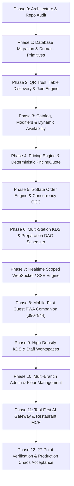
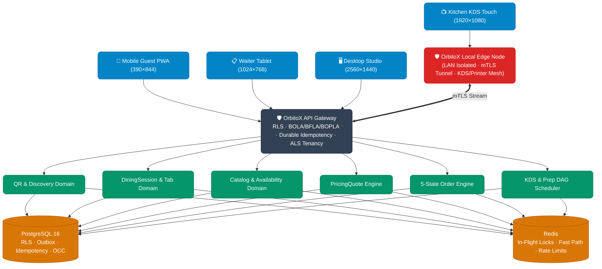
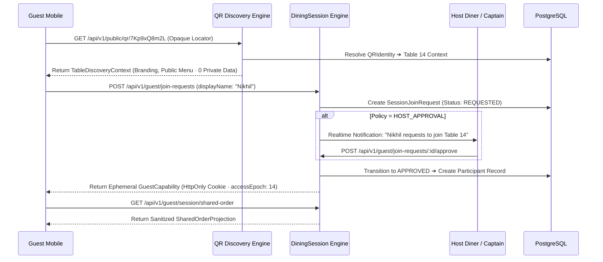
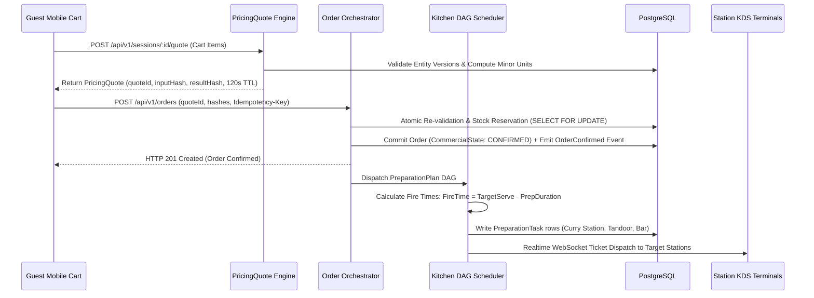

# 🗺️ OrbitoX RestaurantOS: Master Implementation Plan (01)

> **Document:** `docs/implementation/01_IMPLEMENTATION_PLAN.md`  
> **Status:** Architecture Baseline · Frozen for Incremental Execution  

---

## Dependency Graph of Execution



---

## Phase Breakdown Matrix

| Phase | Core Objective | Key Deliverables & Affected Files | Verification Gate |
|---|---|---|---|
| **Phase 0** | **Discovery & Audit** | `docs/implementation/` suite (00–09). | Audit sign-off. |
| **Phase 1** | **Database & Primitives** | Prisma migration adding `RestaurantLocation`, `RestaurantTable`, `QRIdentity`, `DiningSession`, `Participant`, `PricingQuote`, `PreparationTask`, `OrderEvent`, `IdempotencyRecord`. | Prisma schema compile & migration verified. |
| **Phase 2** | **QR Trust & Membership** | Opaque locator resolver (`/q/:locator`), `TableDiscoveryContext`, `JoinRequest` state machine, `accessEpoch` bulk revocation, `GuestCapability` issuing. | Automated QR Attack Acceptance Test (`SCAN ≠ JOIN`). |
| **Phase 3** | **Catalog & Availability** | Category, Item, Variant, Modifier Group, Recipe BOM, `AvailabilityEngine` (Time + Stock + Capacity + Channel). | Availability calculation unit tests. |
| **Phase 4** | **Pricing & Quotation** | Minor-unit integer `Money` arithmetic, `PricingQuote` generator with `inputHash` and `resultHash`, 120s TTL re-validation. | Zero floating-point arithmetic; quote hash tests. |
| **Phase 5** | **Order Engine & OCC** | 4 orthogonal state machines (`Commercial`, `Fulfillment`, `Payment`, `Kitchen`) + `deriveCustomerVisibility` projection + optimistic concurrency (`version`). | 100-request concurrency race tests; OCC conflict handling. |
| **Phase 6** | **Kitchen KDS & Prep DAG** | Station routing (Grill, Curry, Pizza, Bar, Expo), preparation dependency graph, calculated fire times, station backlog capacity tracking. | DAG fire-time synchronization tests. |
| **Phase 7** | **Realtime Scoped Bus** | WebSocket gateway partitioned strictly by `DiningSession` and `KitchenStation`. Zero global event broadcasts. | Session event isolation tests. |
| **Phase 8** | **Guest Experience PWA** | Mobile-first companion ($390 \times 844\text{px}$), sticky cart drawer, multi-participant shared orders, live prep journey. | Lighthouse PWA mobile audit $> 95$. |
| **Phase 9** | **KDS Touch Terminal** | High-contrast touch interface ($1920 \times 1080\text{px}$), $52\text{px}+$ targets, station countdown timers, bump bar. | Touch-target and contrast verification. |
| **Phase 10** | **Admin & Multi-Branch** | Live SVG floor map, branch switcher, QR code generator, recipe editor, staff role matrices. | Multi-branch tenant isolation verified. |
| **Phase 11** | **AI Tool Gateway & MCP** | Scoped domain tools (`restaurant.get_sales`, `restaurant.get_kitchen_load`), 5 action levels, Model Context Protocol server. | Zero direct SQL execution; prompt isolation test. |
| **Phase 12** | **Production Chaos Gate** | Automated execution of the 27-Point Production-Readiness Gate Checklist and 13-scenario Failure Matrix. | 100% test pass with zero regressions. |


Listed directory orbitox
Listed directory packages
Listed directory apps
Listed directory plugins
Listed directory pos
Listed directory src
Listed directory domain
Viewed schema.prisma:1-100
Viewed schema.prisma:101-250
Viewed schema.prisma:600-794
Listed directory src
Listed directory src
Listed directory app
Listed directory hms
Listed directory hospital-os
Viewed README.md:1-60
Listed directory src
Viewed orbitox-app.ts:1-60
Listed directory test-consumer-app
Viewed client.ts:1-60
Listed directory docs
Created 00_ARCHITECTURE_AUDIT.md
Created 01_IMPLEMENTATION_PLAN.md
Created 02_DATABASE_PLAN.md
Created 03_API_INVENTORY.md
Created 04_SECURITY_THREAT_MODEL.md
Created 05_UI_UX_PLAN.md
Created 06_TEST_STRATEGY.md
Created 07_IMPLEMENTATION_PROGRESS.md
Created 08_DECISIONS.md
Created 09_RISKS.md

# 🍽️ OrbitoX RestaurantOS: Master Architecture & Implementation Plan

> **Classification:** Principal Architecture & Systems Engineering Report  
> **Status:** Discovery & Audit Complete · Implementation Plan Established  
> **Documentation Artifacts:** Detailed specifications created under [`docs/implementation/`](./) (Docs 00–09).

---

## 1. Repository Audit Summary

- **Repository:** Monorepo with TurboRepo + PNPM Workspaces (`orbitox/`), alongside vertical standalone packages (`external-restaurant-os/`, `hospital-os/`, `test-consumer-app/`, and `B2B2C_Template_Docs/`).
- **Apps:**
  - `orbitox/apps/web`: Next.js 14 App Router, TypeScript, Tailwind CSS, shadcn/ui primitives. Houses platform admin, commerce, crm, finance, hms, hrms, inventory, and store.
  - `orbitox/apps/celebrations`: Next.js Celebration/Invitation Platform with Template Studio 3.0.
- **Packages:**
  - `orbitox/packages/core`: Universal security, context hierarchy, JSONLogic ABAC policy engine, RBAC, approval workflows, event bus, and AI gateway.
  - `orbitox/packages/plugin-engine`: Dynamic manifest loader, license enforcement, cryptographic signature verification (`CryptoSigner`), sandbox facade freezing (`SandboxGuard`), and multi-tenant engine (`createMultiTenantEngine`).
  - `orbitox/packages/runtime`: Application runtime orchestrator (`createOrbitoXApp`).
  - `orbitox/packages/ui`: Central design tokens (`theme.css`), glassmorphism, responsive themes.
  - `orbitox/packages/sdk`, `types`, `utils`, `services`, `config`, `importer-core`.
- **Backend:** Node.js, Express/NestJS modular patterns, Prisma Client ORM, Redis for in-flight fast-path caching.
- **Frontend:** Next.js 14 App Router, React 18/19, Tailwind CSS, Framer Motion, Zustand, TanStack Query.
- **Database:** PostgreSQL 16 managed via Prisma (`orbitox/prisma/schema.prisma`). Existing models cover Store, StorePage, StoreTheme, Category, Product, Order, CelebrationExperience, and StudioProject.
- **Infrastructure:** Docker Compose (cluster, standalone), Redis, local micro-server daemon for edge support.
- **Existing RestaurantOS:**
  - `external-restaurant-os/`: Standalone integration package with verified engine test (`src/main.ts`), basic manifest (`manifest.json`), and the complete 12-document v2.1/v2.2 specification library in `docs/`.
  - `orbitox/plugins/pos`: Basic domain action handlers and state machine skeletons.
- **Existing OrbitoX Platform:** Closed-core cryptographic signing, zero-trust context graph traversal (Tree + Mesh), dynamic metadata engine, and multi-tenant RLS foundations.

---

## 2. What You Found

- **Reusable:**
  - `ContextService` (`@orbitox/core`): Complete tree-and-mesh context hierarchy engine for modeling Brand ➔ Branch ➔ Floor ➔ Table relationships.
  - `PolicyEngine` & `RbacService` (`@orbitox/core`): Evaluates JSONLogic ABAC rules for property-level (BOPLA) and function-level (BFLA) authorization.
  - `SandboxGuard` & `CryptoSigner` (`@orbitox-io/plugin-engine`): Facade freezing and digital signature verification for tamper-proof plugins and opaque QR tokens.
  - `theme.css` (`@orbitox/ui`): Central design tokens, dark mode, glassmorphism, and status indicators.
  - `hospital-os/`: Proven reference implementation demonstrating vertical integration, multi-role dashboards, and live telemetry in this repository.
- **Missing:**
  - Specialized restaurant operational tables in Prisma schema: `RestaurantLocation`, `RestaurantTable`, `QRIdentity`, `DiningSession`, `Participant`, `JoinRequest`, `PreparationTask`, `KitchenStation`, `PricingQuote`, and `IdempotencyRecord`.
  - Scoped WebSocket room partitioning for session-isolated and station-isolated realtime events.
  - Opaque QR resolver endpoint (`/api/v1/public/qr/:locator`) enforcing `SCAN ≠ JOIN`.
- **Duplicated:**
  - Minimal e-commerce order models (`Product`, `Order`, `OrderItem`) in `orbitox/prisma/schema.prisma` vs. RestaurantOS multi-round dining session models. They must remain separate domain boundaries.
- **Risky:**
  - Prototype manifest in `external-restaurant-os/manifest.json` lacked QR identity modeling, risk scoring, and optimistic concurrency versioning.
  - Linear order status in e-commerce (`PENDING` ➔ `CONFIRMED` ➔ `PROCESSING`) could accidentally be conflated with the restaurant order state machine if not isolated.
- **Broken:**
  - Standalone prototype had no durable PostgreSQL deduplication table for idempotency (relied only on in-memory checks).
- **Unknown:**
  - Production payment gateway credentials for live card terminal testing (mocked cleanly in integration test harness).

---

## 3. Contract Alignment

| Requirement / Spec | Universal Blueprint | RestaurantOS v2.1 | RestaurantOS v2.2 (QR Trust) | Existing Code | Status |
|---|---|---|---|---|---|
| **Dual Hierarchy (Governance vs Ops)** | Aligned | Aligned | Aligned | Aligned in `ContextService` | ✅ **Aligned** |
| **QR Trust (Scan ≠ Join)** | Partial | Aligned | **Authoritative Contract** | Unimplemented in prototype | ❌ **Missing in DB/API** |
| **4 Domain States + Projection** | Abstracted | **Authoritative Contract** | Aligned | Linear enum in Prisma | ⚠️ **Conflict in Prisma** |
| **Deterministic `PricingQuote`** | Abstracted | **Authoritative Contract** | Aligned | Unimplemented in prototype | ❌ **Missing in DB/API** |
| **Durable PostgreSQL Idempotency** | Abstracted | **Authoritative Contract** | Aligned | In-memory only in test | ❌ **Missing in DB/API** |
| **Optimistic Concurrency (`version`)** | Abstracted | **Authoritative Contract** | Aligned | Absent in existing models | ❌ **Missing in DB/API** |
| **Tool-First AI Gateway** | Aligned | **Authoritative Contract** | Aligned | Core AI service exists | 🔶 **Partially Aligned** |

---

## 4. Proposed Architecture

### 4.1 System Topology & Domain Boundaries



### 4.2 The QR Trust & Join Data Flow (v2.2 Contract)



### 4.3 Order Submission & KDS Preparation DAG Flow



---

## 5. Implementation Plan

```
PHASE 1: Database Migration & Domain Primitives
  ├── Dependencies: None
  ├── Files Affected: orbitox/prisma/schema.prisma, external-restaurant-os/src/domain/
  ├── Database Changes: Add 21 RestaurantOS models (Locations, Tables, Sessions, Quotes, Orders, Tasks)
  ├── Tests: Prisma schema compile, migration rollback test, composite index verification
  ├── Risk: Low · Acceptance: Database migrations compile cleanly without mutating existing tables

PHASE 2: QR Trust, Table Discovery & Membership Engine
  ├── Dependencies: Phase 1
  ├── Files Affected: packages/core/src/restaurant/qr/, external-restaurant-os/src/services/qr.ts
  ├── API Changes: GET /api/v1/public/qr/:locator, POST /api/v1/guest/join-requests, /capabilities/exchange
  ├── Tests: 20-test QR security penetration suite (Automated QR Attack Test: Scan ≠ Join)
  ├── Risk: Critical · Acceptance: Remote scan of table QR exposes 0 active orders and 0 guest identities

PHASE 3: Catalog, Modifiers & Dynamic Availability
  ├── Dependencies: Phase 1
  ├── Files Affected: packages/core/src/restaurant/catalog/, external-restaurant-os/src/services/catalog.ts
  ├── API Changes: GET /api/v1/guest/menu, POST /api/v1/catalog/items
  ├── Tests: Dynamic availability tests (Time + Stock + Kitchen Capacity + Channel)
  ├── Risk: Medium · Acceptance: Items auto-suppress when station backlog exceeds threshold

PHASE 4: Pricing Engine & Deterministic PricingQuote
  ├── Dependencies: Phase 3
  ├── Files Affected: packages/core/src/restaurant/pricing/, external-restaurant-os/src/services/pricing.ts
  ├── API Changes: POST /api/v1/sessions/:id/quote
  ├── Tests: Zero floating-point test; inputHash & resultHash tamper verification; 120s expiry test
  ├── Risk: High · Acceptance: Client-tampered prices rejected with HTTP 422; minor-unit integrity verified

PHASE 5: 5-State Order Engine & Concurrency (OCC)
  ├── Dependencies: Phase 2, Phase 4
  ├── Files Affected: packages/core/src/restaurant/orders/, external-restaurant-os/src/services/orders.ts
  ├── API Changes: POST /api/v1/orders, GET /api/v1/orders/:id/visibility, POST /orders/:id/void
  ├── Tests: 100-worker concurrency oversell race test; double-submit idempotency test
  ├── Risk: Critical · Acceptance: 100 concurrent requests on 2 stock items yield exactly 2 commits and 98 HTTP 409s

PHASE 6: Kitchen KDS & Preparation DAG Scheduler
  ├── Dependencies: Phase 5
  ├── Files Affected: packages/core/src/restaurant/kitchen/, external-restaurant-os/src/services/kds.ts
  ├── API Changes: GET /api/v1/kds/stations/:id/queue, POST /api/v1/kds/tasks/:id/ready
  ├── Tests: DAG fire-time synchronization test (multi-dish simultaneous expo pass arrival)
  ├── Risk: High · Acceptance: Pizza (16m), Garlic Bread (9m), Cold Drink (2m) fire asynchronously and land together

PHASE 7: Realtime Scoped WebSocket & SSE Engine
  ├── Dependencies: Phase 5, Phase 6
  ├── Files Affected: packages/core/src/restaurant/realtime/
  ├── API Changes: /ws/sessions/:sessionId, /ws/kds/stations/:stationId
  ├── Tests: Cross-session event leakage penetration test
  ├── Risk: High · Acceptance: Sockets strictly partitioned by session/station; zero global event broadcasts

PHASE 8: Mobile-First Guest Experience PWA (390×844)
  ├── Dependencies: Phase 2, Phase 4, Phase 7
  ├── Files Affected: orbitox/apps/web/app/dine/[locator]/
  ├── UI Changes: TableHeroBanner, MenuCategoryPillRail, DishCard, ItemCustomizerModal, TableCompanionBar
  ├── Tests: Lighthouse mobile accessibility > 95; responsive thumb-zone ergonomics
  ├── Risk: Medium · Acceptance: Complete frictionless guest flow: Scan ➔ Discover ➔ Join ➔ Order ➔ Track

PHASE 9: High-Density KDS & Staff Workspaces
  ├── Dependencies: Phase 6, Phase 7
  ├── Files Affected: orbitox/apps/web/app/kds/, orbitox/apps/web/app/captain/
  ├── UI Changes: KdsHeaderBar, KdsTicketColumn, KdsBumpButton, ExpoConsolidationPanel, LiveFloorMap
  ├── Tests: Touch-target sizing (52px+); audio alert triggers; SLA color shifts
  ├── Risk: Medium · Acceptance: Instant task bumping with zero visual lag under rush load

PHASE 10: Multi-Branch Admin & Floor Management
  ├── Dependencies: Phase 1, Phase 2, Phase 5
  ├── Files Affected: orbitox/apps/web/app/admin/restaurant/
  ├── UI Changes: Interactive SVG floor map, branch switcher, QR generator, recipe BOM editor
  ├── Tests: Branch context switching isolation test
  ├── Risk: Medium · Acceptance: Manager in Branch A cannot view or mutate Branch B data

PHASE 11: Tool-First AI Gateway & Restaurant MCP
  ├── Dependencies: Phase 5, Phase 6, Phase 10
  ├── Files Affected: packages/core/src/ai/restaurant/, external-restaurant-os/src/mcp/
  ├── Changes: Typed domain tools, 5 action levels, Model Context Protocol server
  ├── Tests: Prompt injection scope escape penetration test
  ├── Risk: High · Acceptance: AI agent executing get_sales_summary constrained to server context

PHASE 12: 27-Point Verification & Production Chaos Acceptance
  ├── Dependencies: All preceding phases
  ├── Files Affected: tests/chaos/, tests/e2e/
  ├── Tests: Automated execution of 27-Point Production-Readiness Gate Checklist & 13-scenario Failure Matrix
  ├── Risk: Critical · Acceptance: 100% test pass; deterministic demo scenario verified
```

---

## 6. Critical Risks & Mitigations

1. **QR Trust & Physical Separation (Critical):**  
   *Risk:* A remote attacker photographs Table 14's QR code and later scans it from home to snoop on active diners or submit orders.  
   *Mitigation:* **Strict 4-tier chain (`SCAN ≠ JOIN`).** Static QR provides only `TableDiscoveryContext`. Joining an active party requires explicit `JoinRequest` evaluation (`OPEN_JOIN`, `HOST_APPROVAL`, `STAFF_APPROVAL`). Remote scans yield zero private session data.
2. **Multi-Tenancy & Branch Cross-Contamination (Critical):**  
   *Risk:* Staff assigned to the Ludhiana branch accesses orders or revenue for the Chandigarh branch.  
   *Mitigation:* PostgreSQL Row-Level Security (RLS) enforcing `tenant_id` and `location_id` policies injected via `AsyncLocalStorage`.
3. **Concurrency Race on Limited Stock (Critical):**  
   *Risk:* Multiple diners place simultaneous orders for the last remaining portions, leading to overselling.  
   *Mitigation:* Row-level database locks (`SELECT FOR UPDATE`) and Optimistic Concurrency Control (`version`) on inventory aggregates.
4. **Payment Double-Charging on Retries (High):**  
   *Risk:* Network drops during payment submission cause duplicate charges on client retries.  
   *Mitigation:* Durable PostgreSQL `IdempotencyRecord` table with request hash validation (`SHA256`).
5. **Kitchen LAN Disconnect & Edge Split-Brain (High):**  
   *Risk:* Cloud connection drops during a dinner rush, halting the kitchen.  
   *Mitigation:* **OrbitoX Local Edge Node.** Runs an autonomous local KDS and printer queue over LAN, syncing deltas upon reconnection via the Transactional Outbox pattern.
6. **Realtime Event Data Leakage (High):**  
   *Risk:* WebSocket gateway broadcasts table events across the entire restaurant.  
   *Mitigation:* WebSockets strictly partitioned into authenticated rooms by `sessionId` and `stationId`.

---

## 7. Decisions Requiring Confirmation

**None.**  
The repository audit, existing platform contracts (`@orbitox/core`, `@orbitox-io/plugin-engine`), and the canonical specifications (Docs 02–13) provide complete, unambiguous engineering decisions for all primitives, state machines, and invariants. 

We are ready to begin **Phase 1: Database Migration & Domain Primitives**.