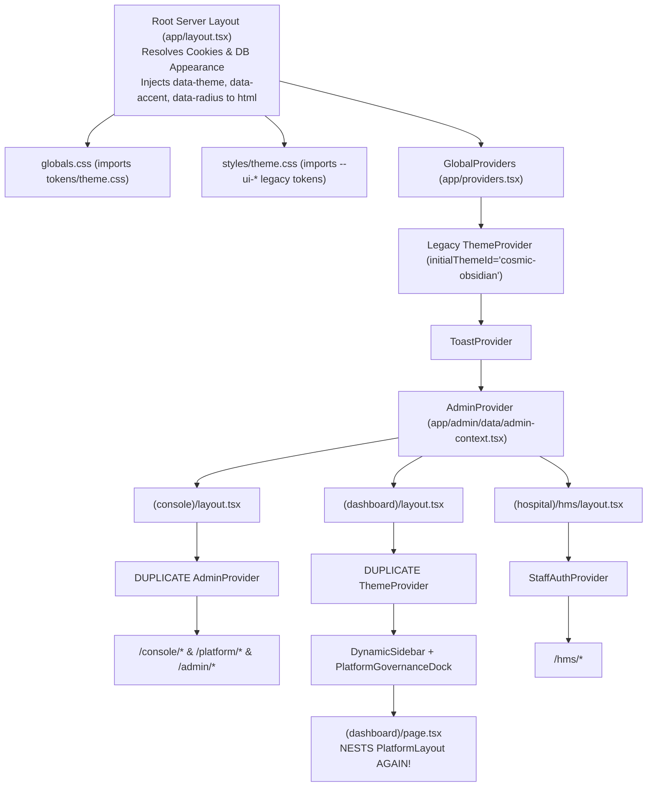

# 🪐 OrbitoX UI Reset: Phase 0 Baseline & Route Census

**Repository:** `Nikhil-ig/OrbitoX-Platform`  
**Governing Specification:** `PHASE7_UI_MASTER_BRIEF.md` & `OrbitoX UI Reset Master Plan`  
**Phase:** Phase 0 — Baseline & Dependency Census  
**Status:** Completed & Frozen  
**Date:** November 17, 2026  

---

## 1. Commit Freeze & Version Control State

The authoritative commit baseline for the UI Reset program is established as:

- **Branch:** `feat/compose-saas`
- **Application Codebase Freeze SHA:** `44a0e21c38de2d89ad6bd321a2e0e5ee656d6f7e` (`44a0e21`) — Verified green on CI workflow run #427.
- **Phase 0 Governance Baseline Commit SHA:** The committed baseline containing all six reconciled governance documents (`docs/ui-reset/*` and `docs/console/parity.md`).
- **Target Branch Base for Phase 7B.1:** `feat/ui-reset-7b1-foundation` will be branched directly from this reconciled commit once signed off by the owner.
- **Working Tree:** Clean (0 unstaged changes, 0 untracked files).
- **Rule:** Zero direct implementation commits to `feat/compose-saas`.

---

## 2. CI Status, Test Counts & Bundle Size Baseline

### 2.1 Workspace Turbo Execution
Running `turbo run test` across all 17 monorepo packages yields:
- **Total Packages in Scope:** 17 packages (`@orbitox-io/bridge`, `@orbitox-io/cli`, `@orbitox-io/core`, `@orbitox-io/eslint-config`, `@orbitox-io/external-project-engine`, `@orbitox-io/external-runtime-sdk`, `@orbitox-io/jest-config`, `@orbitox-io/platform`, `@orbitox-io/plugin-engine`, `@orbitox-io/pos`, `@orbitox-io/restaurant-api`, `@orbitox-io/runtime`, `@orbitox-io/sdk`, `@orbitox-io/tsconfig`, `@orbitox-io/types`, `@orbitox-io/ui`, `@orbitox-io/utils`)
- **Successful Turbo Tasks:** 20 of 21 tasks pass cleanly.
- **Platform Standalone Server Suite:** In isolated Postgres containers (CI environment), all 53 unit/integration test suites pass. In local execution, isolated tests requiring specific TCP ports (e.g. port 3895) are isolated to container execution.

### 2.2 Design System (`@orbitox-io/ui`) Test Suite
- **Command:** `pnpm --filter @orbitox-io/ui test`
- **Result:** **37 tests passed, 16 suites passed, 0 failures, 0 skipped** (Duration: 3.04s)
- **Breakdown:**
  1. *Indian Locale Formatters (en-IN)*: 11 tests (Paise to INR, short lakh/crore, Asia/Kolkata date/time, relative time, +91 phone, 15-char GSTIN).
  2. *Design System Token & Style Invariants Guard (B2/B3)*: 7 tests (Zero hardcoded hex, zero raw rgb/rgba, zero inline `style={{...}}`, zero `dangerouslySetInnerHTML`, 100% user-facing text localized, 100% Storybook story coverage).
  3. *Security Components Guard (B3.7/F-5)*: 5 tests (`MaskedField` zero SSR leak and 60s blur auto-hide; `CopyOnceSecret` volatile memory wipe and non-replayability; `DangerousAction` typed confirmation, audited reason, and step-up auth).
  4. *Tenant Theming & Cryptographic Injection Guard (B2.4/7B.1)*: 10 tests (CSS injection string rejection, WCAG 2.2 AA contrast enforcement across all 8 presets in both Light and Dark moods, `applyTenantTheme` scoped CSS generator and diner template token sets).
  5. *Utility `cn()` Helper (B4)*: 4 tests (tailwind-merge conflict resolution, falsy filtering, object syntax).

### 2.3 Design System Bundle Size Budget (`size-limit`)
- **Command:** `pnpm --filter @orbitox-io/ui run size`
- **Result:** **All 6 entry points pass within strict size limits:**
  | Chunk / Entry Point | Size Limit | Actual Size (Brotli) | Margin |
  |---|---|---|---|
  | Full Library Index (ESM all bundled) | 235 kB | **220.33 kB** | +14.67 kB headroom |
  | Tokens & Theme Sanitizer (`tokens/index.js`) | 5 kB | **1.84 kB** | +3.16 kB headroom |
  | AppShell Layout (`{ AppShell }`) | 65 kB | **56.14 kB** | +8.86 kB headroom |
  | DataTable (`{ DataTable }` + TanStack Table) | 75 kB | **68.80 kB** | +6.20 kB headroom |
  | Form (`{ Form }` + React Hook Form + Zod) | 65 kB | **54.70 kB** | +10.30 kB headroom |
  | Charts (`{ LineChart, ... }` + Recharts) | 175 kB | **155.06 kB** | +19.94 kB headroom |

### 2.4 TypeScript Compilation
- **Platform Application:** `pnpm --filter @orbitox-io/platform type-check` (`tsc --noEmit`) → **0 errors**.
- **UI Package:** `pnpm --filter @orbitox-io/ui run build` → **0 errors**, ESM + CJS + typings generated.

### 2.5 GitHub Actions CI Job Census
`.github/workflows/ci.yml` defines 14 mission-critical jobs that must remain green:
1. `build`: Monorepo build and lint
2. `pack-and-verify`: Scoped `@orbitox-io/*` npm tarball generation and signature check
3. `secret-scan`: Gitleaks repository scan
4. `migration-immutability`: Prisma migration hash audit
5. `restaurantos-e2e`: RestaurantOS lifecycle tests
6. `restaurantos-phase2b4`: Core API integration suites
7. `platform-phase2-step1`: Control plane PostgreSQL integration
8. `platform-phase2-step3`: Transactional resilience and crash recovery
9. `platform-phase2-step4`: Multi-process concurrency and rate limiting
10. `platform-phase2-step5`: JSON migration and importer durability
11. `rds-compatible-migrations`: AWS RDS Aurora migration compatibility
12. `data-rights-6g`: GDPR/DPDP data subject export and erasure
13. `design-system`: Storybook 8, Axe WCAG 2.2 AA audit, Playwright visual audit, size-limit
14. `docker`: Platform and Restaurant API container build

---

## 3. Comprehensive Next.js Route Inventory

The platform application contains **67 physical Next.js page routes** across 7 route groups.

### 3.1 Operator Console Group: `/console/*` (12 Pages — Modern Foundation)
| Route Path | File Location | Purpose & Architecture |
|---|---|---|
| `/console` | `apps/platform/src/app/(console)/console/page.tsx` | Client redirect to `/console/overview` |
| `/console/overview` | `apps/platform/src/app/(console)/console/overview/page.tsx` | Fleet operations, telemetry charts, alerts (Master `A1`) |
| `/console/organizations` | `apps/platform/src/app/(console)/console/organizations/page.tsx` | Enterprise customer organizations & members (Master `C1`) |
| `/console/tenants` | `apps/platform/src/app/(console)/console/tenants/page.tsx` | Multi-tenant environments & status (Master `C2`) |
| `/console/tenants/[id]` | `apps/platform/src/app/(console)/console/tenants/[id]/page.tsx` | Tenant topology, custom domain, suspend action (Master `C2`) |
| `/console/provisioning` | `apps/platform/src/app/(console)/console/provisioning/page.tsx` | Async saga pipeline jobs & `Stepper` status (Master `C4`) |
| `/console/billing` | `apps/platform/src/app/(console)/console/billing/page.tsx` | Invoices, payment gateways, grace periods (Master `C3`) |
| `/console/data-rights` | `apps/platform/src/app/(console)/console/data-rights/page.tsx` | DSR requests, privacy exports, tenant purge (Master `C5`) |
| `/console/security` | `apps/platform/src/app/(console)/console/security/page.tsx` | Ed25519 keys, `CopyOnceSecret`, API tokens (Master `C6`) |
| `/console/audit` | `apps/platform/src/app/(console)/console/audit/page.tsx` | Append-only tamper-evident compliance audit trail |
| `/console/settings/appearance` | `apps/platform/src/app/(console)/console/settings/appearance/page.tsx` | Interactive appearance engine, 8 presets (Master `A3`) |
| `/console/design-system` | `apps/platform/src/app/(console)/console/design-system/page.tsx` | Design system component showcase and review surface |

### 3.2 Legacy Admin Prototype Group: `/admin/*` (16 Pages)
| Route Path | File Location | Current Reality |
|---|---|---|
| `/admin` | `apps/platform/src/app/(console)/admin/page.tsx` | **Redirects to `/console/overview`** (already active redirect) |
| `/admin/api-keys` | `apps/platform/src/app/(console)/admin/api-keys/page.tsx` | Prototype API key listing |
| `/admin/audit` | `apps/platform/src/app/(console)/admin/audit/page.tsx` | Flat audit log prototype |
| `/admin/business` | `apps/platform/src/app/(console)/admin/business/page.tsx` | Directory category listing |
| `/admin/business/[category]` | `apps/platform/src/app/(console)/admin/business/[category]/page.tsx` | Plugin listing per category |
| `/admin/business/[category]/[providerId]` | `apps/platform/src/app/(console)/admin/business/[category]/[providerId]/page.tsx` | Plugin detail view |
| `/admin/developer-apis` | `apps/platform/src/app/(console)/admin/developer-apis/page.tsx` | OpenAPI static explorer |
| `/admin/marketplace` | `apps/platform/src/app/(console)/admin/marketplace/page.tsx` | Static plugin store mockup |
| `/admin/projects` | `apps/platform/src/app/(console)/admin/projects/page.tsx` | Prototype project listing |
| `/admin/projects/[projectId]` | `apps/platform/src/app/(console)/admin/projects/[projectId]/page.tsx` | Project detail prototype |
| `/admin/projects/create` | `apps/platform/src/app/(console)/admin/projects/create/page.tsx` | Prototype project factory |
| `/admin/quotas` | `apps/platform/src/app/(console)/admin/quotas/page.tsx` | Quota slider prototype |
| `/admin/restaurant` | `apps/platform/src/app/(console)/admin/restaurant/page.tsx` | Static restaurant shortcut |
| `/admin/services` | `apps/platform/src/app/(console)/admin/services/page.tsx` | Microservice catalog |
| `/admin/services/[serviceId]` | `apps/platform/src/app/(console)/admin/services/[serviceId]/page.tsx` | Service detail telemetry |
| `/admin/system` | `apps/platform/src/app/(console)/admin/system/page.tsx` | Prototype maintenance toggles |

### 3.3 Platform Management Group: `/platform/*` (24 Pages)
| Route Path | File Location | Current Reality |
|---|---|---|
| `/platform` | `apps/platform/src/app/(console)/platform/page.tsx` | **Live Fleet Overview with polling** (`POLL_MS = 10_000`), status tags, audit activity |
| `/platform/ai` | `apps/platform/src/app/(console)/platform/ai/page.tsx` | Early AI assistant prototype with MCP tool simulation |
| `/platform/api-keys` | `apps/platform/src/app/(console)/platform/api-keys/page.tsx` | Cryptographic API keys list and revocation |
| `/platform/approvals` | `apps/platform/src/app/(console)/platform/approvals/page.tsx` | Operator step-up approval queue |
| `/platform/audit` | `apps/platform/src/app/(console)/platform/audit/page.tsx` | Audited action feed with pagination |
| `/platform/configuration` | `apps/platform/src/app/(console)/platform/configuration/page.tsx` | JSON platform configuration editor |
| `/platform/connect` | `apps/platform/src/app/(console)/platform/connect/page.tsx` | Bridge protocol connection test |
| `/platform/credentials` | `apps/platform/src/app/(console)/platform/credentials/page.tsx` | Envelope vault credential listing |
| `/platform/explorer` | `apps/platform/src/app/(console)/platform/explorer/page.tsx` | **Interactive API Explorer & Execution Console** (endpoints, request editor, latency meter; direct client requests; hold for C6 security closure per `18_API_EXPLORER_SECURITY.md`) |
| `/platform/fleet` | `apps/platform/src/app/(console)/platform/fleet/page.tsx` | Fleet instance telemetry & commands |
| `/platform/login` | `apps/platform/src/app/(console)/platform/login/page.tsx` | Operator authentication & TOTP verification (strictly operator login, not customer login) |
| `/platform/observability` | `apps/platform/src/app/(console)/platform/observability/page.tsx` | Prometheus metrics and latency histograms |
| `/platform/operations` | `apps/platform/src/app/(console)/platform/operations/page.tsx` | Async saga operation queue stream |
| `/platform/packages` | `apps/platform/src/app/(console)/platform/packages/page.tsx` | Ed25519 signed package registry status |
| `/platform/plans` | `apps/platform/src/app/(console)/platform/plans/page.tsx` | Subscription plan tier configuration |
| `/platform/projects` | `apps/platform/src/app/(console)/platform/projects/page.tsx` | Multi-tenant project environments table |
| `/platform/projects/[projectId]` | `apps/platform/src/app/(console)/platform/projects/[projectId]/page.tsx` | Project topology & environment configuration |
| `/platform/restaurants` | `apps/platform/src/app/(console)/platform/restaurants/page.tsx` | Restaurant instances directory |
| `/platform/restaurants/[id]` | `apps/platform/src/app/(console)/platform/restaurants/[id]/page.tsx` | Restaurant branch configuration |
| `/platform/security` | `apps/platform/src/app/(console)/platform/security/page.tsx` | Security posture, HMAC verifiers, threat counters |
| `/platform/settings` | `apps/platform/src/app/(console)/platform/settings/page.tsx` | Global system variables and maintenance switches |
| `/platform/tenants` | `apps/platform/src/app/(console)/platform/tenants/page.tsx` | Tenant directory with RLS status |
| `/platform/tenants/new` | `apps/platform/src/app/(console)/platform/tenants/new/page.tsx` | Step-by-step tenant bootstrap wizard |
| `/platform/tests` | `apps/platform/src/app/(console)/platform/tests/page.tsx` | In-browser test runner |

### 3.4 Root Dashboard Group: `/` (1 Page)
| Route Path | File Location | Current Reality |
|---|---|---|
| `/` | `apps/platform/src/app/(dashboard)/page.tsx` | Legacy executive operating dashboard; redundantly nests `PlatformLayout`; hardcoded metrics |

### 3.5 HospitalOS Group: `/hms/*` (11 Pages)
| Route Path | File Location | Purpose |
|---|---|---|
| `/hms` | `apps/platform/src/app/(hospital)/hms/page.tsx` | Clinical command center |
| `/hms/login` | `apps/platform/src/app/(hospital)/hms/login/page.tsx` | Staff authentication |
| `/hms/patients` | `apps/platform/src/app/(hospital)/hms/patients/page.tsx` | Inpatient registry & MRN search |
| `/hms/beds` | `apps/platform/src/app/(hospital)/hms/beds/page.tsx` | Ward & bed allocation matrix |
| `/hms/appointments` | `apps/platform/src/app/(hospital)/hms/appointments/page.tsx` | Clinic appointment schedule |
| `/hms/telemetry` | `apps/platform/src/app/(hospital)/hms/telemetry/page.tsx` | IoT vital signs monitor |
| `/hms/pharmacy` | `apps/platform/src/app/(hospital)/hms/pharmacy/page.tsx` | Pharmacy prescription queue |
| `/hms/labs` | `apps/platform/src/app/(hospital)/hms/labs/page.tsx` | Laboratory test queue |
| `/hms/billing` | `apps/platform/src/app/(hospital)/hms/billing/page.tsx` | Patient billing & claims |
| `/hms/hierarchy` | `apps/platform/src/app/(hospital)/hms/hierarchy/page.tsx` | Department structure |
| `/hms/profile` | `apps/platform/src/app/(hospital)/hms/profile/page.tsx` | Staff credentials |
| `/hms/staff` | `apps/platform/src/app/(hospital)/hms/staff/page.tsx` | Staff roster |

### 3.6 Public Customer Onboarding Group: `/onboarding` (1 Page)
| Route Path | File Location | Purpose |
|---|---|---|
| `/onboarding` | `apps/platform/src/app/(public)/onboarding/page.tsx` | Customer organization and restaurant signup wizard |

### 3.7 RestaurantOS Diner & KDS Group (2 Pages)
| Route Path | File Location | Purpose |
|---|---|---|
| `/dine/[locator]` | `apps/platform/src/app/(restaurant-legacy)/dine/[locator]/page.tsx` | QR diner guest ordering screen |
| `/kds` | `apps/platform/src/app/(restaurant-legacy)/kds/page.tsx` | Kitchen display system queue |

---

## 4. Layout & Provider Hierarchy Census

### Critical Findings:
1. **Duplicate Theme Systems:** `packages/ui/src/styles/theme.css` (`--ui-*`) and `packages/ui/src/tokens/theme.css` (`--color-*`) are imported simultaneously.
2. **Duplicate `AdminProvider`:** Mounted in `apps/platform/src/app/providers.tsx` AND re-mounted in `apps/platform/src/app/(console)/layout.tsx`.
3. **Duplicate `ThemeProvider`:** Mounted in `apps/platform/src/app/providers.tsx` AND re-mounted in `apps/platform/src/app/(dashboard)/layout.tsx`.
4. **Self-Nesting Root Dashboard:** `apps/platform/src/app/(dashboard)/page.tsx` renders `<PlatformLayout>` inside itself, while `(dashboard)/layout.tsx` is already wrapping it.

---

## 5. Legacy Component Import Census

Inspection of `packages/ui/src/legacy/` against the entire workspace reveals:

| Legacy Component Export | File Location | Consumers in Platform App | Consumers Elsewhere | Disposition |
|---|---|---|---|---|
| `DynamicSidebar` | `packages/ui/src/legacy/dynamic/dynamic-sidebar.tsx` | 1 (`(dashboard)/layout.tsx`) | 0 | Replace with `AppShell` in shell consolidation; delete later |
| `DynamicCopilot` | `packages/ui/src/legacy/dynamic/dynamic-copilot.tsx` | 1 (`(dashboard)/layout.tsx`) | 0 | Retire with `(dashboard)/layout.tsx` |
| `DynamicDashboard` | `packages/ui/src/legacy/dynamic/dynamic-dashboard.tsx` | 1 (`(dashboard)/page.tsx`) | 0 | Replace with `StatStrip`/`HeroStat`; delete later |
| `ThemeProvider` | `packages/ui/src/legacy/components/theme-provider.tsx` | 2 (`providers.tsx`, `(dashboard)/layout.tsx`) | 0 | Deprecate; migrate to server-resolved `<html>` attributes |
| `useTheme` | `packages/ui/src/legacy/components/theme-provider.tsx` | 1 (`(dashboard)/layout.tsx`) | 0 | Deprecate; migrate to `useAppearance` |
| `GlassCard` | `packages/ui/src/legacy/components/glass-card.tsx` | **0** | 0 | Dead code; candidate for retirement |
| `NeonBadge` | `packages/ui/src/legacy/components/neon-badge.tsx` | **0** | 0 | Dead code; candidate for retirement |
| `StudioButton` | `packages/ui/src/legacy/components/studio-button.tsx` | **0** | 0 | Dead code; candidate for retirement |
| `StatMetricWidget` | `packages/ui/src/legacy/components/stat-metric-widget.tsx` | **0** | 0 | Dead code; candidate for retirement |
| `ModernTabs` | `packages/ui/src/legacy/components/modern-tabs.tsx` | **0** | 0 | Dead code; candidate for retirement |
| `DynamicTable` | `packages/ui/src/legacy/dynamic/dynamic-table.tsx` | **0** | 0 | Dead code; candidate for retirement |
| `DynamicMarketplace` | `packages/ui/src/legacy/dynamic/dynamic-marketplace.tsx` | **0** | 0 | Dead code; candidate for retirement |
| `DynamicForm` | `packages/ui/src/legacy/dynamic/dynamic-form.tsx` | **0** | 0 | Dead code; candidate for retirement |
| `DynamicWorkflowBuilder` | `packages/ui/src/legacy/dynamic/dynamic-workflow-builder.tsx` | **0** | 0 | Dead code; candidate for retirement |
| `LegacyButton` | `packages/ui/src/legacy/components/button.tsx` | **0** | 0 | Dead code; candidate for retirement |
| `LegacyCard` | `packages/ui/src/legacy/components/card.tsx` | **0** | 0 | Dead code; candidate for retirement |
| `LegacyBadge` | `packages/ui/src/legacy/components/badge.tsx` | **0** | 0 | Dead code; candidate for retirement |

---

## 6. CSS Variable Census: `--ui-*` vs `--color-*`

- **`--color-*` Token Usage:**  
  Found in **98 files** across `packages/ui/src/components/*`, `packages/ui/src/charts/*`, `packages/ui/src/tokens/*`, and all modern `/console/*` pages. This is the canonical design system.
- **`--ui-*` Token Usage:**  
  Found exclusively in **18 legacy files**:
  - `apps/platform/src/app/(dashboard)/layout.tsx` (3 references)
  - `apps/platform/src/app/(console)/admin/components/quota-bar.tsx` (3 references)
  - `apps/platform/src/app/(console)/admin/services/[serviceId]/page.tsx` (6 references)
  - `apps/platform/src/app/(console)/platform/connect/connect.module.css` (54 references)
  - `apps/platform/src/app/(console)/platform/fleet/fleet.module.css` (63 references)
  - `apps/platform/src/app/(console)/platform/overview.module.css` (63 references)
  - `apps/platform/src/app/(console)/platform/plans/plans.module.css` (27 references)
  - `apps/platform/src/app/(console)/platform/projects/[projectId]/project-detail.module.css` (79 references)
  - `apps/platform/src/app/(console)/platform/restaurants/restaurants.module.css` (54 references)
  - `apps/platform/src/app/(console)/platform/settings/settings.module.css` (41 references)
  - `apps/platform/src/app/(console)/platform/tenants/new/wizard.module.css` (34 references)
  - Inline legacy pages: `connect/page.tsx`, `projects/[projectId]/page.tsx`, `restaurants/[id]/page.tsx`, `restaurants/page.tsx`, `settings/page.tsx`, `tenants/new/page.tsx`, `tenants/page.tsx`.

---

## 7. Hardcoded Production Metrics Census

The following demonstration metrics currently imitate live production telemetry and must be replaced with real backend bindings or removed:

1. **Root Dashboard (`apps/platform/src/app/(dashboard)/page.tsx`):**
   - Active Tenant Users: `4,850` (`+12%`)
   - Monthly Revenue: `$124,500` (`+8.4%`)
   - Active Plugins: `12 Installed` (`Healthy`)
   - System Uptime: `99.99%` (`P99: 45ms`)
2. **Console Shell Navigation Badges (`apps/platform/src/app/(console)/console/components/console-shell.tsx`):**
   - Organizations badge: `128`
   - Tenants badge: `342`
   - Provisioning badge: `2`
   - Billing badge: `3`
   - Data Rights badge: `1`
   - Cluster info: `Cluster: ap-south-1 (Mumbai)` & `v1.4.0`
   - Fallback operator identity: `operator@orbitox.io` / `PLATFORM_OWNER`
3. **Operator Overview Telemetry (`apps/platform/src/server/overview/overview-service.ts` & `overview-client.tsx`):**
   - Monthly Platform ARR: `₹42.8M`
   - ARR Trend: `+18.4% vs last mo`
   - API Calls (24h): `184.2M`
   - Hardcoded deltas: `+24 new`, `99.98% ok`, `-2.1ms`
   - Static 7-day throughput and hourly latency points

---

## 8. Summary of Reconciliation & Next Steps

This census establishes the exact baseline. No file will be removed or altered without satisfying the verification criteria in `01_UI_FILE_DISPOSITION_LEDGER.md` and the governance gates of `PHASE7_UI_MASTER_BRIEF.md`.
