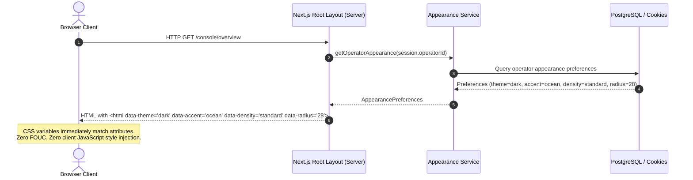

# 🪐 OrbitoX UI Reset: Design System Migration Specification

**Repository:** `Nikhil-ig/OrbitoX-Platform`  
**Governing Specification:** `PHASE7_UI_MASTER_BRIEF.md` (Sections 1, 3, 6) & `OrbitoX UI Reset Master Plan`  
**Phase:** Phase 7B.1 — Design-System Closure & Visual Language Migration  
**Status:** Canonical Implementation Guide  
**Date:** November 17, 2026  

---

## 1. The Master Visual Language

OrbitoX establishes a single unified design system rendered across two cohesive visual moods:

### 1.1 Geometry & Radius Rules
- **Cards:** Base radius of **28 px** (`var(--radius-card)`). Large hero cards use **32 px** (`var(--radius-hero)`).
- **Inner Rows & List Items:** **16–22 px** (`var(--radius-row)`).
- **Pills (Universal):** **999 px** (`var(--radius-pill)` or `rounded-full`). Applied strictly to:
  - Buttons (`Button`)
  - Inputs & Textareas (`Input`, `Select`, `Combobox`)
  - Tabs & Segmented Controls (`Tabs`, `SegmentedControl`, `PillNav`)
  - Badges & Status Indicators (`Badge`, `StatusPill`, `LiveStatusBar`)
  - Sidebar & Top Navigation Items (`AppShell`, `BottomTabBar`)
- **Icon Buttons:** **44–48 px perfect circles** (`rounded-full` with equal aspect ratio and minimum 44px hit-box).

### 1.2 Typography Hierarchy
- **Primary Font Family:** **Plus Jakarta Sans** (self-hosted, OFL licensed).
- **Secondary Fonts:** **Noto Sans Devanagari** (Indian regional localization) and **JetBrains Mono** (hashes, API tokens, cryptographic keys, monospace tables).
- **Headings:** Font weight **600**, letter spacing with negative tracking **−0.02 to −0.03em**.
- **Hero Numbers:** **44–64 px**, weight **300** (Dark mood) or **600** (Light mood), negative tracking **−0.04em**, strictly one hero stat per card with a small muted label underneath.

### 1.3 Dual Mood Architecture
Every component operates identically in both moods, bound exclusively to semantic CSS variables:

| Mood | Target Surfaces | Backgrounds | Surface / Raised | Borders | Text Primary / Muted |
|---|---|---|---|---|---|
| **Dark** | Operator Console (`/console/*`), Kitchen (`/kds`), Waiter Phone | `#0D0F12` (Base) | `#14171C` (Surface) `#1B1F25` (Raised) | `rgba(255, 255, 255, 0.06)` | `#F2F4F7` (Primary) `#9AA3AF` (Muted) |
| **Light** | Customer Workspace, Onboarding, Owner Admin, POS, Invoices | `#EEF1F5` → `#E3E7EE` (Gradient) | `#FFFFFF` (Surface) `#F8FAFC` (Raised) | `rgba(20, 22, 26, 0.08)` | `#14161A` (Primary) `#5A6170` (Muted) |

- **Lighting Accents:**
  - Dark mood: One soft radial accent glow behind the page header (`bg-radial-gradient`), never positioned behind body text.
  - Light mood: Soft low shadow on white cards (`box-shadow: 0 30px 60px -44px rgba(20, 22, 26, 0.35)`). Active nav items and hero elements use a near-black pill (`#14161A`).

### 1.4 The 8 Preset Accents & WCAG 2.2 AA Contrast
Only one accent preset is active per tenant/operator session. Each preset explicitly defines its own foreground color ensuring a minimum **4.5:1 contrast ratio**:

| Preset Name | Dark Mode Value | Light Mode Value | Foreground On Accent | Verified Ratio |
|---|---|---|---|---|
| **Ocean** (Default) | `#3D6EF5` | `#2F5BD8` | `#FFFFFF` | ≥ 4.8:1 |
| **Emerald** | `#10B981` | `#059669` | `#FFFFFF` | ≥ 4.6:1 |
| **Sunflower** | `#EAB308` | `#CA8A04` | `#14161A` (Dark Text) | ≥ 7.2:1 |
| **Saffron** | `#F97316` | `#EA580C` | `#FFFFFF` | ≥ 4.5:1 |
| **Ruby** | `#F43F5E` | `#E11D48` | `#FFFFFF` | ≥ 4.7:1 |
| **Coral** | `#FB7185` | `#F43F5E` | `#FFFFFF` | ≥ 4.5:1 |
| **Violet** | `#8B5CF6` | `#7C3AED` | `#FFFFFF` | ≥ 4.9:1 |
| **Teal** | `#14B8A6` | `#0D9488` | `#FFFFFF` | ≥ 4.6:1 |

### 1.5 Density & Motion
- **Density Settings:** Adjusts spacing tokens only (margins, paddings, gaps); typography scales remain fixed:
  - `relaxed`: `1.25x` spacing multiplier
  - `standard`: `1.0x` spacing multiplier
  - `compact`: `0.65x` spacing multiplier
- **Motion:** Standard transitions use `200–300 ms ease-out`. When `prefers-reduced-motion` is detected or `smoothAnimations: false` is configured, all transition durations collapse immediately to `0ms`.

---

## 2. Component Library Restyling & Verification

### 2.1 Existing Components Under Refactoring
All existing components in `packages/ui/src/components/` must be verified against the 7B.1 geometry rules while preserving their existing test coverage:
1. `Button`: 999px pill shape, 8 accent color variants, touch target ≥ 44px.
2. `Input` / `Select` / `Textarea`: Pill shape on text inputs, pill radius on select triggers, focus-visible ring matching accent.
3. `Tabs`: Pill segment wrapper, active tab pill with elevation or high-contrast background.
4. `Badge` / `StatusPill`: Pill shape, semantic color tones (green, amber, coral, blue) paired with obligatory text labels.
5. `Card`: 28px card radius, 32px hero card radius, surface raised border tokens.
6. `Dialog` / `AlertDialog` / `Sheet`: 28px radius dialog panels, backdrop blur, focus trap, Escape key handling.
7. `Toast` / `Banner`: Pill or 18px rounded row banners, auto-dismiss timers, polite ARIA live region announcements.
8. `DataTable`: 14px text, 1px divider rows, horizontal scrolling container with zero page overflow.
9. `AppShell`: 5-persona responsive navigation foundation.
10. `Stepper`: Vertical and horizontal state progressions (`done`, `active`, `failed`, `waiting`).
11. `DangerousAction` (**C2**): Protected destructive action dialog with typed confirmation string, audited reason text field, and step-up auth gate.
12. `CopyOnceSecret` (**C6**): Single-reveal secret display with automatic memory wiping and replay prevention after unmount.
13. `MaskedField`: PHI/PII masking with zero DOM leakage and 60-second blur auto-hide.
14. `EmptyState` / `ErrorState` / `Skeleton` (**P1**): Consistent feedback states without layout shift.

### 2.2 New Stage 7B.1 Components
1. `SegmentedControl`: Multi-option pill switch with animated sliding indicator.
2. `PillNav`: Horizontal pill tab bar with scroll snap and keyboard arrow navigation.
3. `HeroStat` / `StatStrip`: Large 44–64px metric displays with secondary trend indicators and labels.
4. `ProgressBar` / `MeterRow`: Accessible bar with range bounds and semantic coloring.
5. `ListRowLink` & `ActionCard`: High-density rows with chevron triggers, badges, and optional accent highlight.
6. `ActivityFeed`: Chronological event feed with icon pins and relative timestamps (`formatRelative`).
7. `BottomTabBar`: Floating mobile pill navigation bar (max 5 items, prominent center action).
8. `BottomSheet`: Mobile bottom drawer with real drag gesture handling, backdrop dismiss, and Escape listener.
9. `SwipeActions`: Mobile swipe-to-reveal actions with guaranteed keyboard/button fallbacks.
10. `RingTimer`: Circular SVG countdown timer for kitchen tickets and session expiry.
11. `QuantityStepper`: Pill stepper with minus/count/plus controls for POS and diner ordering.
12. `LiveStatusBar`: Accessible dynamic banner announcing system changes via `aria-live="polite"`.
13. `MenuItemCard` & `VegMark`: F&B catalog cards with dietary badges (green square dot for veg, red triangle for non-veg).
14. `FloorPlan`: SVG/CSS grid table layout (read-only in 7B.1; interactive editor in Stage 7F).
15. `Charts`: Comparison line chart, daily lollipop chart, and hourly bar chart with obligatory accessible table fallbacks.

---

## 3. Server-Resolved Appearance Architecture

### 3.1 Zero Flash of Unstyled Content (FOUC)
Appearance preferences are resolved entirely on the server during the Next.js root layout execution:

### 3.2 Recovery & Rollback on Save Failure
1. **Optimistic UI:** When the user changes an appearance setting in `/console/settings/appearance`, the client applies the change immediately to `document.documentElement`.
2. **Network Mutation:** The client dispatches a `PUT /api/v1/platform/me/appearance` request.
3. **Rollback on Error:** If the server returns a non-200 response or network fails:
   - The client reverts `document.documentElement` attributes to the previous valid state.
   - A high-visibility error toast informs the user: *"Failed to save appearance settings. Reverting changes."*
   - No corrupted or unpersisted state remains in local storage.

---

## 4. The 11 Approved Master Showcase Screens

The showcase at `/console/design-system` and Storybook group `"Showcase"` must accurately render the following 11 reference screens using real shared components and mock data:

| Screen ID | Title | Device Target | Mood | Key Components Featured |
|---|---|---|---|---|
| **A1** | Operator Console Overview | Desktop (1440×900) | Dark | `HeroStat`, `StatStrip`, `LollipopChart`, `ComparisonLineChart`, `ActivityFeed` |
| **A2** | Customer Dashboard Home | Desktop (1440×900) | Light | `StatCard`, `ActionCard`, `DataTable`, `PillNav`, `ProgressBar` |
| **A3** | Appearance Settings | Desktop (1440×900) | Dark | `SegmentedControl`, `Slider`, `Radio`, Real API Persistence Engine |
| **A4** | Diner Template "Saffron" | Phone (390×844) | Tenant | `MenuItemCard`, `VegMark`, `QuantityStepper`, `BottomTabBar` |
| **C2** | Tenant Detail & Suspend | Desktop (1440×900) | Dark | `DangerousAction` Suspend Dialog, `StatusPill`, `DescriptionList` |
| **C4** | Provisioning Saga Pipeline | Desktop (1440×900) | Dark | `Stepper` (Done, Failed, Waiting, Running), Error Callout, Retry Button |
| **C6** | Security & Cryptographic Keys | Desktop (1440×900) | Dark | `CopyOnceSecret` Single-Reveal, Ed25519 Key Table, Revoke Dialog |
| **P1** | System Feedback States | Desktop / Tablet | Dual | `EmptyState`, `ErrorState`, `Skeleton` Shimmer Matrix |
| **S1** | Kitchen KDS Order Card | Tablet (834×1194) | Dark | `RingTimer`, Kitchen Ticket Card, High-Contrast Status Pills |
| **D1** | Restaurant POS Terminal | Tablet (1194×834) | Light | `FloorPlan`, Order Cart Stepper, Category Tabs |
| **D4** | Diner Checkout & Order Status | Phone (390×844) | Light | `BottomSheet`, Bill Splitter, UPI Payment Stepper |

---

## 5. Strict Lint Invariants

The `@orbitox-io/ui` package test suite (`test/lint-invariants.test.ts`) enforces the following invariants on every build:
1. **Zero Hardcoded Hex Colors:** No `#FFFFFF`, `#000000`, etc., in component TSX/JSX. All colors reference semantic tokens (`var(--color-*)`).
2. **Zero Raw RGB/RGBA Colors:** All transparency references use OKLCH or tokenized alpha layers.
3. **Zero Inline Styles:** No `style={{...}}` blocks in modern components or charts (dynamic positioning exempted only in FloorPlan coordinates).
4. **Zero `dangerouslySetInnerHTML`:** Eliminates XSS injection vectors.
5. **Zero Hardcoded Text Literals:** All user-visible strings must pass through props or `t()` localization helper.
