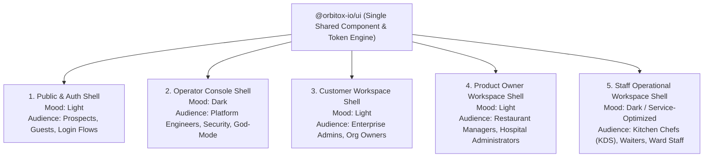
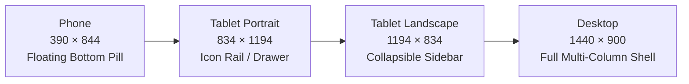

# 🪐 OrbitoX UI Reset: Shell & Navigation Architecture

**Repository:** `Nikhil-ig/OrbitoX-Platform`  
**Governing Specification:** `PHASE7_UI_MASTER_BRIEF.md` (Sections 2, 4) & `OrbitoX UI Reset Master Plan`  
**Phase:** Phase 0 — Target Architecture  
**Status:** Approved Architectural Specification  
**Date:** November 17, 2026  

---

## 1. Persona-Aware Shell Architecture

OrbitoX serves five distinct user personas. Rather than forcing every user into a single layout or building fragmented design systems, OrbitoX uses **one design system with five dedicated application shells**:



### 1.1 Persona Shell Breakdown

| Persona Shell | Target Routes | Visual Mood | Navigation Architecture | Key Capabilities |
|---|---|---|---|---|
| **Public & Auth Shell** | `/onboarding`, `/platform/login`, `/hms/login` | Light | Minimalist centered cards, brand headers, single-column forms | TOTP verification, email sign-in, organization bootstrap wizard |
| **Operator Console Shell** | `/console/*` | Dark (`#0D0F12`) | Left sidebar navigation (`AppShell`) with cluster status dock | Fleet telemetry, Ed25519 keys, saga jobs, tenant suspension, DSR |
| **Customer Workspace Shell** | `/workspace/*` (Future 7D) | Light | Top navigation bar with project switcher and billing shortcut | Organizations, subscription upgrades, project API keys, usage limits |
| **Product Owner Shell** | `/admin/restaurant` (Future 7F), `/hms` | Light | Sidebar or top-rail with store/branch selector | Menu management, staff assignments, inventory catalog, POS settings |
| **Staff Operational Shell** | `/kds`, `/dine/*`, `/hms/patients` | Dark (high contrast) | Floating bottom pill navigation (`BottomTabBar`) or zero-chrome full screen | Live order queues, countdown timers, bed allocation, rapid tap inputs |

---

## 2. Responsive Navigation Model

### 2.1 Viewport Breakpoint Specifications
OrbitoX targets four authoritative viewport classes:



### 2.2 Mobile Navigation (Phone: 390 × 844)
- **Departure from Old Implementation:** The legacy shell relied on a top hamburger menu opening an off-screen side drawer. The Master Brief strictly mandates a **floating bottom navigation pill** (`BottomTabBar`).
- **Rules for `BottomTabBar`:**
  - Maximum of **5 navigation targets** (e.g. Orders, Tables, Menu, Activity, Profile).
  - Prominent center action item (e.g. New Order / Action).
  - Minimum touch target: **44 px** (standard) or **52 px** (Kitchen/POS).
  - Hidden automatically on keyboard display or in full-screen modal overlays.

### 2.3 Desktop & Tablet Navigation (Desktop: 1440 × 900, Tablet: 834 / 1194)
- **Desktop Sidebar:**
  - Fixed 260px left sidebar using `AppShell`.
  - Section 1: Main Platform Navigation (`Overview`, `Organizations`, `Tenants`, `Provisioning`, `Billing`, `Data Rights`, `Security & Keys`, `Audit Log`).
  - Section 2: Installed Vertical Products (`RestaurantOS`, `Hospitality HMS`).
  - Section 3: Bottom Status & Operator Profile card.
- **Tablet Optimization:**
  - Collapsible icon-rail mode to maximize operational screen real estate.

---

## 3. Provider Hierarchy Consolidation

### 3.1 The Competing Provider Problem
The current codebase suffers from three competing state layers:
1. **Root `app/layout.tsx`:** Reads server cookies/database and injects `data-theme`, `data-accent`, etc., into `<html>`.
2. **`GlobalProviders` (`app/providers.tsx`):** Mounts legacy client `ThemeProvider` which writes to local storage and injects inline styles via `dangerouslySetInnerHTML`.
3. **Duplicate `AdminProvider`:** Mounted in `app/providers.tsx` AND re-mounted in `app/(console)/layout.tsx`.

### 3.2 The Consolidated Architecture

```mermaid
graph TD
  Root["app/layout.tsx (Server Component)<br>• Reads Session Cookie & DB Appearance<br>• Injects data-* attributes to html element<br>• Zero inline style or script tags"]

  Root --> LeanProviders["app/providers.tsx (Client Component)<br>• ToastProvider (Toast notification queue)<br>• (No ThemeProvider, No AdminProvider)"]

  LeanProviders --> ShellSelection{"Persona Route Group Router"}

  ShellSelection -->|/(console)/*| ConsoleLayout["(console)/components/console-shell.tsx<br>• Operator Shell<br>• Real Telemetry Data Providers"]
  ShellSelection -->|/workspace/*| CustomerLayout["Customer Shell<br>• Org Context Provider"]
  ShellSelection -->|/hms/*| HMSLayout["(hospital)/hms/layout.tsx<br>• StaffAuthProvider"]
```

---

## 4. Resolving the Root Dashboard (`/`) Destination

### 4.1 Current Root Defect
`apps/platform/src/app/(dashboard)/page.tsx`:
- Imports and nests `PlatformLayout` inside a route group already wrapped by `(dashboard)/layout.tsx`.
- Displays mock widgets (`$124,500` revenue, `4,850` active users, `99.99%` uptime).
- Uses deprecated `DynamicSidebar` and inline styling.

### 4.2 Approved Permanent Root Destination Contract (Owner Approved)

The permanent contract for root route (`/`) navigation is determined by session principal state:

| Session State | Root Destination (`/`) |
|---|---|
| **No valid session** | Public OrbitoX entry / account sign-in selection |
| **Valid operator session** | `/console/overview` |
| **Valid customer session** | Customer's authorized workspace |
| **Expired or invalid session** | Public entry / account sign-in selection |
| **Customer with multiple organizations** | Organization selection, or a validated last-used organization |

### 4.3 Architectural Safeguards & Implementation Timing
1. **Operator vs Customer Auth Separation:** `/platform/login` is strictly an operator credential and TOTP barrier. It must NEVER become the universal login destination for customer users. Public/customer sign-in must use dedicated account selection/login entry.
2. **No Invented Routes:** Do not invent a customer workspace route string before its canonical path is formally defined and built in Stage 7D.
3. **Session Resolution Architecture:** Current `apps/platform/src/middleware.ts` recognizes operator sessions, but does not yet perform customer-session routing. The account service (`apps/platform/src/server/accounts/account-service.ts`) defines `CUSTOMER_SESSION_COOKIE` (`orbitox_customer_session`) and customer organization membership contexts. This change requires deliberate multi-principal session resolution in middleware, not a trivial client redirect on `/`.
4. **Implementation Timing:** The contract is approved now, but physical modification of `/` and middleware is deferred to the shell/customer-workspace milestone. Root-route modification is strictly outside the restricted 7B.1 page-change scope.
