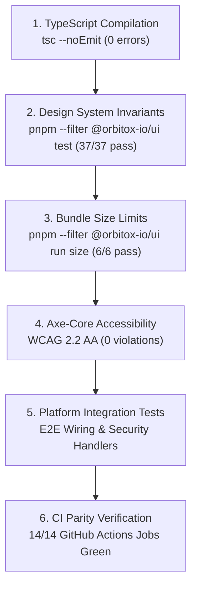

# 🪐 OrbitoX UI Reset: Acceptance & Verification Matrix

**Repository:** `Nikhil-ig/OrbitoX-Platform`  
**Governing Specification:** `PHASE7_UI_MASTER_BRIEF.md` (Sections 1, 3, 6, 8) & `OrbitoX UI Reset Master Plan`  
**Phase:** Phase 0 / Phase 7B.1 Acceptance Specification  
**Status:** Canonical Acceptance Protocol  
**Date:** November 17, 2026  

---

## 1. Visual Verification Matrix

Visual audits must be executed via automated Playwright test scripts across all four authoritative viewport sizes:

| Device Class | Viewport Dimensions | Target Layout Orientation | Mandatory Verifications |
|---|---|---|---|
| **Phone** | `390 × 844` | Mobile Portrait | Floating `BottomTabBar` pill active; 0 horizontal page overflow; touch targets ≥ 44px; BottomSheet drag handle |
| **Tablet Portrait** | `834 × 1194` | Vertical Tablet | Collapsible navigation rail; KDS ticket card layout; touch targets ≥ 52px (POS/KDS) |
| **Tablet Landscape** | `1194 × 834` | Horizontal Tablet / POS | Dual-column POS terminal layout; FloorPlan SVG matrix reachable |
| **Desktop** | `1440 × 900` | Full Screen Console | 260px `AppShell` left sidebar; 28px card grids; large hero stats; soft header glow |

### 1.1 Dual Mood & Accent Coverage
Every screen must be audited across the full matrix:
- **Modes:** Dark (`#0D0F12`) and Light (`#EEF1F5` → `#E3E7EE`).
- **Accents:** 8 presets (Ocean, Emerald, Sunflower, Saffron, Ruby, Coral, Violet, Teal).
- **Total Variations:** `2 moods × 8 accents = 16 visual states`.
- **Contrast Requirement:** WCAG 2.2 AA compliant contrast (≥ 4.5:1 for normal text, ≥ 3.0:1 for large text/icons) verified across all 16 states.

---

## 2. Functional Verification Protocol

| Verification Area | Acceptance Criteria | Failure Condition |
|---|---|---|
| **Navigation Integrity** | Every navigation link and tab routes to the exact destination; active state indicator highlights current route accurately. | 404, blank screen, or mismatch between active tab and URL. |
| **No Dead Controls** | Every visible button, switch, and trigger triggers a functional mutation, navigation, or modal dialog. | Buttons with `onClick={() => {}}` or unhandled stubs. |
| **No Fake Production Data** | Operational console screens display real API-backed telemetry or graceful loading/empty states. | Hardcoded sample metrics (e.g. `$124,500`, `128 orgs`, static deltas). |
| **Appearance Persistence** | Selected appearance preferences persist across full browser page refresh, logout/login, and across browser tabs. | Preferences revert to default on page reload. |
| **Appearance Save Recovery** | If a PUT appearance mutation fails (500 or network drop), state reverts to previous settings and an error toast is displayed. | Optimistic UI stuck in unsaved state without user feedback. |
| **Modal & Sheet Accessibility** | Dialogs, AlertBoxes, and BottomSheets trap keyboard focus, dismiss on `Escape`, and return focus to trigger on close. | Focus lost to body or trapped indefinitely; inability to close via keyboard. |
| **Destructive Actions (`DangerousAction`)** | Requires typing exact match string + non-empty audited reason + step-up TOTP authorization before mutation fires. | Action triggers on empty reason, typing typo, or bypassed TOTP. |
| **Single-Reveal Secrets (`CopyOnceSecret`)** | Secret shown once in memory; wiped permanently on acknowledge; cannot be retrieved from DOM or re-rendered. | Secret visible in HTML source after confirmation; replayable after unmount. |
| **PHI/PII Protection (`MaskedField`)** | Unrevealed field displays asterisks; reveals only on click; auto-hides after 60s timer, on window blur, and on tab switch. | Unmasked secret rendered in initial SSR HTML or remains revealed after blur. |

---

## 3. Automated Quality Gates

Every milestone submission must pass the following automated verification suite:

### 3.1 Bundle Size Budget Enforcement
- Full Library Index: **< 235 kB** (Baseline: 220.33 kB)
- Tokens Sanitizer: **< 5 kB** (Baseline: 1.84 kB)
- AppShell Layout: **< 65 kB** (Baseline: 56.14 kB)
- DataTable Component: **< 75 kB** (Baseline: 68.80 kB)
- Form Component: **< 65 kB** (Baseline: 54.70 kB)
- Charts Component: **< 175 kB** (Baseline: 155.06 kB)

---

## 4. Source Code Lint Invariants

Any pull request or commit that violates the following four invariants will fail CI immediately:
1. `NO_HEX_IN_COMPONENTS`: No direct hex colors in JSX or CSS modules.
2. `NO_INLINE_STYLES`: No `style={{...}}` blocks in modern components or layout templates.
3. `NO_DANGEROUS_HTML`: Zero instances of `dangerouslySetInnerHTML`.
4. `NO_HARDCODED_STRINGS`: All user-facing strings must use internationalization keys or component props.

---

## 5. Execution Reporting Protocol

Any test, audit, or benchmark that cannot be executed during verification must be explicitly cataloged as **NOT RUN** with the verified technical reason (e.g., *NOT RUN: Requires live Razorpay payment gateway credentials in CI environment*). Memory-based or estimated results are strictly prohibited.
