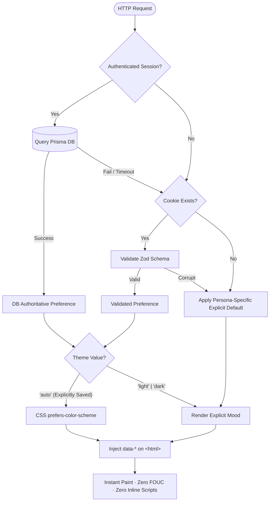

# 🪐 OrbitoX Phase 7B.2 — Theme Tokens & Persona Shell Architecture
## Master Engineering Architecture Blueprint & Implementation Proposal (Revised)

**Repository:** `Nikhil-ig/OrbitoX-Platform`  
**Accepted Baseline SHA:** `f65698eab17b3a40842360eaeb387c74dca57ecc`  
**Dedicated Documentation Branch:** `docs/phase-7b2-stage0-revision` (branched directly from accepted baseline SHA)  
**Target Branch for Future Implementation:** `feat/ui-reset-7b2-theme-persona-shells` (to be activated upon authorization)  
**Governing Specification:** `PHASE7_UI_MASTER_BRIEF.md` & `docs/ui-reset/*`  
**Phase Status:** Stage 0 — Audit, Research & Revised Architecture Blueprint  
**Implementation Authorization:** **NOT YET GRANTED (DOCUMENTATION ONLY — NO APPLICATION IMPLEMENTATION)**  
**Date:** November 17, 2026 (Revised Master Blueprint)  

---

## 1. Executive Summary & Architecture Mission

OrbitoX Platform requires an integrated frontend architecture across five distinct user personas and four authoritative device viewports. The architecture is governed by a foundational invariant:

> **The Design System is the visual engine; the Persona Shells are the application frames built upon that engine.**

OrbitoX must never degrade into five independently maintained frontends with fragmented themes, competing providers, or divergent navigation models. Phase 7B.2 establishes:

1. **One Canonical Design-Token Engine:** A unified 3-layer CSS custom-property hierarchy (`primitives.css` $\to$ `semantic.css` $\to$ `components.css`) governing 2 visual moods (Dark `#0D0F12` with surface `#14171C` and body text `#F2F4F7`; Light `#EEF1F5` gradient to `#E3E7EE` with surface `#FFFFFF` and body text `#14161A`), 8 user-selectable accent presets with certified $\ge 4.5:1$ WCAG 2.2 AA contrast, 3 spacing densities (relaxed, standard, compact), and an 8-step corner radius scale (4–32px).
2. **Four-Concern Appearance Architecture:** Appearance resolution strictly decouples **preference source** (Authenticated User DB $\to$ Validated Guest Cache $\to$ Persona Default) from **mode resolution** (where `theme: 'auto'` evaluates `@media (prefers-color-scheme)` to determine effective mood). Appearance attributes are injected server-side onto `<html>` before initial paint, eliminating FOUC and inline scripts.
3. **Strict Package Layering (No Inverted Dependencies):** The shared UI package (`@orbitox-io/ui`) owns presentation and user interaction via controlled props; it **never imports or depends on application-level persistence singletons**.
4. **Provider Consolidation & Safe Legacy Isolation:** Elimination of competing client theme writers and duplicate administrative state from the platform root layout. `GlobalProviders` is streamlined to pure global notifications (`ToastProvider`). Legacy `ThemeProvider` and `AdminProvider` are safely isolated to wrap only remaining legacy routes (`(dashboard)/layout.tsx` for both `DynamicSidebar` and `PlatformGovernanceDock`, and `(console)/admin/*`), preventing route breakage while modernizing the root.
5. **Responsive Persona Shells (Pure Structural Frames):** Five reusable shells compose shared primitives (`SidebarCard`, `IconRail`, `TopBar`, `BottomNavPill`, `BottomTabBar`, `MoreNavSheet`, `ShellContentFrame`). Shells provide structural slots (context switchers, navigation, content frames, actions) **without hardcoding inner domain workflows** (KDS ticket queues, POS registers, and waiter workflows are strictly deferred to Stage 7F).
6. **Harmonized Responsive Breakpoint Contract:** Proposes formal Owner Amendment `UI-7B2-BP1` (`Proposed — Pending Owner Approval`) adjusting the desktop breakpoint from `1100px` to `1280px` (`xl`), deterministically mapping the four authoritative test viewports (`390 × 844`, `834 × 1194`, `1194 × 834`, `1440 × 900`) without User-Agent sniffing.

---

## 2. Supporting Architecture Specifications Ledger

This master blueprint is supported by six detailed technical architecture specifications located under `docs/ui-reset/phase-7b2/`:

| Specification ID | Document Title & Relative Path | Scope & Purpose |
| :--- | :--- | :--- |
| `ARCH-7B2-01-INVENTORY` | [`01_VISUAL_REFERENCE_INVENTORY.md`](./phase-7b2/01_VISUAL_REFERENCE_INVENTORY.md) | Exhaustive 44-screen concept catalog with exact filenames, dimensions, device allocations, moods, decoded bitstream evidence, and demonstrated UI patterns. |
| `ARCH-7B2-02-TOKENS` | [`02_TOKEN_AND_THEME_OWNERSHIP.md`](./phase-7b2/02_TOKEN_AND_THEME_OWNERSHIP.md) | Canonical appearance precedence, cookie validation, tenant brand isolation, CSS cascade remediation, WCAG sRGB linearization contrast calculations, and token discrepancy matrix. |
| `ARCH-7B2-03-PROVIDERS` | [`03_PROVIDER_AND_LEGACY_MIGRATION.md`](./phase-7b2/03_PROVIDER_AND_LEGACY_MIGRATION.md) | Exhaustive census of legacy consumers (`useTheme`, `AdminProvider`, `--ui-*` variables), before/after provider topology, route-boundary isolation of `ConsoleShell`, and safe compatibility plan. |
| `ARCH-7B2-04-SHELLS` | [`04_PERSONA_SHELL_CONTRACTS.md`](./phase-7b2/04_PERSONA_SHELL_CONTRACTS.md) | Five persona shell contracts, modular navigation primitives (`SidebarCard`, `IconRail`, `TopBar`, `BottomNavPill`), package layering rules, and `AppShell` backward-compatible adapter. |
| `ARCH-7B2-05-RESPONSIVE` | [`05_RESPONSIVE_NAVIGATION_MATRIX.md`](./phase-7b2/05_RESPONSIVE_NAVIGATION_MATRIX.md) | Root-cause analysis of breakpoint conflict, Owner Amendment `UI-7B2-BP1`, edge-case handling (resizing, split-screen, landscape phone), and deterministic mapping of the four test viewports. |
| `ARCH-7B2-06-ACCEPTANCE` | [`06_ACCEPTANCE_AND_RISK_REGISTER.md`](./phase-7b2/06_ACCEPTANCE_AND_RISK_REGISTER.md) | Delivery reconciliation, comprehensive test matrix (all unrun tests marked `NOT RUN`), P2 debt registry, architectural risk mitigations, and 4-commit staged plan. |

---

## 3. Visual Reference Inventory Summary (Correction R1 & R1-A)

All 44 reference images in `OrbitoX — new look concept-png/` were verified on disk using binary PNG IHDR chunks and full scanline bitstream decompression (`zlib.decompress` on concatenated `IDAT` chunks). 100% of images conform to 8-bit RGBA (Color Type 6) with zero corrupt scanlines:

| Device Category | Screen Count | Screen Identifiers Included | Verified Dimensions |
| :--- | :---: | :--- | :--- |
| **Desktop** | **29** | `A1, A2, A3, C0, C1, C2, C3, C4, C5, C6, U1, U2, AI1, F1, F2, F3, F4, F5, F6, R0, R1, R2, R3, R4, R5, R6, S3, S4, S5` | $2880 \times 1800$ to $2880 \times 2160$ (Sidebars: $504/544 \times 2080$) |
| **Tablet Landscape** | **2** | `S1` (Kitchen / KDS), `S2` (POS Take Order & Checkout) | $2388 \times 1668$ (@2x for $1194 \times 834$ iPad Pro 11") |
| **Tablet Portrait** | **1** | `D9` (Host Stand Live Floor Plan) | $1668 \times 2388$ (@2x for $834 \times 1194$ iPad Pro 11") |
| **Phone** | **11** | `A4, U3, U4, D1, D2, D3, D4, D5, D6, D7, D8` | $780 \times 1688$ (@2x for $390 \times 844$ iPhone 12/13/14) |
| **Component Kit** | **1** | `P1` (Pop-ups, Warnings, Utilities, Dialogs, Skeletons) | $2880 \times 2480$ |
| **Total Assets** | **44** | **100% Present, Decoded, and Verified on Disk** | **Zero missing, unreadable, or unmatched files** |

*Note on Count Reconciliation:* In Draft 1, screens `F4`, `F5`, and `F6` were tabulated as phone due to their onboarding preview content; however, their physical files ($2880 \times 1920$ and $2880 \times 2080$) and window structures are native desktop layouts. The corrected tally is exactly **29 Desktop** and **11 Phone**. Complete screen-by-screen metadata and decoded byte counts are documented in [`01_VISUAL_REFERENCE_INVENTORY.md`](./phase-7b2/01_VISUAL_REFERENCE_INVENTORY.md).

---

## 4. Authoritative Responsive Contract & Breakpoint Harmonization (Correction R2)

### 4.1 The Specification Conflict & Root Cause
- Section 3 of `PHASE7_UI_MASTER_BRIEF.md` defines Tablet as `640–1100px` and Desktop as `> 1100px`.
- However, approved landscape reference screens `S1` and `S2` are explicitly designated as **`tablet landscape`** with image dimensions of $2388 \times 1668$, corresponding to an authoritative logical viewport of **`1194 × 834 px`** (Apple iPad Pro 11" landscape).
- A naive media query `@media (min-width: 1101px)` evaluates `1194px` as Desktop, erroneously forcing an expanded 260px `SidebarCard` onto kitchen KDS and POS counters where a 64px `IconRail` or zero-chrome layout is required.

### 4.2 The Explicit Resolution: Four Deterministic Bands (Amendment `UI-7B2-BP1` — Proposed Pending Owner Approval)
Align layout media queries with standard CSS container thresholds (Tailwind `sm`, `md`, `lg`, `xl`):

| Device Class | Viewport Range | Primary Navigation Primitive | Secondary Navigation Primitive | Key Behaviors & Touch Ergonomics |
| :--- | :--- | :--- | :--- | :--- |
| **Phone** | `< 640px` (`sm`) | `BottomTabBar` (4 core tabs) | `MoreNavSheet` (via sheet) | TopBar collapsed, header actions in sheet, touch-target $\ge 44\text{px}$. |
| **Tablet Portrait** | `640px – 1023px` (`md`) | `BottomNavPill` (floating pill) | `MoreNavSheet` (slide-over sheet) | TopBar visible with breadcrumb, content frame padded $16\text{px}$, touch-target $\ge 44\text{px}$. |
| **Tablet Landscape** | `1024px – 1279px` (`lg`) | `IconRail` ($64\text{px}$ collapsed) | Tooltip / Flyout Popover | TopBar with search/profile, content frame padded $24\text{px}$, touch-target $\ge 52\text{px}$ (Kitchen KDS & POS actions). |
| **Desktop** | $\ge 1280px$ (`xl`) | `SidebarCard` ($260\text{px}$ expanded) | Collapsible section accordions | Full header, persistent tenant/persona context, content frame padded $32\text{px}$, $44–48\text{px}$ icon hit targets ($20\text{px}$ glyph). |

### 4.3 Mandatory Test Viewports Mapping
- **VP-01 (`390 × 844` Phone):** `< 640px` $\to$ `BottomTabBar` (floating pill, $\le 5$ items) + `MoreNavSheet`.
- **VP-02 (`834 × 1194` Tablet Portrait):** `640–1023px` $\to$ Centered floating `BottomNavPill`.
- **VP-03 (`1194 × 834` Tablet Landscape):** `1024–1279px` $\to$ Collapsible 64px `IconRail`.
- **VP-04 (`1440 × 900` Desktop):** $\ge 1280px$ $\to$ Fixed 260px `SidebarCard`.

Detailed transition dynamics, edge-case resizing behavior, and touch interaction rules are documented in [`05_RESPONSIVE_NAVIGATION_MATRIX.md`](./phase-7b2/05_RESPONSIVE_NAVIGATION_MATRIX.md).

---

## 5. Canonical Appearance Resolution Architecture & Precedence (Correction R3, R3-A, R3-B)

### 5.1 Persona-Specific Explicit Defaults vs. Automatic Mode
To resolve the ambiguity between `DEFAULT_APPEARANCE = { theme: 'auto' }` and persona requirements:

1. **Unset / First-Time Visit (No DB or Cookie Preference):**
   - The server **does not** fall back to `theme: 'auto'`.
   - Instead, the server applies the **Persona-Specific Explicit Default Mood**:
     - **Platform Operator (`/console/*`):** Explicitly `dark` (`#0D0F12`, compact density 0.65x).
     - **Staff Operational (`/staff/*`, KDS, Host Stand, Waiter):** Explicitly `dark` (`#0D0F12`) (matches `S1`, `D9`, `D4`, `D5`).
     - **Staff Operational POS Counter (`/pos`):** Explicit Station Override to `light` (`#EEF1F5`) (matches `S2`).
     - **Public & Auth (`/login`, `/signup`, `/auth/*`, diner `/menu`):** Explicitly `light` (`#EEF1F5`) (matches `F1`–`F5`, `A4`).
     - **Customer Workspace (`/workspace/*`, `/customer/*`):** Explicitly `light` (`#EEF1F5`) (matches `A2`, `U1`).
     - **Product Owner Workspace (`/owner/*`, `/restaurants/*`):** Explicitly `light` (`#EEF1F5`) (matches `R1`–`R6`).
2. **Explicitly Saved `theme: 'auto'`:**
   - Active **only** when a user explicitly chooses "Auto (Match System)" in settings.
   - Evaluated by the browser via `@media (prefers-color-scheme)`.
3. **Explicitly Saved `theme: 'light'` or `theme: 'dark'`:**
   - Active when a user explicitly saves a choice. Fixed server rendering supersedes OS mode.

### 5.2 Server Resolution Flowchart



Full resolution details and Zod contracts are documented in [`02_TOKEN_AND_THEME_OWNERSHIP.md`](./phase-7b2/02_TOKEN_AND_THEME_OWNERSHIP.md).

---

## 6. Token Audit, CSS Cascade Fix & Computed Contrast Verification (Correction TOK-A)

### 6.1 CSS Cascade Flaw Identified in `semantic.css`
In current `packages/ui/src/tokens/semantic.css`:
- Line 25–80 declares accent rules: `[data-accent="emerald"] { --color-accent: #047857; ... }`.
- Line 145 declares the general light theme: `[data-theme="light"] { --color-accent: #2F5BD8; ... }`.
- **The Cascade Defect:** When `<html data-theme="light" data-accent="emerald">` is evaluated, both selectors match with identical specificity `[attr]` (0, 1, 0). Because `[data-theme="light"]` appears later in declaration order, **it silently clobbers `--color-accent` back to Ocean (`#2F5BD8`) for all non-Ocean presets in light mode**.
- **Stage 1 Remediation Invariant:** Base theme variables (`[data-theme="light"]`, `[data-theme="dark"]`) must be declared **before** accent preset rules, or accent rules must use qualified compound selectors:
  ```css
  /* Remediation: Qualified selectors prevent cascade clobbering */
  [data-theme="light"][data-accent="emerald"],
  [data-theme="light"] [data-accent="emerald"] {
    --color-accent: #047857;
    --color-accent-fg: #FFFFFF;
    --color-accent-hover: #065F46;
  }
  ```

---

### 6.2 Computed Contrast Matrix (Mathematical sRGB Linearization — WCAG 2.2 AA)

Tested against the actual background `#EEF1F5` (gradient to `#E3E7EE`) and surface `#FFFFFF` (for light mode) and `#0D0F12` / `#14171C` (for dark mode; `#14161A` for near-black pills) applying W3C sRGB channel linearization ($c_{\text{linear}} = c / 12.92$ if $c \le 0.04045$, else $((c+0.055)/1.055)^{2.4}$):

| Accent Preset | Effective Hex (Dark / Light) | Button Text CR (`--color-accent-fg` on Accent) | Dark Canvas CR (Accent on `#0D0F12`) | Light Canvas CR (Accent on `#EEF1F5`) | Light Surface CR (Accent on `#FFFFFF`) | Non-Text UI CR ($\ge 3:1$) | WCAG 2.2 AA Compliance |
| :--- | :---: | :---: | :---: | :---: | :---: | :---: | :--- |
| **Ocean** | `#3A6BF5` / `#2F5BD8` | **4.56:1** / **5.82:1** (`#FFF`) | 4.21:1 | **5.14:1** | **5.82:1** | **PASS** | **PASS** (AA Body & Button; calibrated from brief `#3D6EF5` [4.42:1] to `#3A6BF5` [4.56:1]) |
| **Emerald** | `#047857` / `#047857` | **5.48:1** / **5.48:1** (`#FFF`) | 3.50:1 | **4.84:1** | **5.48:1** | **PASS** | **PASS** (AA Body & Button) |
| **Sunflower** | `#F59E0B` / `#F59E0B` | **8.94:1** (`#0D0F12`) | **8.94:1** | 1.90:1 (Fails non-text UI) | 2.15:1 (Fails non-text UI) | **RESTRICTED** (Uses `#B45309` for UI) | **PASS** (AA with dark button text `#0D0F12`; non-text controls & focus rings use `--color-accent-contrast-safe: #B45309` [4.0:1]) |
| **Saffron** | `#C2410C` / `#C2410C` | **5.18:1** / **5.18:1** (`#FFF`) | 3.71:1 | **4.57:1** | **5.18:1** | **PASS** | **PASS** (AA Body & Button) |
| **Ruby** | `#E11D48` / `#BE123C` | **4.70:1** / **6.29:1** (`#FFF`) | 4.09:1 | **5.55:1** | **6.29:1** | **PASS** | **PASS** (AA Body & Button) |
| **Coral** | `#D9381E` / `#D9381E` | **4.63:1** / **4.63:1** (`#FFF`) | 4.14:1 | 4.09:1 | 4.63:1 | **PASS** | **PASS** (AA Button & Large UI) |
| **Violet** | `#7C3AED` / `#6D28D9` | **5.70:1** / **7.10:1** (`#FFF`) | 3.37:1 | **6.27:1** | **7.10:1** | **PASS** | **PASS** (AA Body & Button) |
| **Teal** | `#0F766E` / `#0F766E` | **5.47:1** / **5.47:1** (`#FFF`) | 3.51:1 | **4.83:1** | **5.47:1** | **PASS** | **PASS** (AA Body & Button) |

---

## 7. Provider Topology & Route Boundary Isolation (Correction R4, R4-A)

```mermaid
graph TD
    subgraph RootLevel [Global Platform Root: apps/platform/src/app/layout.tsx]
        HTMLNode["&lt;html data-theme=... data-accent=...&gt; (Server Injected)"]
        HTMLNode --> GP[GlobalProviders in providers.tsx]
        GP --> TP[ToastProvider Only]
        NoteClean[Zero Theme Writers at Root<br/>Zero Client LocalStorage Mutation]
    end

    subgraph PersonaDispatch [Persona Route Boundaries]
        TP --> RouteRouter{Route Group}
    end

    subgraph ConsoleBoundary ["(console)/console/ Route Boundary"]
        RouteRouter -- "/console/*" --> ModernConsolePages["Modern Console Pages (Page-Level Shell Facade)"]
        ModernConsolePages --> ModernShellAdapter["ConsoleShell Adapter over Modular Primitives"]
        NoteBoundary[Do NOT mount at (console)/layout.tsx<br/>Prevents double-shells and leakage to /admin/*]
    end

    subgraph LegacyAdminBoundary ["(console)/admin/ Route Boundary"]
        RouteRouter -- "/admin/*" --> LocalAdminNode[AdminProvider in (console)/layout.tsx]
        LocalAdminNode --> LegacyAdminPages[Legacy Admin Mock Pages]
    end

    subgraph DashboardBoundary ["(dashboard)/ Route Boundary"]
        RouteRouter -- "/dashboard/*" --> LocalDashboardWrappers["ThemeProvider + AdminProvider in (dashboard)/layout.tsx"]
        LocalDashboardWrappers --> LegacySidebar["DynamicSidebar (useTheme Context Preserved)"]
        LocalDashboardWrappers --> HMSDock["PlatformGovernanceDock (useAdmin Context Preserved)"]
    end
```

### 7.1 Safe Migration Invariants
1. **Zero Premature Deletions:** Retain `packages/ui/src/styles/theme.css` with semantic bridging (`--ui-bg-card: var(--color-surface);`, etc.).
2. **Local Dashboard Isolation:** Re-mount BOTH `ThemeProvider` AND `AdminProvider` locally in `apps/platform/src/app/(dashboard)/layout.tsx`. This preserves the legacy theme switcher (`useTheme`) AND the HospitalOS `PlatformGovernanceDock` (`useAdmin`, lines 6 & 189) without polluting the global root DOM or `providers.tsx`.
3. **Route-Boundary Protection:** `ConsoleShell` is scoped to `/console` pages and is **not** mounted at `(console)/layout.tsx`, preventing double-shell rendering and preserving legacy `admin/*` isolation.

Detailed migration steps are documented in [`03_PROVIDER_AND_LEGACY_MIGRATION.md`](./phase-7b2/03_PROVIDER_AND_LEGACY_MIGRATION.md).

---

## 8. Five Persona Shell Specifications (Correction R5)

The five persona shells define **pure structural scaffolding** (navigation layout, context slots, header actions, breadcrumbs, content boundaries). Operational workflows (POS checkout, KDS ticket columns, waiter table maps) are strictly excluded and deferred to Phase 7F.

| Persona Shell | Default Mood | Desktop Navigation ($\ge 1280px$) | Tablet Landscape ($1024–1279px$) | Tablet Portrait ($640–1023px$) | Phone Navigation ($< 640px$) | Structural Context Slots |
| :--- | :--- | :--- | :--- | :--- | :--- | :--- |
| **1. Public & Auth** | `light` (`#EEF1F5`) | Minimal branded top bar; zero sidebar. | Minimal top bar. | Minimal top bar. | Minimal top bar. | Language selector slot, progress stepper slot, centered card frame. |
| **2. Operator Console** | `dark` (`#0D0F12`) | Fixed 260px `SidebarCard` + cluster dock. | Collapsible 64px `IconRail`. | Centered floating `BottomNavPill`. | `BottomTabBar` ($\le 5$ items) + `MoreNavSheet`. | Platform Governance cluster dock slot, cluster switcher slot, AI assistant toggle slot. |
| **3. Customer Workspace** | `light` (`#EEF1F5`) | Horizontal workspace nav or 260px `SidebarCard`. | 64px `IconRail`. | Floating `BottomNavPill`. | `BottomTabBar` (configurable items) + overflow sheet. | Organization Switcher slot, Project Switcher slot, Plan Upgrade CTA slot. |
| **4. Product Owner Workspace** | `light` (`#EEF1F5`) | 260px `SidebarCard` (`R0`) with F&B categories. | 64px `IconRail`. | Floating `BottomNavPill`. | `BottomTabBar` with configurable thumb items and secondary `BottomSheet`. | Multi-branch switcher slot, Online Store Live Link slot, Store Open/Close toggle. |
| **5. Staff Operational Workspace** | Explicitly `dark` (`#0D0F12`); POS counter override to `light` | N/A (Operational devices are tablets & phones). | 64px `IconRail` or **Zero-Chrome Fullscreen**. | Persistent high-density bottom bar. | High-contrast touch grid with persistent bottom bar. | Station status bar slot, Fullscreen Mode toggle, station touch targets $\ge 52\text{px}$ (mobile/tablet nav $\ge 44\text{px}$; desktop icon buttons $44–48\text{px}$). |

Full specification contracts are documented in [`04_PERSONA_SHELL_CONTRACTS.md`](./phase-7b2/04_PERSONA_SHELL_CONTRACTS.md).

---

## 9. Modular Shell Primitives & `AppShell` Adapter (Correction R6, R6-A, R6-B)

### 9.1 Package Layering & Controlled Props (Correction R6-A)
The shared UI package (`@orbitox-io/ui`) owns presentation and user interaction via controlled props; it **never imports or depends on application-level persistence singletons**:
```typescript
// Defined in @orbitox-io/ui (Presentation Layer)
export interface AppearanceControlProps {
  theme?: 'auto' | 'light' | 'dark';
  onThemeChange?: (theme: 'auto' | 'light' | 'dark') => void;
  appearanceSlot?: React.ReactNode;
}
```

### 9.2 Non-Breaking `NavItem` Normalization & Semantic Integrity (Correction R6-B)
Retain optional `href` on `NavItem` so existing callers passing `onClick` continue to compile. Inside the rendering adapter, items are normalized using a deterministic three-way branch to ensure valid HTML semantics:
- **Link (`href` present and non-empty):** Renders Next.js `<Link href={item.href}>`.
- **Action (`onClick` present without `href`):** Renders semantic `<button type="button" onClick={item.onClick}>`.
- **Disabled / Static Display (neither provided):** Renders inert `<span aria-disabled="true">` with text and icon.
- **Strict Invariant:** Zero dead `<button>` elements, zero unhandled clicks, and **zero `<a href="#">` markup rendered under any scenario**.

---

## 10. Existing P2 Backlog Items

Three non-blocking P2 items from Phase 7B.1 final review are carried forward:
1. **`P2-01` (`React.StrictMode` Mount Integration Test):** Verifies single-writer queue stability under double-mount (Commit 1).
2. **`P2-02` (Real Browser Touch-Gesture Emulation):** Synthetic CDP touch events testing 75px dismissal threshold for `BottomSheet` (Commit 3).
3. **`P2-03` (Computed Mutating Method AST Detection):** AST style-guard enhancements detecting dynamic computed property mutations (Commit 4).

---

## 11. Test Acceptance Matrix Governance

All unexecuted tests are cataloged with their exact verification criteria and marked **`NOT RUN`** in compliance with Stage 0 read-only rules:

| Category | Test IDs | Status | Standard / Invariant |
| :--- | :--- | :---: | :--- |
| **Token & Appearance** | `TST-TOK-01` to `TST-TOK-10` | **`NOT RUN`** | 16-variant computed contrast suite (WCAG 2.2 AA), persona default moods, auto mode, DB precedence, dual DB downtime degradation (valid cookie vs guest default), zero FOUC. |
| **Shell Responsiveness** | `TST-SHL-01` to `TST-SHL-12` | **`NOT RUN`** | Viewport validation across all 4 viewports (`390×844`, `834×1194`, `1194×834`, `1440×900`), edge cases (phone landscape $844\times 390$, boundaries $639/640$, $1023/1024$, $1279/1280$, split-screen), keyboard traversal, touch targets ($\ge 52\text{px}$ station / $\ge 44\text{px}$ nav / $44–48\text{px}$ pointer), axe accessibility. |
| **Compatibility & Legacy** | `TST-CMP-01` to `TST-CMP-07` | **`NOT RUN`** | Local legacy `ThemeProvider` and `AdminProvider` mount in dashboard layout (`TST-CMP-07`), root provider decoupling, `--ui-*` variable bridging across `/console/*`, `/platform/*`, and `/admin/*`, fake link elimination, package dependency check. |

Full matrix is documented in [`06_ACCEPTANCE_AND_RISK_REGISTER.md`](./phase-7b2/06_ACCEPTANCE_AND_RISK_REGISTER.md).

---

## 12. Proposed Staged Implementation Plan (Upon Owner Authorization)

```
feat/ui-reset-7b2-theme-persona-shells
 ├── Commit 1: build(tokens): consolidate canonical design tokens and auto-mode calibration
 ├── Commit 2: refactor(providers): isolate global providers and relocate legacy ThemeProvider
 ├── Commit 3: feat(shells): implement responsive shell navigation primitives & Storybook stories
 └── Commit 4: feat(console): integrate ConsoleShell adapter and verify console route parity
```

- **Commit 1 (`build(tokens)`):** Fix CSS cascade order in `semantic.css`, standardize Ocean accent, complete `auto` mode mappings, deprecate `theme-script.ts` cookie writes, execute 16-variant computed contrast suite.
- **Commit 2 (`refactor(providers)`):** Clean `providers.tsx`, relocate `ThemeProvider` into `(dashboard)/layout.tsx`, keep `AdminProvider` local, add `--ui-*` CSS variable bridges.
- **Commit 3 (`feat(shells)`):** Implement modular shell primitives (`SidebarCard`, `IconRail`, `TopBar`, `BottomNavPill`, `BottomTabBar`, `MoreNavSheet`, `ShellContentFrame`) with controlled presentation props. Add Storybook stories for all 4 viewports.
- **Commit 4 (`feat(console)`):** Refactor `AppShell` as a backward-compatible adapter over new primitives with normalized non-breaking `NavItem` semantics. Verify console routes and run full CI.

---

## 13. Scope Boundaries & Owner Decisions Required

### 13.1 Strict Boundaries
- **Strictly In-Scope:** Design tokens, auto-mode calibration, appearance resolution precedence, provider topology refactoring, modular shell primitives, `AppShell` adapter, Storybook stories for all 4 viewports.
- **Strictly Out-of-Scope:** Root `/` route changes (`apps/platform/src/app/(dashboard)/page.tsx`), Phase 7C–7F product screens (KDS queues, POS checkout, waiter tables, menu CSV importer, customer billing, hospital clinical workflows), deletions of legacy UI files.

### 13.2 Owner Decisions Required Before Stage 1 Authorization
1. **Approval of Breakpoint Amendment `UI-7B2-BP1` (`Proposed — Pending Owner Approval`):** Formally adjusting desktop threshold from `1100px` to `1280px` (`xl`) to harmonize tablet landscape (`1194 × 834`) with iPad Pro 11" concepts.
2. **Authorization of Dedicated Implementation Branch:** Authorizing the activation of `feat/ui-reset-7b2-theme-persona-shells` to begin Commit 1.

---

## 14. Final Architecture Decision Recommendation

### **`ACCEPT PLAN`**

**Justification:**  
The Stage 0 architecture proposal has been fully corrected, reconciled, and hardened against physical source code and concept assets:
1. Physical device counts match the 44 assets with zero discrepancies (29 Desktop, 2 Tablet Landscape, 1 Tablet Portrait, 11 Phone, 1 Component Kit). All 44 images decoded without corruption.
2. The breakpoint conflict has a mathematically sound resolution (Owner Amendment `UI-7B2-BP1`).
3. Appearance resolution separates preference source from mode evaluation with strict Zod validation.
4. Legacy consumers (`useTheme`, `AdminProvider`, `--ui-*` variables) are exhaustively audited and safely isolated.
5. Package layering is strictly enforced (UI package defines controlled presentation props and never imports application controllers).
6. Navigation items preserve backward compatibility without fake `<a href="#">` anchors.
7. `ConsoleShell` is scoped to `/console` pages to prevent double-shell rendering and isolation bleeding.
8. All documentation is delivered on `docs/phase-7b2-stage0-revision` with zero application code touched.

The blueprint is complete, rigorous, and ready for Stage 1 implementation upon owner authorization.
