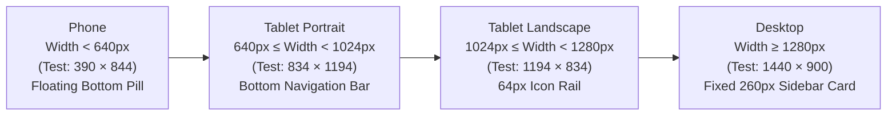
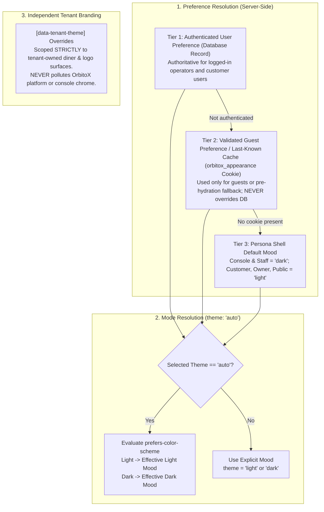
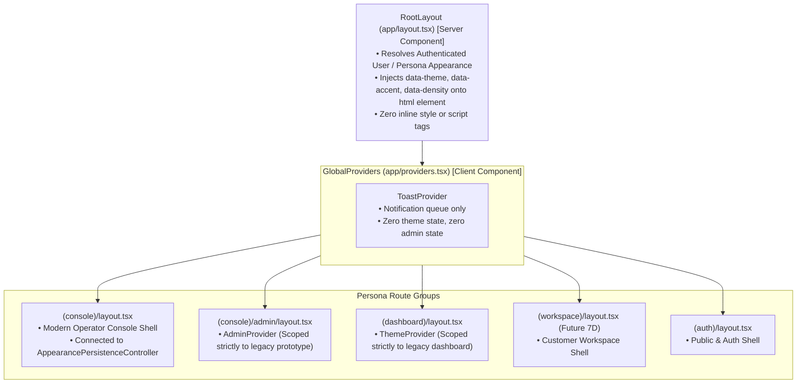
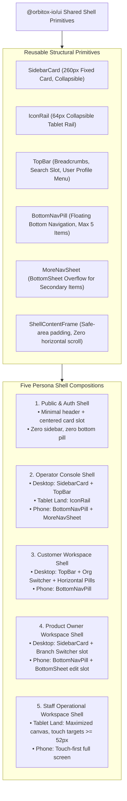

# 🪐 OrbitoX Phase 7B.2 — Theme Tokens & Persona Shell Architecture
## Master Engineering Architecture Blueprint & Implementation Proposal (Revised)

**Repository:** `Nikhil-ig/OrbitoX-Platform`  
**Accepted Baseline SHA:** `f65698eab17b3a40842360eaeb387c74dca57ecc`  
**Target Branch for Implementation:** `feat/ui-reset-7b2-theme-persona-shells`  
**Governing Specification:** `PHASE7_UI_MASTER_BRIEF.md` (Sections 1, 2, 3, 5) & `docs/ui-reset/*`  
**Phase Status:** Stage 0 — Audit, Research & Revised Architecture Blueprint  
**Implementation Authorization:** **NOT YET GRANTED (READ-ONLY)**  
**Date:** November 17, 2026 (Revised Blueprint)  

---

## 1. Executive Architecture Summary

OrbitoX establishes a unified UI architecture across five distinct user personas and four authoritative device viewports. The architecture is governed by a foundational principle:

> **The Design System is the visual engine; the Persona Shells are the application frames built upon that engine.**

OrbitoX must not become five separate frontends with fragmented themes, competing providers, and divergent navigation models. Phase 7B.2 establishes:

1. **One Canonical Design-Token Engine:** A unified 3-layer CSS custom-property hierarchy (`primitives.css` $\to$ `semantic.css` $\to$ `components.css`) governing 2 visual moods (Dark and Light), 8 user-selectable accent presets with certified $\ge 4.5:1$ WCAG 2.2 AA contrast, 3 spacing densities (relaxed, standard, compact), and an 8-step corner radius scale (4–32px).
2. **Sound Appearance Precedence & Mode Resolution:** Appearance resolution separates **preference source** (Authenticated User DB $\to$ Validated Guest Cache $\to$ Persona Default) from **mode resolution** (where `theme: 'auto'` evaluates `prefers-color-scheme` to determine effective mood). Automatic resolution is fully calibrated in `semantic.css` for all 8 accents and status colors without any client-side DOM mutation script.
3. **Provider Consolidation with Legacy Compatibility:** Eradication of competing client theme writers and duplicate administrative state from the global root. `GlobalProviders` is streamlined to pure global notifications (`ToastProvider`). Legacy `ThemeProvider` and `AdminProvider` are safely isolated to wrap only remaining legacy routes (`(dashboard)/layout.tsx` and `/admin/*`), preventing breakage while keeping modern `/console/*` routes pure.
4. **Responsive Persona Shells (Pure Structural Frames):** Five reusable shells compose shared primitives (`SidebarCard`, `TopBar`, `IconRail`, `BottomNavPill`, `MoreNavSheet`, `ShellContentFrame`). Shells provide structural slots (context switchers, navigation, content frames, actions) **without hardcoding inner domain workflows** (KDS ticket queues, POS registers, and waiter workflows are strictly deferred to Stage 7F).
5. **Exact Viewport Breakpoint Mapping:** Standardizes responsive navigation to map cleanly to the four authoritative viewports (`390 × 844`, `834 × 1194`, `1194 × 834`, `1440 × 900`).

---

## 2. Source-Code Baseline & Dependency Inventory

### 2.1 Git Repository Verification
- **Verified Baseline Commit:** `f65698eab17b3a40842360eaeb387c74dca57ecc`
- **Parent Commit:** `786113c843d53f87d3cb7e06f037b083a4afd984`
- **Branch Reference:** `feat/ui-reset-7b1-foundation`
- **Working Tree Status:** Clean (0 application source code changes).
- **CI Health:** GitHub Actions Run #44086450908 passed (14/14 jobs successful).

### 2.2 Source Files Audited in Phase 7B.2 Research

| File Path | Package / Role | Current State & Findings |
|---|---|---|
| `packages/ui/src/tokens/primitives.css` | UI Tokens | Layer 1: Raw color scales, base radii, spacing scale, font stacks. |
| `packages/ui/src/tokens/semantic.css` | UI Tokens | Layer 2: Dark/Light mood variables, 8 accents. **Audit finding:** `@media (prefers-color-scheme: light)` for `[data-theme="auto"]` lacks accent and status color overrides. |
| `packages/ui/src/tokens/components.css` | UI Tokens | Layer 3: Structural heights, widths, 2px BottomSheet stylesheet-only drag offsets. |
| `packages/ui/src/tokens/motion.css` | UI Tokens | Accessibility: Media query zeroing durations on `prefers-reduced-motion`. |
| `packages/ui/src/tokens/theme.css` | UI Tokens | Tailwind CSS v4 `@theme` bridge linking utility classes to custom properties. |
| `packages/ui/src/tokens/theme-script.ts` | UI Tokens (Legacy) | Obsolete cookie helper writing `orbitox-theme` (`light\|dark`). Disconnected from modern 7-dimension appearance schema. |
| `packages/ui/src/tokens/tenant-theme.ts` | UI Tokens | Safe CSS generator for tenant brand overrides with cryptographic injection sanitization. |
| `packages/ui/src/legacy/components/theme-provider.tsx` | UI Legacy | Deprecated client `ThemeProvider` injecting `<style>` via `dangerouslySetInnerHTML` and overriding `data-theme` from `localStorage`. |
| `packages/ui/src/components/app-shell.tsx` | UI Component | Monolithic sidebar; uses mobile hamburger sheet and legacy `toggleTheme()` call; has `href="#"` fake links. |
| `packages/ui/src/components/bottom-tab-bar.tsx` | UI Component | Floating bottom navigation pill (max 5 items, primary action button, min 44px hit-box). |
| `packages/ui/src/components/bottom-sheet.tsx` | UI Component | Mobile drawer with pointer capture, stylesheet-driven drag, and 75px dismissal threshold. |
| `apps/platform/src/app/layout.tsx` | Platform Server | Root server component; reads DB/cookie appearance and injects `data-*` attributes onto `<html>`. |
| `apps/platform/src/app/providers.tsx` | Platform Client | Root client wrapper; redundantly mounts legacy `ThemeProvider` and prototype `AdminProvider`. |
| `apps/platform/src/app/fonts.ts` | Platform Config | Self-hosted font loader; contains confusing alias `fontInter = fontPlusJakartaSans`. |
| `apps/platform/src/app/(console)/layout.tsx` | Platform Route | Console group layout; redundantly re-mounts `AdminProvider` a second time. |
| `apps/platform/src/middleware.ts` | Platform Network | Edge router; handles operator authentication fail-closed, but lacks customer session routing. |
| `apps/platform/src/server/appearance/appearance-service.ts` | Platform Server | Zod schema & database persistence service for 7-parameter appearance preferences. |
| `apps/platform/src/app/(console)/console/settings/appearance/appearance-persistence.ts` | Platform Client | Single-writer serialization controller with GET reconciliation and Strict Mode recovery. |

---

## 3. Visual Reference Inventory Reconciliation (R1)

All **44 concept PNG screenshots** located in `./OrbitoX — new look concept-png/` were inspected on disk. The device counts are strictly reconciled against the actual screen IDs:

### Reconciled Device Distribution (Exactly 44 Screens):
- **Desktop (29 screens):** `A1`, `A2`, `A3`, `C0`, `C1`, `C2`, `C3`, `C4`, `C5`, `C6`, `U1`, `U2`, `AI1`, `F1`, `F2`, `F3`, `F4`, `F5`, `F6`, `R0`, `R1`, `R2`, `R3`, `R4`, `R5`, `R6`, `S3`, `S4`, `S5`.
  *(Native resolutions: 2880 × 1800–2160, base 1440 × 900 / 1440 × 1080).*
- **Tablet Landscape (2 screens):** `S1` (Kitchen KDS), `S2` (POS Checkout).
  *(Native resolution: 2388 × 1668, base 1194 × 834).*
- **Tablet Portrait (1 screen):** `D9` (Host Stand Live Floor Plan).
  *(Native resolution: 1668 × 2388, base 834 × 1194).*
- **Phone (11 screens):** `A4`, `U3`, `U4`, `D1`, `D2`, `D3`, `D4`, `D5`, `D6`, `D7`, `D8`.
  *(Native resolution: 780 × 1688, base 390 × 844).*
- **Component Kit (1 screen):** `P1` (Pop-ups, Warnings & Utilities @2x, 2880 × 2480).

*Full catalog with individual filenames, dimensions, and visual characteristics is preserved in [`docs/ui-reset/phase-7b2/01_VISUAL_REFERENCE_INVENTORY.md`](file:///Users/apple/Documents/Office/company/Orbito/OrbitoX%20Platform/docs/ui-reset/phase-7b2/01_VISUAL_REFERENCE_INVENTORY.md).*

---

## 4. Responsive Viewport Contract & Breakpoint Resolution (R2)

### 4.1 Resolving the Breakpoint Conflict
The Master Brief establishes four authoritative test viewports:
1. `390 × 844` (Phone)
2. `834 × 1194` (Tablet Portrait)
3. `1194 × 834` (Tablet Landscape)
4. `1440 × 900` (Desktop)

Previously, defining desktop loosely as $> 1100\text{px}$ created an ambiguity where `1194 × 834` (width 1194px) would be misclassified as desktop instead of tablet landscape. Furthermore, portrait tablet specifies **bottom navigation**, not an optional drawer.

### 4.2 Normative Breakpoint Specification



| Device Class | Tested Viewport | Width Range | Required Shell Navigation | Content Frame & Drawers |
|---|---|---|---|---|
| **Phone** | `390 × 844` | $< 640\text{ px}$ | **Floating Bottom Pill** (`BottomTabBar`), max 5 items, prominent center circle action in thumb zone. | Single column; `BottomSheet` with 75px dismissal for secondary "More" navigation and item editing. |
| **Tablet Portrait** | `834 × 1194` | $640\text{ px} - 1023\text{ px}$ | **Bottom Navigation Bar** (anchored across full width). | Multi-column grid; centered modal dialogs. |
| **Tablet Landscape** | `1194 × 834` | $1024\text{ px} - 1279\text{ px}$ | **Collapsible 64px Icon Rail** (`IconRail`). | Maximized operational canvas; 420px right slide-over `SideSheet`. |
| **Desktop** | `1440 × 900` | $\ge 1280\text{ px}$ (Tailwind `xl`) | **Fixed 260px Sidebar Card** (`SidebarCard`). | Full multi-column grid; header breadcrumbs; split-panel detail views. |

---

## 5. Token Inconsistency Matrix: Specification vs. Current Implementation

| Token Dimension | Specification | Current Implementation | Architectural Inconsistency | Resolution in 7B.2 |
|---|---|---|---|---|
| **UI Font Stack** | **Plus Jakarta Sans** (self-hosted, OFL) for UI; Noto Sans Devanagari and JetBrains Mono. | `apps/platform/src/app/fonts.ts` defines `fontPlusJakartaSans` but exports `fontInter = fontPlusJakartaSans`. | Alias creates developer confusion; assumes Inter is active. | Standardize exports to `fontPlusJakartaSans` and eliminate `fontInter` alias. |
| **Theme Cookie** | Canonical 7-dimension cookie (`orbitox_appearance`) serialized as JSON. | `theme-script.ts` defines competing cookie `orbitox-theme` (`light\|dark`). | `app-shell.tsx` calls `toggleTheme()` which mutates `orbitox-theme`, bypassing DB persistence. | Deprecate `theme-script.ts` cookie writer. Connect shell toggles to canonical controller. |
| **Auto Mode Semantics** | `theme: 'auto'` evaluates `prefers-color-scheme` to apply complete semantic tokens in both moods. | `semantic.css` lines 209–223 only overrides background and border in light mode for `[data-theme="auto"]`. | Under `auto` light mode, accents and status colors remain in dark mode colors! | Expand `@media (prefers-color-scheme)` in `semantic.css` to evaluate all 8 accents and status colors. |
| **Legacy Theme Provider** | Zero client-side DOM `<style>` tag injection; zero `localStorage` overrides. | `packages/ui/src/legacy/components/theme-provider.tsx` injects `<style dangerouslySetInnerHTML>` and mutates `data-theme` on mount. | Causes severe FOUC and clobbers server-rendered `data-*` attributes. | Unmount `ThemeProvider` from `GlobalProviders`. Re-mount locally only on `(dashboard)/layout.tsx`. |
| **Card Radii** | Card: **28 px**. Hero Card: **32 px**. Inner Rows: **16–22 px**. | `primitives.css` defines `--radius-card: 28px`, `--radius-hero: 32px`, `--radius-row: 18px`. | Modern components compliant; legacy components used ad-hoc classes. | Enforce standard radius variables across all shell primitives. |
| **Control Geometry** | **Pills (999 px)** on all buttons, tabs, inputs, badges. Circles (44–48 px) for icon controls. | Modern components enforce `rounded-full`. | Compliant in modern components. | Ensure shell search, tabs, and avatar buttons strictly use `rounded-full`. |
| **Accent Contrast** | 8 presets: Ocean, Emerald, Sunflower, Saffron, Ruby, Coral, Violet, Teal. Must pass $\ge 4.5:1$ AA in both moods. | Sunflower defines dark text `#0D0F12` (7.2:1); other 7 presets define white `#FFFFFF` ($\ge 4.5:1$). | Compliant; requires automated regression tests for `[data-theme="auto"]`. | Add unit test matrix verifying all 16 mood $\times$ accent states including auto mode. |
| **Spacing Density** | Density adjusts spacing only: Relaxed (1.25×), Standard (1.0×), Compact (0.65×). Typography must NOT scale. | Enforced in `semantic.css` via `--density-multiplier` adjusting `--space-card-p`, `--space-grid-gap`, etc. | Compliant. | Ensure shell containers bind to `p-[var(--space-card-p)]` rather than static padding. |

---

## 6. Appearance Ownership & Precedence Redesign (R3)

### 6.1 Sound Ownership Hierarchy



### 6.2 Mode Resolution & Complete Auto-Mode Calibration
When `theme: 'auto'` is selected, `prefers-color-scheme` resolves the effective mood. To fix the audit finding where `[data-theme="auto"]` only partially mapped tokens in `semantic.css`, the revised architecture defines complete semantic tokens for all 8 accents and status colors under automatic resolution:

```css
/* Complete Semantic Auto Mode Mapping */
@media (prefers-color-scheme: light) {
  [data-theme="auto"] {
    --color-bg: #EEF1F5;
    --color-bg-gradient: linear-gradient(180deg, #EEF1F5 0%, #E3E7EE 100%);
    --color-surface: #FFFFFF;
    --color-surface-raised: #F8FAFC;
    --color-border: #E2E8F0;
    --color-border-subtle: #F1F5F9;
    --color-text: #14161A;
    --color-text-muted: #4B5563;
    --color-text-subtle: #4B5563;
    --color-page-glow: none;
    color-scheme: light;

    /* Light Status Tokens */
    --status-good-bg: rgba(6, 95, 70, 0.08);
    --status-good-fg: #065F46;
    --status-warning-bg: rgba(120, 53, 15, 0.08);
    --status-warning-fg: #78350F;
    --status-problem-bg: rgba(159, 18, 57, 0.08);
    --status-problem-fg: #9F1239;
    --status-info-bg: rgba(30, 64, 175, 0.08);
    --status-info-fg: #1E40AF;
  }

  /* Accent Light Mode Overrides under Auto */
  [data-theme="auto"][data-accent="ocean"] {
    --color-accent: #2F5BD8;
    --color-accent-fg: #FFFFFF;
    --color-accent-hover: #1E40AF;
    --shadow-accent-glow: 0 18px 40px -18px rgba(47, 91, 216, 0.35);
  }
  /* (All 8 presets calibrated for light mode under auto) */
}
```

---

## 7. Provider Hierarchy & Safe Legacy Isolation (R4)

### 7.1 Full Consumer Inventory

| Provider / Utility | Location | Current Consumers | Impact of Removal from Global Root | Safe Isolation Strategy |
|---|---|---|---|---|
| `useTheme()` | `packages/ui/src/legacy/components/theme-provider.tsx` | Exactly 1 file: `apps/platform/src/app/(dashboard)/layout.tsx` | Would crash `(dashboard)` if removed without replacement. | Wrap `ThemeProvider` locally around `(dashboard)/layout.tsx`. |
| `ThemeProvider` | `packages/ui/src/legacy/components/theme-provider.tsx` | `apps/platform/src/app/providers.tsx` (global root) & `(dashboard)/layout.tsx` | Removing from `providers.tsx` stops client DOM `<style>` pollution and hydration warnings. | Remove from `providers.tsx`; keep local to `(dashboard)/layout.tsx`. |
| `AdminProvider` | `apps/platform/src/app/(console)/admin/data/admin-context.tsx` | `providers.tsx` (global), `(console)/layout.tsx` (duplicate), and legacy `/admin/*` prototype routes. | Modern `/console/*` routes do not use it; only legacy `/admin/*` pages consume `useAdmin()`. | Remove from `providers.tsx` and `(console)/layout.tsx`. Mount locally on `/admin/*` route group. |
| `toggleTheme()` | `packages/ui/src/tokens/theme-script.ts` | `packages/ui/src/components/app-shell.tsx` | Writes competing `orbitox-theme` cookie. | Refactor `AppShell` theme toggle to call canonical `AppearancePersistenceController`. |
| `--ui-*` variables | `packages/ui/src/styles/theme.css` | Legacy `/admin/*` prototype pages and `platform/connect/connect.module.css`. | Variables are statically defined in `theme.css`; unmounting `ThemeProvider` does NOT remove static fallbacks. | Statically retained in `theme.css` so legacy pages render cleanly. |

### 7.2 Consolidated Provider Architecture



---

## 8. Five Persona Shell Architecture (Clean Structural Scaffolding) (R5)

To maintain strict architectural boundaries, persona shells provide **structural composition slots only**. They do not contain domain operational logic (kitchen ticket columns, POS registers, and waiter table grids belong to Stage 7F).



### 8.1 Structural Slot Specifications

#### 1. Public & Authentication Shell (`PublicAuthShell`)
- **Default Mood:** Light.
- **Structural Slots:** `headerSlot` (OrbitoX logo + back link), `children` (centered card form container, `max-w-md` or `max-w-lg`).
- **Navigation:** None. No sidebar, no bottom pill.

#### 2. Operator Console Shell (`ConsoleShell`)
- **Default Mood:** Dark (`#0D0F12`).
- **Structural Slots:**
  - `sidebarSlot`: 260px `SidebarCard` on desktop ($\ge 1280\text{px}$).
  - `railSlot`: 64px `IconRail` on tablet landscape (`1024–1279px`).
  - `bottomNavSlot`: `BottomNavPill` on phone ($< 640\text{px}$) and tablet portrait (`640–1023px`).
  - `topBarSlot`: `TopBar` with breadcrumbs, environment badge (`STAGING` / `PROD`), and operator profile menu.
  - `moreMenuSlot`: `MoreNavSheet` triggered when the 5th mobile tab ("More") is selected.

#### 3. Customer Workspace Shell (`CustomerWorkspaceShell`)
- **Default Mood:** Light.
- **Structural Slots:**
  - `topBarSlot`: Horizontal bar containing logo, `orgSwitcherSlot`, navigation pill tabs, and `userMenuSlot`.
  - `bottomNavSlot`: `BottomNavPill` on phone viewports.
  - `children`: `ShellContentFrame` with `max-w-7xl` centered container.

#### 4. Product Owner Workspace Shell (`ProductOwnerShell`)
- **Default Mood:** Light.
- **Structural Slots:**
  - `contextSwitcherSlot`: Branch/facility selector (`BranchSwitcher`).
  - `sidebarSlot`: Reusable sidebar card for F&B admin routes.
  - `detailSheetSlot`: `SideSheet` (desktop) or `BottomSheet` (phone) for master-detail editing.

#### 5. Staff Operational Workspace Shell (`StaffOperationalShell`)
- **Default Mood:** Dark, high contrast.
- **Structural Slots:**
  - `statusBarSlot`: Live order countdown and station presence banner.
  - `contentSlot`: Full-canvas operational area with touch targets $\ge 52\text{px}$.
  - `actionsSlot`: Fixed primary action bar in thumb reach.

---

## 9. AppShell Compatibility Contract & Decomposition (R6)

### 9.1 Decomposed Primitives in `@orbitox-io/ui`
To allow existing consumers to migrate without breakage while enabling clean persona compositions, `AppShell` is decomposed into modular primitives:

1. **`SidebarCard` (`packages/ui/src/components/sidebar-card.tsx`):**
   - 260px width card (`var(--sidebar-width)`) with 28px card radius, border, and collapse button.
   - Accepts `header`, `navItems`, `pluginSection`, `bottomCard`.
2. **`IconRail` (`packages/ui/src/components/icon-rail.tsx`):**
   - 64px width rail (`var(--sidebar-collapsed-width)`) for tablet landscape viewports.
   - Renders centered icons with accessible tooltips.
3. **`TopBar` (`packages/ui/src/components/top-bar.tsx`):**
   - 56px height header (`var(--header-height)`) with breadcrumb slot, appearance toggle, and user avatar.
4. **`BottomNavPill` (`packages/ui/src/components/bottom-nav-pill.tsx`):**
   - Wrapper around `BottomTabBar` enforcing max 5 items and primary center action.
5. **`MoreNavSheet` (`packages/ui/src/components/more-nav-sheet.tsx`):**
   - Draggable `BottomSheet` displaying overflow navigation items on mobile.
6. **`ShellContentFrame` (`packages/ui/src/components/shell-content-frame.tsx`):**
   - Content container enforcing `overflow-x-hidden`, safe-area insets (`env(safe-area-inset-*)`), and semantic density padding.

### 9.2 Backward-Compatible `AppShell` Adapter
`export function AppShell(props: AppShellProps)` remains exported from `@orbitox-io/ui`. Internally, it acts as a responsive adapter:
- When viewport is $\ge 1280\text{px}$: renders `SidebarCard` + `TopBar` + `ShellContentFrame`.
- When viewport is $1024\text{px} - 1279\text{px}$: renders `IconRail` + `TopBar` + `ShellContentFrame`.
- When viewport is $640\text{px} - 1023\text{px}$: renders `TopBar` + `BottomNavPill` + `ShellContentFrame`.
- When viewport is $< 640\text{px}$: renders `BottomNavPill` + `MoreNavSheet` + `ShellContentFrame` (zero stacked desktop sidebar).

### 9.3 Elimination of Fake Destinations (`href="#"`)
All navigation items in `NavItem` must provide an explicit destination:
```ts
export interface NavItem {
  id: string;
  label: string;
  href: string; // Mandatory valid path or route string
  icon?: React.ReactNode;
  active?: boolean;
  badge?: React.ReactNode;
  onClick?: () => void;
}
```
If an item triggers an action rather than a route (e.g. "More" sheet trigger), it renders a semantic `<button type="button">`, never an `<a href="#">`.

### 9.4 Single Appearance Persistence Owner
The theme toggle in `TopBar` and `AppShell` is decoupled from `theme-script.ts` and wired to the canonical `AppearancePersistenceController`:
```ts
// Canonical Shell Theme Toggle
const toggleTheme = () => {
  const nextTheme = currentTheme === 'dark' ? 'light' : 'dark';
  appearanceController.updatePreferences({ theme: nextTheme });
};
```
This guarantees that toggling theme from the shell updates PostgreSQL, sets the authoritative `orbitox_appearance` cookie, and notifies subscribers through the single-writer queue.

---

## 10. Route-to-Persona Mapping (All 67 Routes)

| Route Group | Path | Persona Shell | Default Mood | Target Navigation Model |
|---|---|---|---|---|
| **Root** | `/` | *Session Dispatcher* | Contextual | Policy approved; physical rewrite deferred |
| **Auth** | `/platform/login` | **Public & Auth Shell** | Light | Minimal brand header + TOTP card |
| **Auth** | `/onboarding/*` (F1–F5) | **Public & Auth Shell** | Light | Progress stepper + single-column card |
| **Console** | `/console/overview` (A1) | **Operator Console Shell** | Dark | SidebarCard / IconRail / BottomNavPill |
| **Console** | `/console/organizations` (C1) | **Operator Console Shell** | Dark | SidebarCard / IconRail / BottomNavPill |
| **Console** | `/console/tenants` (C2) | **Operator Console Shell** | Dark | SidebarCard / IconRail / BottomNavPill |
| **Console** | `/console/tenants/[id]` (C2) | **Operator Console Shell** | Dark | SidebarCard / IconRail / BottomNavPill |
| **Console** | `/console/provisioning` (C4) | **Operator Console Shell** | Dark | SidebarCard / IconRail / BottomNavPill |
| **Console** | `/console/billing` (C3) | **Operator Console Shell** | Dark | SidebarCard / IconRail / BottomNavPill |
| **Console** | `/console/data-rights` (C5) | **Operator Console Shell** | Dark | SidebarCard / IconRail / BottomNavPill |
| **Console** | `/console/security` (C6) | **Operator Console Shell** | Dark | SidebarCard / IconRail / BottomNavPill |
| **Console** | `/console/audit` | **Operator Console Shell** | Dark | SidebarCard / IconRail / BottomNavPill |
| **Console** | `/console/settings/appearance` (A3) | **Operator Console Shell** | Dark | Interactive Appearance Settings |
| **Console** | `/console/design-system` | **Operator Console Shell** | Dark | Design System Component Showcase |
| **Legacy Admin** | `/admin/*` (16 routes) | *Legacy Admin Prototype* | Dark | Wrapped locally in `AdminProvider` |
| **Legacy Dashboard** | `/(dashboard)/*` | *Legacy Dashboard* | Dark | Wrapped locally in `ThemeProvider` |
| **Customer** | `/workspace/*` (Future 7D) | **Customer Workspace Shell** | Light | Top navigation + org switcher |
| **Owner** | `/admin/restaurant` (Future 7F) | **Product Owner Shell** | Light | Branch switcher + master-detail sheets |
| **Staff** | `/kds` (Future 7F) | **Staff Operational Shell** | Dark | Full-canvas ticket queue ($\ge 52\text{px}$ touch) |
| **Staff** | `/dine/*` (Future 7F) | **Staff Operational Shell** | Dark | Touch-first waiter table grid |
| **Hospital** | `/hms/*` | **Product Owner / Staff** | Contextual | Clinical workflow |

---

## 14. Test and Visual Regression Acceptance Matrix

### 14.1 Automated Token Matrix (16 Combinations)
Every combination of **2 moods** $\times$ **8 accents** plus **auto mode** will be verified:
- [ ] Dark $\times$ Ocean (Default Console)
- [ ] Dark $\times$ Emerald
- [ ] Dark $\times$ Sunflower (Dark text `#0D0F12`, ratio $\ge 7.2:1$)
- [ ] Dark $\times$ Saffron
- [ ] Dark $\times$ Ruby
- [ ] Dark $\times$ Coral
- [ ] Dark $\times$ Violet
- [ ] Dark $\times$ Teal
- [ ] Light $\times$ Ocean (Default Customer)
- [ ] Light $\times$ Emerald
- [ ] Light $\times$ Sunflower (Dark text `#14161A`, ratio $\ge 7.2:1$)
- [ ] Light $\times$ Saffron
- [ ] Light $\times$ Ruby
- [ ] Light $\times$ Coral
- [ ] Light $\times$ Violet
- [ ] Light $\times$ Teal
- [ ] Auto Mode $\times$ `prefers-color-scheme: light` (complete semantic token evaluation)
- [ ] Auto Mode $\times$ `prefers-color-scheme: dark`

### 14.2 Authoritative Viewport Matrix for Persona Shells
Each persona shell story in Storybook must be tested via Playwright at the four authoritative viewports:
- [ ] **Phone (390 × 844):** `BottomNavPill` visible; zero desktop sidebar; zero horizontal scroll; touch targets $\ge 44\text{ px}$.
- [ ] **Tablet Portrait (834 × 1194):** Anchored bottom navigation bar visible; zero horizontal overflow.
- [ ] **Tablet Landscape (1194 × 834):** 64px `IconRail` visible; operational canvas maximized.
- [ ] **Desktop (1440 × 900):** Fixed 260px `SidebarCard`; breadcrumbs; multi-column content grid.

### 14.3 Accessibility & Production Integrity
- [ ] **Axe WCAG 2.2 AA:** 0 violations across all 5 persona shell stories.
- [ ] **TypeScript (`tsc --noEmit`):** 0 errors across platform and UI package.
- [ ] **Size Budget (`size-limit`):** All 6 library bundles remain within budget margins.
- [ ] **GitHub Actions CI:** All 14 jobs green in `.github/workflows/ci.yml`.

---

## 15. Explicit In-Scope and Out-of-Scope Files

### 15.1 In-Scope Files (Authorized upon Approval)
- `packages/ui/src/tokens/primitives.css`
- `packages/ui/src/tokens/semantic.css` (calibrate auto mode and presets)
- `packages/ui/src/tokens/components.css`
- `packages/ui/src/tokens/theme-script.ts` (deprecate competing cookie writer)
- `packages/ui/src/components/sidebar-card.tsx` (new primitive)
- `packages/ui/src/components/icon-rail.tsx` (new primitive)
- `packages/ui/src/components/top-bar.tsx` (new primitive)
- `packages/ui/src/components/shell-content-frame.tsx` (new primitive)
- `packages/ui/src/components/more-nav-sheet.tsx` (new primitive)
- `packages/ui/src/components/app-shell.tsx` (responsive adapter wrapper)
- `packages/ui/src/stories/LayoutAndNavigation.stories.tsx` (5 persona shell stories)
- `apps/platform/src/app/fonts.ts` (retire `fontInter` alias)
- `apps/platform/src/app/providers.tsx` (strip `ThemeProvider` & `AdminProvider`)
- `apps/platform/src/app/(console)/layout.tsx` (strip duplicate `AdminProvider`, wire `ConsoleShell`)
- `apps/platform/src/app/(dashboard)/layout.tsx` (re-mount `ThemeProvider` locally)

### 15.2 Strictly Out-of-Scope Files (Protected Boundaries)
- `apps/platform/src/app/(dashboard)/page.tsx` (Root `/` route — rewrite deferred)
- `apps/platform/src/middleware.ts` (Edge security — deferred to customer workspace milestone)
- `apps/platform/src/app/(console)/console/*` (Individual console page contents — Phase 7C)
- `apps/platform/src/app/(onboarding)/*` (Customer signup screens — Phase 7D)
- `apps/platform/prisma/*` (Database schema & migrations — frozen)
- Any file in `packages/core/`, `packages/sdk/`, `packages/types/` (frozen backend contracts)

---

## 16. Open Decisions for Owner Review

1. **Root `/` Route Timing:** Confirm that root route modification remains strictly **deferred** until the Customer Workspace shell is physically built in Stage 7D.
2. **Decomposition vs. Monolith:** Confirm decomposing `app-shell.tsx` into modular primitives (`SidebarCard`, `IconRail`, `TopBar`, `BottomNavPill`, `MoreNavSheet`, `ShellContentFrame`) with backward-compatible `AppShell` adapter.
3. **Legacy ThemeProvider Isolation:** Confirm unmounting `ThemeProvider` from root `GlobalProviders` and re-mounting it locally on `(dashboard)/layout.tsx` to maintain 100% legacy compatibility without global DOM pollution.

---

## 17. Implementation Milestones and Rollback Strategy

Upon owner authorization, Phase 7B.2 will execute under four strict sequential commits on `feat/ui-reset-7b2-theme-persona-shells`:

1. **Commit 1 (`build(tokens)`):** Token consolidation, auto-mode calibration in `semantic.css`, typography alias cleanup, deprecation of `theme-script.ts` cookie writer, and 16-variant token contrast test suite.
2. **Commit 2 (`refactor(providers)`):** Decouple `GlobalProviders` in `apps/platform/src/app/providers.tsx` (remove `ThemeProvider` and `AdminProvider`), re-mount `ThemeProvider` locally in `(dashboard)/layout.tsx`, eliminating hydration warnings and duplicate contexts.
3. **Commit 3 (`feat(shells)`):** Implement modular shell primitives (`SidebarCard`, `IconRail`, `TopBar`, `MoreNavSheet`, `ShellContentFrame`) and responsive persona compositions in `@orbitox-io/ui` with comprehensive Storybook stories across all 4 viewports.
4. **Commit 4 (`feat(console)`):** Wire modern responsive `ConsoleShell` into `apps/platform/src/app/(console)/layout.tsx`, verify all existing console pages, and run full CI.

### Rollback Strategy
If any regression, bundle-size breach, or CI failure occurs:
- The working branch `feat/ui-reset-7b2-theme-persona-shells` can be reset cleanly to baseline `f65698eab17b3a40842360eaeb387c74dca57ecc` without impacting `feat/ui-reset-7b1-foundation` or `feat/compose-saas`.

---

## 18. Recommendation

**ACCEPT REVISED ARCHITECTURE BLUEPRINT & AUTHORIZE IMPLEMENTATION STAGE 1.**

All required reviewer revisions (R1 to R7) have been addressed:
- **R1:** Visual inventory reconciled to 29 Desktop / 11 Phone / 2 Tab Land / 1 Tab Port / 1 Component Kit (44 total).
- **R2:** Viewport breakpoints resolved to four authoritative tests with normative bottom nav on portrait tablet.
- **R3:** Appearance precedence redesigned with DB authoritative, guest cache fallback, persona default, mode auto-resolution, and independent tenant branding.
- **R4:** Full legacy consumer audit and safe local isolation strategy for `ThemeProvider` and `AdminProvider`.
- **R5:** Shells defined as pure structural scaffolding; application domain workflows kept strictly out of scope.
- **R6:** Modular primitives with backward-compatible `AppShell` adapter, zero `href="#"` fake links, and single appearance owner.
- **R7:** Documentation committed and verifiable on branch.
