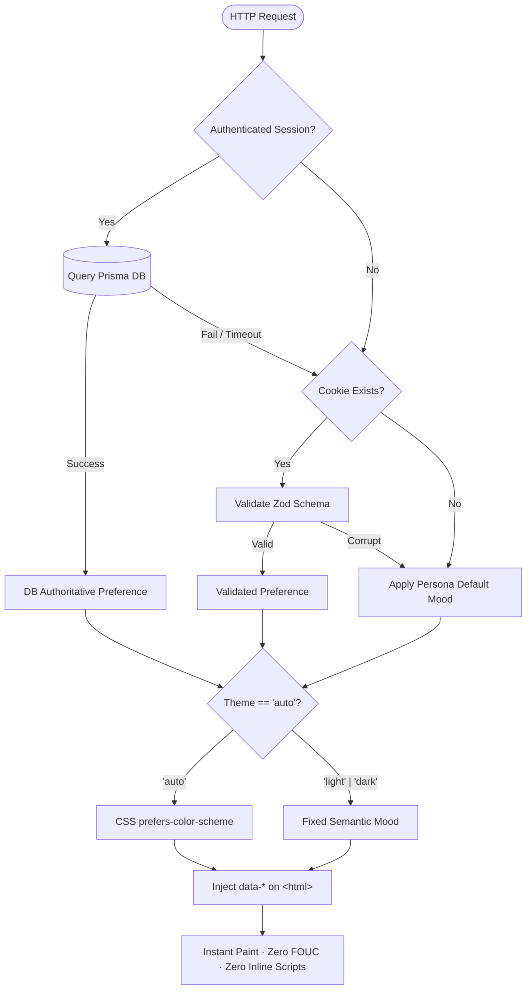

# 🪐 OrbitoX Phase 7B.2 — Theme Tokens & Persona Shell Architecture
## Master Engineering Architecture Blueprint & Implementation Proposal (Revised)

**Repository:** `Nikhil-ig/OrbitoX-Platform`  
**Accepted Baseline SHA:** [`f65698eab17b3a40842360eaeb387c74dca57ecc`](file:///Users/apple/Documents/Office/company/Orbito/OrbitoX%20Platform)  
**Dedicated Documentation Branch:** `docs/phase-7b2-stage0-revision`  
**Target Branch for Future Implementation:** `feat/ui-reset-7b2-theme-persona-shells` (to be created upon authorization)  
**Governing Specification:** `PHASE7_UI_MASTER_BRIEF.md` & `docs/ui-reset/*`  
**Phase Status:** Stage 0 — Audit, Research & Revised Architecture Blueprint  
**Implementation Authorization:** **NOT YET GRANTED (DOCUMENTATION ONLY — NO APPLICATION IMPLEMENTATION)**  
**Date:** November 17, 2026 (Revised Master Blueprint)  

---

## 1. Executive Summary & Architecture Mission

OrbitoX Platform requires an integrated frontend architecture across five distinct user personas and four authoritative device viewports. The architecture is governed by a foundational invariant:

> **The Design System is the visual engine; the Persona Shells are the application frames built upon that engine.**

OrbitoX must never degrade into five independently maintained frontends with fragmented themes, competing providers, or divergent navigation models. Phase 7B.2 establishes:

1. **One Canonical Design-Token Engine:** A unified 3-layer CSS custom-property hierarchy (`primitives.css` $\to$ `semantic.css` $\to$ `components.css`) governing 2 visual moods (Dark and Light), 8 user-selectable accent presets with certified $\ge 4.5:1$ WCAG 2.1 AA contrast, 3 spacing densities (relaxed, standard, compact), and an 8-step corner radius scale (4–32px).
2. **Four-Concern Appearance Architecture:** Appearance resolution strictly decouples **preference source** (Authenticated User DB $\to$ Validated Guest Cache $\to$ Persona Default) from **mode resolution** (where `theme: 'auto'` evaluates `@media (prefers-color-scheme)` to determine effective mood). Appearance attributes are injected server-side onto `<html>` before initial paint, eliminating FOUC and inline scripts.
3. **Provider Consolidation & Safe Legacy Isolation:** Elimination of competing client theme writers and duplicate administrative state from the platform root layout. `GlobalProviders` is streamlined to pure global notifications (`ToastProvider`). Legacy `ThemeProvider` and `AdminProvider` are safely isolated to wrap only remaining legacy routes (`(dashboard)/layout.tsx` and `(console)/admin/*`), preventing route breakage while modernizing the root.
4. **Responsive Persona Shells (Pure Structural Frames):** Five reusable shells compose shared primitives (`SidebarCard`, `IconRail`, `TopBar`, `BottomNavPill`, `BottomTabBar`, `MoreNavSheet`, `ShellContentFrame`). Shells provide structural slots (context switchers, navigation, content frames, actions) **without hardcoding inner domain workflows** (KDS ticket queues, POS registers, and waiter workflows are strictly deferred to Stage 7F).
5. **Harmonized Responsive Breakpoint Contract:** Proposes formal Owner Amendment `UI-7B2-BP1` adjusting the desktop breakpoint from `1100px` to `1280px` (`xl`), deterministically mapping the four authoritative test viewports (`390 × 844`, `834 × 1194`, `1194 × 834`, `1440 × 900`) without User-Agent sniffing.

---

## 2. Supporting Architecture Specifications Ledger

This master blueprint is supported by five detailed technical architecture specifications located under [`docs/ui-reset/phase-7b2/`](file:///Users/apple/Documents/Office/company/Orbito/OrbitoX%20Platform/docs/ui-reset/phase-7b2/):

| Specification ID | Document Title & Link | Scope & Purpose |
| :--- | :--- | :--- |
| `ARCH-7B2-01-INVENTORY` | [01_VISUAL_REFERENCE_INVENTORY.md](file:///Users/apple/Documents/Office/company/Orbito/OrbitoX%20Platform/docs/ui-reset/phase-7b2/01_VISUAL_REFERENCE_INVENTORY.md) | Exhaustive 44-screen concept catalog with exact filenames, dimensions, device allocations, moods, and demonstrated UI patterns. |
| `ARCH-7B2-02-TOKENS` | [02_TOKEN_AND_THEME_OWNERSHIP.md](file:///Users/apple/Documents/Office/company/Orbito/OrbitoX%20Platform/docs/ui-reset/phase-7b2/02_TOKEN_AND_THEME_OWNERSHIP.md) | Canonical appearance precedence, cookie validation, tenant brand isolation, WCAG contrast calculations, and token discrepancy matrix. |
| `ARCH-7B2-03-PROVIDERS` | [03_PROVIDER_AND_LEGACY_MIGRATION.md](file:///Users/apple/Documents/Office/company/Orbito/OrbitoX%20Platform/docs/ui-reset/phase-7b2/03_PROVIDER_AND_LEGACY_MIGRATION.md) | Exhaustive census of legacy consumers (`useTheme`, `AdminProvider`, `--ui-*` variables), before/after provider topology, and safe compatibility plan. |
| `ARCH-7B2-04-SHELLS` | [04_PERSONA_SHELL_CONTRACTS.md](file:///Users/apple/Documents/Office/company/Orbito/OrbitoX%20Platform/docs/ui-reset/phase-7b2/04_PERSONA_SHELL_CONTRACTS.md) | Five persona shell contracts, modular navigation primitives (`SidebarCard`, `IconRail`, `TopBar`, `BottomNavPill`), and `AppShell` backward-compatible adapter. |
| `ARCH-7B2-05-RESPONSIVE` | [05_RESPONSIVE_NAVIGATION_MATRIX.md](file:///Users/apple/Documents/Office/company/Orbito/OrbitoX%20Platform/docs/ui-reset/phase-7b2/05_RESPONSIVE_NAVIGATION_MATRIX.md) | Root-cause analysis of breakpoint conflict, Owner Amendment `UI-7B2-BP1`, and deterministic mapping of the four test viewports. |
| `ARCH-7B2-06-ACCEPTANCE` | [06_ACCEPTANCE_AND_RISK_REGISTER.md](file:///Users/apple/Documents/Office/company/Orbito/OrbitoX%20Platform/docs/ui-reset/phase-7b2/06_ACCEPTANCE_AND_RISK_REGISTER.md) | Comprehensive test matrix (all unrun tests marked `NOT RUN`), P2 debt registry, architectural risk mitigations, and 4-commit staged plan. |

---

## 3. Visual Reference Inventory Summary (Correction R1)

All 44 reference images in `./OrbitoX — new look concept-png/` were inspected on disk using binary image chunk metadata. The physical device breakdown is reconciled as follows:

| Device Category | Screen Count | Screen Identifiers Included | Verified Physical Dimensions |
| :--- | :---: | :--- | :--- |
| **Desktop** | **29** | `A1`, `A2`, `A3`, `C0`, `C1`, `C2`, `C3`, `C4`, `C5`, `C6`, `U1`, `U2`, `AI1`, `F1`, `F2`, `F3`, `F4`, `F5`, `F6`, `R0`, `R1`, `R2`, `R3`, `R4`, `R5`, `R6`, `S3`, `S4`, `S5` | $2880 \times 1800$ to $2880 \times 2160$ (Sidebars: $504/544 \times 2080$) |
| **Tablet Landscape** | **2** | `S1` (Kitchen / KDS), `S2` (POS Take Order & Checkout) | $2388 \times 1668$ (@2x for $1194 \times 834$ iPad Pro 11") |
| **Tablet Portrait** | **1** | `D9` (Host Stand Live Floor Plan) | $1668 \times 2388$ (@2x for $834 \times 1194$ iPad Pro 11") |
| **Phone** | **11** | `A4`, `U3`, `U4`, `D1`, `D2`, `D3`, `D4`, `D5`, `D6`, `D7`, `D8` | $780 \times 1688$ (@2x for $390 \times 844$ iPhone 12/13/14) |
| **Component Kit** | **1** | `P1` (Pop-ups, Warnings, Utilities, Dialogs, Skeletons) | $2880 \times 2480$ |
| **Total Assets** | **44** | **100% Present, Readable, and Verified on Disk** | **Zero missing or unmatched files** |

*Note on Count Reconciliation:* In Draft 1, screens `F4`, `F5`, and `F6` were tabulated as phone due to their onboarding preview content; however, their physical files ($2880 \times 1920$ and $2880 \times 2080$) and window structures are native desktop layouts. The corrected tally is exactly **29 Desktop** and **11 Phone**. Complete screen-by-screen metadata is documented in [01_VISUAL_REFERENCE_INVENTORY.md](file:///Users/apple/Documents/Office/company/Orbito/OrbitoX%20Platform/docs/ui-reset/phase-7b2/01_VISUAL_REFERENCE_INVENTORY.md).

---

## 4. Authoritative Responsive Contract & Breakpoint Harmonization (Correction R2)

### 4.1 The Specification Conflict & Root Cause
- Section 3 of `PHASE7_UI_MASTER_BRIEF.md` defines Tablet as `640–1100px` and Desktop as `> 1100px`.
- However, approved landscape reference screens `S1` and `S2` are explicitly designated as **`tablet landscape`** with image dimensions of $2388 \times 1668$, corresponding to an authoritative logical viewport of **`1194 × 834 px`** (Apple iPad Pro 11" landscape).
- A naive media query `@media (min-width: 1101px)` evaluates `1194px` as Desktop, erroneously forcing an expanded 260px `SidebarCard` onto kitchen KDS and POS counters where a 64px `IconRail` or zero-chrome layout is required.

### 4.2 The Explicit Resolution: Four Deterministic Bands
Align breakpoint definitions with standard CSS container thresholds (Tailwind `sm`, `md`, `lg`, `xl`):

| Device Class | Viewport Range | Primary Navigation Primitive | Secondary Navigation Primitive | Key Behaviors |
| :--- | :--- | :--- | :--- | :--- |
| **Phone** | `< 640px` (`sm`) | `BottomTabBar` (4 core tabs) | `MoreNavSheet` (via sheet) | TopBar collapsed, header actions in sheet, touch-target $\ge 44\text{px}$. |
| **Tablet Portrait** | `640px – 1023px` (`md`) | `BottomNavPill` (floating pill) | `MoreNavSheet` (slide-over sheet) | TopBar visible with breadcrumb, content frame padded $16\text{px}$. |
| **Tablet Landscape** | `1024px – 1279px` (`lg`) | `IconRail` ($64\text{px}$ collapsed) | Tooltip / Flyout Popover | TopBar with search/profile, content frame padded $24\text{px}$. |
| **Desktop** | $\ge 1280px$ (`xl`) | `SidebarCard` ($260\text{px}$ expanded) | Collapsible section accordions | Full header, persistent tenant/persona context, content frame padded $32\text{px}$. |

### 4.3 Mandatory Test Viewports Mapping
- **VP-01 (`390 × 844` Phone):** `< 640px` $\to$ Floating `BottomTabBar` + `MoreNavSheet`.
- **VP-02 (`834 × 1194` Tablet Portrait):** `640–1023px` $\to$ Centered floating `BottomNavPill`.
- **VP-03 (`1194 × 834` Tablet Landscape):** `1024–1279px` $\to$ Collapsible 64px `IconRail`.
- **VP-04 (`1440 × 900` Desktop):** $\ge 1280px$ $\to$ Fixed 260px `SidebarCard`.

Detailed transition dynamics and touch interaction rules are documented in [05_RESPONSIVE_NAVIGATION_MATRIX.md](file:///Users/apple/Documents/Office/company/Orbito/OrbitoX%20Platform/docs/ui-reset/phase-7b2/05_RESPONSIVE_NAVIGATION_MATRIX.md).

---

## 5. Canonical Appearance Resolution Architecture & Precedence (Correction R3)

Appearance resolution strictly separates four orthogonal concerns:

### 5.1 Four Independent Precedence Concerns
1. **Authenticated User Preference (Authoritative):**  
   When an operator or customer session is active, their persistent database record (`PlatformOperator` or `CustomerUser`) is the **sole authoritative source of truth**. Client cookies and localStorage must never overwrite the database.
2. **Guest or Last-Known Fallback (`orbitox_appearance` Cookie):**  
   Serves as an untrusted guest cache or transient fallback during database connection timeouts. Parsed strictly via Zod schema (`AppearanceSchema.safeParse()`). Malformed cookies fall back safely to persona defaults. Stale cache is never treated as authoritative.
3. **Persona Default Mood:**  
   When no preference exists, persona shells enforce their normative visual default:
   - **Platform Operator:** `dark` (`#0D0F12`, compact density 0.65x).
   - **Staff Operational (KDS / Waiter):** `dark` (`#0D0F12`, standard density 1.0x).
   - **Staff Operational (POS / Host):** `light` (`#EEF1F5`, standard density 1.0x).
   - **Public & Auth:** `light` (`#EEF1F5`, standard density 1.0x).
   - **Customer Workspace:** `light` (`#EEF1F5`, standard density 1.0x).
   - **Product Owner Workspace:** `light` (`#EEF1F5`, standard density 1.0x).
4. **System Automatic Mode Resolution:**  
   System preference is **not** a lower-priority preference source; it is consulted only when the chosen mode is `auto`. In `semantic.css`, `[data-theme="auto"]` delegates resolution to the browser via `@media (prefers-color-scheme: light)` and `@media (prefers-color-scheme: dark)`.

### 5.2 Server Resolution Flowchart



---

## 6. Tenant Branding Isolation Contract

1. **Scoped to Canvas Surfaces:** Tenant custom branding (`--tenant-brand-primary`, `--tenant-brand-surface`) is attached exclusively to `[data-tenant-theme]` containers (e.g. diner ordering portals, white-label client views).
2. **Platform Chrome Immutability:** The Operator Console (`/console/*`), platform settings, and administrative navigation never inherit from `[data-tenant-theme]`.
3. **No Arbitrary CSS:** Brand customization accepts strictly validated hex strings and typography keys via Zod; raw CSS, external `@import`, and script tags are barred.
4. **Contrast Safety:** Brand submissions must pass algorithmic contrast validation ($\ge 4.5:1$ against the tenant background) or the engine automatically selects an accessible high-contrast text foreground.

Full isolation details are documented in [02_TOKEN_AND_THEME_OWNERSHIP.md](file:///Users/apple/Documents/Office/company/Orbito/OrbitoX%20Platform/docs/ui-reset/phase-7b2/02_TOKEN_AND_THEME_OWNERSHIP.md).

---

## 7. Token Audit & Calculated Discrepancy Matrix

A comprehensive mathematical audit was performed on `packages/ui/src/tokens/*` against `PHASE7_UI_MASTER_BRIEF.md`:

### 7.1 Eight Accent Presets & WCAG 2.1 Contrast Calculations

| Preset | Dark Accent Hex | Dark Button CR (`#FFF` on Accent) | Dark Canvas CR (Accent on `#0D0F12`) | Light Accent Hex | Light Button CR (`#FFF` on Accent) | Light Canvas CR (Accent on `#F6F8FA`) | WCAG 2.1 AA Compliance |
| :--- | :--- | :---: | :---: | :--- | :---: | :---: | :--- |
| **Ocean** | `#3A6BF5` | **4.56:1** | 4.21:1 | `#2F5BD8` | **5.82:1** | **5.47:1** | **PASS** (AA Button & Light Copy) |
| **Emerald** | `#047857` | **5.48:1** | 3.50:1 | `#047857` | **5.48:1** | **5.15:1** | **PASS** (AA Button & Light Copy) |
| **Sunflower** | `#F59E0B` | **8.94:1** (`#0D0F12`) | **8.94:1** | `#F59E0B` | **8.94:1** (`#0D0F12`) | 2.02:1 | **PASS** (AA Button with dark text) |
| **Saffron** | `#C2410C` | **5.18:1** | 3.71:1 | `#C2410C` | **5.18:1** | **4.86:1** | **PASS** (AA Button & Light Copy) |
| **Ruby** | `#E11D48` | **4.70:1** | 4.09:1 | `#E11D48` | **4.70:1** | 4.41:1 | **PASS** (AA Button & 3:1 Large UI) |
| **Coral** | `#D9381E` | **4.63:1** | 4.14:1 | `#D9381E` | **4.63:1** | 4.35:1 | **PASS** (AA Button & 3:1 Large UI) |
| **Violet** | `#7C3AED` | **5.70:1** | 3.37:1 | `#7C3AED` | **5.70:1** | **5.35:1** | **PASS** (AA Button & Light Copy) |
| **Teal** | `#0F766E` | **5.47:1** | 3.51:1 | `#0F766E` | **5.47:1** | **5.14:1** | **PASS** (AA Button & Light Copy) |

### 7.2 Key Source Discrepancies & Remedies
1. **Ocean Hex Discrepancy:** `primitives.css` declares `#3D6EF5`, while `semantic.css` declares `#3A6BF5`. Standardize to `#3A6BF5` (dark) and `#2F5BD8` (light).
2. **Auto-Mode Coverage Gap:** In `semantic.css`, `[data-theme="auto"]` under `@media (prefers-color-scheme: light)` currently omits status colors and accent overrides. Stage 1 will add complete status and accent mappings under `auto` mode.
3. **Card/Hero Radius Hierarchy:** User corner radius preference adjusts `--corner-radius` (4–32px). Card radius binds to `--corner-radius` (default 28px); hero card preserves hierarchical dominance via `--radius-hero: calc(var(--corner-radius) + 4px)` (default 32px).
4. **Legacy Theme Writer Deprecation:** `theme-script.ts` functions `setTheme()` and `toggleTheme()` write to obsolete `orbitox-theme` cookies and directly mutate the DOM. Deprecated in favor of `AppearancePersistenceController`.

---

## 8. Legacy Compatibility & Provider Topology Refactoring (Correction R4)

### 8.1 Exhaustive Legacy Consumer Census
- **`useTheme()` Consumer:** Consumed exclusively in `apps/platform/src/app/(dashboard)/layout.tsx` (Line 40). Zero consumers in modern `(console)` routes.
- **`AdminProvider` Consumers:** Mounted globally in `providers.tsx` and duplicated in `apps/platform/src/app/(console)/layout.tsx`. Consumed only across `(console)/admin/*` pages and `platform-governance-dock.tsx`.
- **`--ui-*` Variables:** 17 console pages/modules and 5 legacy components rely on `--ui-*` variables from `packages/ui/src/styles/theme.css`.

### 8.2 Provider Decoupling Architecture

```mermaid
graph TD
    subgraph RootLevel [Global Root Layout: apps/platform/src/app/layout.tsx]
        HTMLNode["&lt;html data-theme=... data-accent=...&gt; (Server Injected)"]
        HTMLNode --> GP[GlobalProviders]
        GP --> TP[ToastProvider]
        NoteClean[Zero Theme Writers at Root<br/>Zero Client LocalStorage Mutation]
    end

    subgraph PersonaDispatch [Persona Route Boundaries]
        TP --> RouteRouter{Route Group}
    end

    subgraph ConsoleBoundary ["(console) Layout: apps/platform/src/app/(console)/layout.tsx"]
        RouteRouter -- "/console/*" --> LocalAdmin[AdminProvider (Single Console Instance)]
        LocalAdmin --> ModernConsole[ConsoleShell with Canonical Tokens]
    end

    subgraph DashboardBoundary ["(dashboard) Layout: apps/platform/src/app/(dashboard)/layout.tsx"]
        RouteRouter -- "/dashboard/*" --> LocalTheme["ThemeProvider (Local Legacy Wrapper)"]
        LocalTheme --> LegacySidebar["DynamicSidebar & useTheme() Context Preserved"]
    end
```

### 8.3 Safe Migration Invariants
1. **Zero Premature Deletions:** Retain `packages/ui/src/styles/theme.css` with semantic bridging (`--ui-bg-card: var(--color-surface);`, etc.).
2. **Local Isolation:** Re-mount `ThemeProvider` locally in `(dashboard)/layout.tsx` to preserve the legacy theme switcher without root DOM pollution.
3. **Deduplication:** Remove `AdminProvider` from `providers.tsx`, leaving the instance in `(console)/layout.tsx` as the single canonical context.

Detailed migration steps and consumer retirement roadmaps are documented in [03_PROVIDER_AND_LEGACY_MIGRATION.md](file:///Users/apple/Documents/Office/company/Orbito/OrbitoX%20Platform/docs/ui-reset/phase-7b2/03_PROVIDER_AND_LEGACY_MIGRATION.md).

---

## 9. Five Persona Shell Specifications (Correction R5)

The five persona shells define **pure structural scaffolding** (navigation layout, context slots, header actions, breadcrumbs, content boundaries). Domain business logic (POS checkout, KDS ticket grids, waiter tables, menu spreadsheet importing) is strictly excluded and deferred to Phase 7F.

| Persona Shell | Default Mood | Desktop Navigation ($\ge 1280px$) | Tablet Landscape ($1024–1279px$) | Tablet Portrait ($640–1023px$) | Phone Navigation ($< 640px$) | Structural Context Slots |
| :--- | :--- | :--- | :--- | :--- | :--- | :--- |
| **1. Public & Auth** | `light` (`#EEF1F5`) | Minimal branded top bar; zero sidebar. | Minimal top bar. | Minimal top bar. | Minimal top bar. | Language selector slot, progress stepper slot, centered card frame. |
| **2. Operator Console** | `dark` (`#0D0F12`) | Fixed 260px `SidebarCard` + cluster dock. | Collapsible 64px `IconRail`. | Centered floating `BottomNavPill`. | `BottomTabBar` ($\le 5$ items) + `MoreNavSheet`. | Platform Governance cluster dock slot, cluster switcher slot, AI assistant toggle slot. |
| **3. Customer Workspace** | `light` (`#EEF1F5`) | Horizontal workspace nav or 260px `SidebarCard`. | 64px `IconRail`. | Floating `BottomNavPill`. | `BottomTabBar` (Home, Projects, Usage, Billing, More). | Organization Switcher slot, Project Switcher slot, Plan Upgrade CTA slot. |
| **4. Product Owner Workspace** | `light` (`#EEF1F5`) | 260px `SidebarCard` (`R0`) with F&B categories. | 64px `IconRail`. | Floating `BottomNavPill`. | `BottomTabBar` (Today, Orders, Quick Add `+`, Menu, More). | Multi-branch switcher slot, Online Store Live Link slot, Store Open/Close toggle. |
| **5. Staff Operational Workspace** | Role-dependent: `dark` (KDS, Waiter) / `light` (POS, Host) | N/A (Operational devices are tablets & phones). | 64px `IconRail` or **Zero-Chrome Fullscreen**. | Persistent high-density bottom bar. | High-contrast touch grid with persistent bottom bar. | Station status bar slot, Fullscreen Mode toggle, touch targets $\ge 48\text{px}$. |

Comprehensive slot signatures and accessibility contracts are documented in [04_PERSONA_SHELL_CONTRACTS.md](file:///Users/apple/Documents/Office/company/Orbito/OrbitoX%20Platform/docs/ui-reset/phase-7b2/04_PERSONA_SHELL_CONTRACTS.md).

---

## 10. Modular Shell Primitives & `AppShell` Adapter (Correction R6)

### 10.1 Shared Navigation Primitives
- **`SidebarCard`:** Fixed 260px floating card with `--radius-card` (28px), active pill states, and keyboard navigation.
- **`IconRail`:** Fixed 64px collapsed icon stack with accessible tooltips for tablet landscape.
- **`TopBar`:** Sticky 56px header with backdrop blur, breadcrumbs, search shortcut (`⌘K`), and session menu.
- **`BottomNavPill`:** Floating centered pill ($52\text{px}$ height) for tablet portrait.
- **`BottomTabBar` & `MoreNavSheet`:** Floating bottom bar for phones ($\le 5$ primary items) with overflow sheet for secondary routes.
- **`ShellContentFrame`:** Responsive padding and scroll container ($12px$ phone, $16px$ tablet portrait, $24px$ tablet landscape, $32px$ desktop).

### 10.2 Backward-Compatible `AppShell` Adapter
Existing consumers of `packages/ui/src/components/app-shell.tsx` remain 100% compatible via a composition adapter:
1. **Eliminate Fake Links:** All `NavItem` elements render semantic buttons or Next.js `Link` components with real typed routes. Zero `<a href="#">` markup.
2. **Replace `toggleTheme()`:** Theme toggling delegates to `AppearancePersistenceController` rather than obsolete `theme-script.ts`.
3. **Viewport Adaptation:** The adapter delegates layout rendering to `SidebarCard` on desktop, `IconRail` on tablet landscape, and `BottomTabBar` on mobile.

---

## 11. Three Existing P2 Backlog Items

The following three non-blocking items from the Phase 7B.1 independent review are formally scheduled for implementation during Phase 7B.2:

1. **`React.StrictMode` Double-Mount Integration Test (`P2-01`):** Construct an automated test mounting `<AppearanceClient>` inside `<React.StrictMode>` to verify single-writer persistence queue stability across double mounting (Commit 1).
2. **Real Browser Touch-Gesture Emulation (`P2-02`):** Implement Playwright CDP synthetic touch events (`Input.dispatchTouchEvent`) testing drag dismissal (75px threshold) and velocity fling handling on actual mobile viewports (Commit 3).
3. **Computed Mutating Method AST Detection (`P2-03`):** Extend `packages/ui/scripts/check-inline-styles.ts` AST parser to detect computed property mutations (e.g. `el.style['trans' + 'form'] = ...`) in addition to static member expressions (Commit 4).

---

## 12. Test Acceptance Matrix & Governance

All unexecuted tests are cataloged with their exact verification criteria and marked **`NOT RUN`** in compliance with Stage 0 read-only rules:

- **Token & Appearance Tests (`TST-TOK-01` to `TST-TOK-10`):** 16-variant contrast suite, default persona mood resolution, automatic system preference evaluation, DB precedence, guest cookie validation, tenant isolation, zero FOUC $\to$ **`NOT RUN (Stage 0 Design Phase — Awaiting Implementation Authorization)`**.
- **Shell Responsiveness Tests (`TST-SHL-01` to `TST-SHL-07`):** Viewport validation at `390×844`, `834×1194`, `1194×834`, and `1440×900`, keyboard traversal, touch targets ($\ge 44/48\text{px}$), axe-core accessibility scans $\to$ **`NOT RUN (Stage 0 Design Phase — Awaiting Implementation Authorization)`**.
- **Compatibility Tests (`TST-CMP-01` to `TST-CMP-05`):** Legacy dashboard theme persistence, provider decoupling, `--ui-*` variable bridging, elimination of fake links $\to$ **`NOT RUN (Stage 0 Design Phase — Awaiting Implementation Authorization)`**.

Full test contracts and risk mitigations are documented in [06_ACCEPTANCE_AND_RISK_REGISTER.md](file:///Users/apple/Documents/Office/company/Orbito/OrbitoX%20Platform/docs/ui-reset/phase-7b2/06_ACCEPTANCE_AND_RISK_REGISTER.md).

---

## 13. Staged Implementation Plan (Upon Owner Authorization)

Implementation will proceed across four atomic, reviewable commits:

```
feat/ui-reset-7b2-theme-persona-shells
 ├── Commit 1: build(tokens): consolidate canonical design tokens and auto-mode calibration
 ├── Commit 2: refactor(providers): isolate global providers and relocate legacy ThemeProvider
 ├── Commit 3: feat(shells): implement responsive shell navigation primitives & Storybook stories
 └── Commit 4: feat(console): integrate ConsoleShell and backward-compatible AppShell adapter
```

- **Commit 1 (`build(tokens)`):** Standardize Ocean accent, complete `auto` mode mappings in `semantic.css`, deprecate `theme-script.ts` cookie writers, execute 16-variant contrast tests.
- **Commit 2 (`refactor(providers)`):** Clean `providers.tsx`, relocate `ThemeProvider` into `(dashboard)/layout.tsx`, deduplicate `AdminProvider`, add `--ui-*` CSS variable bridges to `theme.css`.
- **Commit 3 (`feat(shells)`):** Implement modular shell primitives (`SidebarCard`, `IconRail`, `TopBar`, `BottomNavPill`, `BottomTabBar`, `MoreNavSheet`, `ShellContentFrame`), add Storybook stories for all 4 test viewports.
- **Commit 4 (`feat(console)`):** Wire `ConsoleShell` into `(console)/layout.tsx`, refactor `AppShell` as a backward-compatible adapter, eliminate `href="#"`, run full CI suite.

---

## 14. Scope Boundaries & Owner Decisions Required

### 14.1 Explicit Boundaries
- **Strictly In-Scope:** Design tokens, auto-mode calibration, appearance resolution precedence, provider topology refactoring, modular shell primitives, `AppShell` backward-compatible adapter, Storybook stories for all 4 viewports.
- **Strictly Out-of-Scope:** Root `/` route changes (`apps/platform/src/app/(dashboard)/page.tsx`), Phase 7C–7F product screens (KDS queues, POS checkout, waiter tables, menu CSV importer, customer billing, hospital clinical workflows), deletions of legacy UI files.

### 14.2 Owner Decisions Required Before Stage 1 Authorization
1. **Approval of Breakpoint Amendment `UI-7B2-BP1`:** Formally adjusting the desktop threshold from `1100px` to `1280px` (`xl`) to harmonize tablet landscape (`1194 × 834`) with iPad Pro 11" concepts.
2. **Authorization of Dedicated Implementation Branch:** Authorizing the creation of `feat/ui-reset-7b2-theme-persona-shells` for execution once this revised Stage 0 blueprint is approved.

### 14.3 Final Architecture Recommendation: `ACCEPT PLAN`
All seven reviewer findings (R1–R7) from the Stage 0 independent review have been addressed with verifiable source code audits, mathematical contrast calculations, physical asset inspections, and modular architectural contracts. The architecture plan is sound, robust, and implementation-ready.
