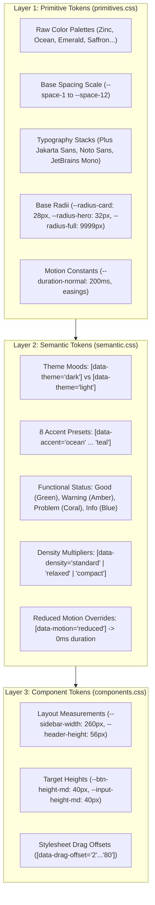
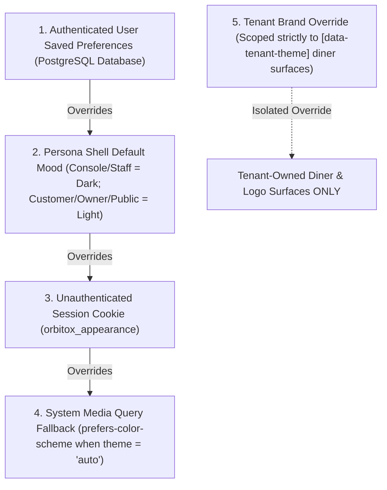
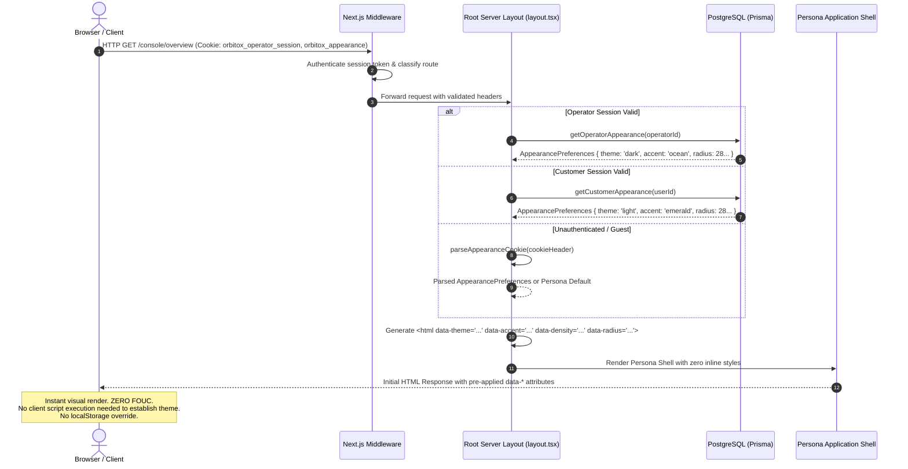
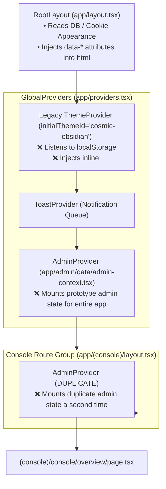
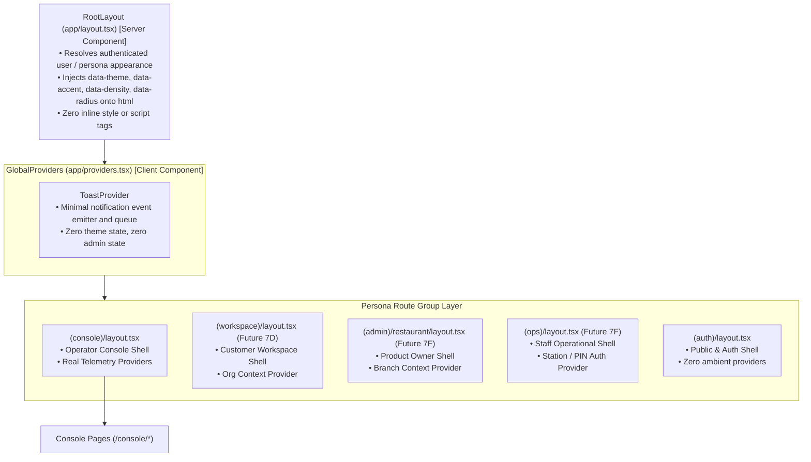
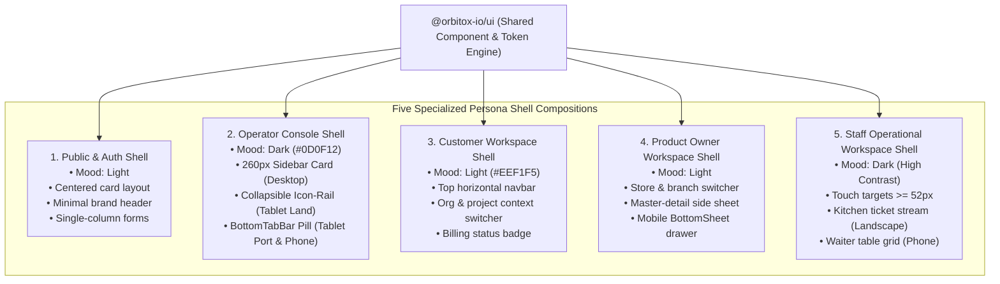
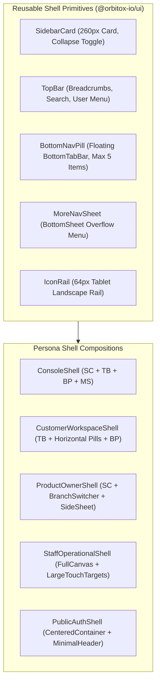
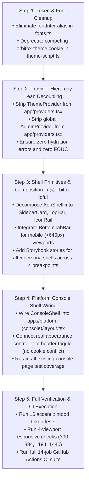

# 🪐 OrbitoX Phase 7B.2 — Theme Tokens & Persona Shell Architecture
## Master Engineering Architecture Blueprint & Implementation Proposal

**Repository:** `Nikhil-ig/OrbitoX-Platform`  
**Accepted Baseline SHA:** `f65698eab17b3a40842360eaeb387c74dca57ecc`  
**Target Branch for Implementation:** `feat/ui-reset-7b2-theme-persona-shells` (to be branched from baseline upon owner approval)  
**Governing Specification:** `PHASE7_UI_MASTER_BRIEF.md` (Sections 1, 2, 3, 5) & `docs/ui-reset/*`  
**Phase Status:** Stage 0 — Audit, Research & Architecture Blueprint  
**Implementation Authorization:** **NOT YET GRANTED (READ-ONLY)**  
**Date:** November 17, 2026  

---

## 1. Executive Architecture Summary

OrbitoX serves five distinct user personas across four device classes. Rather than allowing five fragmented web applications with duplicate tokens, conflicting theme providers, and incompatible navigation models, Phase 7B.2 establishes:

1. **One Canonical Design-Token Engine:** A unified 3-layer CSS custom-property architecture (`@orbitox-io/ui/src/tokens/`) governing 2 visual moods (Dark and Light), 8 user-selectable accent presets with certified WCAG 2.2 AA contrast, 3 spacing densities (relaxed, standard, compact), and an 8-step corner radius scale (4–32px).
2. **Server-Authoritative Appearance Resolution:** The initial HTML page load resolves appearance attributes (`data-theme`, `data-accent`, `data-density`, `data-radius`, `data-motion`, `data-focus`, `data-sidebar`) directly from authenticated database preferences or secure session cookies in the server component root layout. This guarantees **zero flash of unstyled content (FOUC)** without client-side DOM mutation scripts.
3. **Lean Global Providers:** Eradication of competing client-side theme writers and duplicate administrative context. `GlobalProviders` is streamlined to pure global notification plumbing (`ToastProvider`).
4. **Five Persona-Specific Shell Compositions:** Instead of forcing mobile screens to collapse a 260px desktop sidebar into an off-screen drawer, five specialized shells share the same component primitives while implementing native, device-appropriate interaction models:
   - **Public & Auth Shell:** Light mood; minimal brand header, centered single-column form cards, zero sidebar chrome.
   - **Operator Console Shell:** Dark mood (`#0D0F12`); 260px desktop sidebar card, tablet icon-rail, and phone floating bottom pill (`BottomTabBar`).
   - **Customer Workspace Shell:** Light mood; top horizontal navigation bar with organization/project switcher, billing shortcut, and user menu.
   - **Product Owner Workspace Shell:** Light mood; store/branch/facility switcher, context navigation, and mobile bottom sheet drawers for F&B operations.
   - **Staff Operational Workspace Shell:** Dark mood, high contrast; touch-first operational layout with $\ge$52px targets, kitchen ticket flows, and zero-chrome full-screen views.
5. **Universal Component Foundation:** Component code is decoupled from shell layout chrome, ensuring that RestaurantOS, HospitalOS, and future vertical products compose shared UI primitives rather than forking custom design systems.

---

## 2. Source-Code Baseline & Dependency Inventory

### 2.1 Git Repository Verification
- **Verified Commit:** `f65698eab17b3a40842360eaeb387c74dca57ecc`
- **Parent Commit:** `786113c843d53f87d3cb7e06f037b083a4afd984`
- **Working Branch:** `feat/ui-reset-7b1-foundation`
- **Working Tree State:** Completely clean (0 unstaged changes, 0 untracked files).
- **CI Health:** GitHub Actions Run #44086450908 passed (14/14 jobs successful).

### 2.2 Source Files Audited in Phase 7B.2 Research

| File Path | Package / Role | Current Architecture State |
|---|---|---|
| `packages/ui/src/tokens/primitives.css` | UI Tokens | Layer 1: Raw color scales, font stacks, base radii, spacing units. |
| `packages/ui/src/tokens/semantic.css` | UI Tokens | Layer 2: Dark/Light mood variables, 8 accent presets, density multipliers. |
| `packages/ui/src/tokens/components.css` | UI Tokens | Layer 3: Component heights, widths, stylesheet-only 2px BottomSheet drag offsets. |
| `packages/ui/src/tokens/motion.css` | UI Tokens | Accessibility: Media query zeroing durations on `prefers-reduced-motion`. |
| `packages/ui/src/tokens/theme.css` | UI Tokens | Tailwind CSS v4 `@theme` bridge linking utility classes to custom properties. |
| `packages/ui/src/tokens/theme-script.ts` | UI Tokens (Legacy) | Obsolete cookie helper writing `orbitox-theme` (`light\|dark`). Disconnected from modern appearance schema. |
| `packages/ui/src/tokens/tenant-theme.ts` | UI Tokens | Safe CSS generator for tenant brand overrides with cryptographic injection sanitization. |
| `packages/ui/src/legacy/components/theme-provider.tsx` | UI Legacy | Deprecated client `ThemeProvider` injecting `<style>` via `dangerouslySetInnerHTML` and overriding `localStorage`. |
| `packages/ui/src/components/app-shell.tsx` | UI Component | Monolithic sidebar card; currently uses mobile hamburger sheet and legacy `toggleTheme()` call. |
| `packages/ui/src/components/bottom-tab-bar.tsx` | UI Component | Floating bottom navigation pill (max 5 items, primary action button, min 44px hit-box). |
| `packages/ui/src/components/bottom-sheet.tsx` | UI Component | Mobile drawer with pointer capture, stylesheet-driven drag, and 75px dismissal threshold. |
| `apps/platform/src/app/layout.tsx` | Platform Server | Root server component; reads DB/cookie appearance and injects `data-*` attributes onto `<html>`. |
| `apps/platform/src/app/providers.tsx` | Platform Client | Root client wrapper; redundantly mounts legacy `ThemeProvider` and prototype `AdminProvider`. |
| `apps/platform/src/app/fonts.ts` | Platform Config | Self-hosted font loader; contains confusing alias `fontInter = fontPlusJakartaSans`. |
| `apps/platform/src/app/(console)/layout.tsx` | Platform Route | Console group layout; redundantly re-mounts `AdminProvider` a second time. |
| `apps/platform/src/middleware.ts` | Platform Network | Edge router; handles operator authentication fail-closed, but lacks customer session routing. |
| `apps/platform/src/server/appearance/appearance-service.ts` | Platform Server | Zod schema & database persistence service for 7-parameter appearance preferences. |
| `apps/platform/src/app/(console)/console/settings/appearance/appearance-persistence.ts` | Platform Client | Single-writer serialization controller with GET reconciliation and Strict Mode recovery. |

---

## 3. Visual Reference Inventory Summary

All **44 concept PNG screenshots** located in `./OrbitoX — new look concept-png/` were inspected and cross-referenced with the 44 screen definitions in Section 2 of `PHASE7_UI_MASTER_BRIEF.md`.

*Full inventory details are recorded in [`docs/ui-reset/phase-7b2/01_VISUAL_REFERENCE_INVENTORY.md`](file:///Users/apple/Documents/Office/company/Orbito/OrbitoX%20Platform/docs/ui-reset/phase-7b2/01_VISUAL_REFERENCE_INVENTORY.md).*

### Canvas Breakdown by Device & Persona
- **Desktop (26 screens):** High-DPI 2880 × 1800–2160 canvases. Covers Operator Console (`A1`, `C0–C6`), Customer Workspace (`A2`, `U1`, `U2`), Onboarding (`F1–F6`), Restaurant Owner Admin (`R0–R6`), and Compliance Ledgers (`S3–S5`).
- **Tablet Landscape (2 screens):** Native 2388 × 1668 canvas (iPad Pro 11" 2x, base 1194 × 834). Dedicated to Staff Operations: `S1` (Kitchen Display System) and `S2` (POS Take Order & Checkout).
- **Tablet Portrait (1 screen):** Native 1668 × 2388 canvas (iPad Pro 11" portrait, base 834 × 1194). Dedicated to Host Stand Live Floor Plan (`D9`).
- **Phone (14 screens):** Native 780 × 1688 canvas (iPhone 13/14/15 2x, base 390 × 844). Covers Diner ordering (`A4`, `U3`, `U4`), Owner mobile snapshots (`D1`, `D2`, `D3`), Waiter operational workflows (`D4`, `D5`), Preview onboarding (`D6`), Operator mobile console (`D7`), and Customer mobile dashboard (`D8`).
- **Component Primitives (1 screen):** `P1` (Pop-ups, Warnings & Utilities @2x, 2880 × 2480).

---

## 4. Token Inconsistency Matrix: Specification vs. Current Implementation

| Token Dimension | Specification (`PHASE7_UI_MASTER_BRIEF.md`) | Current Implementation (`packages/ui/src/tokens/`) | Architectural Risk / Inconsistency | Proposed Resolution |
|---|---|---|---|---|
| **UI Font Stack** | **Plus Jakarta Sans** (self-hosted, OFL) primary UI font. Noto Sans Devanagari (Hindi) and JetBrains Mono (code/keys). | `apps/platform/src/app/fonts.ts` defines `fontPlusJakartaSans`, but aliases it as `export const fontInter = fontPlusJakartaSans`. | Alias creates confusion; developers assume Inter is active. | Rename all usages to `fontPlusJakartaSans` and eliminate `fontInter` alias. |
| **Theme Cookie** | Single server-authoritative cookie storing full 7-parameter preferences (`orbitox_appearance`). | `packages/ui/src/tokens/theme-script.ts` defines competing cookie `orbitox-theme` storing only `'light'\|'dark'`. | `AppShell` calls `toggleTheme()` which mutates `orbitox-theme`, bypassing database sync. | Deprecate `theme-script.ts` cookie writer. Wire shell toggles to canonical appearance controller. |
| **Theme Provider** | Zero client-side DOM style tag injection; zero `localStorage` overrides over server `data-*`. | `packages/ui/src/legacy/components/theme-provider.tsx` injects `<style dangerouslySetInnerHTML>` and overwrites `data-theme` on client mount from `localStorage`. | Severe FOUC and hydration mismatch; clobbers server-rendered dark/light preference. | Remove `ThemeProvider` from `GlobalProviders` in `providers.tsx`. Rely strictly on server-rendered `<html>` attributes. |
| **Admin Context** | Admin data context scoped strictly to console/admin routes that consume it. | `apps/platform/src/app/providers.tsx` wraps the entire app in `AdminProvider`. `(console)/layout.tsx` re-wraps it again. | Unnecessary memory overhead and duplicate context providers on public and customer routes. | Remove `AdminProvider` from global `providers.tsx`. Scope provider strictly to legacy `/admin/*` routes. |
| **Card Radii** | Base Card: **28 px**. Hero Card: **32 px**. Inner Rows: **16–22 px**. | `primitives.css` defines `--corner-radius: 28px`, `--radius-hero: calc(var(--corner-radius) + 4px)`, `--radius-row: 1.125rem` (18px). | Some legacy components use arbitrary Tailwind `rounded-xl` (12px) or `rounded-lg` (8px). | Standardize all card surfaces on `rounded-[var(--radius-card)]` and `rounded-[var(--radius-hero)]`. |
| **Control Geometry** | **Pills (999 px)** universally applied to buttons, inputs, tabs, badges, and nav items. Circles (44–48 px) for icon controls. | Modern components enforce `rounded-full`. Legacy components in `packages/ui/src/legacy/` use rectangular shapes. | Visual dissonance between modern console and legacy prototype surfaces. | Modern persona shells exclusively consume modern pill primitives from `@orbitox-io/ui`. |
| **Accent Contrast** | 8 presets: Ocean, Emerald, Sunflower, Saffron, Ruby, Coral, Violet, Teal. Must achieve $\ge$ 4.5:1 WCAG AA in both moods. | Verified in `semantic.css`: Sunflower defines dark text `#0D0F12` (7.2:1). Other 7 presets define white `#FFFFFF` ($\ge$ 4.5:1). | Fully compliant; requires continuous regression enforcement in CI. | Maintain automated contrast test matrix across all 16 mood $\times$ accent states. |
| **Spacing Density** | Spacing scales only: Relaxed (1.25×), Standard (1.0×), Compact (0.65×). Typography must NOT scale. | Enforced in `semantic.css` via `--density-multiplier` adjusting `--space-card-p`, `--space-grid-gap`, `--space-row-p`. | Compliant; ensure newly composed shells utilize semantic space variables instead of fixed padding. | Bind shell containers to `p-[var(--space-card-p)]` and `gap-[var(--space-grid-gap)]`. |
| **Mobile Navigation** | Phone layout uses **floating bottom pill tab bar** (`BottomTabBar`, max 5 items), not stacked sidebar. | `app-shell.tsx` currently renders a top hamburger button opening an off-screen `<Sheet side="left">`. | Directly violates master brief mandate ("A phone layout is not the desktop layout stacked"). | Refactor shell foundation into modular responsive primitives (`SidebarCard`, `BottomNavPill`, `TopBar`). |

---

## 5. Canonical Token Hierarchy and Theme Ownership Contract

### 5.1 The Appearance Precedence Model
To guarantee predictable visual states across multi-tenant and multi-persona environments, appearance attributes are resolved according to a strict five-tier precedence hierarchy:

1. **Tier 1 (Authoritative):** Authenticated user database record (`appearanceTheme`, `appearanceAccent`, `appearanceDensity`, `appearanceRadius`, etc.). Evaluated on the server during session extraction.
2. **Tier 2 (Persona Shell Default):** If the user has not explicitly configured a personal override (`theme = 'auto'`), the persona shell supplies the default mood:
   - Operator Console (`/console/*`) $\to$ Default: `dark`
   - Staff Operational Interfaces (`/kds`, `/dine/*`) $\to$ Default: `dark`
   - Customer Workspace (`/workspace/*`) $\to$ Default: `light`
   - Product Owner Administration (`/admin/restaurant`, `/hms`) $\to$ Default: `light`
   - Public & Authentication (`/platform/login`, `/onboarding`) $\to$ Default: `light`
3. **Tier 3 (Unauthenticated Cookie):** Fallback for guest sessions or pre-login workflows (`orbitox_appearance`).
4. **Tier 4 (System Media Query):** When `theme = 'auto'` and no explicit user/persona rule is active, standard CSS `@media (prefers-color-scheme)` rules apply.
5. **Tier 5 (Tenant Brand Isolation):** Tenant brand colors (e.g. restaurant brand orange in diner templates) are scoped strictly under `[data-tenant-theme]` selectors generated via `applyTenantTheme()`. **Tenant brand styles are cryptographically validated, pass WCAG contrast checks, and can NEVER pollute OrbitoX platform or operator console surfaces.**

---

## 6. Server-Authoritative Appearance-Resolution Sequence

---

## 7. Provider Hierarchy: Before vs. After

### 7.1 Existing Flawed Provider Topology

### 7.2 Target Clean Architecture

---

## 8. Five Persona Shell Architecture

### 8.1 Detailed Shell Specifications

#### 1. Public & Authentication Shell (`PublicAuthShell`)
- **Default Mood:** Light (`#EEF1F5` background gradient, `#FFFFFF` cards).
- **Target Surfaces:** `/platform/login` (Operator MFA gate), `/onboarding` (Wizard F1–F5), future customer signup.
- **Layout Architecture:**
  - Minimal sticky brand header with OrbitoX logo and security badge.
  - Centered single-column container (`max-w-md` or `max-w-xl`).
  - Zero sidebar navigation, zero bottom pill bar.
  - Accessible step-by-step progression (`Stepper`) on multi-step flows (F1 $\to$ F5).
  - Explicit operator vs. customer separation: `/platform/login` strictly rejects customer logins.

#### 2. Operator Console Shell (`ConsoleShell`)
- **Default Mood:** Dark (`#0D0F12` base, `#14171C` surface, `#1B1F25` raised).
- **Target Surfaces:** All `/console/*` routes (Overview, Organizations, Tenants, Provisioning, Billing, Data Rights, Security & Keys, Audit, Appearance).
- **Layout Architecture:**
  - **Desktop (> 1100 px):** Fixed 260px Sidebar Card (`SidebarCard`), main platform links, installed products group (`RestaurantOS`, `HospitalOS`), and bottom operator status dock (`PlatformGovernanceDock`).
  - **Tablet Landscape (1024–1100 px):** Collapsible 64px icon rail to preserve screen width for telemetry charts.
  - **Tablet Portrait (640–1024 px) & Phone (< 640 px):** Floating bottom navigation pill (`BottomTabBar`) with 5 primary destinations (`Overview`, `Tenants`, `Orgs`, `Audit`, `More`). Clicking "More" opens a `BottomSheet` containing secondary platform routes.
  - **Header:** Sticky top bar with breadcrumb trail, environment pill (`STAGING` / `PRODUCTION`), and operator avatar menu.

#### 3. Customer Workspace Shell (`CustomerWorkspaceShell`)
- **Default Mood:** Light (`#EEF1F5` gradient, white cards with `0 30px 60px -44px` drop shadow).
- **Target Surfaces:** Future `/workspace/*` routes (Screen `A2`, `U1`, `U2`, `D8`).
- **Layout Architecture:**
  - **Desktop (> 1100 px):** Top horizontal navigation bar.
    - Left: OrbitoX logo + Organization & Project Switcher dropdown.
    - Center: Horizontal navigation pill tabs (`Projects`, `Usage`, `Billing`, `Team`, `API Keys`).
    - Right: Subscription tier badge (`PRO` / `ENTERPRISE`), documentation shortcut, and user profile menu.
  - **Mobile (< 640 px):** Header contains active organization indicator; bottom pill bar (`BottomTabBar`) provides one-tap switching between workspace views.

#### 4. Product Owner Workspace Shell (`ProductOwnerShell`)
- **Default Mood:** Light.
- **Target Surfaces:** Future `/admin/restaurant` (Screens `R0–R6`, `D1–D3`) and `/hms` administration.
- **Layout Architecture:**
  - Store, branch, and facility context selector (`BranchSwitcher`) docked in header or top of sidebar.
  - Multi-tab operational settings (`Tabs`) for Menu, Floors/Tables, Staff, GST, and Payments.
  - Master-detail editing: Desktop utilizes right-hand slide-over sheets (`SideSheet`); mobile phone utilizes touch-draggable bottom drawers (`BottomSheet`).

#### 5. Staff Operational Workspace Shell (`StaffOperationalShell`)
- **Default Mood:** Dark, high contrast (`#0D0F12` with vibrant status indicators).
- **Target Surfaces:** Kitchen Display System (`/kds`, Screen `S1`), Waiter Phone (`/dine/*`, Screens `D4`, `D5`), Host Stand (`D9`), POS Checkout (`S2`).
- **Layout Architecture:**
  - **Kitchen / POS (Tablet Landscape 2388 × 1668):** Full-screen zero-chrome grid layout. No sidebar, no header clutter. Large touch targets ($\ge$52px) for wet/busy operational hands. High-visibility prep countdown timers (`RingTimer`).
  - **Waiter Phone (Phone 780 × 1688):** Floating bottom tab bar (`BottomTabBar`) for rapid switching between "My Tables", "Active Orders", and "Punch Ticket". Zero horizontal page overflow.

---

## 9. Responsive Navigation Matrix

| Viewport Class | Breakpoint Range | Navigation Pattern | Primary Action Placement | Detail / Edit Surface | Overflow & Secondary Links |
|---|---|---|---|---|---|
| **Phone** | $< 640\text{ px}$ | **Floating Bottom Pill Bar** (`BottomTabBar`) | Fixed center circle in thumb zone ($-my-3$ offset) | Touch-draggable `BottomSheet` with 75px dismissal | Secondary items placed under 5th tab ("More") opening `BottomSheet` |
| **Tablet Portrait** | $640\text{ px} - 1024\text{ px}$ | **Bottom Navigation Bar** or Collapsed Rail | Bottom right or Top bar | Centered Modal Dialog or Wide `BottomSheet` | Dropdown menu or side drawer |
| **Tablet Landscape** | $1024\text{ px} - 1100\text{ px}$ | **Collapsible Icon Rail** (64px width) | Top right action button | 420px Right Slide-over `SideSheet` | Popover flyout menu on icon hover/click |
| **Desktop** | $> 1100\text{ px}$ | **Fixed 260px Sidebar Card** (`SidebarCard`) | Top right header bar | Side-by-side split view or 480px `SideSheet` | Full vertical menu with grouped section dividers |

### 9.1 Touch Target & Safe Area Guarantees
1. **WCAG 2.2 AA Hit-Box Targets:** All interactive elements on mobile and tablet enforce a minimum dimension of **44 × 44 px** (standard controls) or **52 × 52 px** (operational kitchen tickets and POS numpads).
2. **Safe-Area Insets:** Floating bottom tab bars and sheets explicitly bind to CSS `env(safe-area-inset-bottom)` and `env(safe-area-inset-top)` to prevent obstruction by home indicator bars on iOS and Android devices.
3. **Keyboard Accessibility:** All navigation items render semantic `<a>` or `<button>` tags with visible focus rings (`--color-focus-ring`). Tabbing cycles smoothly through destinations without focus trapping outside modal overlays.

---

## 10. Route-to-Persona Mapping (Full 67-Route Census)

Every existing route in `apps/platform/src/app` is mapped to its target persona shell:

| Route Path | Current File Location | Target Persona Shell | Target Visual Mood | Status & Stage |
|---|---|---|---|---|
| `/` | `src/app/(dashboard)/page.tsx` | *Root Session Dispatcher* | Contextual | Policy approved; physical rewrite deferred |
| `/platform/login` | `src/app/(auth)/platform/login/page.tsx` | **Public & Auth Shell** | Light | Active Operator Auth Barrier |
| `/onboarding/*` (F1–F5) | `src/app/(onboarding)/*` | **Public & Auth Shell** | Light | Active Onboarding Flow |
| `/console` | `src/app/(console)/console/page.tsx` | **Operator Console Shell** | Dark | Redirect to `/console/overview` |
| `/console/overview` | `src/app/(console)/console/overview/page.tsx` | **Operator Console Shell** | Dark | Core Telemetry Dashboard (Screen A1) |
| `/console/organizations` | `src/app/(console)/console/organizations/page.tsx` | **Operator Console Shell** | Dark | Enterprise Org Ledger (Screen C1) |
| `/console/tenants` | `src/app/(console)/console/tenants/page.tsx` | **Operator Console Shell** | Dark | Multi-Tenant Management (Screen C2) |
| `/console/tenants/[id]` | `src/app/(console)/console/tenants/[id]/page.tsx` | **Operator Console Shell** | Dark | Tenant Detail & Suspend (Screen C2) |
| `/console/provisioning` | `src/app/(console)/console/provisioning/page.tsx` | **Operator Console Shell** | Dark | Saga Pipeline Monitor (Screen C4) |
| `/console/billing` | `src/app/(console)/console/billing/page.tsx` | **Operator Console Shell** | Dark | Platform Billing Reconciliation (Screen C3) |
| `/console/data-rights` | `src/app/(console)/console/data-rights/page.tsx` | **Operator Console Shell** | Dark | DSR Export & Erasure (Screen C5) |
| `/console/security` | `src/app/(console)/console/security/page.tsx` | **Operator Console Shell** | Dark | Ed25519 Keys & Tokens (Screen C6) |
| `/console/audit` | `src/app/(console)/console/audit/page.tsx` | **Operator Console Shell** | Dark | Compliance Audit Log |
| `/console/settings/appearance` | `src/app/(console)/console/settings/appearance/page.tsx` | **Operator Console Shell** | Dark | Interactive Appearance Settings (Screen A3) |
| `/console/design-system` | `src/app/(console)/console/design-system/page.tsx` | **Operator Console Shell** | Dark | Design System Component Showcase |
| `/admin/*` (16 routes) | `src/app/(console)/admin/*` | *Legacy Admin Prototype* | Dark | Deprecated prototype; redirects to `/console` |
| `/workspace/*` (Future) | Target Stage 7D | **Customer Workspace Shell** | Light | Enterprise Customer Portal (Screen A2) |
| `/admin/restaurant` (Future) | Target Stage 7F | **Product Owner Shell** | Light | RestaurantOS Management (Screens R0–R6) |
| `/kds` | Target Stage 7F | **Staff Operational Shell** | Dark | Kitchen Display System (Screen S1) |
| `/dine/*` | Target Stage 7F | **Staff Operational Shell** | Dark / Tenant | Waiter & Diner Service (Screens D4, D5) |
| `/hms/*` | `src/app/(hospital)/hms/*` | **Product Owner / Staff** | Contextual | HospitalOS Clinical System |

---

## 11. Shared Component and Shell File Disposition Ledger

To avoid creating five divergent implementations of shell scaffolding, the architecture establishes a **composition-based shell design**:

### 11.1 File Disposition Ledger

| File Path | Action | Rationale | Target Replacement |
|---|---|---|---|
| `packages/ui/src/components/app-shell.tsx` | **REFACTOR** | Currently monolithic with mobile hamburger sheet and legacy theme toggle. | Decompose into shared primitives (`SidebarCard`, `TopBar`, `IconRail`) while keeping `AppShell` as the default backward-compatible wrapper. |
| `packages/ui/src/components/bottom-tab-bar.tsx` | **RETAIN & EXTEND** | Verified in 7B.1; provides the required 44px pill navigation for mobile viewports. | Extend with badge support and active route link integration. |
| `packages/ui/src/components/bottom-sheet.tsx` | **RETAIN** | Hardened in 7B.1 with pointer capture, 75px dismissal, and stylesheet-only motion. | Retain as mobile detail/edit surface and "More" overflow container. |
| `packages/ui/src/legacy/components/theme-provider.tsx` | **DEPRECATE / ISOLATE** | Injects inline `<style>` and mutates `localStorage`. | Remove from root `GlobalProviders`. Keep isolated in legacy folder until legacy pages retire. |
| `packages/ui/src/tokens/theme-script.ts` | **DEPRECATE** | Writes competing `orbitox-theme` cookie. | Remove cookie-writing side effect; export pure types or alias to `appearance-service`. |
| `apps/platform/src/app/providers.tsx` | **REFACTOR** | Contains duplicate `AdminProvider` and legacy `ThemeProvider`. | Clean to lean `GlobalProviders` mounting only `ToastProvider`. |
| `apps/platform/src/app/(console)/layout.tsx` | **REFACTOR** | Mounts duplicate `AdminProvider`. | Refactor to consume modern `ConsoleShell` composition. |
| `apps/platform/src/app/fonts.ts` | **REFACTOR** | Contains `fontInter = fontPlusJakartaSans` alias. | Standardize to `fontPlusJakartaSans` export. |

---

## 12. Migration Sequence & Dependency Ordering

---

## 13. Security, Tenancy and Accessibility Risk Register

| Risk ID | Category | Description | Mitigation Strategy |
|---|---|---|---|
| **R-01** | Security / Auth | Accidental mixing of operator and customer sign-in destinations. | `/platform/login` strictly rejects customer logins. Separate customer login flow is required before Stage 7D. |
| **R-02** | Multi-Tenancy | Tenant brand color injecting hostile CSS into platform UI. | Tenant theme styles are compiled strictly through `applyTenantTheme()` with regex validation and contrast verification. Never applied to operator surfaces. |
| **R-03** | Performance / UX | Flash of incorrect theme (FOUC) during page load. | Root server component injects `data-*` attributes directly onto `<html>` before HTML streaming. Zero client script DOM mutation. |
| **R-04** | Accessibility | Touch targets $< 44\text{ px}$ on mobile or $< 52\text{ px}$ in kitchen/POS. | Automated Axe WCAG 2.2 AA tests in Playwright verify bounding boxes on all buttons, tabs, and inputs across all viewports. |
| **R-05** | State Management | Stale `AdminProvider` state clobbering modern console routes. | `AdminProvider` removed from global tree; modern console pages fetch authoritative data via React Server Components and typed APIs. |
| **R-06** | Responsive Layout | Horizontal page overflow on mobile ($390\text{ px}$) due to wide desktop tables. | Tables containerized in `overflow-x-auto` cards; phone layouts prioritize card lists over dense tables. |

---

## 14. Test and Visual Regression Acceptance Matrix

### 14.1 Automated Token Matrix (16 Combinations)
Every combination of **2 moods** $\times$ **8 accents** must be verified:
- [ ] Dark $\times$ Ocean (Default Console)
- [ ] Dark $\times$ Emerald
- [ ] Dark $\times$ Sunflower (Dark text `#0D0F12`, ratio $\ge 7.2:1$)
- [ ] Dark $\times$ Saffron
- [ ] Dark $\times$ Ruby
- [ ] Dark $\times$ Coral
- [ ] Dark $\times$ Violet
- [ ] Dark $\times$ Teal
- [ ] Light $\times$ Ocean (Default Customer)
- [ ] Light $\times$ Emerald
- [ ] Light $\times$ Sunflower (Dark text `#14161A`, ratio $\ge 7.2:1$)
- [ ] Light $\times$ Saffron
- [ ] Light $\times$ Ruby
- [ ] Light $\times$ Coral
- [ ] Light $\times$ Violet
- [ ] Light $\times$ Teal

### 14.2 Viewport Matrix for Persona Shells
Each persona shell story in Storybook must be tested via Playwright at the four authoritative viewports:
- [ ] **Phone (390 × 844):** BottomTabBar visible; zero desktop sidebar; zero horizontal scroll; touch targets $\ge 44\text{ px}$.
- [ ] **Tablet Portrait (834 × 1194):** Bottom bar or clean collapsed navigation; zero horizontal overflow.
- [ ] **Tablet Landscape (1194 × 834):** 64px collapsible icon rail; operational canvas maximized.
- [ ] **Desktop (1440 × 900):** Fixed 260px Sidebar Card; breadcrumbs; multi-column content grid.

### 14.3 Accessibility & Production Integrity
- [ ] **Axe WCAG 2.2 AA:** 0 violations across all 5 persona shell stories.
- [ ] **TypeScript (`tsc --noEmit`):** 0 errors across platform and UI package.
- [ ] **Size Budget (`size-limit`):** All 6 library bundles remain within budget margins.
- [ ] **GitHub Actions CI:** All 14 jobs green in `.github/workflows/ci.yml`.

---

## 15. Explicit In-Scope and Out-of-Scope Files

### 15.1 In-Scope Files (Authorized for Modification in Future Implementation Phase)
- `packages/ui/src/tokens/primitives.css`
- `packages/ui/src/tokens/semantic.css`
- `packages/ui/src/tokens/components.css`
- `packages/ui/src/tokens/theme-script.ts` (deprecate conflicting writer)
- `packages/ui/src/components/app-shell.tsx` (modularize responsive shell)
- `packages/ui/src/components/bottom-tab-bar.tsx`
- `packages/ui/src/stories/LayoutAndNavigation.stories.tsx` (persona shell stories)
- `apps/platform/src/app/fonts.ts` (retire `fontInter` alias)
- `apps/platform/src/app/providers.tsx` (strip `ThemeProvider` & `AdminProvider`)
- `apps/platform/src/app/(console)/layout.tsx` (strip duplicate `AdminProvider`)

### 15.2 Strictly Out-of-Scope Files (Protected Boundaries)
- `apps/platform/src/app/(dashboard)/page.tsx` (Root `/` route — rewrite deferred)
- `apps/platform/src/middleware.ts` (Edge security — deferred to customer workspace milestone)
- `apps/platform/src/app/(console)/console/*` (Individual console page contents — Phase 7C)
- `apps/platform/src/app/(onboarding)/*` (Customer signup screens — Phase 7D)
- `apps/platform/prisma/*` (Database schema & migrations — frozen)
- Any file in `packages/core/`, `packages/sdk/`, `packages/types/` (frozen backend contracts)

---

## 16. Open Decisions Requiring Owner Approval

Before implementation authorization is granted, the following architectural decisions are submitted for owner confirmation:

1. **Root `/` Route Implementation Timing:**
   - *Recommendation:* Confirm that root `/` route modification and multi-principal middleware routing remain **deferred** until the Customer Workspace shell is physically built in Stage 7D, leaving the current `/` route untouched in 7B.2.
2. **AppShell Deprecation vs. Decomposition:**
   - *Recommendation:* Decompose `app-shell.tsx` into composable primitives (`SidebarCard`, `TopBar`, `BottomNavPill`, `IconRail`) while keeping `export function AppShell(...)` as a backward-compatible wrapper that automatically switches between `SidebarCard` on desktop and `BottomNavPill` on phone.
3. **Legacy ThemeProvider Retirement:**
   - *Recommendation:* Formally unmount `ThemeProvider` from `GlobalProviders` (`apps/platform/src/app/providers.tsx`) and rely entirely on server-rendered `data-*` attributes. Confirm that prototype `/admin/*` routes will fall back to default dark appearance custom properties rather than injecting inline `<style>` tags.

---

## 17. Implementation Milestones and Rollback Strategy

Upon owner authorization, Phase 7B.2 will execute under four strict sequential commits on `feat/ui-reset-7b2-theme-persona-shells`:

1. **Commit 1 (`build(tokens)`):** Token consolidation, typography alias cleanup, deprecation of `theme-script.ts` cookie writer, and 16-variant token contrast test suite.
2. **Commit 2 (`refactor(providers)`):** Decouple `GlobalProviders` in `apps/platform/src/app/providers.tsx` (remove `ThemeProvider` and `AdminProvider`), eliminating hydration warnings and duplicate contexts.
3. **Commit 3 (`feat(shells)`):** Implement modular shell primitives (`SidebarCard`, `IconRail`, `TopBar`) and responsive persona compositions in `@orbitox-io/ui` with comprehensive Storybook stories.
4. **Commit 4 (`feat(console)`):** Wire modern responsive `ConsoleShell` into `apps/platform/src/app/(console)/layout.tsx`, verify all existing console pages, and run full CI.

### Rollback Strategy
If any regression, bundle-size breach, or CI failure occurs:
- The working branch `feat/ui-reset-7b2-theme-persona-shells` can be reset cleanly to baseline `f65698eab17b3a40842360eaeb387c74dca57ecc` without impacting `feat/ui-reset-7b1-foundation` or `feat/compose-saas`.

---

## 18. Recommendation

**ACCEPT ARCHITECTURE BLUEPRINT & AUTHORIZE IMPLEMENTATION STAGE 1.**

The audit is complete, all 44 concept screens are verified, and the token and provider contradictions have been documented with concrete resolution paths. Source code has remained strictly read-only. We await the owner's review and authorization before creating the implementation branch or making code changes.
