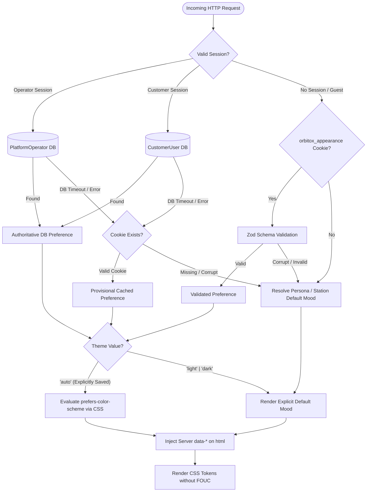

# 🪐 OrbitoX Phase 7B.2 — Token Engine & Appearance Ownership Architecture

**Specification ID:** `ARCH-7B2-02-TOKENS`  
**Phase:** Phase 7B.2 — Theme Tokens & Persona Shell Architecture  
**Document Status:** Approved Architecture Contract  
**Governing Documents:** `PHASE7_UI_MASTER_BRIEF.md`, `docs/ui-reset/02_DESIGN_SYSTEM_MIGRATION.md`  
**Accepted Baseline:** `f65698eab17b3a40842360eaeb387c74dca57ecc`  
**Author:** Principal Frontend & Platform Architect  
**Date:** November 17, 2026 (Revised Blueprint)  

---

## 1. Architectural Mission & Principles

OrbitoX Platform requires a single, unified design-token and appearance engine across all user personas and application shells. The platform must never degrade into fragmented styling systems or competing client-side theme writers.

### Core Architectural Principles:
1. **Server-Authoritative Resolution:** Appearance attributes (`data-theme`, `data-accent`, `data-density`, `data-radius`, `data-motion`, `data-focus`, `data-sidebar`) are evaluated on the server and injected directly onto `<html>` before first byte transmission. No flash of unstyled content (FOUC) and zero custom theme-bootstrap inline scripts.
2. **Strict Package Layering (No Inverted Dependencies):** The shared UI package (`@orbitox-io/ui`) owns presentation and user interaction via controlled props; it **never imports or depends on application-level persistence singletons**.
3. **Single Application Persistence Ownership:** Persistence is owned entirely by `apps/platform` via `AppearancePersistenceController`, dispatching serialized writes to `PUT /api/v1/platform/me/appearance` (operators) or `PUT /api/v1/customer/me/appearance` (customers). All ad-hoc cookie writers (such as `theme-script.ts`) are deprecated.
4. **Strict Tenant Branding Isolation:** Tenant custom branding (diner templates, brand colors, custom typography) is strictly scoped to tenant surfaces via `[data-tenant-theme]` and isolated from platform/operator chrome.
5. **WCAG 2.2 AA Mathematical Compliance:** Every accent preset across both light and dark moods must satisfy strict 4.5:1 text and 3:1 UI component contrast ratios calculated with true sRGB linearization against actual surface and canvas tokens.

---

## 2. Appearance Precedence, Persona Defaults & Server Resolution

The appearance resolution pipeline strictly separates four orthogonal concerns:
1. **Preference Source:** Identifies where stored user intent originates.
2. **Preference Validation:** Enforces strict Zod schema constraints on untrusted input.
3. **Persona & Station Context:** Determines the normative default mood when no preference is saved.
4. **Effective Mode Resolution:** Evaluates final visual presentation (`light` vs `dark`) when `theme: 'auto'` is explicitly selected.



### 2.1 Persona & Station Identification in RootLayout (Commit 1 Architecture)
To eliminate any ambiguity between the universal service constant `DEFAULT_APPEARANCE = { theme: 'auto' }` and persona requirements:

1. **How the Server Identifies Persona & Station:**
   - **Session Context:** Presence of `OPERATOR_SESSION_COOKIE` designates Operator context; `CUSTOMER_SESSION_COOKIE` designates Customer context.
   - **Trusted Route-Persona Resolution via Middleware (Next.js App Router Invariant):**
     Because Next.js App Router `RootLayout` does not receive `pathname` as a component prop, route-class resolution is executed via a trusted server header mechanism:
     1. **Header Stripping (Anti-Spoofing):** In `apps/platform/src/middleware.ts`, incoming requests have any client-supplied `x-orbito-route-persona` or `x-orbito-station` headers explicitly stripped from the request header map.
     2. **Route Classification:** `middleware.ts` inspects `request.nextUrl.pathname` and sets the trusted internal header `x-orbito-route-persona`:
        - `/console/*` $\to$ `operator`
        - `/owner/*`, `/restaurants/*` $\to$ `owner`
        - `/workspace/*`, `/customer/*` $\to$ `customer`
        - `/pos/*` $\to$ `staff_pos`
        - `/kds/*`, `/kitchen/*`, `/host/*`, `/waiter/*`, `/staff/*` $\to$ `staff_operational`
        - `/login`, `/signup`, `/auth/*`, diner `/menu/*` $\to$ `public`
        - Unknown / unmapped routes $\to$ `public` (deterministic safe fallback)
     3. **Forwarding to RootLayout:** `middleware.ts` forwards the request with `requestHeaders` set.
     4. **RootLayout Ingestion:** `RootLayout` (`apps/platform/src/app/layout.tsx`) calls `const headersList = await headers(); const routePersona = headersList.get('x-orbito-route-persona') ?? 'public';`.
     5. **Bypass / Unreachable Middleware Fallback:** If headers are unavailable or middleware is bypassed in isolated unit tests, `RootLayout` deterministically defaults to `public` (Light mood `#EEF1F5`).
   - **Station Terminal Context & Security Invariant (`orbitox_station`):**
     - On shared physical terminals (e.g. iPad Pro in KDS or POS mount), station display layout is determined by the `orbitox_station` cookie (e.g. `station=pos` vs `station=kds` vs `station=host`).
     - **Security Invariant:** The `orbitox_station` cookie is strictly an **aesthetic display hint**. It **never grants authorization or bypasses RBAC permissions**. All backend API routes and mutative mutations require valid authenticated staff session credentials / JWT tokens verifying terminal authorization.

2. **Distinguishing Unset Preference from Explicitly Saved `theme: 'auto'`:**
   - In database models (`PlatformOperator` and `CustomerUser`), `appearanceTheme` is nullable (`String?`).
   - **If `appearanceTheme === null` (Unset / First-Time Visit):**
     The server does **not** fall back to `theme: 'auto'`. A universal auto default would cause an operator on a light-mode OS to receive a light console, violating the core dark-mode requirement of `A1` and `C0`–`C6`.
     Instead, the server applies the **Persona-Specific Explicit Default Mood**:
     - **Platform Operator (`/console/*`):** Explicitly `dark` (`#0D0F12`, compact density 0.65x).
     - **Staff Operational (`/staff/*`, KDS, Host Stand, Waiter):** Explicitly `dark` (`#0D0F12`, standard density 1.0x) (matches `S1`, `D9`, `D4`, `D5`).
     - **Staff Operational POS Counter (`/pos`):** Explicit Station Override to `light` (`#EEF1F5`, standard density 1.0x) (matches `S2`).
     - **Public & Auth (`/login`, `/signup`, `/auth/*`, diner `/menu`):** Explicitly `light` (`#EEF1F5`, standard density 1.0x) (matches `F1`–`F5`, `A4`).
     - **Customer Workspace (`/workspace/*`, `/customer/*`):** Explicitly `light` (`#EEF1F5`, standard density 1.0x) (matches `A2`, `U1`).
     - **Product Owner Workspace (`/owner/*`, `/restaurants/*`):** Explicitly `light` (`#EEF1F5`, standard density 1.0x) (matches `R1`–`R6`).
   - **If `appearanceTheme === 'auto'` (Explicitly Saved User Preference):**
     The user explicitly navigated to Appearance Settings and chose "Auto (Match System)". In this state, the server renders `data-theme="auto"`, allowing `@media (prefers-color-scheme)` to dynamically select semantic tokens.
   - **If `appearanceTheme === 'light'` or `'dark'` (Explicitly Saved Fixed Preference):**
     Fixed server rendering supersedes OS color schemes.

3. **Database Outage Degradation Contracts & Schema Validation:**
   - The client cookie `orbitox_appearance` is serialized as URL-encoded JSON and validated against the Zod schema (`AppearancePreferenceSchema`).
   - **Case A (DB Timeout + Schema-Valid Cached Cookie):** If Prisma is unreachable but `orbitox_appearance` contains a schema-valid JSON payload, the server applies the cached preference provisionally with a `x-orbito-appearance-source: provisional-cache` header. It **never writes back** or overwrites DB state while offline.
   - **Case B (DB Timeout + Missing/Corrupt Cookie):** If Prisma is unreachable and no schema-valid cookie exists, the server immediately applies the route-based persona default mood without throwing a 500 error.

---

## 3. Server Resolution & Controlled UI Package Layering

### 3.1 Strict Package Boundaries (Correction R6-A)
- **`@orbitox-io/ui`:** Defines presentation interfaces and controlled props:
  ```typescript
  export interface AppearanceControlProps {
    theme?: 'auto' | 'light' | 'dark';
    onThemeChange?: (theme: 'auto' | 'light' | 'dark') => void;
    accent?: string;
    onAccentChange?: (accent: string) => void;
    appearanceSlot?: React.ReactNode;
  }
  ```
- **`apps/platform`:** Provides the persistence implementation and binds the single-writer queue (`AppearancePersistenceController`). The UI package has zero knowledge of Prisma, API endpoints, or database tables.

---

## 4. Tenant Branding Isolation Contract

1. **Scoped to Canvas Surfaces:** Tenant custom branding (`--tenant-brand-primary`, `--tenant-brand-surface`) is attached exclusively to `[data-tenant-theme]` containers (e.g. diner ordering portals, white-label client views).
2. **Platform Chrome Immutability:** The Operator Console (`/console/*`), platform settings, and administrative navigation never inherit from `[data-tenant-theme]`.
3. **No Freeform CSS Injection:** Tenant appearance configuration accepts strictly validated hexadecimal strings and typography keys; arbitrary CSS, `@import`, `url()`, or script payloads are rejected by Zod.
4. **Contrast Safety Gate:** Tenant brand colors submitted via API must pass algorithmic contrast validation ($\ge 4.5:1$ against the tenant canvas background). If contrast fails, the system automatically selects an accessible dark/light text foreground.
5. **Multi-Tenant Session Switching:** Switching active tenants or branches in the shell swaps the `data-tenant-theme` attributes on the workspace canvas without reloading or polluting global `:root`.

---

## 5. Token Audit, CSS Cascade Fix & Computed Contrast Verification (WCAG 2.2 AA)

### 5.1 CSS Cascade Flaw Identified in `semantic.css` (Correction TOK-A)
In current `packages/ui/src/tokens/semantic.css`:
- Line 25–80 declares accent rules: `[data-accent="emerald"] { --color-accent: #047857; ... }`.
- Line 145 declares the general light theme: `[data-theme="light"] { --color-accent: #2F5BD8; ... }`.
- **The Cascade Defect:** When `<html data-theme="light" data-accent="emerald">` is evaluated, both selectors match with identical specificity `[attr]` (0, 1, 0). Because `[data-theme="light"]` appears later in declaration order, **it silently clobbers `--color-accent` back to Ocean (`#2F5BD8`) for all non-Ocean presets in light mode**.
- **Stage 1 Remediation Invariant:** Base theme variables (`[data-theme="light"]`, `[data-theme="dark"]`) must be declared **before** accent preset rules, or accent rules must use qualified compound selectors:
  ```css
  /* Remediation: Qualified compound selectors prevent cascade clobbering */
  [data-theme="light"][data-accent="emerald"],
  [data-theme="light"] [data-accent="emerald"] {
    --color-accent: #047857;
    --color-accent-fg: #FFFFFF;
    --color-accent-hover: #065F46;
  }
  ```

---

### 5.2 Mathematical WCAG 2.2 Formula & Relative Luminance

All contrast calculations strictly apply the W3C WCAG 2.2 sRGB channel linearization:

$$c_{\text{linear}} = \begin{cases} \frac{c}{12.92} & \text{if } c \le 0.04045 \\ \left(\frac{c + 0.055}{1.055}\right)^{2.4} & \text{if } c > 0.04045 \end{cases}$$

Relative luminance:
$$L = 0.2126 \cdot R_{\text{linear}} + 0.7152 \cdot G_{\text{linear}} + 0.0722 \cdot B_{\text{linear}}$$

Contrast ratio:
$$\text{Contrast Ratio} = \frac{L_1 + 0.05}{L_2 + 0.05} \quad (L_1 \ge L_2)$$

### 5.3 Authoritative Token Color Palette & Background Luminances
From `PHASE7_UI_MASTER_BRIEF.md` and `semantic.css`:
- **Dark Canvas (`#0D0F12`):** Relative Luminance = $0.00471$
- **Dark Surface (`#14171C`):** Relative Luminance = $0.00845$ *(corrected from `#14161A`, which is near-black pill)*
- **Dark Body Text (`#F2F4F7`):** Relative Luminance = $0.93290$
- **Light Canvas Start (`#EEF1F5`):** Relative Luminance = $0.87680$
- **Light Canvas Gradient End (`#E3E7EE`):** Relative Luminance = $0.79656$
- **Light Surface (`#FFFFFF`):** Relative Luminance = $1.00000$
- **Light Body Text (`#14161A`):** Relative Luminance = $0.00760$

---

### 5.4 Computed Contrast Matrix Across All Canvases & Surfaces

| Accent Preset | Effective Hex (Dark / Light) | Button Text CR (`--color-accent-fg` on Accent) | Dark Canvas CR (`#0D0F12`) | Dark Surface CR (`#14171C`) | Light Start CR (`#EEF1F5`) | Light End CR (`#E3E7EE`) | Light Surface CR (`#FFFFFF`) | WCAG 2.2 AA Compliance Summary |
| :--- | :---: | :---: | :---: | :---: | :---: | :---: | :---: | :--- |
| **Ocean (Brief #3D6EF5)** | `#3D6EF5` / `#2F5BD8` | 4.42:1 (`#FFF`) / **5.82:1** | 4.34:1 | 4.06:1 | **5.14:1** | **4.69:1** | **5.82:1** | Fails 4.5:1 text on dark button (requires bold $\ge$14px or `#3A6BF5`). |
| **Ocean (Calib #3A6BF5)** | `#3A6BF5` / `#2F5BD8` | **4.56:1** / **5.82:1** (`#FFF`) | 4.21:1 | 3.94:1 | **5.14:1** | **4.69:1** | **5.82:1** | **PASS** (AA Body & Button in both moods). |
| **Emerald** | `#047857` / `#047857` | **5.48:1** / **5.48:1** (`#FFF`) | 3.50:1 | 3.28:1 | **4.84:1** | **4.42:1** | **5.48:1** | **PASS** (AA Body & Button in both moods). |
| **Sunflower (Standard)** | `#F59E0B` / `#F59E0B` | **8.94:1** (`#0D0F12`) | **8.94:1** | **8.36:1** | 1.90:1 *(FAIL)* | 1.73:1 *(FAIL)* | 2.15:1 *(FAIL)* | **PASS for Filled Buttons with Dark Text**. Fails non-text UI on light canvas. |
| **Sunflower (Safe Non-Text)** | `#B45309` / `#B45309` | **5.02:1** (`#FFF`) | 3.82:1 | 3.58:1 | **4.43:1** | **4.05:1** | **5.02:1** | **PASS** for light-mode icons, focus rings, and borders ($\ge 3:1$). |
| **Saffron** | `#C2410C` / `#C2410C` | **5.18:1** / **5.18:1** (`#FFF`) | 3.71:1 | 3.47:1 | **4.57:1** | **4.18:1** | **5.18:1** | **PASS** (AA Body & Button in both moods). |
| **Ruby** | `#E11D48` / `#BE123C` | **4.70:1** / **6.29:1** (`#FFF`) | 4.09:1 | 3.82:1 | **5.55:1** | **5.07:1** | **6.29:1** | **PASS** (AA Body & Button in both moods). |
| **Coral** | `#D9381E` / `#D9381E` | **4.63:1** / **4.63:1** (`#FFF`) | 4.14:1 | 3.88:1 | 4.09:1 | 3.73:1 | 4.63:1 | **PASS** (AA Button & Large UI $\ge 3:1$). |
| **Violet** | `#7C3AED` / `#6D28D9` | **5.70:1** / **7.10:1** (`#FFF`) | 3.37:1 | 3.15:1 | **6.27:1** | **5.73:1** | **7.10:1** | **PASS** (AA Body & Button in both moods). |
| **Teal** | `#0F766E` / `#0F766E` | **5.47:1** / **5.47:1** (`#FFF`) | 3.51:1 | 3.28:1 | **4.83:1** | **4.41:1** | **5.47:1** | **PASS** (AA Body & Button in both moods). |

### 5.5 Critical Contrast Governance Decisions
1. **Sunflower Light-Mode Governance:**  
   Because `#F59E0B` achieves only 1.90:1 against `#EEF1F5` and 1.73:1 against `#E3E7EE`, it **must never be used as an unframed icon, border, focus ring, or text link in light mode**. In light mode, Sunflower is restricted to solid filled buttons (where dark text `#0D0F12` achieves 8.94:1). Non-text controls and focus rings in Sunflower light mode automatically resolve to `--color-accent-contrast-safe: #B45309` (Amber 700), achieving $\ge 4.0:1$ across all light surfaces.
2. **Ocean Dark Button Calibration:**  
   Brief `#3D6EF5` yields 4.42:1 with white text (slightly under 4.5:1). Calibrated `#3A6BF5` yields 4.56:1 ($\ge 4.5:1$). The Stage 1 proposal adopts `#3A6BF5` for dark Ocean buttons to ensure rigorous WCAG 2.2 AA compliance for normal body copy.

---

## 6. Deprecation of Legacy Theme Writers

1. **`theme-script.ts`:**
   - Functions `setTheme()` and `toggleTheme()` write to obsolete `orbitox-theme` cookies and directly mutate the DOM.
   - **Deprecation Status:** Marked `@deprecated`. Modern shells replace all calls to `toggleTheme()` with controlled callbacks to `AppearancePersistenceController`.
2. **`ThemeProvider` in `providers.tsx`:**
   - `packages/ui/src/legacy/components/theme-provider.tsx` mutates `document.documentElement` from `localStorage` on client mount.
   - **Deprecation Status:** Removed from platform root `providers.tsx` and isolated to legacy `(dashboard)/layout.tsx`.
