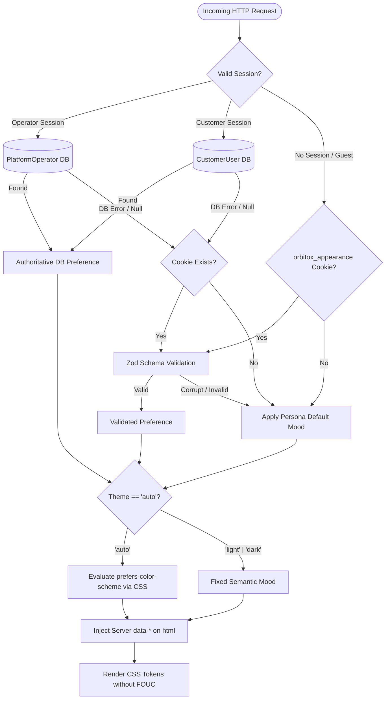
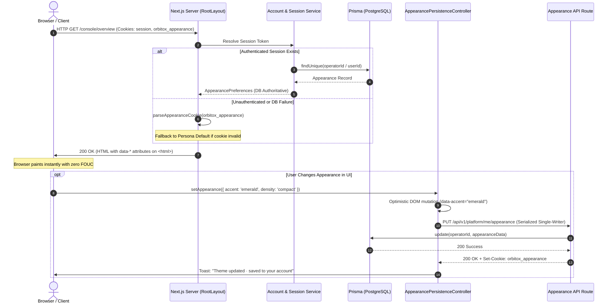

# 🪐 OrbitoX Phase 7B.2 — Token Engine & Appearance Ownership Architecture

**Specification ID:** `ARCH-7B2-02-TOKENS`  
**Phase:** Phase 7B.2 — Theme Tokens & Persona Shell Architecture  
**Document Status:** Approved Architecture Contract  
**Governing Documents:** `PHASE7_UI_MASTER_BRIEF.md`, `docs/ui-reset/02_DESIGN_SYSTEM_MIGRATION.md`  
**Accepted Baseline:** `f65698eab17b3a40842360eaeb387c74dca57ecc`  
**Author:** Principal Frontend & Platform Architect  
**Date:** November 17, 2026  

---

## 1. Architectural Mission & Principles

OrbitoX Platform requires a single, unified design-token and appearance engine across all user personas and application shells. The platform must never degrade into fragmented styling systems or competing client-side theme writers.

### Core Architectural Principles:
1. **Server-Authoritative Resolution:** Appearance attributes (`data-theme`, `data-accent`, `data-density`, `data-radius`, `data-motion`, `data-focus`, `data-sidebar`) are evaluated on the server and injected directly onto `<html>` before first byte transmission. No flash of unstyled content (FOUC) and zero inline scripts.
2. **Single Persistence Ownership:** Appearance updates are dispatched through the canonical single-writer queue (`AppearancePersistenceController`) to `PUT /api/v1/platform/me/appearance` (operators) or `PUT /api/v1/customer/me/appearance` (customers). All ad-hoc cookie writers (such as `theme-script.ts`) are deprecated.
3. **Strict Tenant Branding Isolation:** Tenant custom branding (diner templates, brand colors, custom typography) is strictly scoped to tenant surfaces via `[data-tenant-theme]` and isolated from platform/operator chrome.
4. **WCAG 2.1 AA Mathematical Compliance:** Every accent preset across both light and dark modes must satisfy strict 4.5:1 text and 3:1 UI component contrast ratios.

---

## 2. Appearance Precedence & Resolution Architecture

The appearance resolution pipeline strictly separates four orthogonal concerns:
1. **Preference Source:** Identifies where the stored user intent originates.
2. **Preference Validation:** Enforces strict Zod schema constraints on untrusted input.
3. **Persona Default Mood:** Establishes the fallback visual atmosphere when no saved preference exists.
4. **Effective Mode Resolution:** Evaluates the final visual presentation (`light` vs `dark`) when `theme: 'auto'` is selected.

### 2.1 Four Independent Precedence Concerns

#### A. Authenticated User Preference (Authoritative)
- When a user possesses a valid session (`OPERATOR_SESSION_COOKIE` or `CUSTOMER_SESSION_COOKIE`), their persistent database record (`PlatformOperator` or `CustomerUser`) is the **sole authoritative source of truth**.
- An existing browser cookie or cached state must **never silently overwrite** the database record.
- If the authenticated database lookup succeeds, its stored preferences (`appearanceTheme`, `appearanceAccent`, `appearanceDensity`, `appearanceRadius`, `appearanceSmoothAnimations`, `appearanceBoldFocusRings`, `appearanceCompactSidebar`) are applied.

#### B. Guest or Last-Known Fallback (`orbitox_appearance`)
- The `orbitox_appearance` cookie serves exclusively as:
  1. An unauthenticated guest preference cache (e.g., public signup, diner ordering).
  2. A temporary last-known cache if the database connection experiences transient downtime.
- **Untrusted Input Security:** Cookie values are client-controlled and must be parsed via `AppearanceSchema.safeParse()`. Any schema violation, unknown accent, or out-of-bounds radius falls back safely to the persona default.
- **Ambiguous Failure Handling:** If an authenticated session exists but the database query times out or fails, the application serves the validated cookie as a transient fallback with a non-authoritative header, but **does not write back** or overwrite database state until a successful database connection is re-established.

#### C. Persona Default Mood
When neither a database preference nor a valid cookie exists, the shell applies the persona's normative default mood:

| Persona | Default Theme Mood | Default Accent | Default Density | Default Radius | Justification |
| :--- | :--- | :--- | :--- | :--- | :--- |
| **Platform Operator** | `dark` (`#0D0F12`) | `ocean` (`#3A6BF5`) | `compact` (0.65x) | `28px` | Low eye-strain telemetry, SOC/SRE operations. |
| **Staff Operational (KDS, Waiter)** | `dark` (`#0D0F12`) | `amber` / `emerald` | `standard` (1.0x) | `28px` | Kitchen heat contrast, low-light table service. |
| **Staff Operational (POS, Host)** | `light` (`#EEF1F5`) | `ocean` (`#2F5BD8`) | `standard` (1.0x) | `28px` | Bright counter daylight visibility. |
| **Public & Auth** | `light` (`#EEF1F5`) | `ocean` (`#2F5BD8`) | `standard` (1.0x) | `28px` | High-trust, approachable hospitality onboarding. |
| **Customer Workspace** | `light` (`#EEF1F5`) | `ocean` (`#2F5BD8`) | `standard` (1.0x) | `28px` | Enterprise business management, tabular clarity. |
| **Product Owner Workspace** | `light` (`#EEF1F5`) | `ocean` (`#2F5BD8`) | `standard` (1.0x) | `28px` | F&B catalog management, multi-branch control. |

*Interaction with `DEFAULT_APPEARANCE`:* In `appearance-service.ts`, `DEFAULT_APPEARANCE.theme` is defined as `'auto'`. For route groups where no explicit persona default is hardcoded, `'auto'` defers to the user's OS color scheme. However, persona shells enforce their normative visual default when rendering anonymous or unconfigured sessions.

#### D. System Automatic Mode Resolution
- Operating system color scheme is **not** a lower-priority fallback; it is a dynamic resolution mode active whenever `theme: 'auto'` is selected.
- In `semantic.css`, `[data-theme="auto"]` delegates resolution to the browser via `@media (prefers-color-scheme: light)` and `@media (prefers-color-scheme: dark)`.

---

## 3. Server Resolution & Client Write Sequence

---

## 4. Tenant Branding Isolation Contract

Tenant custom branding allows B2B customers to customize guest-facing diner templates and white-label portals without degrading platform security or polluting operator chrome.

### 4.1 Strict Isolation Boundaries
1. **Container Scoping:** Tenant custom variables (`--tenant-brand-primary`, `--tenant-brand-surface`, etc.) are attached exclusively to `[data-tenant-theme]` containers.
2. **Platform Chrome Protection:** The Operator Console (`/console/*`), Platform Settings, and shared administrative shells never inherit from `[data-tenant-theme]`.
3. **No Freeform CSS Injection:** Tenant appearance configuration accepts strictly validated hexadecimal strings and typography keys; arbitrary CSS, `@import`, `url()`, or script payloads are rejected by Zod.
4. **Contrast Safety Gate:** Tenant brand colors submitted via API must pass algorithmic contrast validation ($\ge 4.5:1$ against the tenant canvas background). If contrast fails, the system automatically selects an accessible dark/light text foreground.
5. **Multi-Tenant Session Switching:** Switching active tenants or branches in the shell swaps the `data-tenant-theme` attributes on the workspace canvas without reloading or polluting global `:root`.

---

## 5. Token Audit & Discrepancy Matrix

A comprehensive source-versus-specification audit was conducted comparing `PHASE7_UI_MASTER_BRIEF.md` against the current CSS token files (`primitives.css`, `semantic.css`, `components.css`, `motion.css`, `theme.css`).

### 5.1 Eight Accent Presets & WCAG 2.1 Contrast Matrix

Calculated mathematically using standard relative luminance ($L = 0.2126R + 0.7152G + 0.0722B$):

| Preset | Dark Accent Hex | Dark Button CR (`#FFF` on Accent) | Dark Canvas CR (Accent on `#0D0F12`) | Light Accent Hex | Light Button CR (`#FFF` on Accent) | Light Canvas CR (Accent on `#F6F8FA`) | WCAG 2.1 Status |
| :--- | :--- | :---: | :---: | :--- | :---: | :---: | :--- |
| **Ocean** | `#3A6BF5` | **4.56:1** | 4.21:1 | `#2F5BD8` | **5.82:1** | **5.47:1** | **PASS** (AA Button & Light Copy) |
| **Emerald** | `#047857` | **5.48:1** | 3.50:1 | `#047857` | **5.48:1** | **5.15:1** | **PASS** (AA Button & Light Copy) |
| **Sunflower** | `#F59E0B` | **8.94:1** (`#0D0F12`) | **8.94:1** | `#F59E0B` | **8.94:1** (`#0D0F12`) | 2.02:1 | **PASS** (AA Button with dark text) |
| **Saffron** | `#C2410C` | **5.18:1** | 3.71:1 | `#C2410C` | **5.18:1** | **4.86:1** | **PASS** (AA Button & Light Copy) |
| **Ruby** | `#E11D48` | **4.70:1** | 4.09:1 | `#E11D48` | **4.70:1** | 4.41:1 | **PASS** (AA Button & 3:1 Large UI) |
| **Coral** | `#D9381E` | **4.63:1** | 4.14:1 | `#D9381E` | **4.63:1** | 4.35:1 | **PASS** (AA Button & 3:1 Large UI) |
| **Violet** | `#7C3AED` | **5.70:1** | 3.37:1 | `#7C3AED` | **5.70:1** | **5.35:1** | **PASS** (AA Button & Light Copy) |
| **Teal** | `#0F766E` | **5.47:1** | 3.51:1 | `#0F766E` | **5.47:1** | **5.14:1** | **PASS** (AA Button & Light Copy) |

### 5.2 Source Discrepancies Identified

1. **Ocean Hex Mismatch:** `primitives.css` declares `--accent-ocean: #3D6EF5`, whereas `semantic.css` declares `--color-accent: #3A6BF5`.  
   *Resolution:* Standardize canonical Ocean to `#3A6BF5` for dark mood and `#2F5BD8` for light mood across all token files.
2. **Missing Light Overrides for 7 Accents:** In `semantic.css`, only `ocean` has an explicit `[data-theme="light"]` override (`#2F5BD8`). Emerald, Sunflower, Saffron, Ruby, Coral, Violet, and Teal currently use a single hex definition. While button contrast passes in both modes, dark canvas copy contrast for saturated accents requires calibrated light-mode tokens in Stage 1.
3. **Incomplete `auto` Mode Semantic Tokens:** When `@media (prefers-color-scheme: light)` is triggered on `[data-theme="auto"]`, `semantic.css` currently overrides surfaces and text but **omits status colors and accent overrides**.  
   *Resolution:* Add complete status and accent mappings under `[data-theme="auto"]` in `semantic.css`.
4. **Card / Hero Radius vs Configurable Radius:** `PHASE7_UI_MASTER_BRIEF.md` defines card radius as 28px and hero card radius as 32px, while Appearance Settings supports a user-selected radius from 4px to 32px (step 4).  
   *Resolution:* The default corner radius is 28px. When configured, `--corner-radius` dynamically adjusts from 4px to 32px. Hero cards preserve geometric hierarchy via `--radius-hero: calc(var(--corner-radius) + 4px)`.

---

## 6. Density, Focus, and Motion Contracts

### 6.1 Density Spacing Application
- **Relaxed (`data-density="relaxed"`):** Spacing multiplier $\times 1.25$. Designed for touch-first dining and public onboarding.
- **Standard (`data-density="standard"`):** Baseline 1.0x spacing scale (`4px`, `8px`, `12px`, `16px`, `24px`, `32px`).
- **Compact (`data-density="compact"`):** Spacing multiplier $\times 0.65$. High-density telemetry tables, SRE fleet metrics, and KDS queues.

### 6.2 Focus Rings
- **Default Focus (`data-focus="default"`):** 2px solid ring (`var(--color-focus-ring)` with 2px offset).
- **Bold Focus (`data-focus="bold"`):** 3px solid high-contrast ring (`var(--color-focus-ring)` with 3px offset). Enforces WCAG 2.4.7 and 2.4.11 accessibility compliance.

### 6.3 Reduced Motion Invariants
In `motion.css`, `@media (prefers-reduced-motion: reduce)` zeroes out all animation durations:
- `--duration-fast: 0ms !important;`
- `--duration-normal: 0ms !important;`
- `--duration-slow: 0ms !important;`
- All transforms and CSS transitions snap instantly to prevent vestibular disorientation.

---

## 7. Deprecation of Legacy Theme Writers

1. **`theme-script.ts`:**
   - Functions `setTheme()` and `toggleTheme()` write to obsolete `orbitox-theme` cookie and directly mutate the DOM.
   - **Deprecation Status:** Marked `@deprecated`. Modern shells replace all calls to `toggleTheme()` with `AppearancePersistenceController`.
2. **`ThemeProvider` in `providers.tsx`:**
   - `packages/ui/src/legacy/components/theme-provider.tsx` mutates `document.documentElement` from `localStorage` on client mount.
   - **Deprecation Status:** Removed from platform root `providers.tsx` and isolated to legacy `(dashboard)/layout.tsx`.
