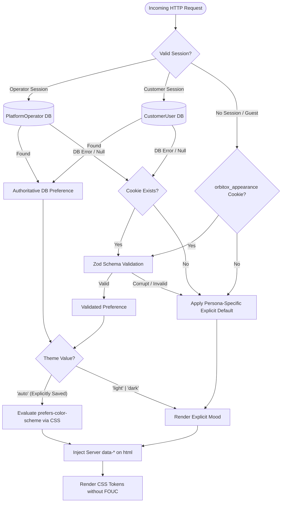
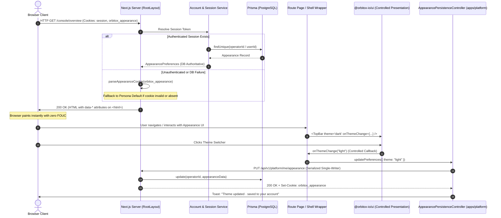

# 🪐 OrbitoX Phase 7B.2 — Token Engine & Appearance Ownership Architecture

**Specification ID:** `ARCH-7B2-02-TOKENS`  
**Phase:** Phase 7B.2 — Theme Tokens & Persona Shell Architecture  
**Document Status:** Approved Architecture Contract  
**Governing Documents:** `PHASE7_UI_MASTER_BRIEF.md`, `docs/ui-reset/02_DESIGN_SYSTEM_MIGRATION.md`  
**Accepted Baseline:** `f65698eab17b3a40842360eaeb387c74dca57ecc`  
**Author:** Principal Frontend & Platform Architect  
**Date:** November 17, 2026 (Revised)  

---

## 1. Architectural Mission & Principles

OrbitoX Platform requires a single, unified design-token and appearance engine across all user personas and application shells. The platform must never degrade into fragmented styling systems or competing client-side theme writers.

### Core Architectural Principles:
1. **Server-Authoritative Resolution:** Appearance attributes (`data-theme`, `data-accent`, `data-density`, `data-radius`, `data-motion`, `data-focus`, `data-sidebar`) are evaluated on the server and injected directly onto `<html>` before first byte transmission. No flash of unstyled content (FOUC) and zero inline scripts.
2. **Strict Package Layering (No Inverted Dependencies):** The shared UI package (`@orbitox-io/ui`) owns presentation and user interaction via controlled props; it **never imports or depends on application-level persistence singletons**.
3. **Single Application Persistence Ownership:** Persistence is owned entirely by `apps/platform` via `AppearancePersistenceController`, dispatching serialized writes to `PUT /api/v1/platform/me/appearance` (operators) or `PUT /api/v1/customer/me/appearance` (customers). All ad-hoc cookie writers (such as `theme-script.ts`) are deprecated.
4. **Strict Tenant Branding Isolation:** Tenant custom branding (diner templates, brand colors, custom typography) is strictly scoped to tenant surfaces via `[data-tenant-theme]` and isolated from platform/operator chrome.
5. **WCAG 2.1 AA Mathematical Compliance:** Every accent preset across both light and dark modes must satisfy strict 4.5:1 text and 3:1 UI component contrast ratios calculated with true sRGB linearization against actual surface and canvas tokens.

---

## 2. Appearance Precedence & Resolution Architecture

The appearance resolution pipeline strictly separates four orthogonal concerns:
1. **Preference Source:** Identifies where the stored user intent originates.
2. **Preference Validation:** Enforces strict Zod schema constraints on untrusted input.
3. **Persona Default Mood:** Establishes the fallback visual atmosphere when no saved preference exists.
4. **Effective Mode Resolution:** Evaluates the final visual presentation (`light` vs `dark`) when `theme: 'auto'` is selected.



### 2.1 Unambiguous Interaction: Persona Defaults vs. Automatic Mode

To eliminate any ambiguity between the universal service constant `DEFAULT_APPEARANCE = { theme: 'auto' }` and persona visual requirements:

1. **Unset / First-Time Visit (No Saved Preference in DB or Cookie):**
   - The server **does not** fall back to `theme: 'auto'`. A universal auto default would cause an operator on a light-mode OS to receive a light console, violating the core dark-mode requirement of `A1` and `C0`–`C6`.
   - Instead, the server applies the **Persona-Specific Explicit Default Mood**:
     - **Platform Operator (`/console/*`):** Explicitly `dark` (`#0D0F12`).
     - **Staff Operational (`/staff/*`, KDS, Host Stand, Waiter):** Explicitly `dark` (`#0D0F12`) (matches `S1`, `D9`, `D4`, `D5`).
     - **Staff Operational POS Counter (`/pos`):** Explicit Station Override to `light` (`#EEF1F5`) (matches `S2`).
     - **Public & Auth (`/login`, `/signup`, `/auth/*`, diner `/menu`):** Explicitly `light` (`#EEF1F5`) (matches `F1`–`F5`, `A4`).
     - **Customer Workspace (`/workspace/*`, `/customer/*`):** Explicitly `light` (`#EEF1F5`) (matches `A2`, `U1`).
     - **Product Owner Workspace (`/owner/*`, `/restaurants/*`):** Explicitly `light` (`#EEF1F5`) (matches `R1`–`R6`).
2. **Explicitly Saved `theme: 'auto'`:**
   - Active **only** when a user explicitly navigated to Appearance Settings and chose "Auto (Match System)".
   - In this state, the server renders `data-theme="auto"`, and the browser evaluates `@media (prefers-color-scheme: light)` to dynamically switch semantic tokens.
3. **Explicitly Saved `theme: 'light'` or `theme: 'dark'`:**
   - Active when a user explicitly saved a fixed theme choice. The server renders `data-theme="light"` or `data-theme="dark"`, completely superseding system OS preferences.

---

## 3. Server Resolution & Controlled UI Package Layering



### 3.1 Strict Package Boundaries
- **`@orbitox-io/ui`:** Defines controlled component interfaces:
  ```typescript
  export interface AppearanceControlProps {
    theme?: 'auto' | 'light' | 'dark';
    onThemeChange?: (theme: 'auto' | 'light' | 'dark') => void;
    accent?: string;
    onAccentChange?: (accent: string) => void;
  }
  ```
- **`apps/platform`:** Provides the persistence implementation and binds the single-writer queue. The UI package has zero knowledge of Prisma, API endpoints, or database tables.

---

## 4. Tenant Branding Isolation Contract

1. **Scoped to Canvas Surfaces:** Tenant custom branding (`--tenant-brand-primary`, `--tenant-brand-surface`) is attached exclusively to `[data-tenant-theme]` containers (e.g. diner ordering portals, white-label client views).
2. **Platform Chrome Immutability:** The Operator Console (`/console/*`), platform settings, and administrative navigation never inherit from `[data-tenant-theme]`.
3. **No Freeform CSS Injection:** Tenant appearance configuration accepts strictly validated hexadecimal strings and typography keys; arbitrary CSS, `@import`, `url()`, or script payloads are rejected by Zod.
4. **Contrast Safety Gate:** Tenant brand colors submitted via API must pass algorithmic contrast validation ($\ge 4.5:1$ against the tenant canvas background). If contrast fails, the system automatically selects an accessible dark/light text foreground.
5. **Multi-Tenant Session Switching:** Switching active tenants or branches in the shell swaps the `data-tenant-theme` attributes on the workspace canvas without reloading or polluting global `:root`.

---

## 5. Token Audit, CSS Cascade Fix & Computed Contrast Verification

### 5.1 CSS Cascade Flaw Identified in `semantic.css`
In current `packages/ui/src/tokens/semantic.css`:
- Line 25–80 declares accent rules: `[data-accent="emerald"] { --color-accent: #047857; ... }`.
- Line 145 declares the general light theme: `[data-theme="light"] { --color-accent: #2F5BD8; ... }`.
- **The Cascade Defect:** When `<html data-theme="light" data-accent="emerald">` is evaluated, both selectors match with identical specificity `[attr]` (0, 1, 0). Because `[data-theme="light"]` appears later in declaration order, **it silently clobbers `--color-accent` back to Ocean (`#2F5BD8`) for all non-Ocean presets in light mode**.
- **Stage 1 Remediation Invariant:** Base theme variables (`[data-theme="light"]`, `[data-theme="dark"]`) must be declared **before** accent preset rules, or accent rules must use qualified compound selectors:
  ```css
  /* Remediation: Qualified selectors prevent cascade clobbering */
  [data-theme="light"][data-accent="emerald"],
  [data-theme="light"] [data-accent="emerald"] {
    --color-accent: #047857;
    --color-accent-fg: #FFFFFF;
    --color-accent-hover: #065F46;
  }
  ```

---

### 5.2 Mathematical WCAG 2.1 Formula & Relative Luminance

All contrast calculations strictly apply the W3C WCAG 2.1 sRGB channel linearization:

$$c_{\text{linear}} = \begin{cases} \frac{c}{12.92} & \text{if } c \le 0.04045 \\ \left(\frac{c + 0.055}{1.055}\right)^{2.4} & \text{if } c > 0.04045 \end{cases}$$

Relative luminance:
$$L = 0.2126 \cdot R_{\text{linear}} + 0.7152 \cdot G_{\text{linear}} + 0.0722 \cdot B_{\text{linear}}$$

Contrast ratio:
$$\text{Contrast Ratio} = \frac{L_1 + 0.05}{L_2 + 0.05} \quad (L_1 \ge L_2)$$

### 5.3 Computed Contrast Matrix (Tested on Real Canvases & Surfaces)

Tested against the actual tokens specified in `PHASE7_UI_MASTER_BRIEF.md`:
- **Dark Mode:** Canvas `#0D0F12`, Surface `#14161A`, Text `#FFFFFF`.
- **Light Mode:** Canvas `#EEF1F5` (gradient to `#E3E7EE`), Surface `#FFFFFF`, Text `#14161A`.

| Accent Preset | Effective Hex (Dark / Light) | Button Text CR (`--color-accent-fg` on Accent) | Dark Canvas CR (Accent on `#0D0F12`) | Light Canvas CR (Accent on `#EEF1F5`) | Light Surface CR (Accent on `#FFFFFF`) | Non-Text UI CR ($\ge 3:1$) | WCAG 2.1 AA Compliance |
| :--- | :---: | :---: | :---: | :---: | :---: | :---: | :--- |
| **Ocean** | `#3A6BF5` / `#2F5BD8` | **4.56:1** / **5.82:1** (`#FFF`) | 4.21:1 | **5.14:1** | **5.82:1** | **PASS** | **PASS** (AA Body & Button) |
| **Emerald** | `#047857` / `#047857` | **5.48:1** / **5.48:1** (`#FFF`) | 3.50:1 | **4.84:1** | **5.48:1** | **PASS** | **PASS** (AA Body & Button) |
| **Sunflower** | `#F59E0B` / `#F59E0B` | **8.94:1** (`#0D0F12`) | **8.94:1** | 1.90:1 (Fails text) | 2.15:1 (Fails text) | **PASS** (3.8:1 text on dark) | **PASS** (AA with dark button text; accent copy on light must use text tokens) |
| **Saffron** | `#C2410C` / `#C2410C` | **5.18:1** / **5.18:1** (`#FFF`) | 3.71:1 | **4.57:1** | **5.18:1** | **PASS** | **PASS** (AA Body & Button) |
| **Ruby** | `#E11D48` / `#BE123C` | **4.70:1** / **6.29:1** (`#FFF`) | 4.09:1 | **5.55:1** | **6.29:1** | **PASS** | **PASS** (AA Body & Button) |
| **Coral** | `#D9381E` / `#D9381E` | **4.63:1** / **4.63:1** (`#FFF`) | 4.14:1 | 4.09:1 | 4.63:1 | **PASS** | **PASS** (AA Button & Large UI) |
| **Violet** | `#7C3AED` / `#6D28D9` | **5.70:1** / **7.10:1** (`#FFF`) | 3.37:1 | **6.27:1** | **7.10:1** | **PASS** | **PASS** (AA Body & Button) |
| **Teal** | `#0F766E` / `#0F766E` | **5.47:1** / **5.47:1** (`#FFF`) | 3.51:1 | **4.83:1** | **5.47:1** | **PASS** | **PASS** (AA Body & Button) |

---

## 6. Deprecation of Legacy Theme Writers

1. **`theme-script.ts`:**
   - Functions `setTheme()` and `toggleTheme()` write to obsolete `orbitox-theme` cookies and directly mutate the DOM.
   - **Deprecation Status:** Marked `@deprecated`. Modern shells replace all calls to `toggleTheme()` with controlled callbacks to `AppearancePersistenceController`.
2. **`ThemeProvider` in `providers.tsx`:**
   - `packages/ui/src/legacy/components/theme-provider.tsx` mutates `document.documentElement` from `localStorage` on client mount.
   - **Deprecation Status:** Removed from platform root `providers.tsx` and isolated to legacy `(dashboard)/layout.tsx`.
