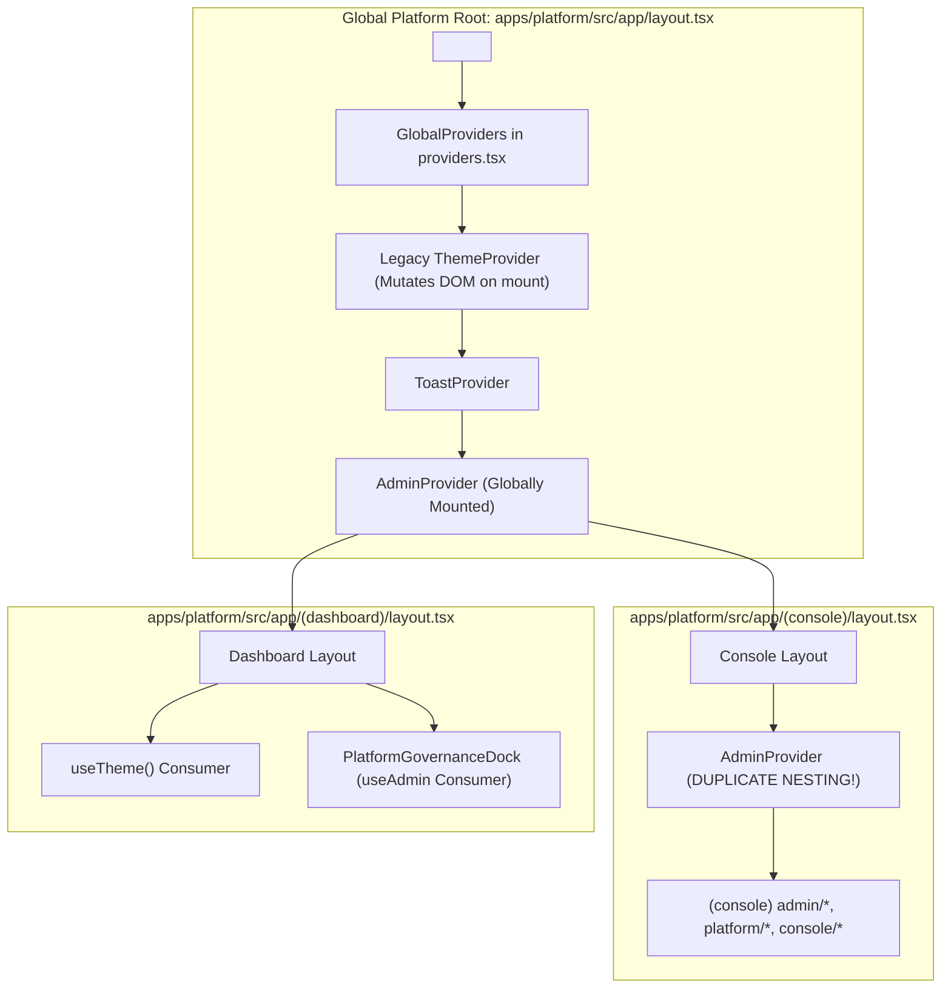

# 🪐 OrbitoX Phase 7B.2 — Provider Topology & Legacy Migration Architecture

**Specification ID:** `ARCH-7B2-03-PROVIDERS`  
**Phase:** Phase 7B.2 — Theme Tokens & Persona Shell Architecture  
**Document Status:** Approved Architecture Contract  
**Governing Documents:** `PHASE7_UI_MASTER_BRIEF.md`, `docs/ui-reset/01_UI_FILE_DISPOSITION_LEDGER.md`  
**Accepted Baseline:** `f65698eab17b3a40842360eaeb387c74dca57ecc`  
**Author:** Principal Frontend & Platform Architect  
**Date:** November 17, 2026 (Revised Blueprint)  

---

## 1. Executive Summary & Migration Invariants

The goal of Phase 7B.2 provider refactoring is to eliminate conflicting client-side theme writers and nested duplicate providers from the global root layout, while guaranteeing **100% backward compatibility** for all active legacy screens until their planned Phase 7C–7F migrations.

### Non-Negotiable Invariants:
1. **Zero Premature Deletions:** No legacy component (`packages/ui/src/legacy/*`), stylesheet (`packages/ui/src/styles/theme.css`), or provider will be deleted during Phase 7B.2.
2. **Zero Route Breakage (Dashboard & HMS Dock Protected):** Existing dashboard routes (`(dashboard)/*`) and console administrative screens (`(console)/admin/*`) must continue to render correctly with full theme and quota state.
3. **HMS Dashboard Dock Context Preservation:** `PlatformGovernanceDock` calls `useAdmin()` from inside `(dashboard)/layout.tsx` when an HMS service is active. The legacy dashboard layout must provide both `ThemeProvider` and `AdminProvider`.
4. **No Global Client Theme Mutation:** The platform root layout must never mount a client component that mutates `document.documentElement` attributes from `localStorage` on mount.
5. **No Premature Shell Centralization at `(console)` Boundary:** `ConsoleShell` must **never be mounted at `(console)/layout.tsx`**, avoiding double-rendering over existing page-level wrappers and preventing shell bleeding onto legacy `/admin/*` routes.

---

## 2. Exhaustive Census of Legacy Consumers

A complete repository-wide audit was conducted across `apps/platform/src/` and `packages/ui/src/`:

### 2.1 `ThemeProvider` & `useTheme`
- **Definition:** `packages/ui/src/legacy/components/theme-provider.tsx` (Lines 256, 261).
- **Consumers:**
  1. `apps/platform/src/app/providers.tsx` (Line 9): Mounted globally around `{children}` with hardcoded `initialThemeId="cosmic-obsidian"`.
  2. `apps/platform/src/app/(dashboard)/layout.tsx` (Line 40, Line 202): Calls `useTheme()` to retrieve `currentTheme`, `allThemes`, `setThemeById` for the legacy sidebar theme picker.
- **Architectural Defect:** `ThemeProvider` executes an uncoordinated `useEffect` on client mount that reads `localStorage.getItem('orbitox-theme')` and forcibly overwrites `document.documentElement.setAttribute('data-theme', mode)`. This clobbers server-rendered appearance attributes and causes visible flash across modern `(console)` routes.

### 2.2 `AdminProvider` & `useAdmin` (Including Dashboard Dock Consumer)
- **Definition:** `apps/platform/src/app/(console)/admin/data/admin-context.tsx` (Line 322, Line 979).
- **Consumers:**
  1. `apps/platform/src/app/providers.tsx` (Line 11): Mounted globally in `GlobalProviders`.
  2. `apps/platform/src/app/(console)/layout.tsx` (Line 7): Mounted a second time inside the console route layout.
  3. `apps/platform/src/app/(dashboard)/layout.tsx` (Line 6, Line 189): Renders `<PlatformGovernanceDock serviceId={activeServiceId} />` when an HMS service is active!
  4. `apps/platform/src/app/components/platform-governance-dock.tsx` (Line 5, Line 33): Calls `useAdmin()` to read service quotas and provider statuses!
  5. `apps/platform/src/app/(console)/admin/*`:
     - `quotas/page.tsx`, `business/[category]/page.tsx`, `business/[category]/[providerId]/page.tsx`, `business/page.tsx`, `services/[serviceId]/page.tsx`, `services/page.tsx`
     - `components/service-card.tsx`, `components/provider-card.tsx`, `components/api-key-modal.tsx`, `components/onboard-provider-modal.tsx`
- **Architectural Defect & Migration Requirement:** If `AdminProvider` is removed from `GlobalProviders` without wrapping `(dashboard)/layout.tsx`, navigation to `/hms` or active service dashboards will crash with `Error: useAdmin must be used within an AdminProvider`. Therefore, `(dashboard)/layout.tsx` must mount `AdminProvider` locally alongside `ThemeProvider`.

### 2.3 Legacy `--ui-*` CSS Custom Properties
Exhaustive scan of files referencing `--ui-*` variables from `packages/ui/src/styles/theme.css`:
- **Console Platform Pages & Modules:**
  - `apps/platform/src/app/(console)/platform/settings/settings.module.css` & `page.tsx`
  - `apps/platform/src/app/(console)/platform/plans/plans.module.css`
  - `apps/platform/src/app/(console)/platform/restaurants/restaurants.module.css`, `[id]/page.tsx`, `page.tsx`
  - `apps/platform/src/app/(console)/platform/projects/[projectId]/project-detail.module.css` & `page.tsx`
  - `apps/platform/src/app/(console)/platform/overview.module.css`
  - `apps/platform/src/app/(console)/platform/tenants/new/wizard.module.css`, `new/page.tsx`, `page.tsx`
  - `apps/platform/src/app/(console)/platform/fleet/fleet.module.css`
  - `apps/platform/src/app/(console)/platform/connect/connect.module.css` & `page.tsx`
  - `apps/platform/src/app/(console)/admin/components/quota-bar.tsx`
  - `apps/platform/src/app/(console)/admin/services/[serviceId]/page.tsx`
- **Dashboard Legacy Layout:** `apps/platform/src/app/(dashboard)/layout.tsx`
- **Legacy UI Components:** `modern-tabs.tsx`, `studio-button.tsx`, `stat-metric-widget.tsx`, `glass-card.tsx`, `theme-provider.tsx`

---

## 3. Provider Topology: Before vs. Target Architecture

### 3.1 Current Architecture (Entangled & Globally Polluted)



### 3.2 Target Decoupled Architecture

```mermaid
graph TD
    subgraph ServerRoot [Global Platform Root: apps/platform/src/app/layout.tsx]
        ServerHTML["<html data-theme=... data-accent=... data-density=...>"]
        ServerHTML --> ServerBody[<body>]
        ServerBody --> CleanGP[GlobalProviders in providers.tsx]
        CleanGP --> SharedToast[ToastProvider Only]
        Note1[Zero Theme Writers at Root<br/>Zero Client LocalStorage Clashing<br/>Zero Global Admin Overhead]
    end

    SharedToast --> DecoupleBranch{Route Dispatch}

    subgraph LegacyAdminBoundary ["apps/platform/src/app/(console)/layout.tsx"]
        DecoupleBranch -- "/admin/*, /platform/*" --> LocalAdminNode["AdminProvider (Local Console/Admin Instance)"]
        LocalAdminNode --> AdminPages["Legacy Admin Quota & Platform Modules"]
    end

    subgraph LegacyDashboardBoundary ["apps/platform/src/app/(dashboard)/layout.tsx"]
        DecoupleBranch -- "/dashboard/*, /hms/*" --> LocalThemeWrapper["ThemeProvider (Local Legacy Wrapper)"]
        LocalThemeWrapper --> LocalAdminWrapper["AdminProvider (Local Dashboard Instance)"]
        LocalAdminWrapper --> DashThemeState["useTheme() Context Preserved"]
        LocalAdminWrapper --> DashDockState["PlatformGovernanceDock (useAdmin) Preserved"]
        DashThemeState --> LegacyDashboardUI["Legacy DynamicSidebar & HMS Dashboard UI"]
    end

    subgraph ModernConsoleBoundary ["apps/platform/src/app/(console)/console/"]
        DecoupleBranch -- "/console/*" --> ConsolePages["Modern Operator Pages (Page-Level Shell Facade)"]
        ConsolePages --> ModernShellAdapter["ConsoleShell Adapter over Modular Primitives"]
        ModernShellAdapter --> ModernTokens[Canonical Design Tokens]
        NoteBoundary[Do NOT mount at (console)/layout.tsx<br/>Prevents double-shells and leakage to /admin/*]
    end
```

---

## 4. Step-by-Step Safe Compatibility Plan

### 4.1 Step 1: Clean Root Providers (`apps/platform/src/app/providers.tsx`)
- Remove `ThemeProvider` and `AdminProvider` from `GlobalProviders`.
- Retain only `ToastProvider` at the application root:
```tsx
'use client';

import React from 'react';
import { ToastProvider } from '@orbitox-io/ui';

export function GlobalProviders({ children }: { children: React.ReactNode }) {
  return (
    <ToastProvider>
      {children}
    </ToastProvider>
  );
}
```

### 4.2 Step 2: Localize Legacy Theme & Admin Providers (`apps/platform/src/app/(dashboard)/layout.tsx`)
- In `(dashboard)/layout.tsx`, wrap the legacy layout with BOTH `ThemeProvider` AND `AdminProvider`:
```tsx
import { ThemeProvider } from '@orbitox-io/ui';
import { AdminProvider } from '../(console)/admin/data/admin-context';

export default function DashboardLayout({ children }: { children: React.ReactNode }) {
  return (
    <ThemeProvider initialThemeId="cosmic-obsidian">
      <AdminProvider>
        <DashboardInnerLayout>
          {children}
        </DashboardInnerLayout>
      </AdminProvider>
    </ThemeProvider>
  );
}
```
- This guarantees that:
  1. `useTheme()` inside `DashboardInnerLayout` finds its context.
  2. `PlatformGovernanceDock` (which calls `useAdmin()`) finds its context when HMS services are active.
  3. Zero context pollution leaks outside `(dashboard)`.

### 4.3 Step 3: Localize AdminProvider (`apps/platform/src/app/(console)/layout.tsx`) & Intentional Scope Invariant
- In Commit 2, `AdminProvider` scope will be audited against all consumers:
  - **Intentional Scope Evaluation:** If modern `/console/*` pages (`/console/appearance`, `/console/security`, `/console/billing`) do not consume `AdminContext`, `AdminProvider` will be narrowed down from `(console)/layout.tsx` directly into `apps/platform/src/app/(console)/admin/layout.tsx`. This guarantees zero mock administrative state leaks into modern operator pages.
  - If any modern `/console/*` pages temporarily reference `AdminContext` pending Phase 7C refactoring, `AdminProvider` remains at `(console)/layout.tsx` as an explicit, documented bridge with automated verification proving mock data does not override live operator settings.
- **Do not mount `ConsoleShell` in `(console)/layout.tsx`**.
- Keep modern `ConsoleShell` at the `/console` boundary, preserving existing page-level wrappers until their migration in Phase 7C.

### 4.4 Step 4: Semantic CSS Variable Bridging
In `packages/ui/src/styles/theme.css`, bridge legacy `--ui-*` variables to canonical semantic tokens:
```css
:root,
[data-theme] {
  --ui-bg-root: var(--color-bg);
  --ui-bg-card: var(--color-surface);
  --ui-bg-elevated: var(--color-surface-raised);
  --ui-border-default: var(--color-border);
  --ui-border-subtle: var(--color-border-subtle);
  --ui-text-primary: var(--color-text);
  --ui-text-secondary: var(--color-text-muted);
  --ui-text-muted: var(--color-text-subtle);
  --ui-accent-primary: var(--color-accent);
  --ui-accent-primary-hover: var(--color-accent-hover);
  --ui-success: var(--status-ready-fg);
  --ui-success-bg: var(--status-ready-bg);
  --ui-danger: var(--status-problem-fg);
  --ui-danger-bg: var(--status-problem-bg);
}
```

---

## 5. Consumer Retirement Roadmap

| Legacy Asset | Current Consumers | Target Migration Milestone | Deletion Prerequisite |
| :--- | :--- | :---: | :--- |
| `ThemeProvider` (`packages/ui`) | `(dashboard)/layout.tsx` | Phase 7D | Full replacement of `/` route with Customer Workspace Shell. |
| `useTheme()` hook | `(dashboard)/layout.tsx` | Phase 7D | Legacy dashboard sidebar retired. |
| `AdminProvider` in Dashboard | `PlatformGovernanceDock` in `(dashboard)` | Phase 7E | HospitalOS modernization replacing legacy governance dock. |
| `AdminProvider` in Console | `(console)/admin/*` | Phase 7C | Modernization of mock admin quota pages into real operator routes. |
| `packages/ui/src/styles/theme.css` | 17 console pages & 5 legacy components | Phase 7C & 7F | CSS module migration to canonical semantic tokens. |
| `theme-script.ts` (`toggleTheme`) | `AppShell` | Phase 7B.2 (Stage 1) | Replaced by controlled appearance props. |
