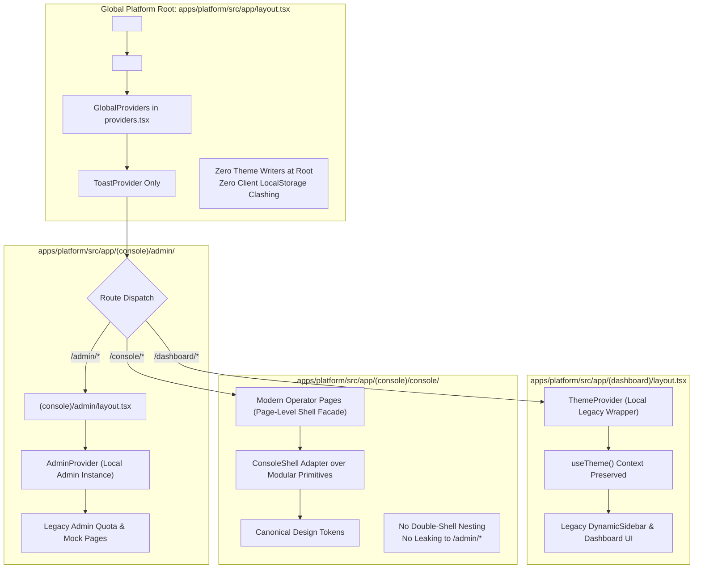

# 🪐 OrbitoX Phase 7B.2 — Provider Topology & Legacy Migration Architecture

**Specification ID:** `ARCH-7B2-03-PROVIDERS`  
**Phase:** Phase 7B.2 — Theme Tokens & Persona Shell Architecture  
**Document Status:** Approved Architecture Contract  
**Governing Documents:** `PHASE7_UI_MASTER_BRIEF.md`, `docs/ui-reset/01_UI_FILE_DISPOSITION_LEDGER.md`  
**Accepted Baseline:** `f65698eab17b3a40842360eaeb387c74dca57ecc`  
**Author:** Principal Frontend & Platform Architect  
**Date:** November 17, 2026 (Revised)  

---

## 1. Executive Summary & Migration Invariants

The goal of Phase 7B.2 provider refactoring is to eliminate conflicting client-side theme writers and nested duplicate providers from the global root layout, while guaranteeing **100% backward compatibility** for all active legacy screens until their planned Phase 7C–7F migrations.

### Non-Negotiable Invariants:
1. **Zero Premature Deletions:** No legacy component (`packages/ui/src/legacy/*`), stylesheet (`packages/ui/src/styles/theme.css`), or provider will be deleted during Phase 7B.2.
2. **Zero Route Breakage:** Existing dashboard routes (`(dashboard)/*`) and console administrative screens (`(console)/admin/*`) must continue to render correctly with full theme and quota state.
3. **No Global Client Theme Mutation:** The platform root layout must never mount a client component that mutates `document.documentElement` attributes from `localStorage` on mount.
4. **No Premature Shell Centralization at `(console)` Boundary:** `ConsoleShell` must **never be mounted at `(console)/layout.tsx`**, avoiding double-rendering over existing page-level wrappers and preventing shell bleeding onto legacy `/admin/*` routes.

---

## 2. Exhaustive Census of Legacy Consumers

A complete repository-wide audit was conducted across `apps/platform/src/` and `packages/ui/src/`:

### 2.1 `ThemeProvider` & `useTheme`
- **Definition:** `packages/ui/src/legacy/components/theme-provider.tsx` (Lines 256, 261).
- **Consumers:**
  1. `apps/platform/src/app/providers.tsx` (Line 9): Mounted globally around `{children}` with hardcoded `initialThemeId="cosmic-obsidian"`.
  2. `apps/platform/src/app/(dashboard)/layout.tsx` (Line 40, Line 202): Calls `useTheme()` to retrieve `currentTheme`, `allThemes`, `setThemeById` for the legacy sidebar theme picker.
- **Architectural Defect:** `ThemeProvider` executes an uncoordinated `useEffect` on client mount that reads `localStorage.getItem('orbitox-theme')` and forcibly overwrites `document.documentElement.setAttribute('data-theme', mode)`. This clobbers server-rendered appearance attributes and causes visible flash across modern `(console)` routes.

### 2.2 `AdminProvider` & `useAdmin`
- **Definition:** `apps/platform/src/app/(console)/admin/data/admin-context.tsx` (Line 322, Line 979).
- **Consumers:**
  1. `apps/platform/src/app/providers.tsx` (Line 11): Mounted globally in `GlobalProviders`.
  2. `apps/platform/src/app/(console)/layout.tsx` (Line 7): Mounted a second time inside the console route layout!
  3. `apps/platform/src/app/(console)/admin/*`:
     - `quotas/page.tsx`, `business/[category]/page.tsx`, `business/[category]/[providerId]/page.tsx`, `business/page.tsx`, `services/[serviceId]/page.tsx`, `services/page.tsx`
     - `components/service-card.tsx`, `components/provider-card.tsx`, `components/api-key-modal.tsx`, `components/onboard-provider-modal.tsx`
  4. `apps/platform/src/app/components/platform-governance-dock.tsx` (Line 5).
- **Architectural Defect:** Global mounting forces non-console routes (public landing, login, customer workspace) to needlessly instantiate administrative mock services, service quota reducers, and API key managers.

### 2.3 Legacy `--ui-*` CSS Custom Properties
Exhaustive scan of files referencing `--ui-*` variables from `packages/ui/src/styles/theme.css`:
- **Console Platform Pages & Modules:**
  - `apps/platform/src/app/(console)/platform/settings/settings.module.css` & `page.tsx`
  - `apps/platform/src/app/(console)/platform/plans/plans.module.css`
  - `apps/platform/src/app/(console)/platform/restaurants/restaurants.module.css`, `[id]/page.tsx`, `page.tsx`
  - `apps/platform/src/app/(console)/platform/projects/[projectId]/project-detail.module.css` & `page.tsx`
  - `apps/platform/src/app/(console)/platform/overview.module.css`
  - `apps/platform/src/app/(console)/platform/tenants/new/wizard.module.css`, `new/page.tsx`, `page.tsx`
  - `apps/platform/src/app/(console)/platform/fleet/fleet.module.css`
  - `apps/platform/src/app/(console)/platform/connect/connect.module.css` & `page.tsx`
  - `apps/platform/src/app/(console)/admin/components/quota-bar.tsx`
  - `apps/platform/src/app/(console)/admin/services/[serviceId]/page.tsx`
- **Dashboard Legacy Layout:** `apps/platform/src/app/(dashboard)/layout.tsx`
- **Legacy UI Components:** `modern-tabs.tsx`, `studio-button.tsx`, `stat-metric-widget.tsx`, `glass-card.tsx`, `theme-provider.tsx`

---

## 3. Provider Topology & Route Boundary Decoupling

### 3.1 The Route Boundary Trap: `(console)` vs `/console` (Correction R4-A)
The route group `apps/platform/src/app/(console)` contains three distinct sub-hierarchies:
1. `(console)/admin/*` (legacy mock admin pages using `AdminProvider`).
2. `(console)/platform/*` (legacy platform screens using `--ui-*` variables).
3. `(console)/console/*` (modern operator console pages: `overview`, `appearance`, `tenants`, `billing`).

Furthermore, modern console pages **already render `<ConsoleShell>` individually at the page level**:
- `apps/platform/src/app/(console)/console/overview/page.tsx` (Line 46): `<ConsoleShell activeId="overview">`
- `apps/platform/src/app/(console)/console/settings/appearance/page.tsx` (Line 46): `<ConsoleShell activeId="appearance">`

**Severe Risk of Centralizing into `(console)/layout.tsx`:**  
If `ConsoleShell` is mounted in `apps/platform/src/app/(console)/layout.tsx`, it will:
1. Forcibly wrap legacy `/admin/*` and `/platform/*` routes with the modern operator shell.
2. Result in **double/nested `ConsoleShell` rendering** on all modern routes (`<ConsoleShell><ConsoleShell>...</ConsoleShell></ConsoleShell>`).

### 3.2 Correct Architectural Boundary Mapping



---

## 4. Step-by-Step Safe Compatibility Plan

### 4.1 Step 1: Clean Root Providers (`apps/platform/src/app/providers.tsx`)
- Remove `ThemeProvider` and `AdminProvider` from `GlobalProviders`.
- Retain only `ToastProvider` at the application root:
```tsx
'use client';

import React from 'react';
import { ToastProvider } from '@orbitox-io/ui';

export function GlobalProviders({ children }: { children: React.ReactNode }) {
  return (
    <ToastProvider>
      {children}
    </ToastProvider>
  );
}
```

### 4.2 Step 2: Localize Legacy ThemeProvider (`apps/platform/src/app/(dashboard)/layout.tsx`)
- In `(dashboard)/layout.tsx`, wrap the legacy layout with `ThemeProvider`:
```tsx
export default function DashboardLayout({ children }: { children: React.ReactNode }) {
  return (
    <ThemeProvider initialThemeId="cosmic-obsidian">
      <DashboardInnerLayout>
        {children}
      </DashboardInnerLayout>
    </ThemeProvider>
  );
}
```

### 4.3 Step 3: Localize AdminProvider (`apps/platform/src/app/(console)/layout.tsx`)
- Keep `AdminProvider` in `apps/platform/src/app/(console)/layout.tsx` so legacy `admin/*` pages continue functioning without disruption.
- **Do not mount `ConsoleShell` in `(console)/layout.tsx`**.
- Keep modern `ConsoleShell` at the `/console` boundary, preserving existing page-level wrappers until their migration in Phase 7C.

### 4.4 Step 4: Semantic CSS Variable Bridging
In `packages/ui/src/styles/theme.css`, bridge legacy `--ui-*` variables to canonical semantic tokens:
```css
:root,
[data-theme] {
  --ui-bg-root: var(--color-bg);
  --ui-bg-card: var(--color-surface);
  --ui-bg-elevated: var(--color-surface-raised);
  --ui-border-default: var(--color-border);
  --ui-border-subtle: var(--color-border-subtle);
  --ui-text-primary: var(--color-text);
  --ui-text-secondary: var(--color-text-muted);
  --ui-text-muted: var(--color-text-subtle);
  --ui-accent-primary: var(--color-accent);
  --ui-accent-primary-hover: var(--color-accent-hover);
  --ui-success: var(--status-ready-fg);
  --ui-success-bg: var(--status-ready-bg);
  --ui-danger: var(--status-problem-fg);
  --ui-danger-bg: var(--status-problem-bg);
}
```

---

## 5. Consumer Retirement Roadmap

| Legacy Asset | Current Consumers | Target Migration Milestone | Deletion Prerequisite |
| :--- | :--- | :---: | :--- |
| `ThemeProvider` (`packages/ui`) | `(dashboard)/layout.tsx` | Phase 7D | Full replacement of `/` route with Customer Workspace Shell. |
| `useTheme()` hook | `(dashboard)/layout.tsx` | Phase 7D | Legacy dashboard sidebar retired. |
| `AdminProvider` | `(console)/admin/*` | Phase 7C | Modernization of mock admin quota pages into real operator routes. |
| `packages/ui/src/styles/theme.css` | 17 console pages & 5 legacy components | Phase 7C & 7F | CSS module migration to canonical semantic tokens. |
| `theme-script.ts` (`toggleTheme`) | `AppShell` | Phase 7B.2 (Stage 1) | Replaced by controlled appearance props. |
