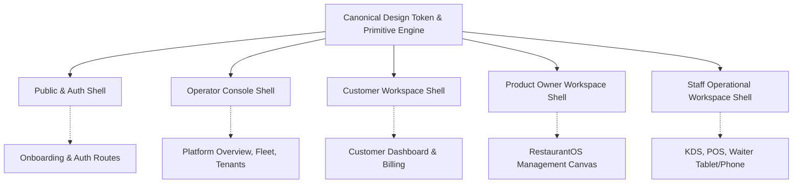

# 🪐 OrbitoX Phase 7B.2 — Persona Shell Contracts & Modular Primitives

**Specification ID:** `ARCH-7B2-04-SHELLS`  
**Phase:** Phase 7B.2 — Theme Tokens & Persona Shell Architecture  
**Document Status:** Approved Architecture Contract  
**Governing Documents:** `PHASE7_UI_MASTER_BRIEF.md`, `docs/ui-reset/03_SHELL_AND_NAVIGATION_ARCHITECTURE.md`  
**Accepted Baseline:** `f65698eab17b3a40842360eaeb387c74dca57ecc`  
**Author:** Principal Frontend & Platform Architect  
**Date:** November 17, 2026  

---

## 1. Architectural Mission & Principles

OrbitoX Platform powers multiple personas with distinct operational requirements, yet all personas must share:
1. **One canonical design-token engine** (`primitives.css`, `semantic.css`, `motion.css`).
2. **One shared library of accessible UI components and navigation primitives**.
3. **One server-authoritative appearance resolution model**.

The persona shells define **pure structural scaffolding** (navigation layout, context slots, header actions, breadcrumbs, content boundaries). They must **never contain domain workflows or business logic**.

---

## 2. Five Persona Shell Specifications



---

### 2.1 Public & Auth Shell
- **Target Audience:** Unauthenticated visitors, self-service signups, diner guests.
- **Reference Screens:** `F1` (Sign up), `F2` (Create org), `F3` (Add restaurant), `F5` (Checkout).
- **Default Visual Mood:** `light` (`#EEF1F5`). Approachable, high contrast, clean white surfaces.
- **Navigation Model:**
  - Minimal top bar with OrbitoX brand glyph and language/help selector.
  - Zero persistent sidebar or bottom navigation bar.
- **Header & Identity:** Centered or split-screen brand identity with subtle logo mark.
- **Content Frame:** Focused card layout (`--radius-card: 28px`), max-width 480px (for single cards) or 1200px (for split-screen onboarding preview in `F4`).
- **Context Slots:** Breadcrumbs slot (hidden on mobile), progress stepper slot (e.g. `Step 1 of 3`).
- **Primary Action Slot:** Full-width pill button (`h-12`, `rounded-full`) at the base of the card.
- **Touch & Accessibility:** Touch targets $\ge 44\text{px}$, autofill compatible inputs, WCAG 2.1 AA focus rings.

---

### 2.2 Operator Console Shell
- **Target Audience:** Platform operators, SREs, security officers, support engineers.
- **Reference Screens:** `A1` (Overview), `C0` (Sidebar), `C1` (Org detail), `C2` (Suspend), `C3` (Billing), `C4` (Provisioning), `C5` (Data rights), `C6` (API keys), `AI1` (Ask OrbitoX), `D7` (Phone).
- **Default Visual Mood:** `dark` (`#0D0F12`). Low-fatigue dark background, soft radial glow (`--color-page-glow`), high-contrast tabular clarity.
- **Navigation Model Across Devices:**
  - **Desktop ($\ge 1280\text{px}$):** Fixed 260px `SidebarCard` with platform routes, installed vertical plugins section, cluster status dock, and operator profile.
  - **Tablet Landscape ($1024\text{px}–1279\text{px}$):** Collapsible 64px `IconRail` with tooltip indicators.
  - **Tablet Portrait ($640\text{px}–1023\text{px}$):** Floating `BottomNavPill` with active state indicator.
  - **Phone ($< 640\text{px}$):** `BottomTabBar` (max 5 items) + `MoreNavSheet`.
- **Header & Identity:** Top bar (`h-14`) with dynamic breadcrumbs, live search trigger (`⌘K`), AI assistant toggle (`AI1`), appearance switcher, and operator session menu.
- **Context Slots:** Platform governance cluster health indicator slot, cluster switcher slot.
- **Primary Action Slot:** Top-right action button slot (`Button variant="primary"`).
- **Required Primitives:** `SidebarCard`, `TopBar`, `IconRail`, `BottomNavPill`, `MoreNavSheet`, `ShellContentFrame`.

---

### 2.3 Customer Workspace Shell
- **Target Audience:** B2B tenant owners, account administrators, enterprise buyers.
- **Reference Screens:** `A2` (Dashboard home), `U1` (Change plan), `U2` (Template gallery), `D8` (Phone).
- **Default Visual Mood:** `light` (`#EEF1F5`). Clean corporate aesthetic, soft card drop shadows (`0 30px 60px -44px rgba(0,0,0,0.1)`), near-black active pills.
- **Navigation Model Across Devices:**
  - **Desktop:** Horizontal top workspace navigation or 260px `SidebarCard` with workspace links.
  - **Tablet / Phone:** Floating bottom tab navigation (`BottomTabBar`) with primary tabs (Home, Projects, Usage, Billing, More).
- **Header & Identity:** Tenant organization switcher dropdown, environment badge (Live / Staging), notification bell, user profile.
- **Context Slots:** Organization Switcher slot, Project Switcher slot, Plan Upgrade CTA slot.
- **Primary Action Slot:** Context-sensitive top-right primary action (e.g. "Create Project", "Add Domain").
- **Required Primitives:** `TopBar`, `SidebarCard`, `BottomTabBar`, `MoreNavSheet`, `ShellContentFrame`.

---

### 2.4 Product Owner Workspace Shell
- **Target Audience:** Restaurant owners, store managers, F&B operations directors.
- **Reference Screens:** `F6` (Checklist), `R0` (Sidebar), `R1` (Today), `R2` (Branches), `R3` (Floors & tables), `R4` (Menu editor), `R5` (Staff), `R6` (Settings), `S3` (Orders), `S4` (Invoices), `S5` (Reports), `D1` (Today phone), `D2` (Orders phone), `D3` (Edit dish sheet).
- **Default Visual Mood:** `light` (`#EEF1F5`).
- **Navigation Model Across Devices:**
  - **Desktop:** 260px `SidebarCard` (`R0`) with F&B categories (Live Today, Orders, Menu, Floors, Staff, Invoices, Settings).
  - **Tablet Landscape:** 64px `IconRail`.
  - **Tablet Portrait:** Floating `BottomNavPill`.
  - **Phone:** `BottomTabBar` (Today, Orders, Quick Add `+`, Menu, More). Secondary workflows in draggable `BottomSheet` (`D3`).
- **Header & Identity:** Restaurant brand logo, Multi-branch switcher dropdown (`R2`), active table occupancy badge.
- **Context Slots:** Branch Switcher slot, Online Store Live Link slot, Store Open/Close toggle.
- **Required Primitives:** `SidebarCard`, `IconRail`, `TopBar`, `BottomNavPill`, `BottomTabBar`, `BottomSheet`, `ShellContentFrame`.

---

### 2.5 Staff Operational Workspace Shell
- **Target Audience:** Line cooks, kitchen expeditors, POS cashiers, table waiters, host stand greeters.
- **Reference Screens:** `S1` (Kitchen KDS tablet land), `S2` (POS tablet land), `D4` (Waiter phone tables), `D5` (Waiter phone order), `D9` (Host stand tablet port).
- **Default Visual Mood:** Role-preset dependent:
  - **Kitchen / KDS (`S1`) & Waiter (`D4`, `D5`):** `dark` (`#0D0F12`). High-contrast dark mood for kitchen glare and dim dining rooms.
  - **POS Counter (`S2`) & Host Stand (`D9`):** `light` (`#EEF1F5`). High ambient daylight visibility.
- **Navigation Model Across Devices:**
  - **Tablet Landscape ($1194\text{px} \times 834\text{px}$):** Minimalist 64px `IconRail` or **Zero-Chrome Fullscreen Mode** with instant status bar.
  - **Tablet Portrait ($834\text{px} \times 1194\text{px}$):** Persistent high-density bottom bar.
  - **Phone ($390\text{px} \times 844\text{px}$):** High-contrast touch grid with persistent bottom bar.
- **Operational Ergonomics & Invariants:**
  - Minimum touch target $\ge 48\text{px}$ (exceeding standard 44px for oily/rushed kitchen touches).
  - High-contrast visual timers (`RingTimer`, `VegMark`).
  - Instant station switcher and full-screen toggle slot.
- **Required Primitives:** `IconRail`, `TopBar` (compact), `BottomNavPill`, `ShellContentFrame` (zero-padding option).

---

## 3. Strict Scope Bounding: Excluded Domain Workflows

To preserve architectural integrity and avoid milestone scope creep, the following domain applications are **strictly excluded** from Phase 7B.2 and deferred to their governing milestones:

| Excluded Domain Capability | Governing Future Milestone | Rationale for Exclusion in 7B.2 |
| :--- | :---: | :--- |
| **KDS Ticket Columns & Prep Queues** | Phase 7F | Operational domain state machine; requires real WebSocket ticket streams. |
| **POS Order Punching, Menu Grid & Cashier Keypad** | Phase 7F | Transactional commerce engine; requires tax calculations, payment gateway. |
| **Waiter Table Assignment & Dine-in Billing** | Phase 7F | Table layout state; requires table occupancy database models. |
| **Menu Category & 82-Dish CSV Spreadsheet Importer** | Phase 7F | Inventory file parsing and catalog schema. |
| **Floor Plan Draggable Table Editor (`R3`)** | Phase 7F | SVG/Canvas coordinate engine; pure product feature. |
| **HospitalOS Clinical Workflows** | Phase 7E | Strictly pending owner-supplied concept screens. No visual invention permitted. |
| **Operator Telemetry Charts & Fleet Sagas** | Phase 7C | Real-time metric aggregation and Prometheus/Grafana pipeline integration. |

---

## 4. Modular Shell Primitives & Specifications

```
packages/ui/src/shells/
├── primitives/
│   ├── sidebar-card.tsx       # 260px expanded desktop navigation card
│   ├── icon-rail.tsx          # 64px collapsed tablet landscape rail
│   ├── top-bar.tsx            # Sticky header with breadcrumbs & context slots
│   ├── bottom-nav-pill.tsx    # Floating pill for tablet portrait
│   ├── bottom-tab-bar.tsx     # Phone bottom bar (max 5 items)
│   ├── more-nav-sheet.tsx     # Overflow sheet for secondary phone destinations
│   └── shell-content-frame.tsx# Responsive container with safe-area padding
├── adapters/
│   └── app-shell.tsx          # Backward-compatible wrapper over primitives
└── personas/
    ├── public-shell.tsx
    ├── operator-shell.tsx
    ├── customer-shell.tsx
    ├── product-owner-shell.tsx
    └── staff-operational-shell.tsx
```

### 4.1 Primitive Contracts

#### A. `SidebarCard`
- **Width:** Fixed `260px` (`w-[260px] shrink-0`).
- **Styling:** Floating card with `--radius-card` (28px), `16px` margin from viewport edge.
- **Composition Slots:** Brand logo/title slot, tenant/switcher slot, main navigation slot, plugin navigation slot, bottom footer card slot.
- **A11y:** `<aside role="navigation" aria-label="Main Navigation">`, full keyboard arrow-key navigation.

#### B. `IconRail`
- **Width:** Fixed `64px` (`w-16 shrink-0`).
- **Styling:** Centered vertical icon stack, floating card with `--radius-card`.
- **A11y:** Accessible tooltips (`role="tooltip"`), keyboard traversal, badge counters.

#### C. `TopBar`
- **Height:** Standard `56px` (`h-14`).
- **Layout:** Sticky top with backdrop blur (`bg-[var(--color-surface)]/95 backdrop-blur-xs`).
- **Slots:** Mobile menu trigger slot, breadcrumbs slot, center context slot, right-hand actions slot (search, appearance, notifications, profile).

#### D. `BottomNavPill` (Tablet Portrait)
- **Position:** Fixed floating pill centered at bottom (`bottom-4 left-1/2 -translate-x-1/2`).
- **Dimensions:** Height `52px`, pill radius (`rounded-full`), shadow `--shadow-accent-glow`.
- **Items:** 4–6 primary destinations with visible icons and labels.

#### E. `BottomTabBar` & `MoreNavSheet` (Phone)
- **Position:** Fixed floating bottom pill, thumb-reach optimized (`bottom-3 inset-x-3`).
- **Navigation Capacity:** Exactly $\le 5$ primary items. If more than 5 exist, the 5th item is automatically rendered as "More", opening `MoreNavSheet`.
- **Safe Area:** Respects `env(safe-area-inset-bottom)`.

#### F. `ShellContentFrame`
- **Responsiveness:**
  - Phone: `p-3`, `max-w-full`.
  - Tablet Portrait: `p-4 sm:p-6`.
  - Tablet Landscape: `p-6 lg:p-8`.
  - Desktop: `p-8 xl:p-10`, `max-w-7xl mx-auto`.
- **Overflow:** Dedicated vertical scroll container (`overflow-y-auto overflow-x-hidden`).

---

## 5. Backward-Compatible `AppShell` Adapter Contract

To ensure that existing consumers (`(console)/console/components/console-shell.tsx`, `design-client.tsx`, and Storybook stories) continue to function without disruption, `packages/ui/src/components/app-shell.tsx` is refactored into a thin adapter:

```tsx
export interface NavItem {
  id: string;
  label: string;
  href?: string;
  icon?: React.ReactNode;
  active?: boolean;
  badge?: React.ReactNode;
  disabled?: boolean;
  onClick?: () => void;
}

export interface AppShellProps {
  appName?: string;
  logo?: React.ReactNode;
  navItems: NavItem[];
  pluginNavItems?: NavItem[];
  pluginSectionTitle?: string;
  tenantSwitcher?: React.ReactNode;
  breadcrumbs?: React.ReactNode;
  userMenu?: React.ReactNode;
  banner?: React.ReactNode;
  bottomCard?: React.ReactNode;
  children: React.ReactNode;
  defaultCollapsed?: boolean;
}
```

### Critical Refactorings Inside the Adapter:
1. **Eliminate Fake Links:** Every `NavItem` renders a semantic button or Next.js `Link` with a valid `href`. No `<a href="#">` markup.
2. **Eliminate `toggleTheme()` Call:** The hardcoded `toggleTheme()` button from `theme-script.ts` is replaced with an accessible appearance control slot that invokes `AppearancePersistenceController`.
3. **Responsive Primitive Composition:** Rather than hardcoding a desktop hamburger sheet for mobile, `AppShell` conditionally delegates layout rendering to `SidebarCard` on desktop ($\ge 1280px$), `IconRail` on tablet landscape ($1024px–1279px$), and `BottomTabBar` on mobile ($< 640px$).
