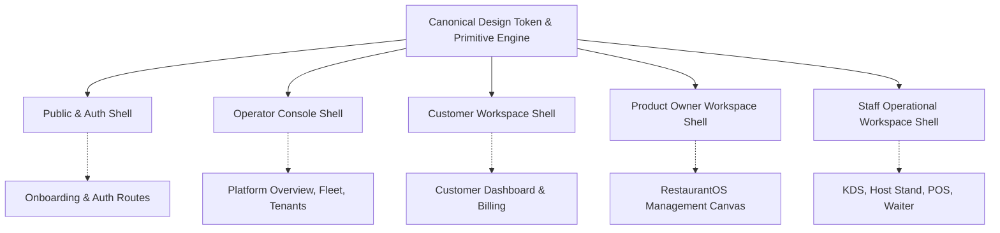

# 🪐 OrbitoX Phase 7B.2 — Persona Shell Contracts & Modular Primitives

**Specification ID:** `ARCH-7B2-04-SHELLS`  
**Phase:** Phase 7B.2 — Theme Tokens & Persona Shell Architecture  
**Document Status:** Approved Architecture Contract  
**Governing Documents:** `PHASE7_UI_MASTER_BRIEF.md`, `docs/ui-reset/03_SHELL_AND_NAVIGATION_ARCHITECTURE.md`  
**Accepted Baseline:** `f65698eab17b3a40842360eaeb387c74dca57ecc`  
**Author:** Principal Frontend & Platform Architect  
**Date:** November 17, 2026 (Revised)  

---

## 1. Architectural Mission & Principles

OrbitoX Platform powers multiple personas with distinct operational requirements, yet all personas share:
1. **One canonical design-token engine** (`primitives.css`, `semantic.css`, `motion.css`).
2. **One shared library of accessible UI components and navigation primitives**.
3. **Strict Package Layering (No Inverted Dependencies):** `@orbitox-io/ui` is a presentation library. It never imports application-level singletons or persistence controllers. Controlled props and composition slots govern all interactivity.
4. **Pure Structural Framing:** Shells provide navigation frames, breadcrumbs, context switchers, and action slots. **They never contain or own product domain workflows** (POS checkout, KDS queues, and table management are strictly excluded).

---

## 2. Five Persona Shell Specifications



---

### 2.1 Public & Auth Shell
- **Target Audience:** Unauthenticated visitors, self-service signups, diner guests.
- **Reference Screens:** `F1` (Sign up), `F2` (Create org), `F3` (Add restaurant), `F5` (Checkout).
- **Default Visual Mood:** `light` (`#EEF1F5`). Approachable, high contrast, clean white surfaces.
- **Navigation Model:** Minimal top bar with OrbitoX brand glyph and language/help selector. Zero persistent sidebar.
- **Header & Identity:** Centered or split-screen brand identity with subtle logo mark.
- **Content Frame:** Focused card layout (`--radius-card: 28px`), max-width 480px (for single cards) or 1200px (for split-screen onboarding preview in `F4`).
- **Context Slots:** Breadcrumbs slot, progress stepper slot (e.g. `Step 1 of 3`).
- **Primary Action Slot:** Full-width pill button (`h-12`, `rounded-full`) at the base of the card.
- **Touch & Accessibility:** Touch targets $\ge 44\text{px}$, autofill compatible inputs, WCAG 2.1 AA focus rings.

---

### 2.2 Operator Console Shell
- **Target Audience:** Platform operators, SREs, security officers, support engineers.
- **Reference Screens:** `A1` (Overview), `C0` (Sidebar), `C1` (Org detail), `C2` (Suspend), `C3` (Billing), `C4` (Provisioning), `C5` (Data rights), `C6` (API keys), `AI1` (Ask OrbitoX), `D7` (Phone).
- **Default Visual Mood:** `dark` (`#0D0F12`). Low-fatigue dark background, soft radial glow (`--color-page-glow`), high-contrast tabular clarity.
- **Navigation Model Across Devices:**
  - **Desktop ($\ge 1280\text{px}$):** Fixed 260px `SidebarCard` with platform routes, installed vertical plugins section, cluster status dock, and operator profile.
  - **Tablet Landscape ($1024\text{px}–1279\text{px}$):** Collapsible 64px `IconRail` with tooltip indicators.
  - **Tablet Portrait ($640\text{px}–1023\text{px}$):** Floating `BottomNavPill` with active state indicator.
  - **Phone ($< 640\text{px}$):** `BottomTabBar` (max 5 items) + `MoreNavSheet`.
- **Header & Identity:** Top bar (`h-14`) with dynamic breadcrumbs, live search trigger (`⌘K`), AI assistant toggle (`AI1`), appearance control slot, and operator session menu.
- **Context Slots:** Platform governance cluster health indicator slot, cluster switcher slot.
- **Primary Action Slot:** Top-right action button slot (`Button variant="primary"`).

---

### 2.3 Customer Workspace Shell
- **Target Audience:** B2B tenant owners, account administrators, enterprise buyers.
- **Reference Screens:** `A2` (Dashboard home), `U1` (Change plan), `U2` (Template gallery), `D8` (Phone).
- **Default Visual Mood:** `light` (`#EEF1F5`). Clean corporate aesthetic, soft card drop shadows (`0 30px 60px -44px rgba(0,0,0,0.1)`), near-black active pills.
- **Navigation Model Across Devices:**
  - **Desktop:** Horizontal top workspace navigation or 260px `SidebarCard` with workspace links.
  - **Tablet / Phone:** Floating bottom tab navigation (`BottomTabBar`) with primary configurable tabs and overflow sheet.
- **Header & Identity:** Tenant organization switcher dropdown, environment badge (Live / Staging), notification bell, user profile.
- **Context Slots:** Organization Switcher slot, Project Switcher slot, Plan Upgrade CTA slot.
- **Primary Action Slot:** Context-sensitive top-right primary action (e.g. "Create Project", "Add Domain").

---

### 2.4 Product Owner Workspace Shell
- **Target Audience:** Restaurant owners, store managers, F&B operations directors.
- **Reference Screens:** `F6` (Checklist), `R0` (Sidebar), `R1` (Today), `R2` (Branches), `R3` (Floors & tables), `R4` (Menu editor), `R5` (Staff), `R6` (Settings), `S3` (Orders), `S4` (Invoices), `S5` (Reports), `D1` (Today phone), `D2` (Orders phone), `D3` (Edit dish sheet).
- **Default Visual Mood:** `light` (`#EEF1F5`).
- **Navigation Model Across Devices:**
  - **Desktop:** 260px `SidebarCard` (`R0`) with F&B categories.
  - **Tablet Landscape:** 64px `IconRail`.
  - **Tablet Portrait:** Floating `BottomNavPill`.
  - **Phone:** `BottomTabBar` with configurable thumb items and secondary workflows in draggable `BottomSheet` (`D3`).
- **Header & Identity:** Restaurant brand logo, Multi-branch switcher dropdown (`R2`), active table occupancy badge.
- **Context Slots:** Branch Switcher slot, Online Store Live Link slot, Store Open/Close toggle.

---

### 2.5 Staff Operational Workspace Shell
- **Target Audience:** Line cooks, kitchen expeditors, POS cashiers, table waiters, host stand greeters.
- **Reference Screens:** `S1` (Kitchen KDS tablet land), `S2` (POS tablet land), `D4` (Waiter phone tables), `D5` (Waiter phone order), `D9` (Host stand tablet port).
- **Default Visual Mood:** **Explicitly `dark` (`#0D0F12`)** across operational environments:
  - **Kitchen / KDS (`S1`), Host Stand (`D9`), Waiter Phone (`D4`, `D5`):** `dark` (`#0D0F12`). High-contrast dark mood for kitchen glare and dim dining rooms.
  - **POS Counter Station Override (`S2`):** Explicit product-level override to **`light` (`#EEF1F5`)** for bright daylight counter visibility.
- **Navigation Model Across Devices:**
  - **Tablet Landscape ($1194\text{px} \times 834\text{px}$):** Minimalist 64px `IconRail` or **Zero-Chrome Fullscreen Mode** with instant status bar.
  - **Tablet Portrait ($834\text{px} \times 1194\text{px}$):** Persistent high-density bottom bar.
  - **Phone ($390\text{px} \times 844\text{px}$):** High-contrast touch grid with persistent bottom bar.
- **Operational Ergonomics & Invariants:**
  - Minimum touch target $\ge 48\text{px}$ (exceeding standard 44px for fast, greasy kitchen touches).
  - High-contrast visual status indicators (`RingTimer`, `VegMark`).
  - Instant station switcher and full-screen toggle slot.

---

## 3. Strict Scope Bounding: Excluded Domain Workflows

The following domain applications are **strictly excluded** from Phase 7B.2 and deferred to their governing milestones:

| Excluded Domain Capability | Governing Future Milestone | Rationale for Exclusion in 7B.2 |
| :--- | :---: | :--- |
| **KDS Ticket Columns & Prep Queues** | Phase 7F | Operational domain state machine; requires real WebSocket ticket streams. |
| **POS Order Punching, Menu Grid & Cashier Keypad** | Phase 7F | Transactional commerce engine; requires tax calculations, payment gateway. |
| **Waiter Table Assignment & Dine-in Billing** | Phase 7F | Table layout state; requires table occupancy database models. |
| **Menu Category & 82-Dish CSV Spreadsheet Importer** | Phase 7F | Inventory file parsing and catalog schema. |
| **Floor Plan Draggable Table Editor (`R3`)** | Phase 7F | SVG/Canvas coordinate engine; pure product feature. |
| **HospitalOS Clinical Workflows** | Phase 7E | Strictly pending owner-supplied concept screens. No visual invention permitted. |
| **Operator Telemetry Charts & Fleet Sagas** | Phase 7C | Real-time metric aggregation and Prometheus/Grafana pipeline integration. |

---

## 4. Controlled Navigation Model & Package Layering

### 4.1 Strict Dependency Direction (Correction R6-A)
The shared UI package must remain reusable and platform-agnostic. It exposes controlled props and presentation slots, delegating persistence to `apps/platform`:

```typescript
// Defined in @orbitox-io/ui (Presentation Layer)
export interface AppearanceControlProps {
  theme?: 'auto' | 'light' | 'dark';
  onThemeChange?: (theme: 'auto' | 'light' | 'dark') => void;
  appearanceSlot?: React.ReactNode;
}

export interface ShellNavigationProps {
  items: NavItem[];
  activeId?: string;
  onItemSelect?: (item: NavItem) => void;
}
```

---

### 4.2 Non-Breaking `NavItem` Backward Compatibility (Correction R6-B)

The existing `NavItem` interface keeps `href` optional to prevent breaking callers that pass `onClick` action handlers:

```typescript
export interface NavItem {
  id: string;
  label: string;
  href?: string;           // Optional for backward compatibility
  icon?: React.ReactNode;
  active?: boolean;
  badge?: React.ReactNode;
  disabled?: boolean;
  onClick?: (e?: React.MouseEvent) => void; // Optional action handler
}
```

### 4.3 Semantic Normalization Adapter (Eliminating Fake Anchors)
Inside the rendering adapter of `SidebarCard`, `IconRail`, and `BottomTabBar`, items are normalized to ensure valid HTML semantics:

```tsx
export function NavItemRenderer({ item, isCollapsed }: { item: NavItem; isCollapsed?: boolean }) {
  const content = (
    <>
      {item.icon && <span className="h-4 w-4 shrink-0 flex items-center justify-center">{item.icon}</span>}
      {!isCollapsed && <span className="flex-1 truncate">{item.label}</span>}
      {!isCollapsed && item.badge && <span className="shrink-0">{item.badge}</span>}
    </>
  );

  const className = cn(
    'flex items-center gap-3 rounded-full px-4 py-2 text-sm font-medium transition-all select-none',
    item.active
      ? 'bg-[var(--color-primary)] text-[var(--color-primary-fg)] font-semibold shadow-[var(--shadow-accent-glow)]'
      : 'text-[var(--color-text-muted)] hover:bg-[var(--color-surface-raised)] hover:text-[var(--color-text)]',
    item.disabled && 'opacity-50 pointer-events-none cursor-not-allowed'
  );

  // Invariant: Never render <a href="#">. Render real Link or accessible button.
  if (item.href && item.href !== '#') {
    return (
      <Link href={item.href} className={className} aria-current={item.active ? 'page' : undefined}>
        {content}
      </Link>
    );
  }

  return (
    <button
      type="button"
      onClick={item.onClick}
      disabled={item.disabled}
      className={className}
      aria-current={item.active ? 'page' : undefined}
    >
      {content}
    </button>
  );
}
```

This guarantees that:
1. Existing callers with `{ id, label, href }` compile and render real router links.
2. Existing callers with `{ id, label, onClick }` compile and render accessible `<button type="button">`.
3. If `href` is missing or empty, it **never renders fake `<a href="#">`**.
4. Existing consumers compile with 100% backward compatibility.
