# 🪐 OrbitoX Phase 7B.2 — Authoritative Responsive Navigation Matrix & Breakpoint Harmonization

**Specification ID:** `ARCH-7B2-05-RESPONSIVE`  
**Phase:** Phase 7B.2 — Theme Tokens & Persona Shell Architecture  
**Document Status:** Architecture Contract — Incorporating Proposed Amendment UI-7B2-BP1 (**Proposed — Pending Owner Approval**)  
**Governing Documents:** `PHASE7_UI_MASTER_BRIEF.md` (Section 3), `docs/ui-reset/03_SHELL_AND_NAVIGATION_ARCHITECTURE.md`  
**Accepted Baseline:** `f65698eab17b3a40842360eaeb387c74dca57ecc`  
**Author:** Principal Frontend & Platform Architect  
**Date:** November 17, 2026 (Revised Blueprint)  

---

## 1. Executive Summary & Specification Conflict Analysis

Section 3 of `PHASE7_UI_MASTER_BRIEF.md` defines the responsive device matrix as follows:
- **Phone:** `< 640 px`
- **Tablet:** `640–1100 px` (with "bottom bar in portrait, rail in landscape")
- **Desktop:** `> 1100 px` (with "sidebar card")

### The Architectural Conflict:
1. **Approved Landscape Reference Viewport:** In Section 2 and Section 6.3 of the Master Brief, screens `S1` (Kitchen / KDS) and `S2` (POS Take Order & Checkout) are explicitly designated as **`tablet landscape`**.
2. **Physical Asset Resolution:** The verified concept images `Kitchen screen (KDS) · tablet landscape.png` and `POS take order & checkout · tablet landscape.png` have exact pixel dimensions of **`2388 × 1668`**. At standard Retina @2x scaling, this corresponds to an authoritative logical CSS viewport of **`1194 × 834 px`** (the native viewport of the 11-inch Apple iPad Pro in landscape orientation).
3. **The Flaw of a Naive Breakpoint:** If an engineer implements a simple CSS breakpoint `@media (min-width: 1101px)` to activate the desktop layout, the tablet landscape reference (`1194px`) will be erroneously evaluated as **Desktop**.
   - **Severe Consequence:** An expanded 260px `SidebarCard` will be forced onto the kitchen KDS and POS counter tablets, stealing vital horizontal screen real estate from order tickets and checkout grids, and directly violating the requirement that tablet landscape must render a 64px `IconRail` or zero-chrome mode.

---

## 2. Proposed Architectural Resolution: Four Authoritative Bands

Rather than relying on fragile User-Agent header sniffing or client-side JavaScript window listeners, OrbitoX establishes **four strictly non-overlapping viewport bands** aligned with industry-standard CSS container thresholds (Tailwind `sm`, `md`, `lg`, `xl`):

```mermaid
block-beta
    columns 4
    block:phone:1
        Phone["Phone Band<br/>&lt; 640px<br/>(Tailwind &lt; sm)"]
        Pill["Floating BottomTabBar<br/>max 5 items + More Sheet"]
    end
    block:tabport:1
        TabPort["Tablet Portrait<br/>640px – 1023px<br/>(Tailwind sm / md)"]
        BottomPill["Floating BottomNavPill<br/>centered bottom"]
    end
    block:tabland:1
        TabLand["Tablet Landscape<br/>1024px – 1279px<br/>(Tailwind lg)"]
        IconRail["Collapsible IconRail<br/>64px width"]
    end
    block:desktop:1
        Desktop["Desktop Band<br/>&ge; 1280px<br/>(Tailwind xl)"]
        Sidebar["SidebarCard<br/>260px expanded"]
    end
```



### 2.1 The Four Authoritative Device Test Scenarios

The four mandatory QA acceptance viewports map cleanly and deterministically:

| Test ID | Device Reference | Logical Viewport (W × H) | Pixel Ratio | Active Viewport Band | Primary Navigation Primitive | Secondary Navigation Primitive | Mandatory Layout Invariant |
| :--- | :--- | :---: | :---: | :--- | :--- | :--- | :--- |
| **VP-01** | iPhone 12/13/14 | **`390 × 844`** | 2.0 / 3.0 | **Phone** (`< 640px`) | `BottomTabBar` (floating) | `MoreNavSheet` (via drag handle) | TopBar collapsed, header actions in sheet, touch target $\ge 44\text{px}$. |
| **VP-02** | iPad Pro 11" Portrait | **`834 × 1194`** | 2.0 | **Tablet Portrait** (`640–1023px`) | `BottomNavPill` (floating) | `MoreNavSheet` (slide-over) | TopBar visible with breadcrumb, content frame padded $16\text{px}$. |
| **VP-03** | iPad Pro 11" Landscape | **`1194 × 834`** | 2.0 | **Tablet Landscape** (`1024–1279px`) | `IconRail` ($64\text{px}$ collapsed) | Tooltip / Flyout Popover | TopBar with search/profile, content frame padded $24\text{px}$. |
| **VP-04** | Desktop / MacBook | **`1440 × 900`** | 1.0 / 2.0 | **Desktop** ($\ge 1280\text{px}$) | `SidebarCard` ($260\text{px}$ expanded) | Collapsible section accordions | Full header, persistent tenant/persona context, content frame padded $32\text{px}$. |

---

## 3. Formal Owner Breakpoint Amendment Request

To reconcile the conceptual text in `PHASE7_UI_MASTER_BRIEF.md` with physical reality, the following formal amendment is submitted for owner approval:

> **Amendment UI-7B2-BP1 (Breakpoint Harmonization):**  
> **Status:** `Proposed — Pending Owner Approval`  
> *"The boundary between Tablet Landscape and Desktop is formally adjusted from `1100px` to `1280px` (`xl`). The Tablet Landscape range is defined as `1024px – 1279px` (`lg`). Viewports below `1280px` shall never render the expanded 260px desktop sidebar card, ensuring that tablet viewports (including iPad Pro 11" landscape at 1194px) consistently render the 64px icon rail or zero-chrome layout as designed."*

### Why this amendment is mathematically sound:
1. **Preserves 100% of Tablet Landscape Concepts:** Screens `S1` (Kitchen KDS) and `S2` (POS Take Order & Checkout) at `1194px` fall unambiguously into the `1024px–1279px` band.
2. **Superior Desktop Resizing Behavior:** When a desktop user resizes their browser window or runs split-screen mode (e.g. side-by-side IDE and browser at 1100px), the layout **gracefully collapses** to the 64px `IconRail` instead of causing horizontal overflow or clipping cards.
3. **Zero JavaScript Overhead:** Implemented using pure, standard Tailwind CSS media queries (`max-sm:`, `sm:`, `md:`, `lg:`, `xl:`).

---

## 4. Behavior Across Edge-Case Viewports & Constraints

### 4.1 Strict Breakpoint Boundaries & Subpixel Precision
To prevent subpixel jitter, flash of mismatched layouts, or unstyled dead zones during resize events, the media queries enforce strict mathematical boundaries:
- **Phone (`< 640px`):** `@media (max-width: 639.98px)` (Tailwind `max-sm`).
- **Boundary 639px / 640px:** At `639px`, Phone `BottomTabBar` is active. At `640px`, transitions cleanly to Tablet Portrait `BottomNavPill`.
- **Tablet Portrait (`640px – 1023px`):** `@media (min-width: 640px) and (max-width: 1023.98px)` (Tailwind `sm` and `md`).
- **Boundary 1023px / 1024px:** At `1023px`, `BottomNavPill` is active. At `1024px`, transitions cleanly to Tablet Landscape 64px `IconRail`.
- **Tablet Landscape (`1024px – 1279px`):** `@media (min-width: 1024px) and (max-width: 1279.98px)` (Tailwind `lg`).
- **Boundary 1279px / 1280px:** At `1279px`, 64px `IconRail` is active. At `1280px`, transitions cleanly to expanded 260px `SidebarCard`.
- **Desktop (`>= 1280px`):** `@media (min-width: 1280px)` (Tailwind `xl`).

### 4.2 Browser Window Resizing & Desktop Split-Screen ($1024px – 1279px$)
When a desktop browser window is resized continuously from 1920px down to 800px:
- **$\ge 1280px$:** Expanded 260px `SidebarCard` is visible.
- **$1279px \to 1024px$ (Split-screen on 1440p / 4K displays or half-screen tiling):** The shell transitions smoothly to the collapsed 64px `IconRail`, reclaiming 196px of horizontal space for tables and grids without layout clipping or horizontal scrollbars.
- **$1023px \to 640px$:** The `IconRail` transitions to the floating `BottomNavPill`, maximizing full-canvas width for reading.
- **$< 640px$:** Navigation transitions to thumb-friendly `BottomTabBar`.

### 4.3 Landscape Phone Usage (Constrained Height: $844 \times 390$)
When a modern phone (e.g., iPhone 12/13/14 at $390 \times 844$) is rotated horizontally:
- Viewport width is 844px (falling in the tablet portrait width band), but viewport height is severely constrained ($< 500px$, typically 390px minus browser chrome).
- **Height-Constrained Rule (`@media (max-height: 500px)`):**
  - TopBar collapses to 40px height with compact glyphs and compressed padding.
  - Floating bottom navigation automatically docks or collapses to a minimal side rail or bottom auto-hide pill, preventing vertical content obscuration.
  - Dialogs and modals transition from centered popups to full-screen or slide-over sheets with dedicated internal scroll containers (`max-h-[calc(100vh-32px)]`).

### 4.4 Constrained-Height Desktop / Laptop Viewports
- On smaller laptops (e.g., $1366 \times 768$ or $1440 \times 900$ with large browser toolbars):
  - Card padding transitions from 32px to 24px via `@media (max-height: 720px)`.
  - Tables enable dedicated vertical scroll within their card containers (`overflow-y-auto max-h-[calc(100vh-220px)]`).

---

## 5. Touch vs. Pointer Ergonomics & Minimum Target Hierarchy

OrbitoX establishes a strict, tiered touch target hierarchy aligned with **WCAG 2.2 AA SC 2.5.8 (Target Size - Minimum: 24×24px)**, going beyond baseline compliance for industrial and mobile usability:

1. **Station Touch Targets (Kitchen KDS & POS Counter): $\ge 52 \times 52\text{px}$**
   - High-velocity, grease/water-resistant touch targets for kitchen bumping, line item selection, order firing, and payment tenders.
   - Generous spacing ($\ge 12\text{px}$ gutter) between adjacent action tiles to eliminate accidental taps.
2. **Mobile & Tablet Touch Targets (Phone & Tablet Nav): $\ge 44 \times 44\text{px}$**
   - Floating `BottomTabBar` and `BottomNavPill` items enforce a minimum bounding box of $44 \times 44\text{px}$ (typically $48\text{px}$ height in practice).
3. **Desktop Pointer & Icon Buttons: $44–48\text{px}$ Hit Target**
   - Desktop icon buttons (e.g. search trigger, notifications, theme toggle) render an outer interactive bounding box of $44–48\text{px}$ (e.g., $h\text{-11 } w\text{-11}$ or $h\text{-12 } w\text{-12}$) containing a centered $20\text{px}$ SVG glyph.
   - Banned: Sub-sized $36\text{px}$ or $32\text{px}$ touch boundaries for standalone interactive controls.

```css
/* Touch-First Target Sizing for Tablets & Stations */
@media (hover: none) and (pointer: coarse) {
  .nav-touch-target {
    min-height: 48px;
    min-width: 48px;
  }
  .station-touch-target {
    min-height: 52px;
    min-width: 52px;
  }
}

/* Precise Pointer Hover Effects for Desktops */
@media (hover: hover) and (pointer: fine) {
  .nav-touch-target {
    min-height: 44px;
    min-width: 44px;
  }
  .nav-touch-target:hover {
    background-color: var(--color-surface-raised);
    color: var(--color-text);
  }
}
```

This guarantees that physical touch targets on tablets and phones remain thumb-friendly ($\ge 44\text{px}$ / $\ge 52\text{px}$) while desktop mouse interactions enjoy subtle, high-performance hover states.
